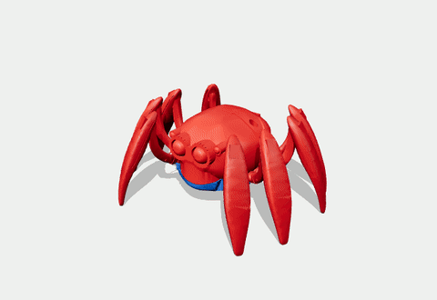

# Capstone 1 · Spider-Bot

Part of [Robotics Capstones](https://github.com/Morante-robotics/robotics-capstones), my path to building robots,
one robot at a time.

Replica of the Spider-Bot from Avengers Campus: 8 legs moved by a single motor, LED eyes, and it walks as soon
as it is switched on (no remote control). It starts from [Spidey-Bot by jenscolt](https://www.thingiverse.com/thing:5196618),
a static display model, rebuilt as parametric CAD at 70 % with the mechanism fitted inside.

**Hardware:** no microcontroller. One N10 gear motor turns four crankshafts that move the eight legs, six button
cells (AG13) power it, and two 5 mm LEDs light the eyes. Full list: [`hardware.md`](hardware.md).

*The robot as it stands today. **[Open it in 3D](https://morante-robotics.github.io/spider-bot-replica/)** in the
browser: turn it, look inside, step the legs, see the check's warnings where they happen.*

**Follow the build:** the [build log](build-log.md) tells the story step by step, dead ends included, so it can be
repeated. Its contents show where each step stands, and its **Open items** list what is left. The
[AI log](ai-log.md) records what was designed with AI help and how it was checked.

**Where it stands (2026-11-24):** the whole robot passes its CAD check with 0 failures, and it is split into three
print plates, one per colour. The first test batch (base, inner mechanisms and one leg) is next.

## Phases

| # | Phase | What it covers |
|---|---|---|
| 0 | Workshop | Printer and tools ready |
| 1 | Soldering and measuring | Soldering and multimeter practice |
| 2 | CAD and 3D printing | The carcass, parametric CAD, print settings |
| 3 | Mechanisms and legs | The legs and the drive from one motor |
| 4 | Motors, power and lights | The N10 motor and its gears, the button cells, the LED eyes |
| 5 | Final build | Printing, assembly and the whole robot walking |

## Contents

| Folder | What |
|---|---|
| [cad/robot/](cad/robot/) | **The robot**: shells, legs, drive and power at 70 %, with its full check and datasheet |
| [cad/legs/](cad/legs/), [eyes/](cad/eyes/), [base/](cad/base/), [body/](cad/body/) | jenscolt's parts rebuilt as parameters (build123d), each checked against its mesh; `cad/robot` builds the printed parts from them |
| [cad/carcass-jenscolt/](cad/carcass-jenscolt/) | jenscolt's model, unmodified (CC BY-NC-SA): the looks reference the conversions are measured against |
| [cad/](cad/) | The rules every design follows: axes, folder layout, rounds, time budget; [`_template/`](cad/_template/) to start a new design |
| [cad/motion.py](cad/motion.py), [cad/fits.py](cad/fits.py) | The approved leg motion over a crank turn, and the measured clearances every design takes its holes and gaps from |
| [print/](print/) | The three print plates (red, yellow, blue) and the standard print settings |
| [viewer/](viewer/) | The whole robot in 3D: [open it in the browser](https://morante-robotics.github.io/spider-bot-replica/) |
| [hardware.md](hardware.md) | The shopping list: motor, cells, springs, switch, connector, screws, LEDs |
| [measurements.csv](measurements.csv) | Every caliper measurement of a printed part, the source of the fits |
| [sim/](sim/) | The leg simulators that chose the toy leg; `cad/motion.py` takes its geometry from them |
| [tools/](tools/) | Scripts: `cad_verify.py` checks a mechanism before printing, `rounds.py` runs a design in rounds, `mesh_ref.py` measures a part against its mesh, `bambu_plate.py` lays out and slices plates, `figures.py` and `workshop_kit.py` make the assembly sheets; `tests/` keeps them honest |

## Run the code

Install [uv](https://docs.astral.sh/uv/), then run `uv sync` here: it sets up Python 3.12 and every library at the
versions in `uv.lock`. Then `uv run python tools/<script>.py --help`, or `uv run python build.py` in a CAD folder.

## License

Code is licensed under the [MIT License](LICENSE). Texts, photos, videos and designs are licensed under
[Creative Commons Attribution-ShareAlike 4.0 International (CC BY-SA 4.0)](https://creativecommons.org/licenses/by-sa/4.0/),
except the carcass files based on [Spidey-Bot by jenscolt](https://www.thingiverse.com/thing:5196618) and everything
derived from them (the robot's shells and legs), which are CC BY-NC-SA like the original
([`LICENSE.txt`](cad/carcass-jenscolt/LICENSE.txt)).
