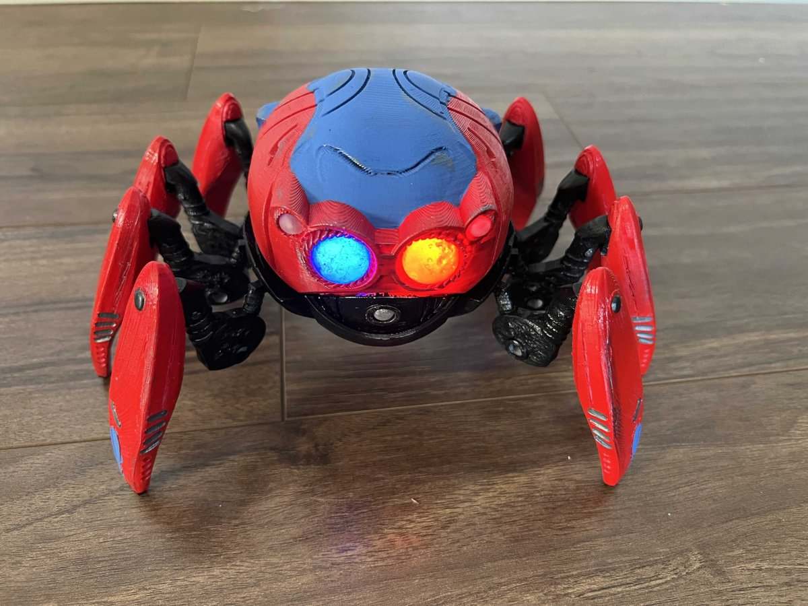

# Capstone 1 · Spider-Bot

Replica of the Spider-Bot from Avengers Campus: 8 legs moved by a single motor, LED eyes, and it walks as soon
as it is switched on (no remote control).

**Hardware plan:** no microcontroller. An N20 gear motor drives the leg mechanism and the LED eyes (on their own
perfboard) light up, both powered by 4×AAA NiMH batteries in a holder with a built-in switch. 3D-printed in PLA at
120 % of the base model's size.

*The starting point: [Spidey-Bot by jenscolt](https://www.thingiverse.com/thing:5196618), a static display model
(photo: jenscolt, CC BY-NC-SA).*

**Follow the build:** the [build log](build-log.md) tells the story step by step, dead ends included, so it can be
repeated. Its contents show where each step stands, and its **Open items** list what is left. The
[AI log](ai-log.md) records what was designed with AI help and how it was checked.

## Phases

| # | Phase | What it covers |
|---|---|---|
| 0 | Workshop | Printer and tools ready |
| 1 | Soldering and measuring | Soldering and multimeter practice |
| 2 | CAD and 3D printing | The carcass, Onshape, print settings |
| 3 | Mechanisms and legs | The legs and the drive from one motor |
| 4 | Motors, power and lights | The N20 motor and its gearing, batteries, LED eyes on perfboard |
| 5 | Final build | The whole robot walking |

## Contents

| Folder | What |
|---|---|
| [cad/carcass-jenscolt/](cad/carcass-jenscolt/) | Carcass base model by jenscolt, unmodified (CC BY-NC-SA) |
| [cad/carcass-120/](cad/carcass-120/) | Carcass parts repaired (watertight) and scaled to 120 %: the base for cuts and holes (CC BY-NC-SA) |
| [cad/layout/](cad/layout/) | What fits inside the body: battery holder and motor, print scale |
| [cad/drive/](cad/drive/) | Legs, pivot forks, four crankshafts with gears, spine and a test frame, modelled in code (build123d) with a collision check over a full turn |
| [cad/base/](cad/base/) | Base v1: the carcass base with a band that lifts the body, the spine built in, fork pockets and a cap over the crankshafts (CC BY-NC-SA) |
| [cad/clearance-test/](cad/clearance-test/) | Block and pin to find the hole clearance this printer needs for turning and sliding fits |
| [print/](print/) | Bambu Studio projects ready to print, with time and filament |
| [sim/](sim/) | Leg simulators: 2D foot paths of three leg types, and the toy leg in 3D on the whole robot |
| [tools/](tools/) | Helper scripts for meshes, previews, fit checks, figures and print plates; each explains its use in its first lines |

## License

Same as the repo (MIT for code, CC BY-SA 4.0 for the rest), except the carcass files based on
[Spidey-Bot by jenscolt](https://www.thingiverse.com/thing:5196618), which are CC BY-NC-SA like the original.
