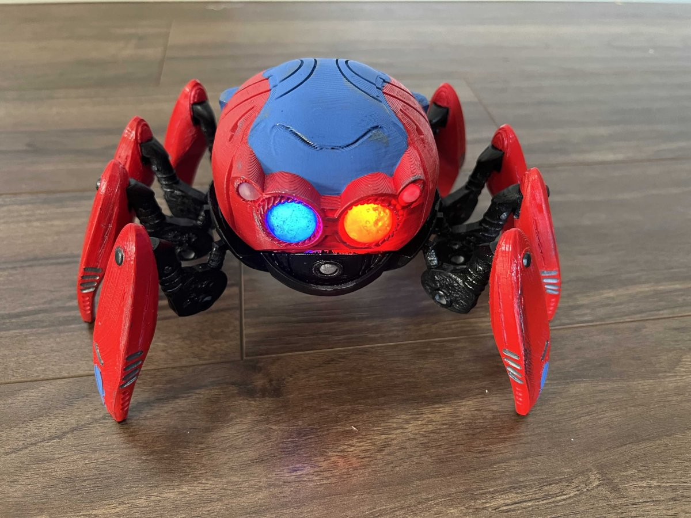

# Spider-Bot · Build log

The story of the build, step by step, written so that anyone can follow it and repeat it. Every entry opens with a
short **In short** box; read only those boxes and you have the whole story. Below each box come the steps, the
results with their figures, and the decisions taken. Commands and full data tables are folded under
**How to reproduce**. Entries are grouped by topic, oldest first; what is left to do and a glossary are at the
end.

<table>
<tr>
<td width="50%"></td>
<td width="50%"></td>
</tr>
<tr>
<td colspan="2"><em>The goal. <a href="https://www.thingiverse.com/thing:5196618">Spidey-Bot by jenscolt</a>, the static
display model this replica starts from (photos: jenscolt, CC BY-NC-SA). Ours keeps its look, and adds legs that
walk, driven by one motor, and lit eyes.</em></td>
</tr>
</table>

## Contents

The robot's story in four parts, then what is left to do and a glossary.

1. **[Workshop](build-log/1-workshop.md#workshop)**: getting the printer ready.
   - [Printer calibration](build-log/1-workshop.md#printer-calibration) · 2026-10 · ✅ done
   - [First print: purge waste bin](build-log/1-workshop.md#first-print-purge-waste-bin) · 2026-11-09 · ✅ done
2. **[Carcass](build-log/2-carcass.md#carcass)**: the robot's outer shell, and what has to fit inside it.
   - [Carcass base model](build-log/2-carcass.md#carcass-base-model) · 2026-11-08 · ✅ done
   - [Motor, battery holder and print scale](build-log/2-carcass.md#motor-battery-holder-and-print-scale) · 2026-11-09 · ✅ 120 %
   - [Mesh repair](build-log/2-carcass.md#mesh-repair) · 2026-11-09 · ✅ done
3. **[Legs and drive](build-log/3-legs-and-drive.md#legs-and-drive)**: how one motor moves eight legs.
   - [Leg simulator and comparison](build-log/3-legs-and-drive.md#leg-simulator-and-comparison) · 2026-11-09 · ✅ toy leg chosen
   - [Toy leg in 3D](build-log/3-legs-and-drive.md#toy-leg-in-3d) · 2026-11-09 · ✅ lateral axle
   - [Toy leg on one crankshaft](build-log/3-legs-and-drive.md#toy-leg-on-one-crankshaft) · 2026-11-09 · ↩️ reversed
   - [Crankshaft against real parts](build-log/3-legs-and-drive.md#crankshaft-against-real-parts) · 2026-11-09 · ❌ one crankshaft ruled out
   - [Two side crankshafts](build-log/3-legs-and-drive.md#two-side-crankshafts) · 2026-11-09 · ❌ ruled out
   - [Four lateral crankshafts](build-log/3-legs-and-drive.md#four-lateral-crankshafts) · 2026-11-09 · ✅ chosen
   - [Legs and drive in CAD](build-log/3-legs-and-drive.md#legs-and-drive-in-cad) · 2026-11-10 · ✅ done
   - [Onshape assembly](build-log/3-legs-and-drive.md#onshape-assembly) · 2026-11-10 · ✅ done
   - [Clearance test and test leg print plate](build-log/3-legs-and-drive.md#clearance-test-and-test-leg-print-plate) · 2026-11-10 · ✅ printed
   - [Test leg: first assembly and clearance result](build-log/3-legs-and-drive.md#test-leg-first-assembly-and-clearance-result) · 2026-11-11 · ✅ v2 designed
   - [Test leg v2: turning by hand](build-log/3-legs-and-drive.md#test-leg-v2-turning-by-hand) · 2026-11-11 · ✅ the leg turns
   - [Base v1 in CAD](build-log/3-legs-and-drive.md#base-v1-in-cad) · 2026-11-11 · ✅ printed, faults found
   - [Gear train test](build-log/3-legs-and-drive.md#gear-train-test) · 2026-11-11 · ✅ faults found
   - [Gear train v2 in CAD](build-log/3-legs-and-drive.md#gear-train-v2-in-cad) · 2026-11-11 · ✅ printed
   - [Gear train test v2: the cap](build-log/3-legs-and-drive.md#gear-train-test-v2-the-cap) · 2026-11-12 · ✅ the train turns
   - [Base v1: print and first fitting](build-log/3-legs-and-drive.md#base-v1-print-and-first-fitting) · 2026-11-13 · ✅ faults found
   - [Whole robot first: motor sizing and chassis plan](build-log/3-legs-and-drive.md#whole-robot-first-motor-sizing-and-chassis-plan) · 2026-11-14 · ✅ plan approved
   - [Chassis Part A: master model and drive module](build-log/3-legs-and-drive.md#chassis-part-a-master-model-and-drive-module) · 2026-11-15 · ✅ modelled and checked
   - [Chassis Part B1, Part C check and the friction clutch](build-log/3-legs-and-drive.md#chassis-part-b1-part-c-check-and-the-friction-clutch) · 2026-11-16 · ✅ chassis checked, clutch modelled
   - [Chassis Part D: the weight review](build-log/3-legs-and-drive.md#chassis-part-d-the-weight-review) · 2026-11-17 · ✅ 459 g, looks parts next
   - [Chassis Part B2: the looks parts](build-log/3-legs-and-drive.md#chassis-part-b2-the-looks-parts) · 2026-11-17 · 🔄 whole robot passes in CAD; buying next
   - [Chassis Part E: the looks pass, planned and paused](build-log/3-legs-and-drive.md#chassis-part-e-the-looks-pass-planned-and-paused) · 2026-11-17 · 🔄 paused until the legs are rethought
   - [Legs v2: three plan rounds, paused](build-log/3-legs-and-drive.md#legs-v2-three-plan-rounds-paused) · 2026-11-17 · 🔄 paused, mass audit first
4. **[Looks first](build-log/4-looks-first.md#looks-first)**: the second design, from the toy's looks inwards.
   - [Redesign: looks first](build-log/4-looks-first.md#redesign-looks-first) · 2026-11-17 · 🔄 in progress
   - [N0 mock-up: the looks robot in simple shapes](build-log/4-looks-first.md#n0-mock-up-the-looks-robot-in-simple-shapes) · 2026-11-18 · ✅ N0 look approved, N1 next
   - [N1 form: the real looking parts as light meshes](build-log/4-looks-first.md#n1-form-the-real-looking-parts-as-light-meshes) · 2026-11-19 · ✅ N1 look approved, N2 next
   - [N2 rev 5: the inside does not fit at 65 %](build-log/4-looks-first.md#n2-rev-5-the-inside-does-not-fit-at-65-) · 2026-11-19 · ↩️ restarted from scratch
   - [Meshes become parameters](build-log/4-looks-first.md#meshes-become-parameters) · 2026-11-20 · ✅ parts converted
   - [Only the parametric parts measure](build-log/4-looks-first.md#only-the-parametric-parts-measure) · 2026-11-20 · ✅ done
   - [N2 round r00: the inside and the leg hold](build-log/4-looks-first.md#n2-round-r00-the-inside-and-the-leg-hold) · 2026-11-23 · ✅ r00 is the robot, printing next
   - [Fast shells: clearances designed, not computed](build-log/4-looks-first.md#fast-shells-clearances-designed-not-computed) · 2026-11-23 · ✅ under 40 s, 0 FAIL
   - [Front sensor removed, mouth closed](build-log/4-looks-first.md#front-sensor-removed-mouth-closed) · 2026-11-24 · ✅ done
5. **[Open items](#open-items)**: everything still to do.
6. **[Glossary](#glossary)**: the terms used in the entries.

Status: ✅ done · 🔄 in progress · ❌ ruled out · ↩️ reversed by a later entry.

## Open items

Everything still to do on the build, in one place. Each row links to the entry where it came up; when an item is
done, its row is removed and the entry that closes it says so. Plan-level tasks (study, purchases) are tracked
outside the repo.

Since 2026-11-17 the robot is designed looks-first ([Looks first](build-log/4-looks-first.md)); the first design is
archived in [Legs and drive](build-log/3-legs-and-drive.md).

| Pending | Came up in | Phase |
|---|---|---|
| Workshop kit: legs 1, 2, 4–7 with the crank at pose 0, then half a turn for legs 0 and 3 and the body; switch glued from the front | [Fast shells](build-log/4-looks-first.md#fast-shells-clearances-designed-not-computed) | 3 |
| Speed, optional: the body skin (cad/body, 17–20 s) and the body's fixed stage (cold 40 s) are cached; make them faster if they get used often (`viewer/src/export.py` is down to 5 s) | [Fast shells](build-log/4-looks-first.md#fast-shells-clearances-designed-not-computed) | 3 |
| Coupon for the leg snap: skipped by Morante; the leg snap is tested on the first plate (base + one leg) before the other 7 legs ([state](cad/robot/datasheet.md#state-2026-11-23)) | [N2 round r00](build-log/4-looks-first.md#n2-round-r00-the-inside-and-the-leg-hold) | 3 |
| Print the robot: plater, pre-print review, workshop kit (shopping list: [`hardware.md`](hardware.md)) | [N2 round r00](build-log/4-looks-first.md#n2-round-r00-the-inside-and-the-leg-hold) | 4 |
| Body: the curved top panels and the chin grille, if Morante wants them later (a build takes 60–80 s) | [Meshes become parameters](build-log/4-looks-first.md#meshes-become-parameters) | 3 |
| Buy the N10 motor (3 V, ≈ 100–150 rpm) and 6 × AG13 cells and measure the motor (body, shaft, mounting); sizing: [`sizing.py`](https://github.com/Morante-robotics/spider-bot-replica/blob/n2-on-meshes-2026-11-20/cad/mockup/sizing.py) | [Redesign: looks first](build-log/4-looks-first.md#redesign-looks-first) | 3 |
| Import the parts into Onshape as STEP and assemble them with mates | [Onshape assembly](build-log/3-legs-and-drive.md#onshape-assembly) | 3 |
| Count the hardware in the workshop (the **Have** column) | [Hardware](hardware.md) | 3 |
| Calibrate X-Y hole and contour compensation and save the standard settings as a Bambu Studio preset | [Standard settings](print/README.md#standard-settings) | 2 |
| Measure battery life | [Motor, battery holder…](build-log/2-carcass.md#motor-battery-holder-and-print-scale) | 4 |

[↑ Contents](#contents)

## Glossary

Terms used in the entries, in the order they first appear, with a link to that entry.

| Term | Meaning | First in |
|---|---|---|
| **STL / STEP** | 3D file formats: STL is a triangle mesh (for printing), STEP is exact geometry (for CAD). | [Carcass base model](build-log/2-carcass.md#carcass-base-model) |
| **Bambu Studio** | The printer's slicer: it turns a 3D model into printer instructions. | [Carcass base model](build-log/2-carcass.md#carcass-base-model) |
| **Clearance** | Free space left around a part: how much bigger a hole or a space is than the part in it. | [Motor, battery holder…](build-log/2-carcass.md#motor-battery-holder-and-print-scale) |
| **Watertight (manifold)** | A mesh with no holes or loose edges, which slicers and CAD tools need. | [Mesh repair](build-log/2-carcass.md#mesh-repair) |
| **Crank** | An arm fixed to a turning shaft; its far end goes round in a circle. | [Leg simulator…](build-log/3-legs-and-drive.md#leg-simulator-and-comparison) |
| **Crank pin** | The pin (here a small ball) at the end of the crank, where the leg is attached. | [Leg simulator…](build-log/3-legs-and-drive.md#leg-simulator-and-comparison) |
| **Stride** | How far the robot moves forward per half turn of the crank. | [Leg simulator…](build-log/3-legs-and-drive.md#leg-simulator-and-comparison) |
| **Bob** | How much the body goes up and down while walking. | [Leg simulator…](build-log/3-legs-and-drive.md#leg-simulator-and-comparison) |
| **Step height** | How high a foot lifts off the ground. | [Leg simulator…](build-log/3-legs-and-drive.md#leg-simulator-and-comparison) |
| **Gait groups** | The legs move in two groups of four (left 1 and 3 + right 2 and 4, and the other four), half a turn apart. | [Leg simulator…](build-log/3-legs-and-drive.md#leg-simulator-and-comparison) |
| **Crankshaft** | One shaft with one or more cranks on it, so one motor turns them all. | [Toy leg on one crankshaft](build-log/3-legs-and-drive.md#toy-leg-on-one-crankshaft) |
| **Idler** | A gear between two others, so they turn the same way. | [Four lateral crankshafts](build-log/3-legs-and-drive.md#four-lateral-crankshafts) |
| **build123d** | A Python library for CAD: parts are written as code. | [Legs and drive in CAD](build-log/3-legs-and-drive.md#legs-and-drive-in-cad) |
| **Journal** | The round part of a shaft that turns inside a hole (its bearing). | [Legs and drive in CAD](build-log/3-legs-and-drive.md#legs-and-drive-in-cad) |
| **Fork (pivot)** | The small block on the body's edge that the leg passes through. It swivels, and the leg tilts in it. | [Legs and drive in CAD](build-log/3-legs-and-drive.md#legs-and-drive-in-cad) |
| **Onshape** | CAD in the browser, used to assemble the parts and animate them. | [Onshape assembly](build-log/3-legs-and-drive.md#onshape-assembly) |
| **Band** | The ring added between the base and the body, 18.7 mm tall, that holds the forks' upper screws. | [Base v1 in CAD](build-log/3-legs-and-drive.md#base-v1-in-cad) |
| **Backlash** | The small play between meshing teeth. Without it, printed gears bind. | [Gear train test](build-log/3-legs-and-drive.md#gear-train-test) |
| **Keel** | A narrow ridge under the bowl that covers the gears where they go lower than the bowl. | [Base v1 in CAD](build-log/3-legs-and-drive.md#base-v1-in-cad) |
| **Keeper** | A cover that holds the crankshaft down in its slots. | [Test leg…](build-log/3-legs-and-drive.md#test-leg-first-assembly-and-clearance-result) |
| **Gear offset** | The angle a gear is turned on its own shaft, relative to the cranks. | [Gear train v2 in CAD](build-log/3-legs-and-drive.md#gear-train-v2-in-cad) |
| **Margin (motor)** | How many times the motor's stall torque exceeds the worst torque it has to give; 3 or more here. | [Whole robot first…](build-log/3-legs-and-drive.md#whole-robot-first-motor-sizing-and-chassis-plan) |
| **Stall torque** | The torque at which a motor stops turning. | [Whole robot first…](build-log/3-legs-and-drive.md#whole-robot-first-motor-sizing-and-chassis-plan) |
| **Pinion** | The small gear on the motor's shaft. | [Whole robot first…](build-log/3-legs-and-drive.md#whole-robot-first-motor-sizing-and-chassis-plan) |
| **Coupon** | A small test piece cut from a part's design, printed to test one fit before the whole part. | [Whole robot first…](build-log/3-legs-and-drive.md#whole-robot-first-motor-sizing-and-chassis-plan) |
| **v0** | The plan's first working chassis with its motor, walking with ballast in place of the body. Dropped on 2026-11-16: the looks robot is the only one printed. | [Whole robot first…](build-log/3-legs-and-drive.md#whole-robot-first-motor-sizing-and-chassis-plan) |
| **Master model** | One file with the robot's reference heights, the joints between its designs and the sizes of the bought parts; every design takes its shared numbers from it. | [Chassis Part A](build-log/3-legs-and-drive.md#chassis-part-a-master-model-and-drive-module) |
| **Drive module** | The gearbox that carries the crankshafts, the idlers and the motor, assembled on the bench and screwed into the chassis as one piece. | [Chassis Part A](build-log/3-legs-and-drive.md#chassis-part-a-master-model-and-drive-module) |
| **D-shaft** | A motor shaft with one flat side, so a part pressed on it cannot turn. | [Chassis Part A](build-log/3-legs-and-drive.md#chassis-part-a-master-model-and-drive-module) |
| **Jig** | A tool made for one job that holds parts in the right place while they are put together. | [Chassis Part A](build-log/3-legs-and-drive.md#chassis-part-a-master-model-and-drive-module) |
| **Gauge** | A piece of a known thickness used to set or check a gap. | [Chassis Part A](build-log/3-legs-and-drive.md#chassis-part-a-master-model-and-drive-module) |
| **Keep-in check** | A check that every part stays inside an envelope (here the carcass, less its wall), except where a named exception says how far it may stand out. | [Chassis Part A](build-log/3-legs-and-drive.md#chassis-part-a-master-model-and-drive-module) |
| **Friction clutch** | A joint that transmits torque by friction and slips when the torque is too high, so a jam cannot break a gear. | [Part B1 and the clutch](build-log/3-legs-and-drive.md#chassis-part-b1-part-c-check-and-the-friction-clutch) |
| **Wave washer** | A thin steel ring bent in waves, used as a spring that presses with a steady force. | [Part B1 and the clutch](build-log/3-legs-and-drive.md#chassis-part-b1-part-c-check-and-the-friction-clutch) |
| **Shim** | A very thin flat washer added or taken away to set a gap or a spring's force. | [Part B1 and the clutch](build-log/3-legs-and-drive.md#chassis-part-b1-part-c-check-and-the-friction-clutch) |
| **Mock-up (N0)** | The whole robot drawn and checked in simple shapes (tubes and boxes), so a change costs seconds. | [N0 mock-up](build-log/4-looks-first.md#n0-mock-up-the-looks-robot-in-simple-shapes) |
| **N1 form** | The real looking parts (body, base, eyes, legs) as light meshes of at most 25k triangles, checked over 24 crank poses. | [N1 form](build-log/4-looks-first.md#n1-form-the-real-looking-parts-as-light-meshes) |
| **Window** | The opening cut in the body and base where a leg root passes, sized by the root's swing over a turn. | [N1 form](build-log/4-looks-first.md#n1-form-the-real-looking-parts-as-light-meshes) |
| **Reference mesh** | A downloaded STL kept only to measure a parametric rebuild against; no printed part is a mesh. | [Meshes become parameters](build-log/4-looks-first.md#meshes-become-parameters) |
| **Spine and sections** | A part's skin described by a curve of 5 points (spine) and a few cross-sections along it; changing the spine bends the part. | [Meshes become parameters](build-log/4-looks-first.md#meshes-become-parameters) |
| **Fidelity (p95, max)** | How far a rebuild's surface is from its reference, both ways: 95 % of points within p95, the max on the 99.9th percentile. | [Meshes become parameters](build-log/4-looks-first.md#meshes-become-parameters) |

[↑ Contents](#contents)
