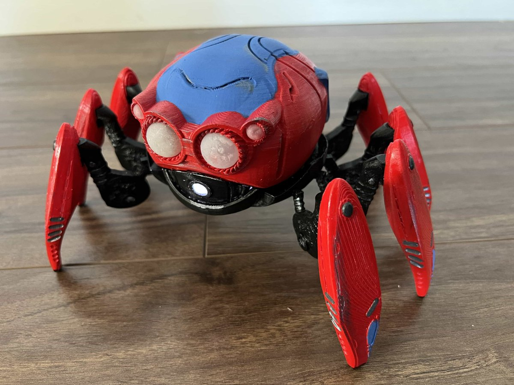

# Spider-Bot · Build log

The story of the build, step by step, written so that anyone can follow it and repeat it. Every entry opens with a
short **In short** box; read only those boxes and you have the whole story. Below each box come the steps, the
results with their figures, and the decisions taken. Commands and full data tables are folded under
**How to reproduce**. Entries are grouped by topic, oldest first; what is left to do and a glossary are at the
end.

<table>
<tr>
<td width="50%"></td>
<td width="50%"></td>
</tr>
<tr>
<td colspan="2"><em>The goal. <a href="https://www.thingiverse.com/thing:5196618">Spidey-Bot by jenscolt</a>, the static
display model this replica starts from (photos: jenscolt, CC BY-NC-SA). Ours keeps its look, and adds legs that
walk, driven by one motor, and lit eyes.</em></td>
</tr>
</table>

## Contents

The robot's story in three parts, then what is left to do and a glossary.

1. **[Workshop](build-log/1-workshop.md#workshop)**: getting the printer ready.
   - [Printer calibration](build-log/1-workshop.md#printer-calibration) · 2026-10 · ✅ done
   - [First print: purge waste bin](build-log/1-workshop.md#first-print-purge-waste-bin) · 2026-11-09 · ✅ done
2. **[Carcass](build-log/2-carcass.md#carcass)**: the robot's outer shell, and what has to fit inside it.
   - [Carcass base model](build-log/2-carcass.md#carcass-base-model) · 2026-11-08 · ✅ done
   - [Motor, battery holder and print scale](build-log/2-carcass.md#motor-battery-holder-and-print-scale) · 2026-11-09 · ✅ 120 %
   - [Mesh repair](build-log/2-carcass.md#mesh-repair) · 2026-11-09 · ✅ done
3. **[Legs and drive](build-log/3-legs-and-drive.md#legs-and-drive)**: how one motor moves eight legs.
   - [Leg simulator and comparison](build-log/3-legs-and-drive.md#leg-simulator-and-comparison) · 2026-11-09 · ✅ toy leg chosen
   - [Toy leg in 3D](build-log/3-legs-and-drive.md#toy-leg-in-3d) · 2026-11-09 · ✅ lateral axle
   - [Toy leg on one crankshaft](build-log/3-legs-and-drive.md#toy-leg-on-one-crankshaft) · 2026-11-09 · ↩️ reversed
   - [Crankshaft against real parts](build-log/3-legs-and-drive.md#crankshaft-against-real-parts) · 2026-11-09 · ❌ one crankshaft ruled out
   - [Two side crankshafts](build-log/3-legs-and-drive.md#two-side-crankshafts) · 2026-11-09 · ❌ ruled out
   - [Four lateral crankshafts](build-log/3-legs-and-drive.md#four-lateral-crankshafts) · 2026-11-09 · ✅ chosen
   - [Legs and drive in CAD](build-log/3-legs-and-drive.md#legs-and-drive-in-cad) · 2026-11-10 · ✅ done
   - [Onshape assembly](build-log/3-legs-and-drive.md#onshape-assembly) · 2026-11-10 · ✅ done
   - [Clearance test and test leg print plate](build-log/3-legs-and-drive.md#clearance-test-and-test-leg-print-plate) · 2026-11-10 · ✅ printed
   - [Test leg: first assembly and clearance result](build-log/3-legs-and-drive.md#test-leg-first-assembly-and-clearance-result) · 2026-11-11 · ✅ v2 designed
   - [Test leg v2: turning by hand](build-log/3-legs-and-drive.md#test-leg-v2-turning-by-hand) · 2026-11-11 · ✅ the leg turns
   - [Base v1 in CAD](build-log/3-legs-and-drive.md#base-v1-in-cad) · 2026-11-11 · ✅ printed, faults found
   - [Gear train test](build-log/3-legs-and-drive.md#gear-train-test) · 2026-11-11 · ✅ faults found
   - [Gear train v2 in CAD](build-log/3-legs-and-drive.md#gear-train-v2-in-cad) · 2026-11-11 · ✅ printed
   - [Gear train test v2: the cap](build-log/3-legs-and-drive.md#gear-train-test-v2-the-cap) · 2026-11-12 · ✅ the train turns
   - [Base v1: print and first fitting](build-log/3-legs-and-drive.md#base-v1-print-and-first-fitting) · 2026-11-13 · ✅ faults found
   - [Whole robot first: motor sizing and chassis plan](build-log/3-legs-and-drive.md#whole-robot-first-motor-sizing-and-chassis-plan) · 2026-11-14 · ✅ plan approved
   - [Chassis Part A: master model and drive module](build-log/3-legs-and-drive.md#chassis-part-a-master-model-and-drive-module) · 2026-11-15 · ✅ modelled and checked
   - [Chassis Part B1, Part C check and the friction clutch](build-log/3-legs-and-drive.md#chassis-part-b1-part-c-check-and-the-friction-clutch) · 2026-11-16 · ✅ chassis checked, clutch modelled
   - [Chassis Part D: the weight review](build-log/3-legs-and-drive.md#chassis-part-d-the-weight-review) · 2026-11-17 · 🔄 459 g, looks parts next
4. **[Open items](#open-items)**: everything still to do.
5. **[Glossary](#glossary)**: the terms used in the entries.

Status: ✅ done · 🔄 in progress · ❌ ruled out · ↩️ reversed by a later entry.

## Open items

Everything still to do on the build, in one place. Each row links to the entry where it came up; when an item is
done, its row is removed and the entry that closes it says so. Plan-level tasks (study, purchases) are tracked
outside the repo.

Since 2026-11-14 the whole robot is designed and checked in CAD before anything else is printed. Since 2026-11-16
the order is: the walking robot checked in CAD; the friction clutch; the weight review (Part D, done); the looks
parts in CAD (body v2 with the holder cradle, the eyes); then the motor, battery holder, switch and clutch hardware
are bought and measured, one batch of coupons is printed, and one robot, the looks one. There is no functional body,
no ballast frame and no printed test chassis before it. Failures change that one version, which is checked again as a
whole. Parts likely to need a fix (motor mount, cap, front block) are screwed on separately, so a fix reprints grams,
not the base. The rows follow that order.

| Pending | Came up in | Phase |
|---|---|---|
| Measure the N20 (motor, gearbox, D-shaft), the 4×AAA holder and the switch with the caliper, and put the measured values in the master model in place of the catalogue ones. They are bought only once the looks version passes in CAD and its mass confirms the motor sizing; the wave washer's load table is checked before it is bought (spring rate at most 60 N/mm, for the clutch's 0.1 mm shims), and the clutch's washer, shims and O-rings are bought with the motor ([hardware](hardware.md)); this replaces checking the holder's listing drawing against 64 × 49 × 16 mm (+2 mm) | [Motor, battery holder…](build-log/2-carcass.md#motor-battery-holder-and-print-scale) · [Whole robot first](build-log/3-legs-and-drive.md#whole-robot-first-motor-sizing-and-chassis-plan) · [Part B1 and the clutch](build-log/3-legs-and-drive.md#chassis-part-b1-part-c-check-and-the-friction-clutch) | 3 |
| Whole robot in CAD, verified as one design, as in [the chassis plan](cad/chassis/design-plan.md#status-and-next-steps). **A** (master model, drive module), **B1** (chassis shell, front block v2, crank cover) and the friction clutch are built and checked ([Part A](build-log/3-legs-and-drive.md#chassis-part-a-master-model-and-drive-module), [Part B1 and the clutch](build-log/3-legs-and-drive.md#chassis-part-b1-part-c-check-and-the-friction-clutch)); **C** (`mass_estimate.py` on the built masses) and **D** (the weight review, [done](build-log/3-legs-and-drive.md#chassis-part-d-the-weight-review): 459 g, shell rebuilt round the 4 mm pinion) are done; left: `sim/motor_sizing.py` rerun on the final masses, then the looks parts, in the next row. It fixes base v1's faults with the CAD rules in [cad/README.md](cad/README.md#a-design-folder) and the checks in [`tools/cad_verify.py`](tools/cad_verify.py). Then imported as STEP into Onshape and assembled with mates, the gear train with **Gear relation** | [Whole robot first](build-log/3-legs-and-drive.md#whole-robot-first-motor-sizing-and-chassis-plan) · [Chassis Part A](build-log/3-legs-and-drive.md#chassis-part-a-master-model-and-drive-module) · [Part B1 and the clutch](build-log/3-legs-and-drive.md#chassis-part-b1-part-c-check-and-the-friction-clutch) · [Base v1: print…](build-log/3-legs-and-drive.md#base-v1-print-and-first-fitting) · [Base v1 in CAD](build-log/3-legs-and-drive.md#base-v1-in-cad) · [Mesh repair](build-log/2-carcass.md#mesh-repair) · [Onshape assembly](build-log/3-legs-and-drive.md#onshape-assembly) | 3 |
| The looks parts in CAD: body v2 with the holder cradle and rear lug, within a 90 g budget (1.6 mm wall, about 20 g less than the scanned body), the eyes pocket and the eyes board, checked with the rest of the robot | [Part B1 and the clutch](build-log/3-legs-and-drive.md#chassis-part-b1-part-c-check-and-the-friction-clutch) · [Part D](build-log/3-legs-and-drive.md#chassis-part-d-the-weight-review) | 3 |
| Before the drive module's workshop kit: bench steps titled with directions as seen on the bench (the jig stands on its end, so «in from the +X side» means «down»), and [`tools/workshop_kit.py`](tools/workshop_kit.py) showing when each measurement is taken (the `when` of a `MEASURE` entry) | [Chassis Part A](build-log/3-legs-and-drive.md#chassis-part-a-master-model-and-drive-module) | 3 |
| Bring `cad/gear-train-test/verify.py` to the spec standard without touching geometry: `MARKS`, `JOINTS` with fits (the printed test cap went on with tongues at 0.3 mm a side: a measured fit for short tongues, or another kind), hardware labels, `LABELS["es"]`, `PRINT_ORIENT` for every part, `GEAR_MOTION`, `MEASURE`; full check PASS and a workshop kit with no FALTA about the spec | [Gear train test v2: the cap](build-log/3-legs-and-drive.md#gear-train-test-v2-the-cap) | 3 |
| One batch of coupons (K1–K6b in [the plan](cad/chassis/design-plan.md#tests-and-coupons)), cut from the whole robot once it passes, one per untested fit: the pinion on the N20's D-shaft, the motor seat, the cap's tongues, the module's and the body's fits, the break of the printed gears (it decides whether the D-bore pinion is kept); the clutch (CL1, CL1-heat, CL2, CL3 and K1, whose pull-off test decides whether 1.2 mm of shaft holds the collar); K1 and K2 also wait for the motor. K4 is recut from the 1.2 mm bowl skin and states its load (an I7 screw torqued in a boss on that skin), and the print-plater checks the support and overhang of the 1.2 mm bowl on the FLIP print before «no support change» is claimed. Also calibrate X-Y hole and contour compensation with the clearance block, and save the standard settings as a Bambu Studio preset | [Standard settings](print/README.md#standard-settings) · [Base v1: print…](build-log/3-legs-and-drive.md#base-v1-print-and-first-fitting) · [Whole robot first](build-log/3-legs-and-drive.md#whole-robot-first-motor-sizing-and-chassis-plan) · [Part D](build-log/3-legs-and-drive.md#chassis-part-d-the-weight-review) | 3 |
| Print the one robot, the looks one, with the N20, the 8 legs and the 8 forks, after the coupon batch passes; measure the gear train's efficiency (test T1) and the motor's margin on it; the legs and forks plate ([`print/legs-forks-v1.3mf`](print/legs-forks-v1.3mf)) is reused if the whole-robot check passes it | [Base v1 in CAD](build-log/3-legs-and-drive.md#base-v1-in-cad) · [Whole robot first](build-log/3-legs-and-drive.md#whole-robot-first-motor-sizing-and-chassis-plan) | 4 |
| Count the hardware in the workshop (the **Have** column) | [Hardware](hardware.md) | 3 |
| Confirm that Bambu Studio keeps the support settings saved by `tools/bambu_plate.py` | [Clearance test…](build-log/3-legs-and-drive.md#clearance-test-and-test-leg-print-plate) | 2 |
| Measure battery life on 4×AAA | [Motor, battery holder…](build-log/2-carcass.md#motor-battery-holder-and-print-scale) | 4 |

[↑ Contents](#contents)

## Glossary

Terms used in the entries, in the order they first appear, with a link to that entry.

| Term | Meaning | First in |
|---|---|---|
| **STL / STEP** | 3D file formats: STL is a triangle mesh (for printing), STEP is exact geometry (for CAD). | [Carcass base model](build-log/2-carcass.md#carcass-base-model) |
| **Bambu Studio** | The printer's slicer: it turns a 3D model into printer instructions. | [Carcass base model](build-log/2-carcass.md#carcass-base-model) |
| **Clearance** | Free space left around a part: how much bigger a hole or a space is than the part in it. | [Motor, battery holder…](build-log/2-carcass.md#motor-battery-holder-and-print-scale) |
| **Watertight (manifold)** | A mesh with no holes or loose edges, which slicers and CAD tools need. | [Mesh repair](build-log/2-carcass.md#mesh-repair) |
| **Crank** | An arm fixed to a turning shaft; its far end goes round in a circle. | [Leg simulator…](build-log/3-legs-and-drive.md#leg-simulator-and-comparison) |
| **Crank pin** | The pin (here a small ball) at the end of the crank, where the leg is attached. | [Leg simulator…](build-log/3-legs-and-drive.md#leg-simulator-and-comparison) |
| **Stride** | How far the robot moves forward per half turn of the crank. | [Leg simulator…](build-log/3-legs-and-drive.md#leg-simulator-and-comparison) |
| **Bob** | How much the body goes up and down while walking. | [Leg simulator…](build-log/3-legs-and-drive.md#leg-simulator-and-comparison) |
| **Step height** | How high a foot lifts off the ground. | [Leg simulator…](build-log/3-legs-and-drive.md#leg-simulator-and-comparison) |
| **Gait groups** | The legs move in two groups of four (left 1 and 3 + right 2 and 4, and the other four), half a turn apart. | [Leg simulator…](build-log/3-legs-and-drive.md#leg-simulator-and-comparison) |
| **Crankshaft** | One shaft with one or more cranks on it, so one motor turns them all. | [Toy leg on one crankshaft](build-log/3-legs-and-drive.md#toy-leg-on-one-crankshaft) |
| **Idler** | A gear between two others, so they turn the same way. | [Four lateral crankshafts](build-log/3-legs-and-drive.md#four-lateral-crankshafts) |
| **build123d** | A Python library for CAD: parts are written as code. | [Legs and drive in CAD](build-log/3-legs-and-drive.md#legs-and-drive-in-cad) |
| **Journal** | The round part of a shaft that turns inside a hole (its bearing). | [Legs and drive in CAD](build-log/3-legs-and-drive.md#legs-and-drive-in-cad) |
| **Fork (pivot)** | The small block on the body's edge that the leg passes through. It swivels, and the leg tilts in it. | [Legs and drive in CAD](build-log/3-legs-and-drive.md#legs-and-drive-in-cad) |
| **Onshape** | CAD in the browser, used to assemble the parts and animate them. | [Onshape assembly](build-log/3-legs-and-drive.md#onshape-assembly) |
| **Band** | The ring added between the base and the body, 18.7 mm tall, that holds the forks' upper screws. | [Base v1 in CAD](build-log/3-legs-and-drive.md#base-v1-in-cad) |
| **Backlash** | The small play between meshing teeth. Without it, printed gears bind. | [Gear train test](build-log/3-legs-and-drive.md#gear-train-test) |
| **Keel** | A narrow ridge under the bowl that covers the gears where they go lower than the bowl. | [Base v1 in CAD](build-log/3-legs-and-drive.md#base-v1-in-cad) |
| **Keeper** | A cover that holds the crankshaft down in its slots. | [Test leg…](build-log/3-legs-and-drive.md#test-leg-first-assembly-and-clearance-result) |
| **Gear offset** | The angle a gear is turned on its own shaft, relative to the cranks. | [Gear train v2 in CAD](build-log/3-legs-and-drive.md#gear-train-v2-in-cad) |
| **Margin (motor)** | How many times the motor's stall torque exceeds the worst torque it has to give; 3 or more here. | [Whole robot first…](build-log/3-legs-and-drive.md#whole-robot-first-motor-sizing-and-chassis-plan) |
| **Stall torque** | The torque at which a motor stops turning. | [Whole robot first…](build-log/3-legs-and-drive.md#whole-robot-first-motor-sizing-and-chassis-plan) |
| **Pinion** | The small gear on the motor's shaft. | [Whole robot first…](build-log/3-legs-and-drive.md#whole-robot-first-motor-sizing-and-chassis-plan) |
| **Coupon** | A small test piece cut from a part's design, printed to test one fit before the whole part. | [Whole robot first…](build-log/3-legs-and-drive.md#whole-robot-first-motor-sizing-and-chassis-plan) |
| **v0** | The plan's first working chassis with its motor, walking with ballast in place of the body. Dropped on 2026-11-16: the looks robot is the only one printed. | [Whole robot first…](build-log/3-legs-and-drive.md#whole-robot-first-motor-sizing-and-chassis-plan) |
| **Master model** | One file with the robot's reference heights, the joints between its designs and the sizes of the bought parts; every design takes its shared numbers from it. | [Chassis Part A](build-log/3-legs-and-drive.md#chassis-part-a-master-model-and-drive-module) |
| **Drive module** | The gearbox that carries the crankshafts, the idlers and the motor, assembled on the bench and screwed into the chassis as one piece. | [Chassis Part A](build-log/3-legs-and-drive.md#chassis-part-a-master-model-and-drive-module) |
| **D-shaft** | A motor shaft with one flat side, so a part pressed on it cannot turn. | [Chassis Part A](build-log/3-legs-and-drive.md#chassis-part-a-master-model-and-drive-module) |
| **Jig** | A tool made for one job that holds parts in the right place while they are put together. | [Chassis Part A](build-log/3-legs-and-drive.md#chassis-part-a-master-model-and-drive-module) |
| **Gauge** | A piece of a known thickness used to set or check a gap. | [Chassis Part A](build-log/3-legs-and-drive.md#chassis-part-a-master-model-and-drive-module) |
| **Keep-in check** | A check that every part stays inside an envelope (here the carcass, less its wall), except where a named exception says how far it may stand out. | [Chassis Part A](build-log/3-legs-and-drive.md#chassis-part-a-master-model-and-drive-module) |
| **Friction clutch** | A joint that transmits torque by friction and slips when the torque is too high, so a jam cannot break a gear. | [Part B1 and the clutch](build-log/3-legs-and-drive.md#chassis-part-b1-part-c-check-and-the-friction-clutch) |
| **Wave washer** | A thin steel ring bent in waves, used as a spring that presses with a steady force. | [Part B1 and the clutch](build-log/3-legs-and-drive.md#chassis-part-b1-part-c-check-and-the-friction-clutch) |
| **Shim** | A very thin flat washer added or taken away to set a gap or a spring's force. | [Part B1 and the clutch](build-log/3-legs-and-drive.md#chassis-part-b1-part-c-check-and-the-friction-clutch) |

[↑ Contents](#contents)
