# Spider-Bot · Build log

The story of the build, step by step, written so that anyone can follow it and repeat it. Every entry opens with a
short **In short** box; read only those boxes and you have the whole story. Below each box come the steps, the
results with their figures, and the decisions taken. Commands and full data tables are folded under
**How to reproduce**. Entries are grouped by topic, oldest first; what is left to do and a glossary are at the
end.

## Contents

The robot's story in three parts, then what is left to do and a glossary.

1. **[Workshop](#workshop)**: getting the printer ready.
   - [Printer calibration](#printer-calibration) · 2026-10 · ✅ done
   - [First print: purge waste bin](#first-print-purge-waste-bin) · 2026-11-09 · ✅ done
2. **[Carcass](#carcass)**: the robot's outer shell, and what has to fit inside it.
   - [Carcass base model](#carcass-base-model) · 2026-11-08 · ✅ done
   - [Motor, battery holder and print scale](#motor-battery-holder-and-print-scale) · 2026-11-09 · ✅ 120 %
   - [Mesh repair](#mesh-repair) · 2026-11-09 · ✅ done
3. **[Legs and drive](#legs-and-drive)**: how one motor moves eight legs.
   - [Leg simulator and comparison](#leg-simulator-and-comparison) · 2026-11-09 · ✅ toy leg chosen
   - [Toy leg in 3D](#toy-leg-in-3d) · 2026-11-09 · ✅ lateral axle
   - [Toy leg on one crankshaft](#toy-leg-on-one-crankshaft) · 2026-11-09 · ↩️ reversed
   - [Crankshaft against real parts](#crankshaft-against-real-parts) · 2026-11-09 · ❌ one crankshaft ruled out
   - [Two side crankshafts](#two-side-crankshafts) · 2026-11-09 · ❌ ruled out
   - [Four lateral crankshafts](#four-lateral-crankshafts) · 2026-11-09 · ✅ chosen
   - [Legs and drive in CAD](#legs-and-drive-in-cad) · 2026-11-10 · ✅ done
   - [Onshape assembly](#onshape-assembly) · 2026-11-10 · ✅ done
   - [Clearance test and test leg print plate](#clearance-test-and-test-leg-print-plate) · 2026-11-10 · ✅ printed
   - [Test leg: first assembly and clearance result](#test-leg-first-assembly-and-clearance-result) · 2026-11-11 · 🔄 v2 to print
4. **[Open items](#open-items)**: everything still to do.
5. **[Glossary](#glossary)**: the terms used in the entries.

Status: ✅ done · 🔄 in progress · ❌ ruled out · ↩️ reversed by a later entry.

## Workshop

The printer is a Bambu Lab P2S Combo (with AMS). Before printing robot parts, it was calibrated and given a first,
useful print. All Spider-Bot parts are printed in PLA.

### Printer calibration

**Phase 0 · Workshop · 2026-10** · Status: ✅ done

> **In short.** The P2S runs its automatic calibration before its first print. Nothing to set by hand.

*Video · The P2S running its automatic calibration.*

https://github.com/user-attachments/assets/948dd098-af7a-4972-a0bd-290c17e0126f

### First print: purge waste bin

**Phase 0 · Workshop · 2026-11-09** · Status: ✅ done

> **In short.** The first real print is a bin that catches the filament the printer purges at the back on every
> filament change. It came out right, so the printer is ready for robot parts.

#### Steps

1. Model: [P1S, P2S, X2D Poop Bin by Pichler](https://makerworld.com/models/1603348) on MakerWorld. Pick the print
   profile **«P2S (10 mm higher) / without Purge Line Corner / with Logo»**: the P1S profile is 10 mm too low for
   the P2S. For a P2S with the exhaust fan, use the X2D / P2S profile instead.
2. Filament: Bambu PLA Basic, black.
3. Print, then slide the bin's foot tab under the printer, below the purge chute.

#### Result

Smooth walls, no visible defects (Fig. 1).

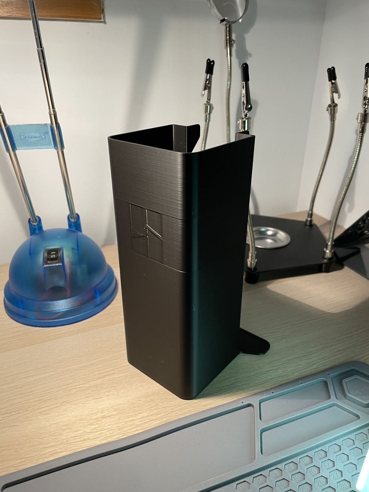

*Fig. 1 · The bin under the printer's purge chute.*

*Video · The first print.*

https://github.com/user-attachments/assets/969db1d2-f4c8-4ad6-a642-058941c77ebe

## Carcass

The robot's look comes from an existing fan model, jenscolt's Spidey-Bot. The first job was to check it could hold
the motor and batteries. At its original size the battery holder does not fit, so it is printed at **120 %**. Its
meshes also had errors, which were repaired without changing the shape. The cuts and holes for the mechanism come
later, once the mechanism is designed.

### Carcass base model

**Phase 2 · CAD · 2026-11-08** · Status: ✅ done

> **In short.** Instead of modelling the shell from scratch, we start from
> [Spidey-Bot by jenscolt](https://www.thingiverse.com/thing:5196618), the most faithful replica found. Its 9 parts
> were measured and assembled into one model. It imports into the slicer, but with mesh errors to fix first.

**Why this model.** It is the most faithful replica found (CC BY-NC-SA). Others looked at: a stylised low-poly game
asset on Sketchfab (CC BY-ND, so no modified versions can be published; reference only) and the MyMiniFactory
«Spider BOT» (an unrelated sci-fi miniature).

#### Steps

1. On the Thingiverse page, **Download all files** (zip with 9 STLs, photos, README and license).
2. Check every STL is valid and measure it with [`tools/stl_preview.py`](tools/stl_preview.py), which prints the size
   of each part and renders the previews.
3. The files place the body, base, sensor and only the front pair of legs; the eyes are off to the side. Join
   everything into one assembled model (How to reproduce): the 4 eye domes go into their sockets and the other
   3 legs per side are added. The leg layout is approximate, read off the author's photos: fine for pictures, not
   for fitting parts.
4. Open the assembled STL in Bambu Studio to check it imports.

<details>
<summary>How to reproduce</summary>

```
python3 tools/assemble_jenscolt.py cad/carcass-jenscolt spideybot_assembled.stl
```

Files, sizes and previews: [cad/carcass-jenscolt/](cad/carcass-jenscolt/).

</details>

#### Result

The body is a hollow shell 96 × 110 × 66 mm; the base has posts and mounts inside. The legs are static display
parts. Assembled, the robot measures 224 × 154 × 118 mm (Fig. 1). It needs 4 of each leg file per side and 2 of
each eye (Fig. 2).

<table>
<tr>
<td width="50%">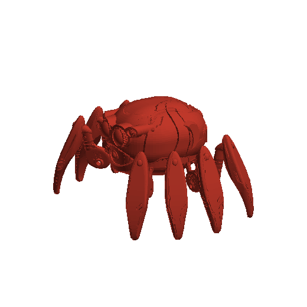</td>
<td width="50%">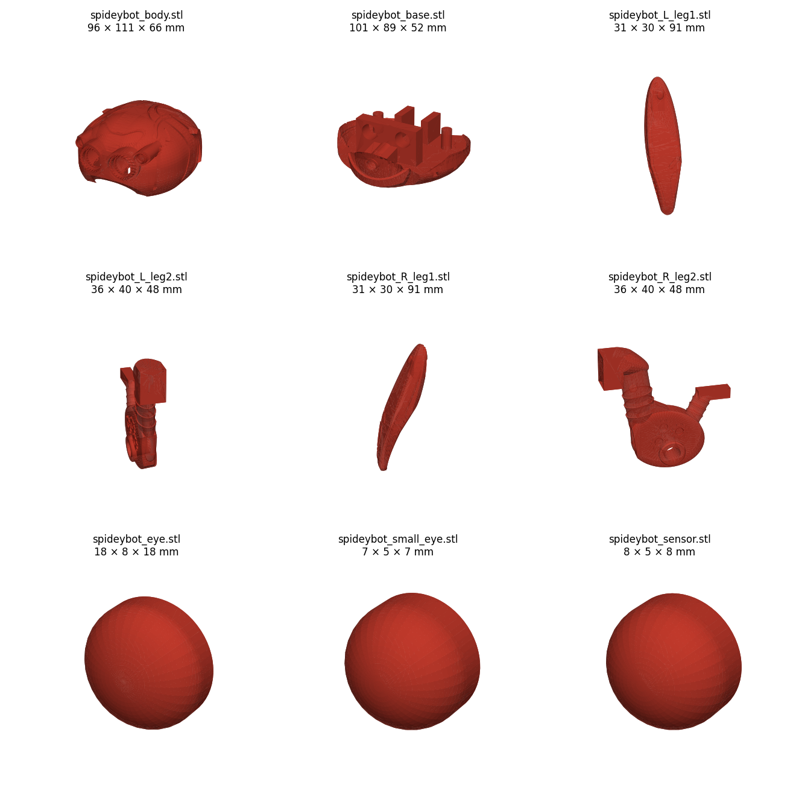</td>
</tr>
<tr>
<td><em>Fig. 1 · The assembled model: eyes in their sockets and all eight legs placed.</em></td>
<td><em>Fig. 2 · The 9 parts as downloaded, with their sizes.</em></td>
</tr>
</table>

Bambu Studio imports the assembly, but reports mesh errors (non-manifold edges and reversed faces) in every file
(Fig. 3).

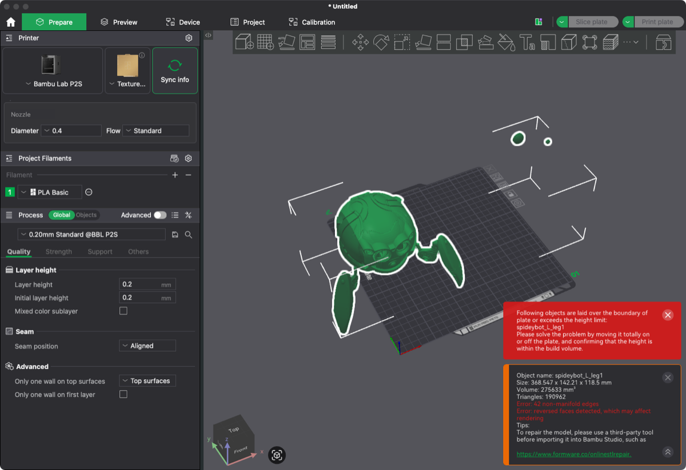

*Fig. 3 · The model in Bambu Studio. The red panel at the bottom right lists the mesh errors; they must be repaired
before cutting or drilling the parts.*

#### Decisions

- **Carcass:** jenscolt's meshes, edited in Bambu Studio (cuts, holes). **Mechanism:** new parts designed in CAD,
  with the body only as a size reference.
- The walking legs are designed new; jenscolt's legs only give their outer look.

### Motor, battery holder and print scale

**Phase 2 · CAD · 2026-11-09** · Status: ✅ 120 %

> **In short.** The body must hold the motor and a battery holder. At 100 % the free space inside is about
> 71 × 62 mm: the small N20 motor fits, but no 4-battery holder with a switch does. At **120 %** a 4×AAA holder fits
> with 2 mm to spare, so that is the print scale.

#### Steps

1. Collect the outer sizes of the candidate parts from shop data sheets (largest listed value, rounded up):

   | Part | Size (mm) | Notes |
   |---|---|---|
   | N20 gear motor | 37 × 12 × 10 | Same cross-section for every gear ratio; length includes the 10 mm shaft |
   | 4×AA holder, switch + cover (flat) | 70.5 × 68 × 20 | Several shop listings |
   | 4×AAA holder, switch + cover | 64 × 49 × 16 | Typical listing; check the one bought |
   | 3×AA / 2×AA holder, switch | ~62 × 50 × 18 / ~60 × 34 × 18 | Typical listings |
   | 4×AA holder, 2×2 stacked | 58 × 32 × 31 | No switch or cover |

2. Measure the free space inside the body and try each part in it with
   [`tools/fit_check.py`](tools/fit_check.py). It slices the body every 1 mm upwards from the top of the base, keeps
   the inside of the wall behind the eye block, and looks for a spot where the part lies flat. The author's screw
   posts are ignored, since the inside is redesigned. The base itself is a near-solid bowl, too shallow at the edges
   to help.
3. Repeat at the chosen scale with 2 mm clearance per side: holder sizes vary about ±0.5 mm between makers, and the
   wires need room.

<details>
<summary>How to reproduce</summary>

```
python3 tools/fit_check.py cad/carcass-jenscolt --scale 1.0 --min-scale \
    --box "4×AA flat, switch + cover" 70.5 68 20 --box "4×AAA holder, switch + cover" 64 49 16 ...
python3 tools/fit_check.py cad/carcass-jenscolt --scale 1.2 --clearance 2 --box ...
```

</details>

#### Result

At 100 % the N20 fits with room to spare, but the holders with a switch do not (Fig. 1). The flat 4×AA holder
would need 137 %. With 2 mm clearance the 4×AAA holder needs 118 %, and at 120 % it fits (Fig. 2).

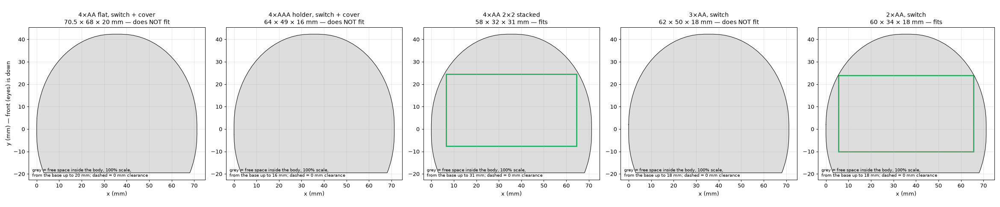

*Fig. 1 · The free space inside the body at 100 % (grey), seen from above, with each holder tried in it. Only the
stacked 4×AA (no switch) and the 2×AA fit.*

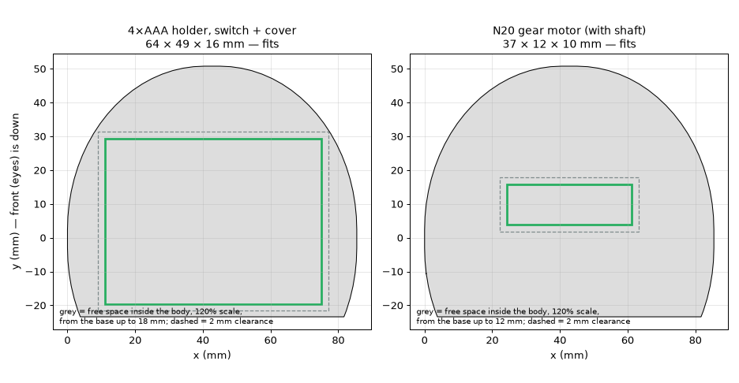

*Fig. 2 · At 120 %: the 4×AAA holder and the N20 motor fit, each with 2 mm clearance (dashed).*

#### Decisions

- **Motor: N20 gear motor.** All gear ratios have the same size; the ratio is picked in phase 4 from the measured
  load.
- **Batteries: 4×AAA NiMH** in a holder with switch and cover. Same 4.8 V as 4×AA, so motor and eyes behave the
  same, with less capacity (about 800–1000 mAh against 2000–2500 mAh). 2×AA was ruled out: 2.4 V (about 2.2 V under
  load) gives a 6 V N20 about 40 % of its speed and torque, and blue or white LEDs (about 3 V) do not light.
- **Print scale: 120 %.** The robot is about 269 × 185 × 142 mm. At 110 % the holder fits with no clearance at all.

### Mesh repair

**Phase 2 · CAD · 2026-11-09** · Status: ✅ done

> **In short.** The downloaded meshes had small errors (duplicate and zero-size triangles, tiny gaps) that stop
> cuts and holes from working in the slicer. A repair script closed them while moving the surface 0.01 mm at most,
> and scaled the parts to 120 %. Bambu Studio now reports every part as watertight.

**What was wrong.** Every file has duplicate triangles (zero-thickness walls), zero-area triangles and tiny gaps
between triangles. The body also has 10 «pinched» edges, where two surfaces touch along a line. Bambu Studio's mesh
check reports `manifold = no` for body, eyes and sensor.

#### Steps

1. Repair and scale the 5 carcass parts with [`tools/repair_stl.py`](tools/repair_stl.py). It merges points that
   are almost in the same place, drops zero-area and duplicate triangles and closes small holes. At pinched edges it
   splits the points and moves each copy 0.01 mm into its own side. It then reads every file back, as a slicer
   would, and measures the largest distance to the original.
2. Check with Bambu Studio's own mesh check.

<details>
<summary>How to reproduce</summary>

```
python3 tools/repair_stl.py cad/carcass-120 --scale 1.2 cad/carcass-jenscolt/spideybot_{body,base,eye,small_eye,sensor}.stl
/Applications/BambuStudio.app/Contents/MacOS/BambuStudio --info cad/carcass-120/spideybot_body.stl   # manifold = yes
```

</details>

#### Result

All 5 parts are watertight, and none moved more than 0.01 mm (measured at 100 %, before scaling).

| File | Bad edges before | Bad edges after | Max change (mm) |
|---|---|---|---|
| `spideybot_body.stl` | 55 | 0 | 0.010 |
| `spideybot_base.stl` | 4 | 0 | 0.000 |
| `spideybot_eye.stl` | 3 | 0 | 0.000 |
| `spideybot_small_eye.stl` | 3 | 0 | 0.000 |
| `spideybot_sensor.stl` | 3 | 0 | 0.000 |

<details>
<summary>What was fixed in each file</summary>

| File | Fixed |
|---|---|
| `spideybot_body.stl` | 228 zero-area, 7 duplicate triangles, 10 pinched edges split (surface moved 0.01 mm) |
| `spideybot_base.stl` | 6 zero-area triangles |
| `spideybot_eye.stl` | 3 duplicate triangles |
| `spideybot_small_eye.stl` | 5 zero-area, 3 duplicate triangles, 3 open edges closed |
| `spideybot_sensor.stl` | 2 zero-area, 3 duplicate triangles |

Bambu Studio before: body 9 non-manifold edges; eye, small eye and sensor 3 each. After: `manifold = yes` for all 5.

</details>

<table>
<tr>
<td width="50%">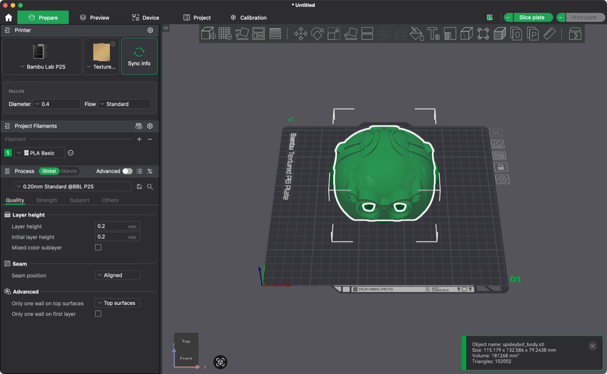</td>
<td width="50%"></td>
</tr>
<tr>
<td><em>Fig. 1 · The repaired body in Bambu Studio: no errors.</em></td>
<td><em>Fig. 2 · The original, for comparison: the red panel at the bottom right lists its errors.</em></td>
</tr>
</table>

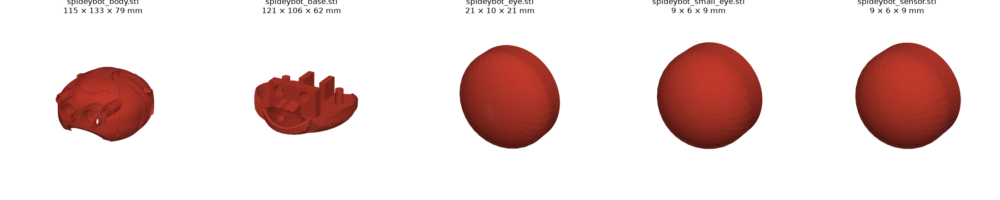

*Fig. 3 · The 5 repaired parts at 120 %, with their print sizes.*

#### Decisions

- **No automatic rebuild (MeshFix).** Tried first: it closes everything, but on a leg it cut off a 1.5 mm relief.
  Only fixes that keep the surface within 0.01 mm are used.
- **Legs not repaired.** Closing their pinched edges would change their shape. They are not printed (the walking
  legs are designed new) and stay as a reference in [cad/carcass-jenscolt/](cad/carcass-jenscolt/).
- The repaired files are kept at 120 %, the print scale, so measurements taken from them are the real ones.

## Legs and drive

The Spider-Bot walks on eight legs driven by one motor, so the core problem is the mechanism. The steps so far:

1. **Which leg?** A simulator compared three leg mechanisms. We chose the simplest, the **toy leg**: one bent part
   per leg, pushed by a crank.
2. **Which drive?** Then came the hard part: how one motor turns eight cranks without the legs hitting each other.
   - **One crankshaft** across the body for all eight legs looked good until the cranks were given real thickness.
     The legs' inner arms then cut through the other legs' cranks.
   - **Two side crankshafts** (front to back) fit, but the feet move sideways and the robot barely walks.
   - **Four crankshafts** across the body, one per pair of legs, linked by gears, is the first layout that fits and
     walks forward. Its stride is short (about 10 mm per half turn), because the body must not bob more than 3 mm.
3. **CAD and first print.** The parts were modelled in code, checked for collisions over a full turn, assembled in
   Onshape, and one leg was printed on a small test frame. It showed that holes need much more clearance than
   expected (0.5 mm), and the frame was redesigned. Next: print the new frame and turn the leg by hand.

### Leg simulator and comparison

**Phase 3 · Mechanisms · 2026-11-09** · Status: ✅ toy leg chosen

> **In short.** A 2D simulator compared three ways to build a leg turned by a crank: the **toy leg** (one part),
> **Klann** (4 parts) and **Jansen** (7 parts). Klann gives the longest stride and Jansen the smoothest walk, but we
> chose the toy leg: one part per leg, and forgiving of small printing errors. The simulator under-rates it,
> because the real toy leg also moves in 3D, which was checked in the next step.

**The three candidates.** In the **toy leg**, one bent part sits on a crank pin at its inner end and slides through
a pivot on the body's edge. **Klann** and **Jansen** are classic walking linkages with 4 and 7 moving parts per
leg (Jansen's is the one in the Strandbeest sculptures).

#### Steps

1. Take the bar lengths: Klann from his patent, as redrawn by
   [DIY Walkers](https://www.diywalkers.com/klann-linkage-optimizer.html); Jansen's published «holy numbers»; and for
   the toy leg, the best of 4000 random tries (longest stride with less than 3 mm of body bob), so that it is
   compared at its best.
2. Run [`sim/legs.py`](sim/legs.py). It turns the crank in 0.5° steps, works out where each joint is, and scales
   every leg so the crank axle is 55 mm above the ground (the body bottom is about 46 mm up at 120 %).
3. Measure each leg over the half turn it carries the body: with two gait groups half a turn apart, every leg holds
   the body for half a turn.

<details>
<summary>How to reproduce</summary>

```
python3 sim/legs.py --png sim/images/foot-paths.png --gif sim/images/legs.gif
```

Klann: crank = 3, frame pivots at (7.4, 16.9) and (3.4, 8.03) with the crank at (10, 10), knee bent 30°, upper bar
bent 12.8°. Its driving four-bar (frame O-P2, crank, bar A-M, rocker M-P2): s + l = 9.88774, p + q = 10.19, a
crank-rocker, so its crank turns fully. Jansen: crank = 15.

</details>

#### Result


*Fig. 1 · The three legs at one crank angle (black squares are the fixed pivots) and the path of each foot over a
full turn. The flat bottom of each loop is where the foot pushes the robot; the higher the loop, the higher the step.*


*Fig. 2 · The same three legs turning.*

| Leg | Stride per half turn (mm) | Body bob (mm) | Step height (mm) | Parts per leg |
|---|---|---|---|---|
| Toy | 29 | 2.5 | 5 | 1 |
| Klann | 60 | 3.7 | 28 | 4 |
| Jansen | 38 | 1.1 | 13 | 7 |

<details>
<summary>All the numbers</summary>

| Leg | Foot slips back on the ground | Foot speed peak / median | Crank radius (mm) | Leg size W × H (mm) | Pin joints per leg |
|---|---|---|---|---|---|
| Toy | yes | 1.4 | 7.7 | 55 × 63 | 2 |
| Klann | yes | 1.3 | 14.4 | 100 × 114 | 6 |
| Jansen | no | 1.2 | 9.0 | 73 × 75 | 10 |

</details>

- **Toy:** one part per leg, but in this flat model the foot barely lifts (5 mm) and drags back. Real toy spiders
  work in 3D (the foot also swings sideways and up), which this simulator does not model, so these numbers
  under-rate it.
- **Klann:** longest stride and highest step, and the leg arches above the body like a spider's. But it needs 4
  parts per leg and a bigger crank, the body bobs 3.7 mm, and small errors in the bar lengths change the foot path
  a lot.
- **Jansen:** the smoothest walk, but 7 parts and 10 pins per leg (56 parts for 8 legs), and it does not look like a
  spider leg.

#### Decisions

**Toy leg.** It is the simplest for a first robot: 8 leg parts against 32 for Klann, not sensitive to small
dimension errors, a small crank (about 7 mm, so less torque), and probably how the original toy walks. Klann's
real-size bars can be regenerated with `sim/legs.py` if needed.

**How the toy leg works.** Its inner end sits on a crank pin that turns in a circle. Further out, it passes through
a pivot on the body's edge that lets it slide and swivel. When the crank pin goes up, the foot goes down (a lever),
and when the pin moves in, the leg slides in: the foot traces a loop. The two gait groups of four legs are on crank
pins half a turn apart.

### Toy leg in 3D

**Phase 3 · Mechanisms · 2026-11-09** · Status: ✅ lateral axle

> **In short.** The toy leg was simulated in 3D on the whole robot, in its 8 real notches. We tried 6 ways to build
> it: the crank turning on 3 different axes, and the leg sliding either at the crank or at the body. Only one gets
> close to every target: **crank axle across the body (lateral), leg sliding at the crank**, with a 26 mm stride and
> 3.1 mm of bob. Each leg still has its own crank here; how one motor drives them all is the next step.

**Ways to build it.**
- **Crank axle:** **lateral** (across the body, left to right), **vertical**, or **longitudinal** (front to back).
- **Where the leg slides:** **at the crank**, where the leg turns about a fixed point on the body and the crank pin
  slides in a bore in its inner end; or **at the body**, where the leg sits on the crank pin and slides through a
  sleeve on the body's edge, as in the 2D model.

#### Steps

1. **Find the leg pivots.** The base rim has 8 notches, 4 per side, about 10 × 5 mm, 70–74 mm above the ground.
   Their positions were measured by slicing the base model.
2. **Model one leg** in [`sim/toy_leg_3d.py`](sim/toy_leg_3d.py): a crank, an inner arm running from the crank pin
   through the pivot, a knee, and a shin bending down and leaning forward or back. All 8 notches use the same leg,
   mirrored on the left, and the two gait groups are half a turn apart.
3. **Walk the robot over one crank turn.** The body stays level, stands on its lowest feet, and moves forward by
   what the lowest foot moves.
4. **Search the best geometry** for each of the 6 combinations: the longest stride that meets the targets. Targets:
   step height ≥ 10 mm, bob ≤ 3 mm, 20–60 mm under the base, ≥ 3 mm between neighbouring legs, knee and foot outside
   the body, stable, footprint ≤ 270 × 185 mm, little foot slip.

<details>
<summary>How to reproduce</summary>

Pivot centres ([cad/carcass-120/](cad/carcass-120/) coordinates: z = height above the ground, forward = −Y), right
side, front to rear: (89.5, −32.2), (95.9, −12.6), (96.1, 2.9), (82.6, 31.1). The left ones are their mirror about
x = 42.7 (the body axis). Measured by slicing `spideybot_base.stl` at z = 71 and 73 and subtracting the slice from
its convex hull.

Leg parameters: crank radius `r`; crank centre `D` mm inward from the pivot and `H` mm above it; inner `arm`
length; knee `bend` angle; shin `sweep` (forward/back lean) and length. The leg keeps its sideways axis horizontal
(a gimbal at the pivot).

Search: 3000 random tries + 750 refinement steps per combination, ranges r 3–12 mm, D 8–40 mm, H −20 to +8 mm,
arm 5–70 mm, bend 30–150°, sweep ±45°, shin 30–120 mm. The 6 searches ran in parallel, about 10 minutes in all.

```
python3 sim/toy_leg_3d.py --search 3000 --only lateral/crank --json lateral-crank.json   # one per combination
python3 sim/toy_leg_3d.py --params sim/toy_leg_3d.json --png sim/images/toy-3d-comparison.png --gif sim/images/toy-3d.gif
```

The 6 best geometries are in [`sim/toy_leg_3d.json`](sim/toy_leg_3d.json).

</details>

#### Result

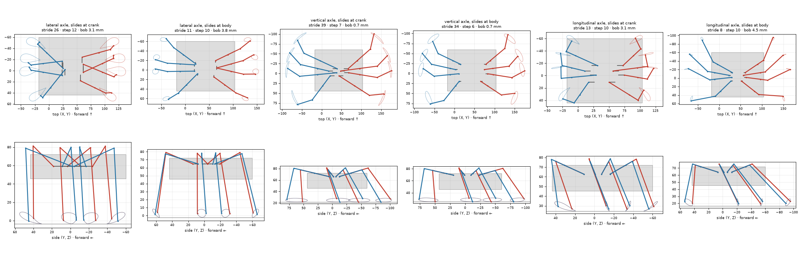

*Fig. 1 · The best robot for each combination, from above (top row) and from the side (bottom row). The grey box is
the body and the loops are the foot paths. The two colours are the two sides.*

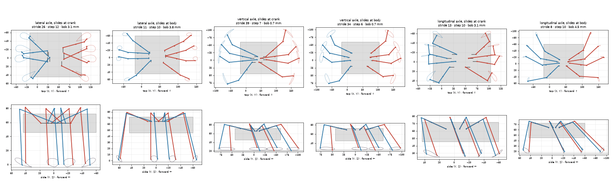

*Fig. 2 · The six combinations walking.*

| Crank axle | Slides at | Stride (mm) | Bob (mm) | Step height (mm) |
|---|---|---|---|---|
| **lateral** | **crank** | **26** | **3.1** | **12** |
| lateral | body | 11 | 3.8 | 10 |
| vertical | crank | 39 | 0.7 | 7 |
| vertical | body | 34 | 0.7 | 6 |
| longitudinal | crank | 13 | 3.1 | 10 |
| longitudinal | body | 8 | 4.5 | 10 |

Stride is per half turn. Knee and foot stay outside the body in all six.

<details>
<summary>All the numbers and geometries</summary>

Feet slip = how far, on average, each foot slides on the ground per turn against the foot carrying the body (it
includes touching down and lifting off).

| Crank axle | Slides at | Feet slip (mm per leg per turn) | Stable all turn (margin mm) | Gap between legs (mm) | Clearance under base (mm) | Footprint X × Y (mm) | Crank radius (mm) |
|---|---|---|---|---|---|---|---|
| lateral | crank | 39 | yes (15) | 8.0 | 49 | 190 × 133 | 10.0 |
| lateral | body | 15 | yes (21) | 15.5 | 48 | 222 × 133 | 3.3 |
| vertical | crank | 29 | yes (13) | 2.9 | 24 | 268 × 184 | 10.1 |
| vertical | body | 22 | yes (12) | 4.0 | 20 | 265 × 176 | 4.1 |
| longitudinal | crank | 39 | yes (6) | 15.5 | 21 | 171 × 133 | 9.1 |
| longitudinal | body | 16 | yes (14) | 15.5 | 29 | 249 × 150 | 3.0 |

| Crank axle / slides at | Geometry (mm, °) | Crank axle above ground (mm) | Slide travel (mm) | Pivot swing yaw / pitch | Leg to crank pin angle |
|---|---|---|---|---|---|
| lateral / crank | r 10.0, D 34.8, H −12.9, arm 23.1, bend 107, sweep 4, shin 79.3 | 62 | 13.9 | 32° / 29° | 7–35° |
| lateral / body | r 3.3, D 30.5, H −7.2, arm 58.7, bend 85, sweep 4, shin 79.7 | 67 | 4.4 | 12° / 12° | 10–22° |
| vertical / crank | r 10.1, D 38.2, H −6.0, arm 45.5, bend 71, sweep 21, shin 66.8 | 44 | 20.0 | 31° / 5° | 78–83° |
| vertical / body | r 4.1, D 17.6, H −2.6, arm 62.4, bend 72, sweep 22, shin 61.4 | 44 | 8.1 | 27° / 4° | 79–83° |
| longitudinal / crank | r 9.1, D 30.8, H −9.3, arm 17.2, bend 104, sweep 22, shin 52.6 | 38 | 18.1 | 6° / 33° | 77–83° |
| longitudinal / body | r 3.0, D 37.0, H −7.7, arm 52.6, bend 63, sweep 27, shin 78.8 | 48 | 6.0 | 2° / 9° | 80–81° |

</details>

- **Lateral axle, sliding at the crank** is the only one close to every target (bob 3.1 against 3). The crank pin
  points along the leg, so it can slide straight into a bore in the leg's inner end: probably the classic toy. Its
  feet slip the most, and the 8 cranks sit near the body centre, where the battery holder goes.
- **Vertical axle** gives the longest, smoothest stride but a low step (6–7 mm): it only lifts the feet by tilting
  the leg. Its legs come within 2.9 mm of each other, and the left cranks must turn the other way.
- **Longitudinal axle** is the weakest: the crank moves the leg's inner end sideways, which hardly makes a stride.
- **Limits of the model:** the body stays level (a real one tilts onto 3 feet), the legs are lines with no
  thickness, and nothing is checked against the inside of the carcass yet.

#### Decisions

Lateral axle, leg sliding at the crank (taken in the next entry, once one motor drives all the legs).

### Toy leg on one crankshaft

**Phase 3 · Mechanisms · 2026-11-09** · Status: ↩️ reversed by [Crankshaft against real parts](#crankshaft-against-real-parts)

> **In short.** In the previous step every leg had its own crank, and the cranks of each side ended up so close
> that they would hit each other. Here all 8 legs share **one crankshaft** across the body, and the legs are given
> a real 5 mm thickness. Stride halves to 14 mm and bob rises to 4.2 mm. The limit is the legs' inner arms bumping
> into each other inside the body, not the shaft. We accepted it, but the next step showed the layout fails anyway.

#### Steps

1. Add a **shaft** mode to [`sim/toy_leg_3d.py`](sim/toy_leg_3d.py): one crankshaft across the body for all 8 legs,
   its 4 cranks per side in any order, mirrored on the left. The two gait groups are pins half a turn apart on the
   same shaft.
2. Keep the crankshaft below the battery holder and inside the base. The holder (64 × 49 × 16 mm) fills almost the
   whole body ([cad/layout/](cad/layout/)), so the cranks must stay below it, inside the base with a 2 mm wall.
3. Use stricter rules: legs are 5 mm thick, so every pair of legs on a side keeps 6 mm between centre lines,
   including inside the body. Footprint at least 240 × 165 mm, close to the original's look.
4. Search again: the shaft with the leg sliding at the crank (3 seeds) and at the body, plus, for reference, one
   crank per leg under the same rules.

<details>
<summary>How to reproduce</summary>

Shaft at y = Y0, z = 72 + H. Cranks from XIN to XIN + 3 × PITCH mm from the body axis (PITCH ≥ 8 mm: crank web plus
leg end), in any of the 24 orders. 3000 random tries + 750 refinement steps; 5 searches in parallel, about 15
minutes.

```
python3 sim/toy_leg_3d.py --strict --search 3000 --seed 3 --only shaft/crank --json shaft-crank.json
python3 sim/toy_leg_3d.py --params sim/toy_leg_3d_strict.json --png sim/images/toy-3d-strict.png --gif sim/images/toy-3d-strict.gif
```

Best results: [`sim/toy_leg_3d_strict.json`](sim/toy_leg_3d_strict.json). Best crankshaft geometry (sliding at
crank): r 5.1, Y0 −12.9, H −6.4 (crank axle 60 mm above the ground), cranks at 6, 16, 26 and 36 mm from the body
axis (front leg innermost), arm 67.4, bend 114°, sweep −15°, shin 77.1 mm. Slide 10 mm, pivot swing 15° each way,
crank pin 2–17° off the leg's axis. The other two seeds gave strides of 9 and 7 mm.

</details>

#### Result

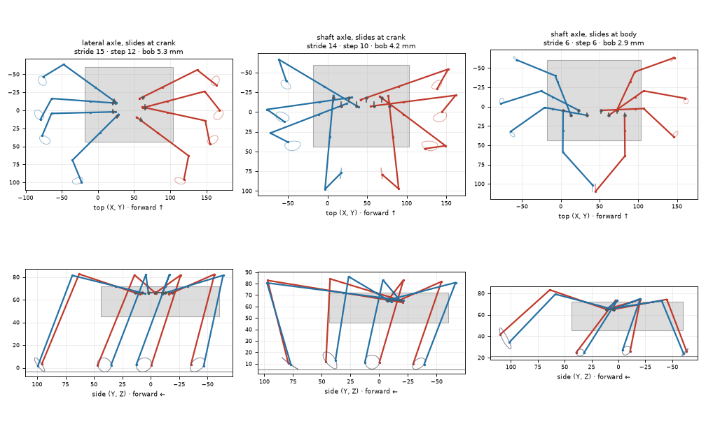

*Fig. 1 · The best layouts with real leg thickness, from above and from the side. In the top view, notice how the
inner arms converge from the notches towards the shaft: that is where they get too close.*

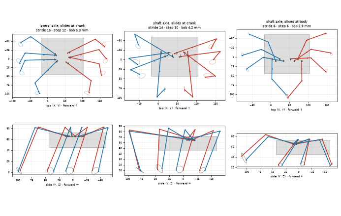

*Fig. 2 · The same, walking.*

| Cranks | Slides at | Stride (mm) | Bob (mm) | Step height (mm) | Gap between legs (mm, need 6) |
|---|---|---|---|---|---|
| one per leg (reference) | crank | 15 | 5.3 | 12 | 1.0 |
| **one crankshaft** | **crank** | **14** | **4.2** | **10** | **2.2** |
| one crankshaft | body | 6 | 2.9 | 6 | 1.4 |

<details>
<summary>All the numbers</summary>

| Cranks | Slides at | Feet slip (mm per leg per turn) | Stable all turn (margin mm) | Clearance under base (mm) | Footprint X × Y (mm) | Crank radius (mm) |
|---|---|---|---|---|---|---|
| one per leg, reference | crank | 18 | yes (7) | 49 | 261 × 166 | 3.0 |
| one crankshaft | crank | 17 | yes (5) | 40 | 241 × 165 | 5.1 |
| one crankshaft | body | 6 | yes (15) | 24 | 243 × 175 | 3.1 |

</details>

- With realistic room between legs, **no layout meets the targets**, not even one crank per leg. Stride halves
  (26 → 14–15 mm) and bob rises to 4–5 mm.
- **The cause:** every closest pair is two **inner arms inside the body**. They come in from notches 10–15 mm apart
  towards the cranks, almost in the same plane, and meet.
- One crankshaft costs almost nothing against one crank per leg (14 against 15 mm).
- **Limits:** the minimum footprint twisted the legs (the rear legs stretch about 100 mm back), and left and right
  legs were not checked against each other.

#### Decisions

**One crankshaft, leg sliding at the crank**, accepting 14 mm per half turn and 4.2 mm of bob: a slower walk, but the
simplest drive. *Reversed in the next entry:* with solid cranks the arms cut through them.

### Crankshaft against real parts

**Phase 3 · Mechanisms · 2026-11-09** · Status: ❌ one crankshaft ruled out

> **In short.** The simulator had checked legs against legs, but not legs against the crankshaft. Once the cranks
> are solid parts, every leg's inner arm cuts through the cranks of the legs further out, by up to 9.5 mm. A new
> search with that rule found no layout that passes. **One crankshaft for all 8 legs is ruled out**, and the drive is
> reopened.

#### Steps

1. **Measure the chosen geometry.** Every inner arm runs from its notch to its own crank, and on the way passes over
   the cranks of the legs further out. A crank reaches 7.1 mm from the shaft axis, and the leg is 5 mm thick, so the
   arm must stay about 10 mm from the axis. It comes as close as 1 mm (table below).
2. **Add the rule** to the simulator (`crank_clear`): every inner arm keeps 1 mm of free space from the cranks it
   does not ride on and from the bare shaft. The geometry of the previous entry fails by 9.5 mm.
3. **Search again** with the same settings: 3 seeds sliding at the crank and 2 sliding at the body.

<details>
<summary>How to reproduce</summary>

Distance from each arm to the shaft axis where it crosses another leg's crank (right side):

| Leg | Crosses the crank at (mm from the body axis) | Distance to shaft axis (mm) |
|---|---|---|
| front | 16 / 26 / 36 | 1–9 / 7–12 / 13–16 |
| middle front | 26 / 36 | 2–5 / 1–6 |
| middle rear | 36 | 3–9 |
| rear | — | — |

Rule: crank discs 4 mm either side of their centre, radius r + 2 (pin head); bare shaft 3 mm; legs 5 mm thick.
3000 tries + 750 refinement steps each, in parallel, about 15 minutes.

```
python3 sim/toy_leg_3d.py --strict --search 3000 --seed 1 --only shaft/crank --json crank-1.json
python3 sim/toy_leg_3d.py --params sim/toy_leg_3d_shaft_check.json --png sim/images/toy-3d-shaft-check.png
```

Results: [`sim/toy_leg_3d_shaft_check.json`](sim/toy_leg_3d_shaft_check.json).

</details>

#### Result

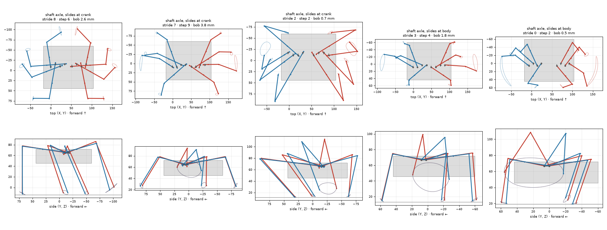

*Fig. 1 · The five searches with the new rule. To avoid the cranks, the search shrinks the stride to almost
nothing, and still fails.*

| Slides at | Seed | Stride (mm) | Bob (mm) | Gap between legs (mm, need 6) | Arm to crankshaft (mm, need 1) |
|---|---|---|---|---|---|
| crank | 2 | 8 | 2.6 | 2.1 | −7.3 |
| crank | 1 | 7 | 3.8 | 2.4 | −4.0 |
| crank | 3 | 2 | 0.7 | 1.7 | −3.9 |
| body | 1 | 3 | 1.8 | 2.1 | −4.2 |
| body | 2 | 0 | 0.5 | 4.6 | −1.8 |

A negative distance means the arm goes through the crank.

- **No layout passes.** Every one still has arms cutting through cranks and legs too close, and the stride drops to
  0–8 mm.
- **The cause is the layout itself.** 8 legs come in from the rim to one line across the body, so the outer cranks
  are always in the way of the inner legs' arms.

#### Decisions

One crankshaft for all 8 legs is ruled out. The drive has to be designed again, and simulated before any CAD.

### Two side crankshafts

**Phase 3 · Mechanisms · 2026-11-09** · Status: ❌ ruled out

> **In short.** To keep arms away from other legs' cranks, we tried two crankshafts running **front to back**, one
> per side, each crank level with its own leg. The parts fit, with room to spare, but the robot barely walks
> (1–2 mm per half turn): a crank turning on a front-to-back axis moves the foot sideways, not forward. The crank must
> turn on an axis **across** the body.

#### Steps

1. Add a **sides** mode to [`sim/toy_leg_3d.py`](sim/toy_leg_3d.py): one front-to-back shaft per side, each leg's
   crank on it level with its notch. The two shafts turn opposite ways (a gear pair, with the motor between them),
   so the left side mirrors the right.
2. Same strict rules as the previous entry, including the arm-to-crankshaft check. 5 searches.

<details>
<summary>How to reproduce</summary>

Shaft XS mm from the body axis at z = 72 + H; each crank shifted DY mm along the shaft. Ranges: r 3–12, XS 10–50,
H −22 to 0, DY ±10 mm, leg as before. 5 searches in parallel, about 15 minutes.

```
python3 sim/toy_leg_3d.py --strict --search 3000 --seed 1 --only sides/crank --json crank-1.json
python3 sim/toy_leg_3d.py --params sim/toy_leg_3d_sides.json --png sim/images/toy-3d-sides.png --gif sim/images/toy-3d-sides.gif
```

The best three: [`sim/toy_leg_3d_sides.json`](sim/toy_leg_3d_sides.json).

</details>

#### Result

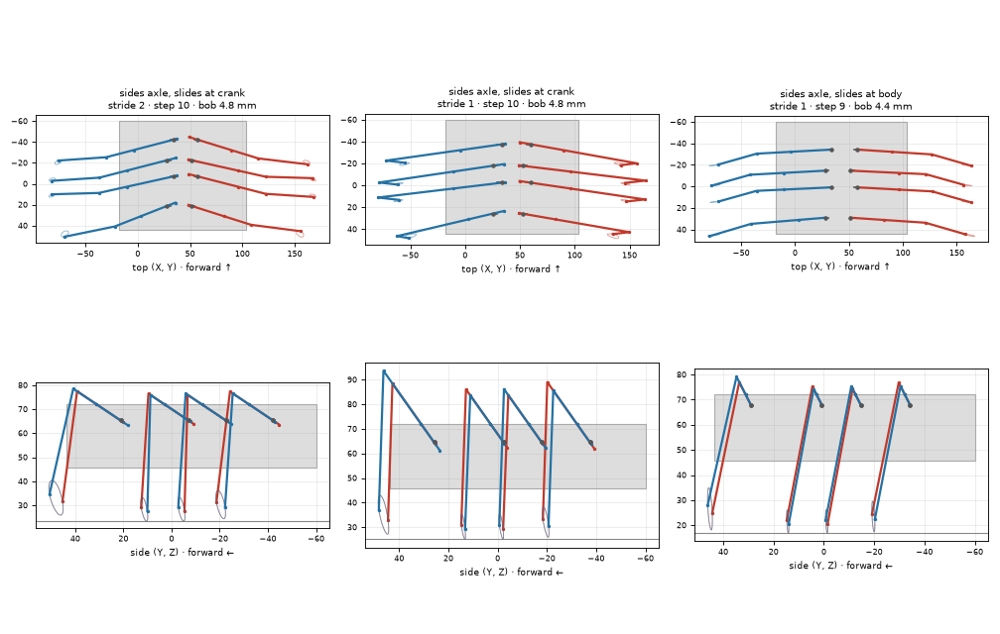

*Fig. 1 · Two side crankshafts. In the side view the foot loops are thin vertical lines: the feet go up and down
but hardly move forward.*

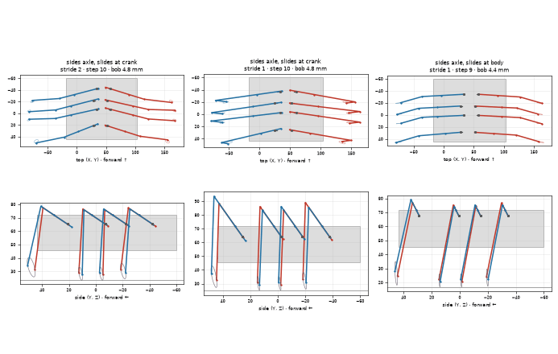

*Fig. 2 · The same, walking: the legs move in and out instead of forward.*

| Slides at | Seed | Stride (mm) | Bob (mm) | Gap between legs (mm, need 6) | Arm to crankshaft (mm, need 1) |
|---|---|---|---|---|---|
| crank | 2 | 2 | 4.8 | 13.0 | 9.2 |
| crank | 3 | 2 | 4.6 | 13.1 | 6.4 |
| crank | 1 | 1 | 4.8 | 13.2 | 11.1 |
| body | 1 | 1 | 4.4 | 14.8 | 13.1 |
| body | 2 | 1 | 4.2 | 14.1 | 9.5 |

<details>
<summary>All the numbers</summary>

| Slides at | Seed | Step height (mm) | Pivot swing yaw / pitch |
|---|---|---|---|
| crank | 2 | 10 | 2° / 8° |
| crank | 3 | 10 | 2° / 8° |
| crank | 1 | 10 | 2° / 11° |
| body | 1 | 9 | 0° / 8° |
| body | 2 | 9 | 1° / 8° |

</details>

- **The parts fit:** 13–15 mm between legs and 6–13 mm of free space to the cranks, the first layout to pass both.
- **The robot barely walks.** A crank on a front-to-back shaft moves the leg's inner end in and out and up and down,
  so the leg hardly swings forward. Forward stride needs the crank pin to move forward and back, so the crank has to
  turn on an axis across the body, as in [Toy leg in 3D](#toy-leg-in-3d).
- Bob is 4.2–4.8 mm, also above the 3 mm target.

#### Decisions

Ruled out for this leg: the parts fit, but the feet move sideways. The cranks must turn on an axis across the body
without lining all 8 up on one shaft.

### Four lateral crankshafts

**Phase 3 · Mechanisms · 2026-11-09** · Status: ✅ chosen

> **In short.** The cranks turn across the body again, but now on **four short shafts, one per pair of legs**, so
> each arm only reaches its own shaft. Gears between the shafts make them turn together. It is the first layout that
> fits and walks forward, but the stride is short: 9 mm per half turn, because a longer stride makes the body bob
> more than the 3 mm allowed. We chose it, keeping the 3 mm limit.

#### Steps

1. Add a **rows** mode to [`sim/toy_leg_3d.py`](sim/toy_leg_3d.py): 4 shafts across the body, each level with its
   pair of notches. The left and right cranks of a shaft are half a turn apart (the two gait groups). Idler gears
   between neighbouring shafts make all four turn the same way (about 7 gears in a row, the motor on one of them;
   not simulated).
2. Same strict rules, with the arm-to-crankshaft check per shaft. 5 searches.
3. Take the best geometry and change the crank size, its height and its distance from the body axis by hand, to see
   which target holds the stride back.

<details>
<summary>How to reproduce</summary>

Each shaft shifted DY mm front or back of its notches, at z = 72 + H; cranks XC mm either side of the body axis.
Ranges: r 3–12, XC 6–45, H −22 to 0, DY ±10 mm, leg as before. 5 searches in parallel, about 15 minutes.

```
python3 sim/toy_leg_3d.py --strict --search 3000 --seed 1 --only rows/crank --json crank-1.json
python3 sim/toy_leg_3d.py --params sim/toy_leg_3d_rows.json --png sim/images/toy-3d-rows.png --gif sim/images/toy-3d-rows.gif
```

The best three: [`sim/toy_leg_3d_rows.json`](sim/toy_leg_3d_rows.json).

</details>

#### Result

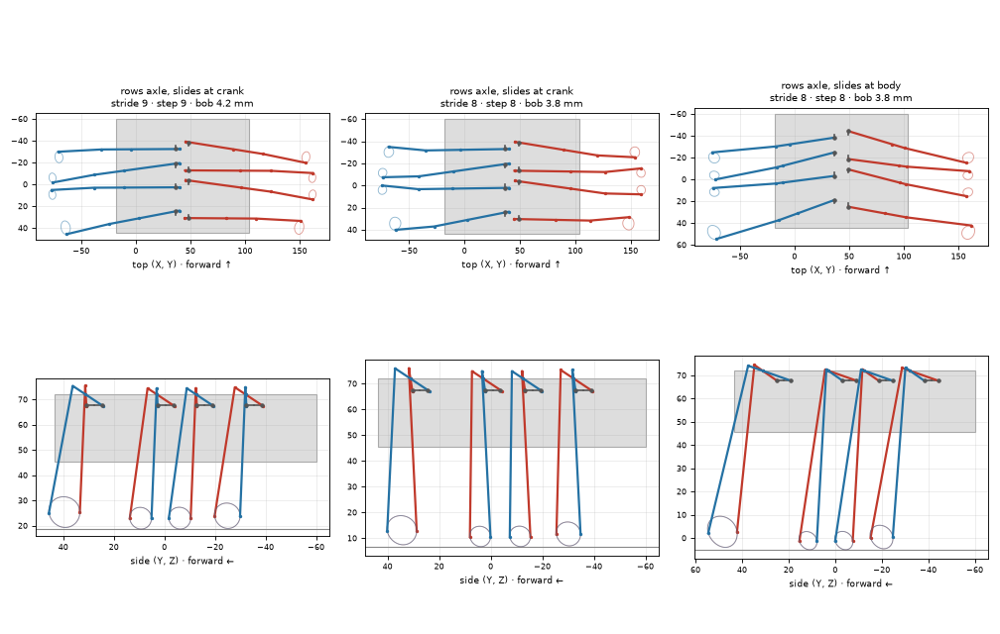

*Fig. 1 · Four lateral crankshafts. In the side view the foot loops lie along the ground: the feet move forward.
The cranks (short stubs near the body axis in the top view) stay clear of the other legs.*

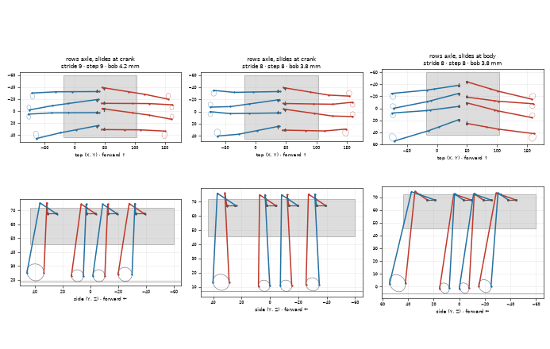

*Fig. 2 · The same, walking.*

| Slides at | Seed | Stride (mm) | Bob (mm) | Gap between legs (mm, need 6) | Arm to crankshaft (mm, need 1) |
|---|---|---|---|---|---|
| **crank** | **2** | **9** | **4.2** | **6.9** | **4.3** |
| crank | 1 | 8 | 3.8 | 7.5 | 4.6 |
| crank | 3 | 8 | 3.8 | 6.8 | 4.6 |
| body | 1 | 8 | 3.9 | 7.7 | 4.7 |
| body | 2 | 8 | 3.8 | 7.8 | 4.5 |

- **The parts fit and the feet loop forward**, the first layout to pass every check, with the cranks inside the base.
- **Stride is only 8–9 mm per half turn.** Every search ends at the smallest crank (3 mm) with the cranks next to
  the body axis.
- **The bob limit holds it back.** Changing the geometry by hand (table below), body bob grows with stride, about
  0.45 mm per mm. A bigger crank also brings the shins closer together and raises the cranks into the battery holder.

| Crank radius (mm) | Height H (mm) | Distance from axis XC (mm) | Stride (mm) | Bob (mm) | Gap between legs (mm) |
|---|---|---|---|---|---|
| 3.1 | −4.3 | 6 | 9 | 4.2 | 6.9 |
| 5 | −8 | 6 | 15 | 6.9 | 1.7 |
| 5 | −8 | 15 | 18 | 8.6 | 0.5 |
| 5 | −8 | 25 | 25 | 11.6 | 2.2 |
| 8 | −10 | 6 | 24 | 11.0 | 0.7 |

#### Decisions

**Four lateral crankshafts, leg sliding at the crank, keeping the 3 mm bob limit:** the best geometry above (the
first entry in [`sim/toy_leg_3d_rows.json`](sim/toy_leg_3d_rows.json)). The three options compared:

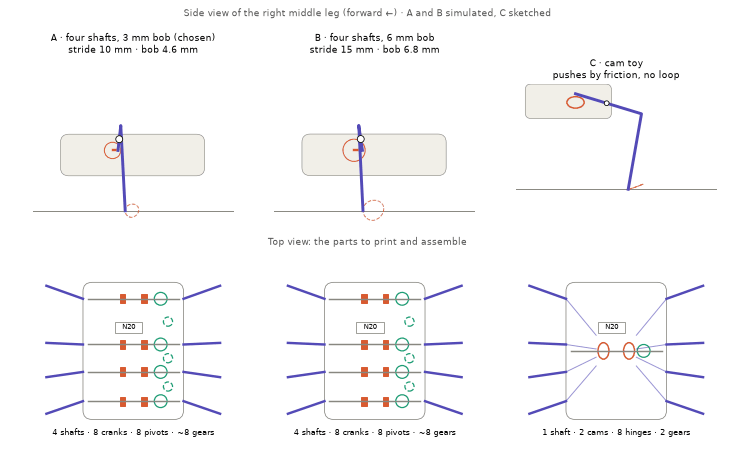

*Fig. 3 · Side view of one leg for each option, with the parts each needs. A and B are simulated; C is a sketch
([`tools/drive_options_gif.py`](tools/drive_options_gif.py)).*

| | A · Four shafts, 3 mm bob (chosen) | B · Four shafts, 6 mm bob | C · Cam toy |
|---|---|---|---|
| Walk | Short, smooth steps, slow | Steps almost twice as long; the body rocks visibly | Feet scrape; works on carpet, may slip on smooth floors |
| Like the original | Yes (the feet step) | Yes | Less (walks like a wind-up toy) |
| Parts | ~45: 8 legs, 4 shafts with 8 cranks, 8 pivots, ~8 gears | Same | ~15: 8 legs, 1 shaft, 2 cams, 2 gears |
| Printing | Small, precise parts | Same | Thick, tolerant parts |
| Fragile | Medium-high: a 3 mm PLA pin can snap; one jammed leg stops all | A bit more | Low |
| N20 motor | Plenty of torque | About 1.7 × the torque | Plenty of torque |

The **cam toy** (one shaft across the body, cams lift hinged legs, the feet push by leaning back) stays as a
fallback. The simulator cannot represent it (its feet slide), so it would be tested by printing a pair of legs.

### Legs and drive in CAD

**Phase 3 · Mechanisms · 2026-11-10** · Status: ✅ done

> **In short.** The legs and the four-crankshaft drive were modelled in Python code (build123d), with sizes taken
> from the simulator. The chosen geometry first had to be adjusted so a gear fits between each shaft's two cranks.
> A script then moved every part through a full crank turn and fixed each collision it found. The result: 25 printed
> parts with no collisions, exported for Onshape (STEP) and for printing (STL), plus a test frame for one leg.

#### Steps

1. **Install build123d** in a Python virtual environment at the repo root (Python 3.12: 3.14 has no CAD packages
   yet).
2. **Make the geometry buildable.** In the chosen geometry a shaft's two cranks were 12 mm apart, with no room for a
   gear and two bearing walls between them. The shafts were also so high that a gear could only be 4 mm in radius
   under the battery holder. A new search with these limits gives 10 mm per half turn and 4.6 mm of bob (Fig. 1).
3. **Model the parts** in [`cad/drive/build.py`](cad/drive/build.py): the leg (3 lengths × 2 sides), the pivot fork,
   one-piece crankshafts (gear, journals, cranks and balls), idler gears, the spine that holds them, and a test
   frame. The gears are standard involute gears, module 1.
4. **Check collisions** with [`cad/drive/check.py`](cad/drive/check.py): it places every part as the simulator
   moves it, every 30°, and measures how much each pair overlaps. Fix and repeat (table below).
5. **Make the STLs watertight.** The CAD kernel leaves a hairline gap where a sphere meets a box; `build.py` closes
   it. Bambu Studio: `manifold = yes` for all 17 files.

<details>
<summary>How to reproduce</summary>

```
uv venv --python python3.12 .venv
uv pip install --python .venv/bin/python build123d numpy scipy matplotlib pillow trimesh shapely networkx manifold3d rtree
python3 sim/toy_leg_3d.py --strict --search 3000 --seed 2 --only rows/crank --json crank-2.json
```

Limits added to the `rows` search: cranks at least 12 mm from the body axis (XC ≥ 12) and shafts at least 8 mm
below the pivots (H ≤ −8). 4 seeds; seed 2 (legs 5.9 mm apart, 30 mm under the base) is in
[`sim/toy_leg_3d_rows_cad.json`](sim/toy_leg_3d_rows_cad.json). Parts and how they fit:
[cad/drive/](cad/drive/).

</details>

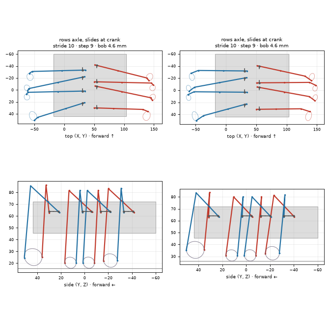

*Fig. 1 · The geometry used for the CAD, with room for the gears.*

What the collision check found, in order:

| Found | Fix |
|---|---|
| Ball not where the simulator puts it | Crankshaft turned the wrong way in the assembly (a placement bug) |
| Leg tube hitting the fork | The leg tilts up 6–23°: fork window sized for 28°, tube ends 8 mm before the pivot |
| Test frame upright in the leg's path | Upright moved beside the leg |
| Middle legs' tubes touching near the cranks | Smaller ball (Ø3.6), tube with flat sides 5.6 mm wide |
| Rear tube mouth on its crank; gear teeth on the spine's end blocks | Mouth 0.4 mm closer to the ball; end blocks 2 mm further out |
| Middle legs' feet and shins touching | Shin and foot 4.5 mm wide (legs 5 mm) |

#### Result

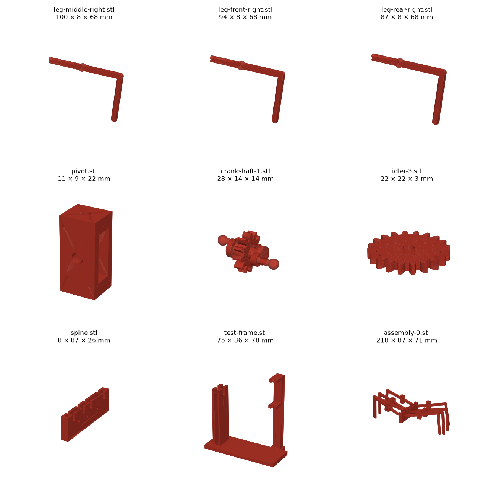

*Fig. 2 · The drive parts: three leg lengths, the pivot fork, a crankshaft, an idler gear, the spine, the test
frame, and the whole robot assembled.*


*Fig. 3 · All eight legs turning over a full crank turn, with no collisions.*

- **No collisions over a full turn.** The closest pairs are the designed clearances (0.1 mm a side for the balls
  and journals, 0.2 mm for the legs in their forks). The closest parts not meant to touch are the middle legs' shins
  (0.7 mm apart) and a rear leg against its crank (0.6 mm).
- **25 printed parts** (8 legs, 8 forks, 4 crankshafts, 3 idlers, spine), plus 8 × M3×12 screws with nuts,
  16 × M3×6 and 3 × 3 mm pins.
- The clearances are a guess (+0.2 mm on the diameter) until a clearance test is printed.

#### Decisions

- **One-piece printed crankshafts** (no steel shaft): the angle between the cranks is printed in, so it cannot slip.
- **Swivel axes are M3 screws:** the leg turns on one, and the fork turns on two driven into it.
- The CAD uses the search with buildable limits (10 mm stride, 4.6 mm bob) instead of the unbuildable geometry
  chosen in [Four lateral crankshafts](#four-lateral-crankshafts) (9 mm, 4.2 mm).

### Onshape assembly

**Phase 2 · CAD · 2026-11-10** · Status: ✅ done

> **In short.** One leg on its test frame was assembled in Onshape from the exported STEP files, with joints
> («mates») that let it move as the real one will, and animated through a full turn. It moves as expected. A
> step-by-step tutorial with pictures is in [cad/drive/onshape.md](cad/drive/onshape.md).

#### Steps

Full tutorial, with a picture of the edges to click for each mate: [cad/drive/onshape.md](cad/drive/onshape.md)
(pictures made by [`cad/drive/onshape_figures.py`](cad/drive/onshape_figures.py)). In short:

1. Import `test-frame`, `crankshaft-2`, `leg-middle-right` and `pivot` (STEP) into one document. Insert the test
   frame at the origin and **Fix** it, so the assembly uses the robot's coordinates.
2. Make a helper part, the slider (a Ø3 × 4 mm cylinder). Onshape has no mate for a ball that slides in a tube and
   tilts, so it is built in two steps: crankshaft → **Ball** → slider → **Slider** → leg.
3. Add five mates: three **Revolute** (crankshaft in the frame, fork in the frame, leg in the fork, offset by the
   designed clearances), **Ball** and **Slider**.
4. **Animate** the crankshaft's revolute, 0–360°.

Document (public): [Spider-Bot drive](https://cad.onshape.com/documents/07632681db3e0a6b5b785746/w/6c5d5bb7bfec5781a6827599/e/c59459f0a1ed69675318d6bb).

#### Result

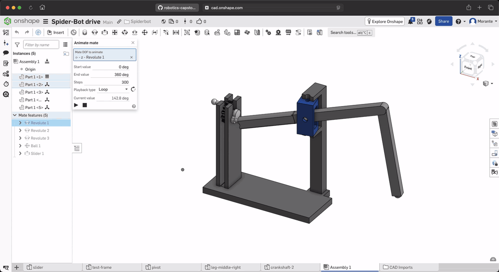

*Fig. 1 · The assembly animated in Onshape: turning the crankshaft moves the fork, the leg and the ball together.*

- The leg has a single degree of freedom, and the animation runs through the full turn.
- The mate offsets had to be negative: with positive ones the parts went into the walls. An offset is measured along
  the mate connector's Z axis, whose direction depends on the face clicked.
- The foot path was not compared with the simulator's; to be checked on the printed leg.

### Clearance test and test leg print plate

**Phase 2 · CAD · 2026-11-10** · Status: ✅ printed

> **In short.** Before printing the 25 drive parts, one print plate holds everything needed to turn one leg by
> hand, plus a block that tests how much bigger the holes must be on this printer. The leg had to be reshaped
> slightly so it lies flat on the bed. The plate takes 1 h 28 min and 29.6 g of PLA.

#### Steps

1. **Clearance test** ([`cad/clearance-test/`](cad/clearance-test/), `build.py`): a block with sideways holes for
   the journal (Ø4.0), the ball (Ø3.6) and an M3 screw (Ø3.0), each 0.1, 0.2, 0.3 and 0.4 mm larger. It also has
   3 holes for M3 screws to cut their own thread (Ø2.3 / 2.5 / 2.7), and a pin with a Ø4.0 journal and a Ø3.6 ball,
   printed lying down like a crankshaft (Fig. 1).
2. **Lay the leg flat.** Turned on its side for printing, only the tube touched the bed: the tube is 5.6 mm wide and
   the rest of the leg 5.0 mm, so the arm hung 0.3 mm in the air, too little for supports.
   - Making the whole leg 5.6 mm wide brought the middle legs' knees to 0.09–0.21 mm from each other.
   - Instead, the leg stays 5.0 mm wide, and the arm, boss and knee move 0.3 mm (the shin 0.55 mm) towards the
     face on the bed, flush with the tube. The fork's window moves with it. The leg now touches the bed over
     567 mm² instead of 190 mm².
3. **Plate** ([`tools/bambu_plate.py`](tools/bambu_plate.py)): orient the parts, then let Bambu Studio arrange and
   slice them with its standard settings (P2S 0.4 mm nozzle, 0.20 mm Standard, PLA Basic, Textured PEI plate).
   Supports are tree supports on the build plate only, so none go into the holes or the leg's bore. Then open it in
   Bambu Studio, check the support settings, slice and save. Details: [print/README.md](print/README.md).

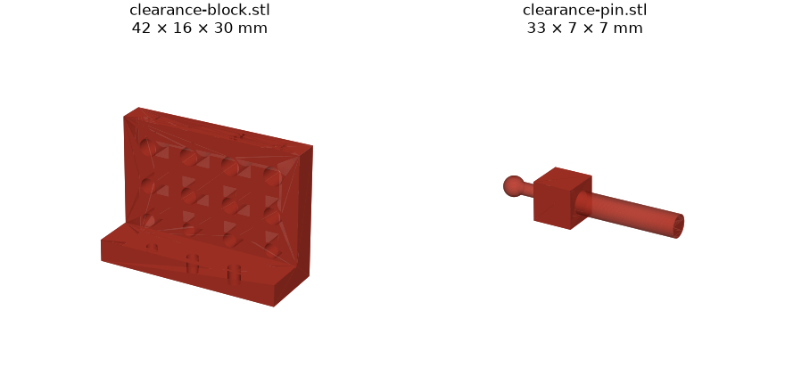

*Fig. 1 · The clearance block and its test pin.*

#### Result

<table>
<tr>
<td width="50%">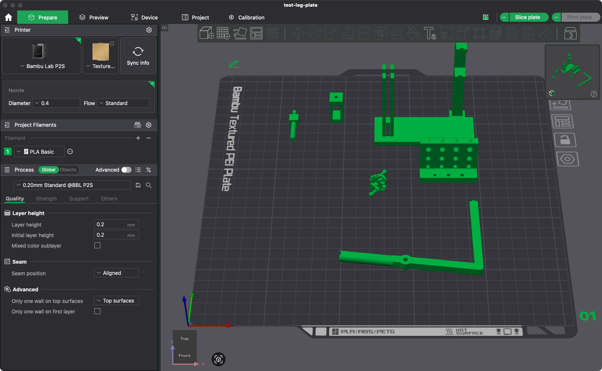</td>
<td width="50%">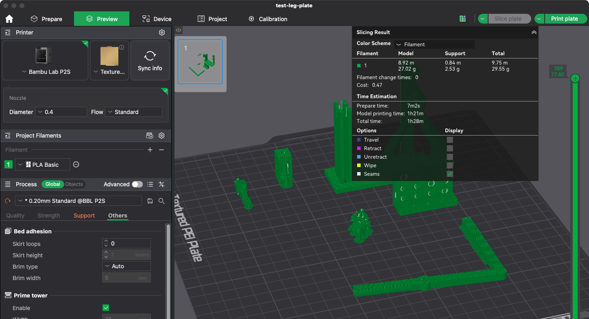</td>
</tr>
<tr>
<td><em>Fig. 2 · The plate in Bambu Studio: test frame, leg, fork, crankshaft, clearance block and pin.</em></td>
<td><em>Fig. 3 · Sliced, with the tree supports.</em></td>
</tr>
</table>

- [`print/test-leg-plate.3mf`](print/test-leg-plate.3mf): 1 h 28 min, 29.6 g of PLA (2.5 g of it support).
- Bambu Studio warns about 2 areas of the leg it cannot support. Both are the top of the 3.8 mm bore and its flared
  mouth inside the tube (9.8 mm²). They print as bridges.
- The collision check of the whole robot with the reshaped leg finds no collisions over a full turn.
- Bambu Studio dropped the support settings when the project was opened in the app. The tool now saves them as
  changed settings in the .3mf; not yet confirmed in the app.

#### Decisions

- One plate for the test only. The rest of the drive waits for the clearance result and for the base.
- The plate actually printed is the first version, with the leg 5.6 mm wide. For one leg on the test frame both
  versions behave the same, so the reshaped one is not printed separately.

### Test leg: first assembly and clearance result

**Phase 3 · Mechanisms · 2026-11-11** · Status: 🔄 second version designed, not printed yet

> **In short.** Before printing all 25 drive parts, we printed just one leg with its own small stand to turn it by
> hand, and a block to measure how loose holes have to be on this printer. The leg could not be turned yet: the stand
> did not hold the fork in place, and the holes were too tight. The block showed the clearance needed (0.5 mm instead
> of 0.2 mm). The CAD now uses it, and the stand is redesigned with screws and nuts that hold every part.

**What is being tested.** The robot's leg is a single bent part. Its inner end slides over a ball on a crank, and
halfway along it passes through a **fork** (a small swivelling block) on the body's edge. When the crank turns, the
foot traces a loop. The **test frame** holds one crankshaft and one fork exactly where the robot's base will, so one
leg can be tried before the base exists. The **clearance block** has holes of the same sizes as the real ones,
each 0.1–0.4 mm larger, to find out which one turns freely.

#### Steps

1. Print [`print/test-leg-plate.3mf`](print/test-leg-plate.3mf). This was the first version, with the leg 5.6 mm wide.
2. Remove the supports, which are on the crankshaft and on one side of the leg (Fig. 2–3).
3. Assemble following the [diagram](cad/drive/README.md): the leg in the fork on an M3×16 and a nut, the fork between
   the frame's two arms, and the crankshaft in its slots with the ball inside the leg's tube (Fig. 4).
4. Push the clearance pin into each hole of the block and note how it turns (Fig. 6).

<table>
<tr>
<td width="50%">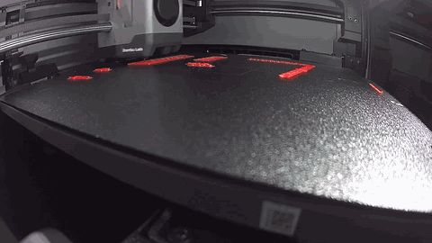</td>
<td width="50%">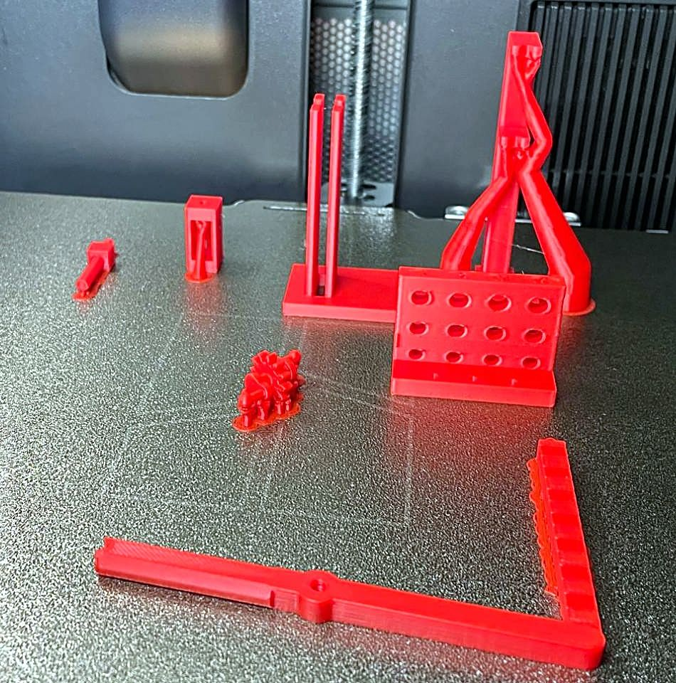</td>
</tr>
<tr>
<td><em>Fig. 1 · Printing <a href="print/test-leg-plate.3mf"><code>print/test-leg-plate.3mf</code></a> (1 h 28 min,
29.6 g of PLA).</em></td>
<td><em>Fig. 2 · On the bed: clearance pin, fork, frame, clearance block, crankshaft (in its tree support) and the
leg lying flat.</em></td>
</tr>
<tr>
<td width="50%">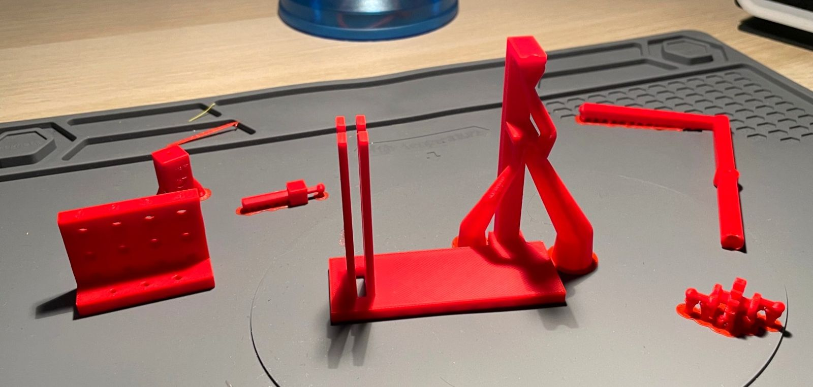</td>
<td width="50%">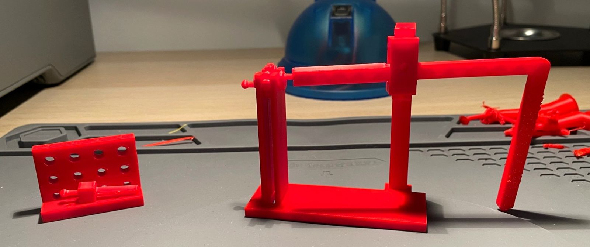</td>
</tr>
<tr>
<td><em>Fig. 3 · Off the bed, supports still on. On the frame, the two thin walls hold the crankshaft and the tall
post on the right holds the fork between its arms.</em></td>
<td><em>Fig. 4 · First assembly: the crankshaft (left) with its ball in the leg's tube, the fork on the right post.
On the left, the clearance pin in its block.</em></td>
</tr>
<tr>
<td width="50%">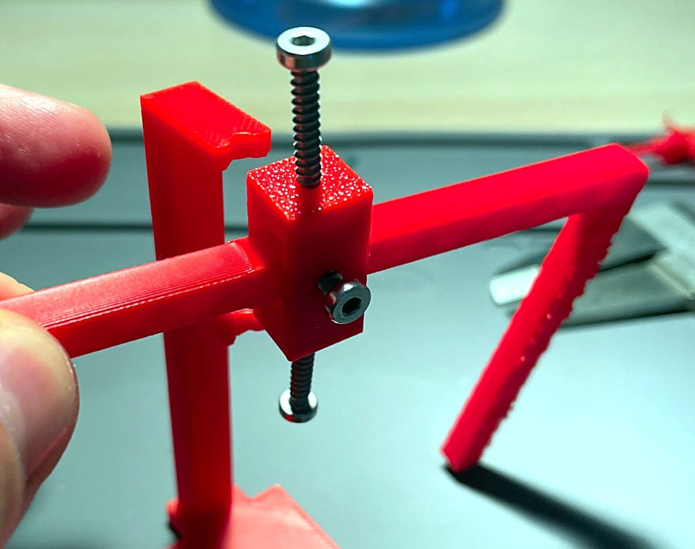</td>
<td width="50%">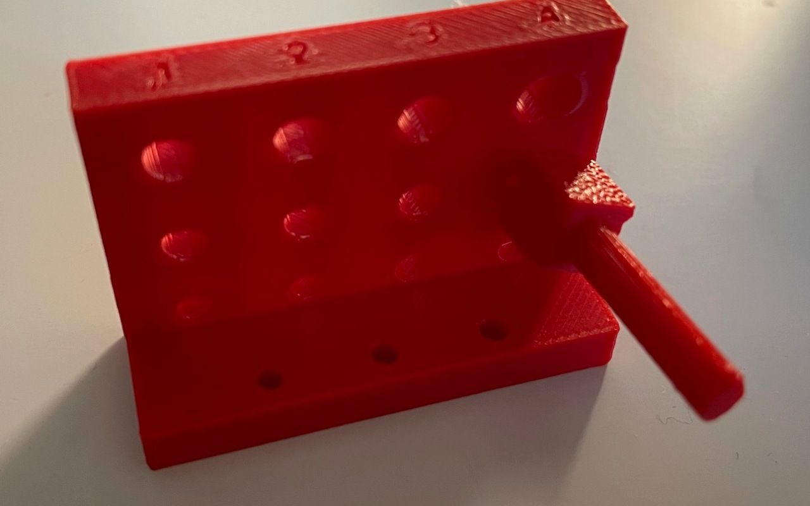</td>
</tr>
<tr>
<td><em>Fig. 5 · The fork has to be held by hand. The frame's upper arm (top left) ends in a half-open «C», so the
screw slides out. The screws in the fork are M2: M3 would not go in.</em></td>
<td><em>Fig. 6 · The clearance block. Columns 1–4 add +0.1 / +0.2 / +0.3 / +0.4 mm to the diameter. Rows, top to
bottom: crankshaft journal (Ø4.0), ball (Ø3.6), M3 screw (Ø3.0). The pin is in the +0.4 journal hole.</em></td>
</tr>
</table>

#### Result

| What | Expected | What happened | Why |
|---|---|---|---|
| Fork in the frame | Swivels on two screws, held by the frame's arms | Falls out; held by hand (Fig. 5) | The arms ended at the centre of their screw holes, leaving a half-open «C» |
| Screws into the fork (Ø2.5 holes) | M3 cuts its own thread | M3 would not go in; M2 used, loose | The hole is too small for M3 in PLA |
| Leg on the fork (M3×16) | Turns | Goes in fine | — |
| Crankshaft and ball | Turn freely with 0.2 mm of clearance | Too tight (see the block, Fig. 6) | 0.2 mm is too little for a printed part in a printed hole |

| Hole | +0.1 | +0.2 | +0.3 | +0.4 |
|---|---|---|---|---|
| Journal Ø4.0 (printed pin) | ✗ | ✗ | ✗ | goes in, turns in jerks |
| Ball Ø3.6 (printed pin) | ✗ | ✗ | ✗ | goes in, turns with difficulty |
| M3 screw (steel) | grips tight | threads easily | wobbles a little | — |

The clearance block, as tested by Morante (Fig. 6). ✗ = does not go in.

**Conclusion:** a printed part needs much more room in a printed hole than a steel screw does. The single 0.2 mm
used for every hole was far too tight for the printed ones.

#### Decisions and fixes

All of these are changes to [`cad/drive/build.py`](cad/drive/build.py):

- **Two clearances instead of one.** `CLR` = 0.5 mm for a printed part in a printed hole (journals, ball in the
  bore) and `CLR_STEEL` = 0.3 mm for a steel screw or pin in a printed hole. 0.5 is one step past the block's
  last hole, because +0.4 only turned roughly. The reprint will show whether it is enough.
- **Frame arms closed.** They now reach 5 mm past their holes.
- **Fork on screw tips, not self-tapped.** It now turns on the tips of two M3×10 screws, each locked to a frame arm
  by a nut, entering Ø3.3 blind holes in the fork. The arms moved 2.4 mm apart to make room for the nuts.
- **Keeper for the crankshaft.** It only sat in slots open at the top, so a knock or the leg's push lifted it out.
  A **keeper** (green in Fig. 7) now closes the slots from above and is held by two M3×12 into nuts.
- **Nylon lock nut** on the leg's M3×16, so the knocks do not loosen it.


*Fig. 7 · The redesigned test frame, exploded. Grey: frame. Orange: fork. Red: leg. Blue: crankshaft. Green: the
new keeper. Made by [`cad/drive/screws_figure.py`](cad/drive/screws_figure.py).*

<details>
<summary>Collision check of the new parts</summary>

`check.py` (which now includes the keeper), over a full turn: no overlaps. The shaft has 0.25 mm a side in the frame
and the keeper, and the keeper rests on the walls. The right rear leg comes to 0.15 mm from its crankshaft, less
than the bore's 0.25 mm a side: to look into before printing the rear legs.

</details>

#### Next

Also listed in [Open items](#open-items).

- Print [`print/test-frame-v2.3mf`](print/test-frame-v2.3mf): frame, keeper, fork and leg (1 h 18 min, 25.6 g). The
  crankshaft from the first print is kept.
- Hardware: 2 × M3×10 + 2 nuts for the fork, 2 × M3×12 + 2 nuts for the keeper, and a nylon lock nut for the leg.
- **Morante:** a video of the leg turning by hand on the new frame.

## Open items

Everything still to do on the build, in one place. Each row links to the entry where it came up; when an item is
done, its row is removed and the entry that closes it says so. Plan-level tasks (study, purchases) are tracked
outside the repo.

| Pending | Came up in | Phase |
|---|---|---|
| Print the test frame v2 and film the leg turning by hand | [Test leg: first assembly…](#test-leg-first-assembly-and-clearance-result) | 3 |
| Check the right rear leg, 0.15 mm from its crankshaft, before printing the rear legs | [Test leg: first assembly…](#test-leg-first-assembly-and-clearance-result) | 3 |
| Compare the printed leg's foot path with the simulator's | [Onshape assembly](#onshape-assembly) | 3 |
| Check that the rim notches (10 × 5 mm) let the leg swing as far as simulated, or widen them | [Toy leg in 3D](#toy-leg-in-3d) | 3 |
| Base: fork seats in the rim notches, hollow bowl for the spine and idlers, spine mounting, cap over the journal slots | [Legs and drive in CAD](#legs-and-drive-in-cad) | 3 |
| Carcass cuts: battery hatch in the base, motor and shaft openings | [Mesh repair](#mesh-repair) | 2 |
| Confirm that Bambu Studio keeps the support settings saved by `tools/bambu_plate.py` | [Clearance test…](#clearance-test-and-test-leg-print-plate) | 2 |
| Check the drawing of the battery holder bought against 64 × 49 × 16 mm (+2 mm) | [Motor, battery holder…](#motor-battery-holder-and-print-scale) | 4 |
| N20 drive: gear ratio and motor position | [Legs and drive in CAD](#legs-and-drive-in-cad) | 4 |
| Measure battery life on 4×AAA | [Motor, battery holder…](#motor-battery-holder-and-print-scale) | 4 |
| Optional: the gear train in Onshape with **Gear relation** mates | [Onshape assembly](#onshape-assembly) | 2 |

## Glossary

Terms used in the entries, in the order they first appear, with a link to that entry.

| Term | Meaning | First in |
|---|---|---|
| **STL / STEP** | 3D file formats: STL is a triangle mesh (for printing), STEP is exact geometry (for CAD). | [Carcass base model](#carcass-base-model) |
| **Bambu Studio** | The printer's slicer: it turns a 3D model into printer instructions. | [Carcass base model](#carcass-base-model) |
| **Clearance** | Free space left around a part: how much bigger a hole or a space is than the part in it. | [Motor, battery holder…](#motor-battery-holder-and-print-scale) |
| **Watertight (manifold)** | A mesh with no holes or loose edges, which slicers and CAD tools need. | [Mesh repair](#mesh-repair) |
| **Crank** | An arm fixed to a turning shaft; its far end goes round in a circle. | [Leg simulator…](#leg-simulator-and-comparison) |
| **Crank pin** | The pin (here a small ball) at the end of the crank, where the leg is attached. | [Leg simulator…](#leg-simulator-and-comparison) |
| **Stride** | How far the robot moves forward per half turn of the crank. | [Leg simulator…](#leg-simulator-and-comparison) |
| **Bob** | How much the body goes up and down while walking. | [Leg simulator…](#leg-simulator-and-comparison) |
| **Step height** | How high a foot lifts off the ground. | [Leg simulator…](#leg-simulator-and-comparison) |
| **Gait groups** | The legs move in two groups of four (left 1 and 3 + right 2 and 4, and the other four), half a turn apart. | [Leg simulator…](#leg-simulator-and-comparison) |
| **Crankshaft** | One shaft with one or more cranks on it, so one motor turns them all. | [Toy leg on one crankshaft](#toy-leg-on-one-crankshaft) |
| **Idler** | A gear between two others, so they turn the same way. | [Four lateral crankshafts](#four-lateral-crankshafts) |
| **build123d** | A Python library for CAD: parts are written as code. | [Legs and drive in CAD](#legs-and-drive-in-cad) |
| **Journal** | The round part of a shaft that turns inside a hole (its bearing). | [Legs and drive in CAD](#legs-and-drive-in-cad) |
| **Fork (pivot)** | The small block on the body's edge that the leg passes through. It swivels, and the leg tilts in it. | [Legs and drive in CAD](#legs-and-drive-in-cad) |
| **Onshape** | CAD in the browser, used to assemble the parts and animate them. | [Onshape assembly](#onshape-assembly) |
| **Keeper** | A cover that holds the crankshaft down in its slots. | [Test leg…](#test-leg-first-assembly-and-clearance-result) |
