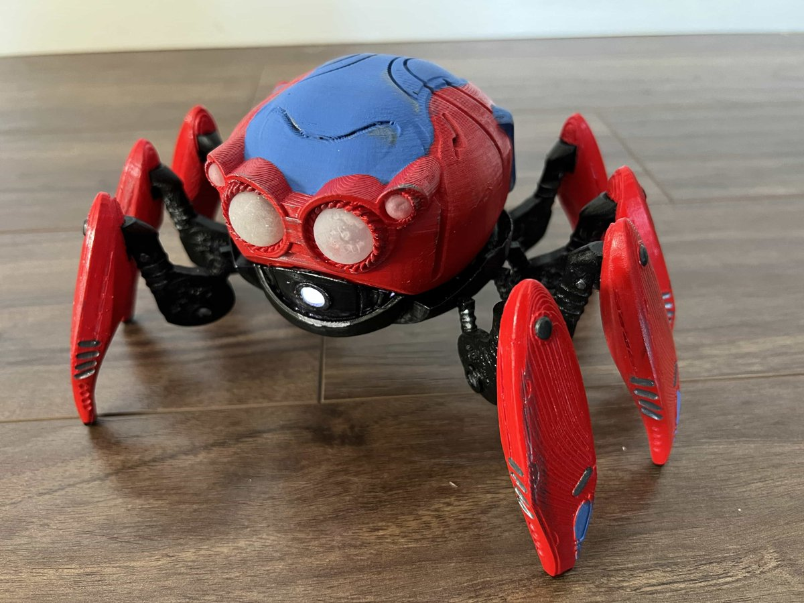
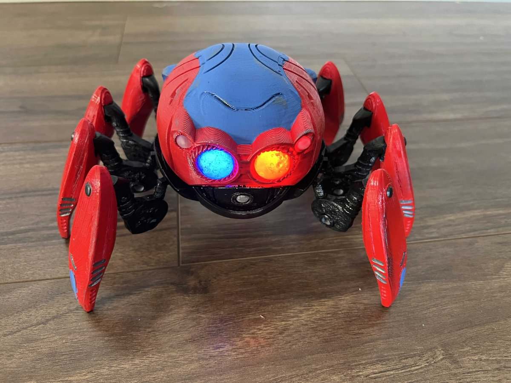

# Spider-Bot · Build log

The story of the build, step by step, written so that anyone can follow it and repeat it. Every entry opens with a
short **In short** box; read only those boxes and you have the whole story. Below each box come the steps, the
results with their figures, and the decisions taken. Commands and full data tables are folded under
**How to reproduce**. Entries are grouped by topic, oldest first; what is left to do and a glossary are at the
end.

<table>
<tr>
<td width="50%"></td>
<td width="50%"></td>
</tr>
<tr>
<td colspan="2"><em>The goal. <a href="https://www.thingiverse.com/thing:5196618">Spidey-Bot by jenscolt</a>, the static
display model this replica starts from (photos: jenscolt, CC BY-NC-SA). Ours keeps its look, and adds legs that
walk, driven by one motor, and lit eyes.</em></td>
</tr>
</table>

## Contents

The robot's story in three parts, then what is left to do and a glossary.

1. **[Workshop](build-log/1-workshop.md#workshop)**: getting the printer ready.
   - [Printer calibration](build-log/1-workshop.md#printer-calibration) · 2026-10 · ✅ done
   - [First print: purge waste bin](build-log/1-workshop.md#first-print-purge-waste-bin) · 2026-11-09 · ✅ done
2. **[Carcass](build-log/2-carcass.md#carcass)**: the robot's outer shell, and what has to fit inside it.
   - [Carcass base model](build-log/2-carcass.md#carcass-base-model) · 2026-11-08 · ✅ done
   - [Motor, battery holder and print scale](build-log/2-carcass.md#motor-battery-holder-and-print-scale) · 2026-11-09 · ✅ 120 %
   - [Mesh repair](build-log/2-carcass.md#mesh-repair) · 2026-11-09 · ✅ done
3. **[Legs and drive](build-log/3-legs-and-drive.md#legs-and-drive)**: how one motor moves eight legs.
   - [Leg simulator and comparison](build-log/3-legs-and-drive.md#leg-simulator-and-comparison) · 2026-11-09 · ✅ toy leg chosen
   - [Toy leg in 3D](build-log/3-legs-and-drive.md#toy-leg-in-3d) · 2026-11-09 · ✅ lateral axle
   - [Toy leg on one crankshaft](build-log/3-legs-and-drive.md#toy-leg-on-one-crankshaft) · 2026-11-09 · ↩️ reversed
   - [Crankshaft against real parts](build-log/3-legs-and-drive.md#crankshaft-against-real-parts) · 2026-11-09 · ❌ one crankshaft ruled out
   - [Two side crankshafts](build-log/3-legs-and-drive.md#two-side-crankshafts) · 2026-11-09 · ❌ ruled out
   - [Four lateral crankshafts](build-log/3-legs-and-drive.md#four-lateral-crankshafts) · 2026-11-09 · ✅ chosen
   - [Legs and drive in CAD](build-log/3-legs-and-drive.md#legs-and-drive-in-cad) · 2026-11-10 · ✅ done
   - [Onshape assembly](build-log/3-legs-and-drive.md#onshape-assembly) · 2026-11-10 · ✅ done
   - [Clearance test and test leg print plate](build-log/3-legs-and-drive.md#clearance-test-and-test-leg-print-plate) · 2026-11-10 · ✅ printed
   - [Test leg: first assembly and clearance result](build-log/3-legs-and-drive.md#test-leg-first-assembly-and-clearance-result) · 2026-11-11 · ✅ v2 designed
   - [Test leg v2: turning by hand](build-log/3-legs-and-drive.md#test-leg-v2-turning-by-hand) · 2026-11-11 · ✅ the leg turns
   - [Base v1 in CAD](build-log/3-legs-and-drive.md#base-v1-in-cad) · 2026-11-11 · 🔄 designed, not printed
   - [Gear train test](build-log/3-legs-and-drive.md#gear-train-test) · 2026-11-11 · ✅ faults found
   - [Gear train v2 in CAD](build-log/3-legs-and-drive.md#gear-train-v2-in-cad) · 2026-11-11 · ✅ printed
   - [Gear train test v2: the cap](build-log/3-legs-and-drive.md#gear-train-test-v2-the-cap) · 2026-11-12 · ✅ the train turns
4. **[Open items](#open-items)**: everything still to do.
5. **[Glossary](#glossary)**: the terms used in the entries.

Status: ✅ done · 🔄 in progress · ❌ ruled out · ↩️ reversed by a later entry.

## Open items

Everything still to do on the build, in one place. Each row links to the entry where it came up; when an item is
done, its row is removed and the entry that closes it says so. Plan-level tasks (study, purchases) are tracked
outside the repo.

| Pending | Came up in | Phase |
|---|---|---|
| Base v1 was printed (2026-11-13) and failed: cap too tight (its tongues broke), front block not fixed (its thin pegs broke the posts), pins unreachable, big gear not fully home, support trapped in recesses, no gear marks. Write its entry with Morante's photos, then design base v2 with the CAD rules below | [Base v1 in CAD](build-log/3-legs-and-drive.md#base-v1-in-cad) | 3 |
| Assemble the drive in the base with the 8 legs and 8 forks ([`print/legs-forks-v1.3mf`](print/legs-forks-v1.3mf)) and turn it by hand | [Base v1 in CAD](build-log/3-legs-and-drive.md#base-v1-in-cad) | 3 |
| Before base v2: move `cad/drive/` and `cad/base/` to the design-folder layout. Split `drive/build.py` into one design per function (legs, crankshafts and idlers, test rigs) and check every moved part's STL comes out identical; `verify.py`, `out/` and `--part` in each; designs import each other as modules instead of `importlib` path tricks | [CAD rules](cad/README.md#a-design-folder) | 3 |
| Bring `cad/drive/verify_gear_train.py` to the spec standard without touching geometry: `MARKS`, `JOINTS` with fits (the printed test cap went on with tongues at 0.3 mm a side: a measured fit for short tongues, or another kind), hardware labels, `LABELS["es"]`, `PRINT_ORIENT` for every part, `GEAR_MOTION`, `MEASURE`; full check PASS and a workshop kit with no FALTA about the spec | [Gear train test v2: the cap](build-log/3-legs-and-drive.md#gear-train-test-v2-the-cap) | 3 |
| Robot master model (`cad/robot.py`): datums, the carcass envelope and a table of every interface between designs; each design imports it, and the whole robot is verified at the end of every design | [CAD rules](cad/README.md#conventions) | 3 |
| Replace `cad/base/check.py` (ad hoc, 2.5–3 min) with a `cad_verify` spec of the whole robot | [Base v1 in CAD](build-log/3-legs-and-drive.md#base-v1-in-cad) | 3 |
| Calibrate X-Y hole and contour compensation with the clearance block, and save the standard settings as a Bambu Studio preset | [Standard settings](print/README.md#standard-settings) | 3 |
| Count the hardware in the workshop (the **Have** column) | [Hardware](hardware.md) | 3 |
| Fix the front block (it stands loose on the deck and the cap) and the body on the band | [Base v1 in CAD](build-log/3-legs-and-drive.md#base-v1-in-cad) | 2 |
| Base for looks, once v1 works: band following the body's outline, screws and fork bosses hidden, no gap under the body's rear, side lips back | [Base v1 in CAD](build-log/3-legs-and-drive.md#base-v1-in-cad) | 5 |
| Carcass cuts: battery hatch in the base, motor and shaft openings | [Mesh repair](build-log/2-carcass.md#mesh-repair) | 2 |
| Confirm that Bambu Studio keeps the support settings saved by `tools/bambu_plate.py` | [Clearance test…](build-log/3-legs-and-drive.md#clearance-test-and-test-leg-print-plate) | 2 |
| Check the drawing of the battery holder bought against 64 × 49 × 16 mm (+2 mm) | [Motor, battery holder…](build-log/2-carcass.md#motor-battery-holder-and-print-scale) | 4 |
| Place the battery holder and the N20 again: the body is 18.7 mm higher and the band's opening is about 70 × 49 mm | [Base v1 in CAD](build-log/3-legs-and-drive.md#base-v1-in-cad) | 4 |
| N20 drive: gear ratio and motor position | [Legs and drive in CAD](build-log/3-legs-and-drive.md#legs-and-drive-in-cad) | 4 |
| Measure battery life on 4×AAA | [Motor, battery holder…](build-log/2-carcass.md#motor-battery-holder-and-print-scale) | 4 |
| Optional: the gear train in Onshape with **Gear relation** mates | [Onshape assembly](build-log/3-legs-and-drive.md#onshape-assembly) | 2 |

[↑ Contents](#contents)

## Glossary

Terms used in the entries, in the order they first appear, with a link to that entry.

| Term | Meaning | First in |
|---|---|---|
| **STL / STEP** | 3D file formats: STL is a triangle mesh (for printing), STEP is exact geometry (for CAD). | [Carcass base model](build-log/2-carcass.md#carcass-base-model) |
| **Bambu Studio** | The printer's slicer: it turns a 3D model into printer instructions. | [Carcass base model](build-log/2-carcass.md#carcass-base-model) |
| **Clearance** | Free space left around a part: how much bigger a hole or a space is than the part in it. | [Motor, battery holder…](build-log/2-carcass.md#motor-battery-holder-and-print-scale) |
| **Watertight (manifold)** | A mesh with no holes or loose edges, which slicers and CAD tools need. | [Mesh repair](build-log/2-carcass.md#mesh-repair) |
| **Crank** | An arm fixed to a turning shaft; its far end goes round in a circle. | [Leg simulator…](build-log/3-legs-and-drive.md#leg-simulator-and-comparison) |
| **Crank pin** | The pin (here a small ball) at the end of the crank, where the leg is attached. | [Leg simulator…](build-log/3-legs-and-drive.md#leg-simulator-and-comparison) |
| **Stride** | How far the robot moves forward per half turn of the crank. | [Leg simulator…](build-log/3-legs-and-drive.md#leg-simulator-and-comparison) |
| **Bob** | How much the body goes up and down while walking. | [Leg simulator…](build-log/3-legs-and-drive.md#leg-simulator-and-comparison) |
| **Step height** | How high a foot lifts off the ground. | [Leg simulator…](build-log/3-legs-and-drive.md#leg-simulator-and-comparison) |
| **Gait groups** | The legs move in two groups of four (left 1 and 3 + right 2 and 4, and the other four), half a turn apart. | [Leg simulator…](build-log/3-legs-and-drive.md#leg-simulator-and-comparison) |
| **Crankshaft** | One shaft with one or more cranks on it, so one motor turns them all. | [Toy leg on one crankshaft](build-log/3-legs-and-drive.md#toy-leg-on-one-crankshaft) |
| **Idler** | A gear between two others, so they turn the same way. | [Four lateral crankshafts](build-log/3-legs-and-drive.md#four-lateral-crankshafts) |
| **build123d** | A Python library for CAD: parts are written as code. | [Legs and drive in CAD](build-log/3-legs-and-drive.md#legs-and-drive-in-cad) |
| **Journal** | The round part of a shaft that turns inside a hole (its bearing). | [Legs and drive in CAD](build-log/3-legs-and-drive.md#legs-and-drive-in-cad) |
| **Fork (pivot)** | The small block on the body's edge that the leg passes through. It swivels, and the leg tilts in it. | [Legs and drive in CAD](build-log/3-legs-and-drive.md#legs-and-drive-in-cad) |
| **Onshape** | CAD in the browser, used to assemble the parts and animate them. | [Onshape assembly](build-log/3-legs-and-drive.md#onshape-assembly) |
| **Band** | The ring added between the base and the body, 18.7 mm tall, that holds the forks' upper screws. | [Base v1 in CAD](build-log/3-legs-and-drive.md#base-v1-in-cad) |
| **Backlash** | The small play between meshing teeth. Without it, printed gears bind. | [Gear train test](build-log/3-legs-and-drive.md#gear-train-test) |
| **Keel** | A narrow ridge under the bowl that covers the gears where they go lower than the bowl. | [Base v1 in CAD](build-log/3-legs-and-drive.md#base-v1-in-cad) |
| **Keeper** | A cover that holds the crankshaft down in its slots. | [Test leg…](build-log/3-legs-and-drive.md#test-leg-first-assembly-and-clearance-result) |
| **Gear offset** | The angle a gear is turned on its own shaft, relative to the cranks. | [Gear train v2 in CAD](build-log/3-legs-and-drive.md#gear-train-v2-in-cad) |

[↑ Contents](#contents)
