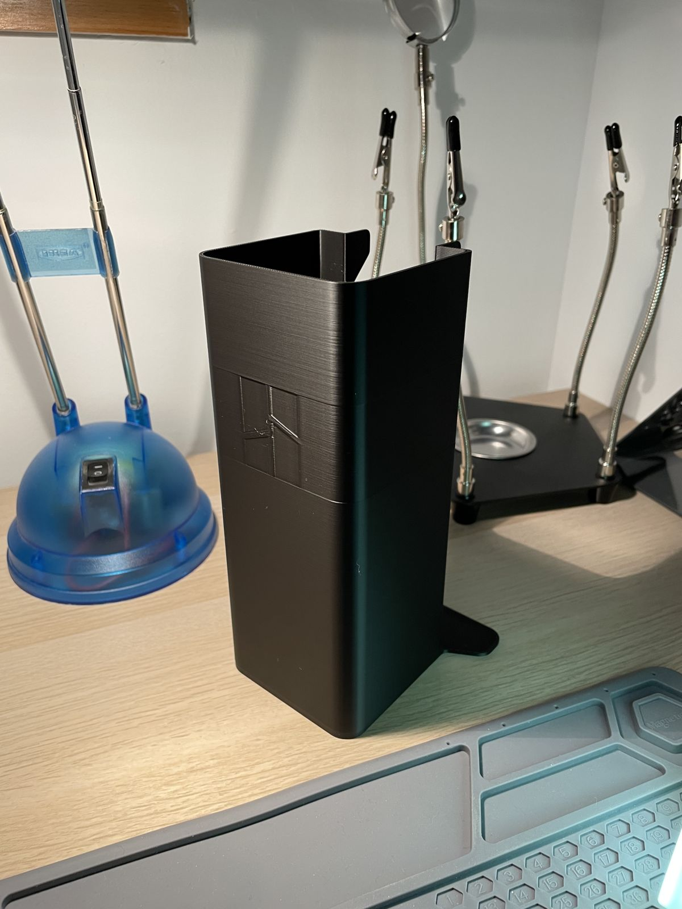

# Spider-Bot · Workshop

Part of the [build log](../build-log.md): its [contents](../build-log.md#contents), [open items](../build-log.md#open-items) and [glossary](../build-log.md#glossary).

## Workshop

The printer is a Bambu Lab P2S Combo (with AMS). Before printing robot parts, it was calibrated and given a first,
useful print. All Spider-Bot parts are printed in PLA.

### Printer calibration

**Phase 0 · Workshop · 2026-10** · Status: ✅ done

> **In short.** The P2S runs its automatic calibration before its first print. Nothing to set by hand.

*Video · The P2S running its automatic calibration.*

https://github.com/user-attachments/assets/948dd098-af7a-4972-a0bd-290c17e0126f

### First print: purge waste bin

**Phase 0 · Workshop · 2026-11-09** · Status: ✅ done

> **In short.** The first real print is a bin that catches the filament the printer purges at the back on every
> filament change. It came out right, so the printer is ready for robot parts.

#### Steps

1. Model: [P1S, P2S, X2D Poop Bin by Pichler](https://makerworld.com/models/1603348) on MakerWorld. Pick the print
   profile **«P2S (10 mm higher) / without Purge Line Corner / with Logo»**: the P1S profile is 10 mm too low for
   the P2S. For a P2S with the exhaust fan, use the X2D / P2S profile instead.
2. Filament: Bambu PLA Basic, black.
3. Print, then slide the bin's foot tab under the printer, below the purge chute.

#### Result

Smooth walls, no visible defects (Fig. 1).

*Fig. 1 · The bin under the printer's purge chute.*

*Video · The first print.*

https://github.com/user-attachments/assets/969db1d2-f4c8-4ad6-a642-058941c77ebe

[↑ Contents](../build-log.md#contents)
