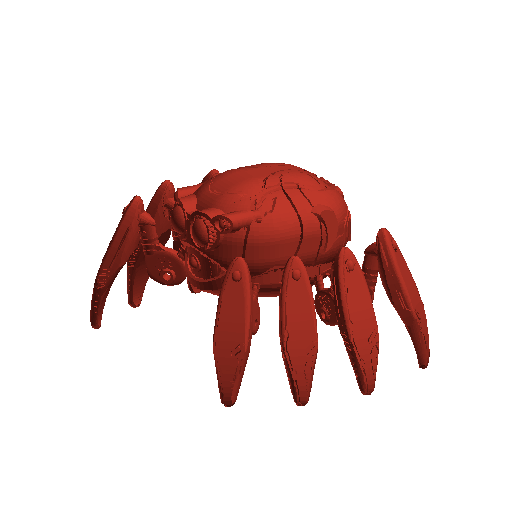
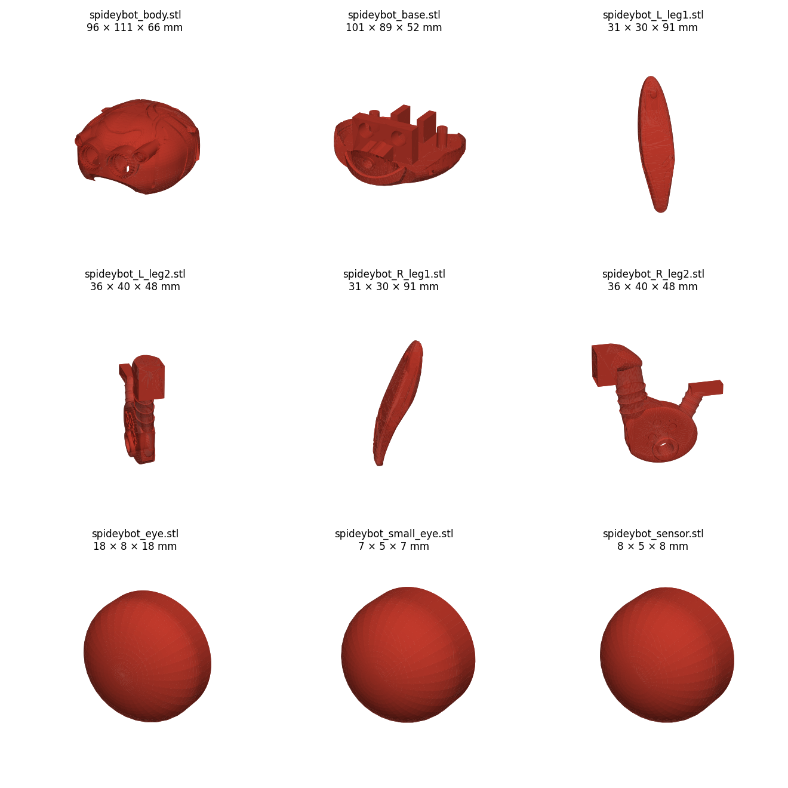
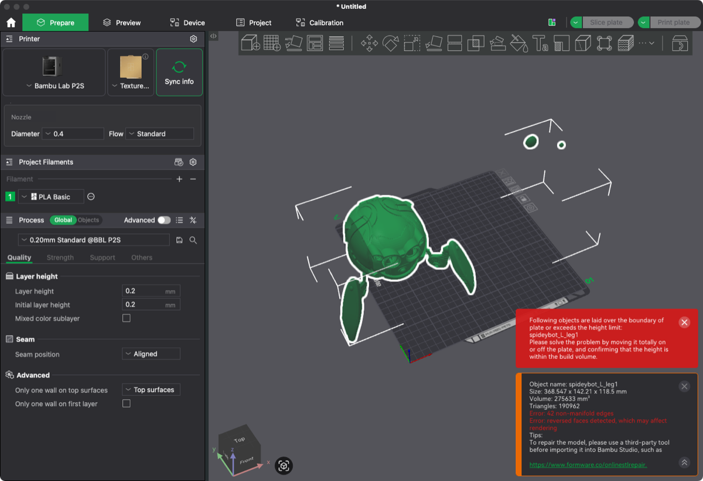
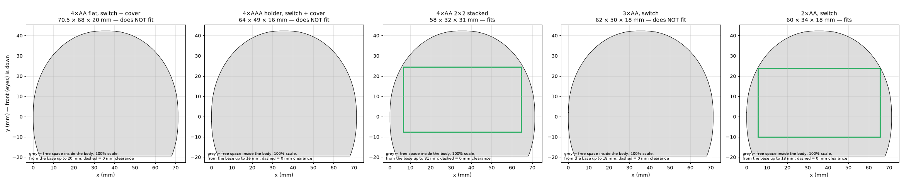
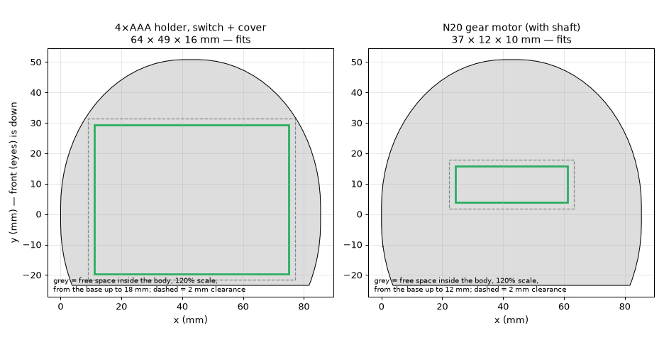
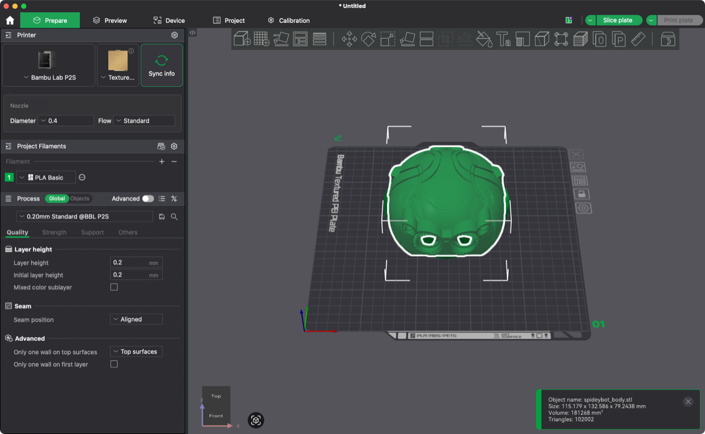
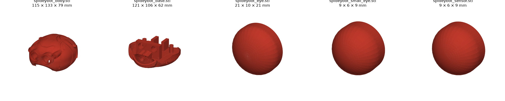

# Spider-Bot · Carcass

Part of the [build log](../build-log.md): its [contents](../build-log.md#contents), [open items](../build-log.md#open-items) and [glossary](../build-log.md#glossary).

## Carcass

The robot's look comes from an existing fan model, jenscolt's Spidey-Bot. The first job was to check it could hold
the motor and batteries. At its original size the battery holder does not fit, so it is printed at **120 %**. Its
meshes also had errors, which were repaired without changing the shape. The cuts and holes for the mechanism come
later, once the mechanism is designed.

### Carcass base model

**Phase 2 · CAD · 2026-11-08** · Status: ✅ done

> **In short.** Instead of modelling the shell from scratch, we start from
> [Spidey-Bot by jenscolt](https://www.thingiverse.com/thing:5196618), the most faithful replica found. Its 9 parts
> were measured and assembled into one model. It imports into the slicer, but with mesh errors to fix first.

**Why this model.** It is the most faithful replica found (CC BY-NC-SA). Others looked at: a stylised low-poly game
asset on Sketchfab (CC BY-ND, so no modified versions can be published; reference only) and the MyMiniFactory
«Spider BOT» (an unrelated sci-fi miniature).

#### Steps

1. On the Thingiverse page, **Download all files** (zip with 9 STLs, photos, README and license).
2. Check every STL is valid and measure it with [`tools/stl_preview.py`](../tools/stl_preview.py), which prints the size
   of each part and renders the previews.
3. The files place the body, base, sensor and only the front pair of legs; the eyes are off to the side. Join
   everything into one assembled model (How to reproduce): the 4 eye domes go into their sockets and the other
   3 legs per side are added. The leg layout is approximate, read off the author's photos: fine for pictures, not
   for fitting parts.
4. Open the assembled STL in Bambu Studio to check it imports.

<details>
<summary>How to reproduce</summary>

```
python3 tools/assemble_jenscolt.py cad/carcass-jenscolt spideybot_assembled.stl
```

Files, sizes and previews: [cad/carcass-jenscolt/](../cad/carcass-jenscolt/).

</details>

#### Result

The body is a hollow shell 96 × 110 × 66 mm; the base has posts and mounts inside. The legs are static display
parts. Assembled, the robot measures 224 × 154 × 118 mm (Fig. 1). It needs 4 of each leg file per side and 2 of
each eye (Fig. 2).

<table>
<tr>
<td width="50%"></td>
<td width="50%"></td>
</tr>
<tr>
<td><em>Fig. 1 · The assembled model: eyes in their sockets and all eight legs placed.</em></td>
<td><em>Fig. 2 · The 9 parts as downloaded, with their sizes.</em></td>
</tr>
</table>

Bambu Studio imports the assembly, but reports mesh errors (non-manifold edges and reversed faces) in every file
(Fig. 3).



*Fig. 3 · The model in Bambu Studio. The red panel at the bottom right lists the mesh errors; they must be repaired
before cutting or drilling the parts.*

#### Decisions

- **Carcass:** jenscolt's meshes, edited in Bambu Studio (cuts, holes). **Mechanism:** new parts designed in CAD,
  with the body only as a size reference.
- The walking legs are designed new; jenscolt's legs only give their outer look.

### Motor, battery holder and print scale

**Phase 2 · CAD · 2026-11-09** · Status: ✅ 120 %

> **In short.** The body must hold the motor and a battery holder. At 100 % the free space inside is about
> 71 × 62 mm: the small N20 motor fits, but no 4-battery holder with a switch does. At **120 %** a 4×AAA holder fits
> with 2 mm to spare, so that is the print scale.

#### Steps

1. Collect the outer sizes of the candidate parts from shop data sheets (largest listed value, rounded up):

   | Part | Size (mm) | Notes |
   |---|---|---|
   | N20 gear motor | 37 × 12 × 10 | Same cross-section for every gear ratio; length includes the 10 mm shaft |
   | 4×AA holder, switch + cover (flat) | 70.5 × 68 × 20 | Several shop listings |
   | 4×AAA holder, switch + cover | 64 × 49 × 16 | Typical listing; check the one bought |
   | 3×AA / 2×AA holder, switch | ~62 × 50 × 18 / ~60 × 34 × 18 | Typical listings |
   | 4×AA holder, 2×2 stacked | 58 × 32 × 31 | No switch or cover |

2. Measure the free space inside the body and try each part in it with
   [`tools/fit_check.py`](../tools/fit_check.py). It slices the body every 1 mm upwards from the top of the base, keeps
   the inside of the wall behind the eye block, and looks for a spot where the part lies flat. The author's screw
   posts are ignored, since the inside is redesigned. The base itself is a near-solid bowl, too shallow at the edges
   to help.
3. Repeat at the chosen scale with 2 mm clearance per side: holder sizes vary about ±0.5 mm between makers, and the
   wires need room.

<details>
<summary>How to reproduce</summary>

```
python3 tools/fit_check.py cad/carcass-jenscolt --scale 1.0 --min-scale \
    --box "4×AA flat, switch + cover" 70.5 68 20 --box "4×AAA holder, switch + cover" 64 49 16 ...
python3 tools/fit_check.py cad/carcass-jenscolt --scale 1.2 --clearance 2 --box ...
```

</details>

#### Result

At 100 % the N20 fits with room to spare, but the holders with a switch do not (Fig. 1). The flat 4×AA holder
would need 137 %. With 2 mm clearance the 4×AAA holder needs 118 %, and at 120 % it fits (Fig. 2).



*Fig. 1 · The free space inside the body at 100 % (grey), seen from above, with each holder tried in it. Only the
stacked 4×AA (no switch) and the 2×AA fit.*



*Fig. 2 · At 120 %: the 4×AAA holder and the N20 motor fit, each with 2 mm clearance (dashed).*

#### Decisions

- **Motor: N20 gear motor.** All gear ratios have the same size; the ratio is picked in phase 4 from the measured
  load.
- **Batteries: 4×AAA NiMH** in a holder with switch and cover. Same 4.8 V as 4×AA, so motor and eyes behave the
  same, with less capacity (about 800–1000 mAh against 2000–2500 mAh). 2×AA was ruled out: 2.4 V (about 2.2 V under
  load) gives a 6 V N20 about 40 % of its speed and torque, and blue or white LEDs (about 3 V) do not light.
- **Print scale: 120 %.** The robot is about 269 × 185 × 142 mm. At 110 % the holder fits with no clearance at all.

### Mesh repair

**Phase 2 · CAD · 2026-11-09** · Status: ✅ done

> **In short.** The downloaded meshes had small errors (duplicate and zero-size triangles, tiny gaps) that stop
> cuts and holes from working in the slicer. A repair script closed them while moving the surface 0.01 mm at most,
> and scaled the parts to 120 %. Bambu Studio now reports every part as watertight.

**What was wrong.** Every file has duplicate triangles (zero-thickness walls), zero-area triangles and tiny gaps
between triangles. The body also has 10 «pinched» edges, where two surfaces touch along a line. Bambu Studio's mesh
check reports `manifold = no` for body, eyes and sensor.

#### Steps

1. Repair and scale the 5 carcass parts with [`tools/repair_stl.py`](../tools/repair_stl.py). It merges points that
   are almost in the same place, drops zero-area and duplicate triangles and closes small holes. At pinched edges it
   splits the points and moves each copy 0.01 mm into its own side. It then reads every file back, as a slicer
   would, and measures the largest distance to the original.
2. Check with Bambu Studio's own mesh check.

<details>
<summary>How to reproduce</summary>

```
python3 ../tools/repair_stl.py cad/carcass-120 --scale 1.2 cad/carcass-jenscolt/spideybot_{body,base,eye,small_eye,sensor}.stl
/Applications/BambuStudio.app/Contents/MacOS/BambuStudio --info cad/carcass-120/spideybot_body.stl   # manifold = yes
```

</details>

#### Result

All 5 parts are watertight, and none moved more than 0.01 mm (measured at 100 %, before scaling).

| File | Bad edges before | Bad edges after | Max change (mm) |
|---|---|---|---|
| `spideybot_body.stl` | 55 | 0 | 0.010 |
| `spideybot_base.stl` | 4 | 0 | 0.000 |
| `spideybot_eye.stl` | 3 | 0 | 0.000 |
| `spideybot_small_eye.stl` | 3 | 0 | 0.000 |
| `spideybot_sensor.stl` | 3 | 0 | 0.000 |

<details>
<summary>What was fixed in each file</summary>

| File | Fixed |
|---|---|
| `spideybot_body.stl` | 228 zero-area, 7 duplicate triangles, 10 pinched edges split (surface moved 0.01 mm) |
| `spideybot_base.stl` | 6 zero-area triangles |
| `spideybot_eye.stl` | 3 duplicate triangles |
| `spideybot_small_eye.stl` | 5 zero-area, 3 duplicate triangles, 3 open edges closed |
| `spideybot_sensor.stl` | 2 zero-area, 3 duplicate triangles |

Bambu Studio before: body 9 non-manifold edges; eye, small eye and sensor 3 each. After: `manifold = yes` for all 5.

</details>

<table>
<tr>
<td width="50%"></td>
<td width="50%"></td>
</tr>
<tr>
<td><em>Fig. 1 · The repaired body in Bambu Studio: no errors.</em></td>
<td><em>Fig. 2 · The original, for comparison: the red panel at the bottom right lists its errors.</em></td>
</tr>
</table>



*Fig. 3 · The 5 repaired parts at 120 %, with their print sizes.*

#### Decisions

- **No automatic rebuild (MeshFix).** Tried first: it closes everything, but on a leg it cut off a 1.5 mm relief.
  Only fixes that keep the surface within 0.01 mm are used.
- **Legs not repaired.** Closing their pinched edges would change their shape. They are not printed (the walking
  legs are designed new) and stay as a reference in [cad/carcass-jenscolt/](../cad/carcass-jenscolt/).
- The repaired files are kept at 120 %, the print scale, so measurements taken from them are the real ones.

[↑ Contents](../build-log.md#contents)
