# Spider-Bot · Legs and drive

Part of the [build log](../build-log.md): its [contents](../build-log.md#contents), [open items](../build-log.md#open-items) and [glossary](../build-log.md#glossary).

## Legs and drive

The Spider-Bot walks on eight legs driven by one motor, so the core problem is the mechanism. The steps so far:

1. **Which leg?** A simulator compared three leg mechanisms. We chose the simplest, the **toy leg**: one bent part
   per leg, pushed by a crank.
2. **Which drive?** Then came the hard part: how one motor turns eight cranks without the legs hitting each other.
   - **One crankshaft** across the body for all eight legs looked good until the cranks were given real thickness.
     The legs' inner arms then cut through the other legs' cranks.
   - **Two side crankshafts** (front to back) fit, but the feet move sideways and the robot barely walks.
   - **Four crankshafts** across the body, one per pair of legs, linked by gears, is the first layout that fits and
     walks forward. Its stride is short (about 10 mm per half turn), because the body must not bob more than 3 mm.
3. **CAD and first print.** The parts were modelled in code, checked for collisions over a full turn, assembled in
   Onshape, and one leg was printed on a small test frame. It showed that holes need much more clearance than
   expected (0.5 mm), and the frame was redesigned. On the second print the leg turns by hand.
4. **The base.** The forks turned out to be too tall for the carcass: their top half went into the body. The body
   now sits 18.7 mm higher, on a band that is part of the new base. Base v1 carries the forks, the crankshafts and
   the gears; it is modelled and checked over a full turn.
5. **The gears.** Printed on their own, the four crankshafts jammed and lifted out of their slots. A new check that
   turns the gears found that two of the idlers cannot mesh with both of their crankshafts at the designed crank
   angles, and that the gears have no backlash. In the redesign each crankshaft's gear is turned on its shaft so
   that every idler meshes with both neighbours, the gears have backlash, and a cap holds the shafts in the test.
   Printed, the new train turned by hand without its cap, but the cap jammed it: its tongues ran a quarter of a
   millimetre from the gear faces. With a new cap, centred by skirts and with its tongues kept clear of the gears,
   the four shafts turn together. Base v1 is next.
6. **Base v1 printed.** It printed but could not be assembled: the cap's tongues broke, the front block was not
   held, the pins could not be reached, a gear did not seat and support stayed trapped. These lessons are now CAD
   rules and checks, and base v2 is next.
7. **The whole robot first.** Rather than a base v2 that still could not test the motor, the whole robot, in its
   final looks, is now modelled and checked in CAD before anything else is printed. The motor is sized (an N20,
   380:1) and the plan for the whole robot is approved: the motor sits over the last idler, the batteries ride in
   the body.
8. **The drive module in CAD.** The first part of the whole robot is modelled: a gearbox of its own that carries
   the crankshafts, the idlers and the motor, and screws into the chassis. Its first version hung 10 mm under the
   carcass, so its gear pockets were cut flat, and a new check now keeps every part inside the carcass. It passes;
   the robot is still about 1 % too heavy for the motor's margin, so a weight and size review is added before
   anything is bought or printed. The looks chassis and body are next.
9. **The chassis and a clutch.** The chassis shell is built within its mass budget, which brings the robot's
   design mass under the motor's ceiling; the checks of the whole robot are one spec that passes, and a friction
   clutch on the motor's shaft is modelled so a jam slips instead of breaking a gear. Nothing will be printed until
   the looks parts are modelled: one robot, not a ballasted test chassis.
10. **The weight review.** The robot is made 7 g lighter without new hardware, and the shell no longer carries the
    cut of the old 5 mm pinion.
11. **The looks parts.** Body v2 keeps the scanned skin as it is and the slicer lightens it; it carries the battery
    holder's cradle, a rear lug and an eyes tab. After four fix passes the whole robot passes the check, 420 g
    built and 457 g by design mass, still under the motor's ceiling. The motor and the other hardware can now be
    bought.
12. **The looks pass and the legs.** The robot works but looks functional, so the legs were to be rethought as thick
    and curved like the toy's. Three plan rounds gave legs that fit the 478 g ceiling only by being thinner than the
    toy's, and Morante rejected them: the legs are not traded for weight, so every other printed part is audited
    first and the legs come back with the grams it frees.
13. **Looks first.** The robot is redesigned looks-first in three levels of detail. The first, a mock-up in simple
    shapes at 60 % of jenscolt's size, draws and checks the whole robot in about 2 seconds, and its look was approved.
    The real looking parts as light meshes are next.
14. **The real parts as meshes.** N1 puts jenscolt's own body, base, eyes and legs into the same check, with the legs
    warped onto the mock-up's path, and cuts one window per leg root. The check passes within 1 mm and the look was
    approved. The print detail (N2) is next.

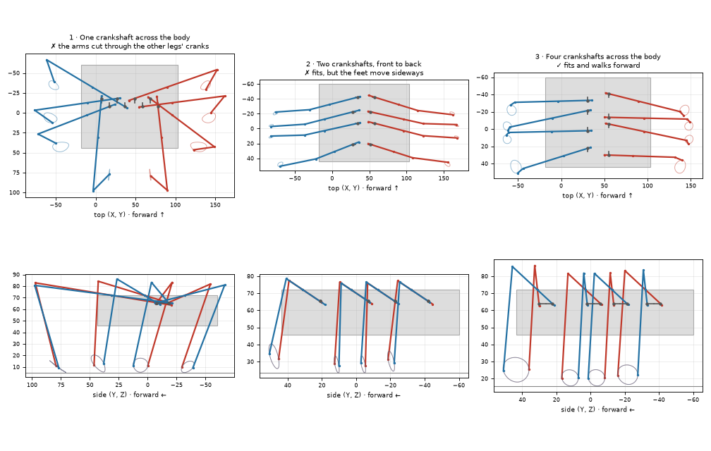

*The three drives tried, from above (top) and from the side (bottom). The grey box is the body; the grey stubs are
the cranks; the loops are the paths of the feet. In 1, the inner arms cross the cranks of the other legs. In 2, the
loops seen from the side are thin and upright: the feet go up and down but hardly forward. In 3, every arm reaches
only its own crank and the loops lie along the ground. Made by
[`tools/drive_attempts_figure.py`](https://github.com/Morante-robotics/spider-bot-replica/blob/pre-redesign-2026-11-17/tools/drive_attempts_figure.py).*

### Leg simulator and comparison

**Phase 3 · Mechanisms · 2026-11-09** · Status: ✅ toy leg chosen

> **In short.** A 2D simulator compared three ways to build a leg turned by a crank: the **toy leg** (one part),
> **Klann** (4 parts) and **Jansen** (7 parts). Klann gives the longest stride and Jansen the smoothest walk, but we
> chose the toy leg: one part per leg, and forgiving of small printing errors. The simulator under-rates it,
> because the real toy leg also moves in 3D, which was checked in the next step.

**The three candidates.** In the **toy leg**, one bent part sits on a crank pin at its inner end and slides through
a pivot on the body's edge. **Klann** and **Jansen** are classic walking linkages with 4 and 7 moving parts per
leg (Jansen's is the one in the Strandbeest sculptures).

#### Steps

1. Take the bar lengths: Klann from his patent, as redrawn by
   [DIY Walkers](https://www.diywalkers.com/klann-linkage-optimizer.html); Jansen's published «holy numbers»; and for
   the toy leg, the best of 4000 random tries (longest stride with less than 3 mm of body bob), so that it is
   compared at its best.
2. Run [`sim/legs.py`](../sim/legs.py). It turns the crank in 0.5° steps, works out where each joint is, and scales
   every leg so the crank axle is 55 mm above the ground (the body bottom is about 46 mm up at 120 %).
3. Measure each leg over the half turn it carries the body: with two gait groups half a turn apart, every leg holds
   the body for half a turn.

<details>
<summary>How to reproduce</summary>

```
python3 sim/legs.py --png sim/images/foot-paths.png --gif sim/images/legs.gif
```

Klann: crank = 3, frame pivots at (7.4, 16.9) and (3.4, 8.03) with the crank at (10, 10), knee bent 30°, upper bar
bent 12.8°. Its driving four-bar (frame O-P2, crank, bar A-M, rocker M-P2): s + l = 9.88774, p + q = 10.19, a
crank-rocker, so its crank turns fully. Jansen: crank = 15.

</details>

#### Result


*Fig. 1 · The three legs at one crank angle (black squares are the fixed pivots) and the path of each foot over a
full turn. The flat bottom of each loop is where the foot pushes the robot; the higher the loop, the higher the step.*

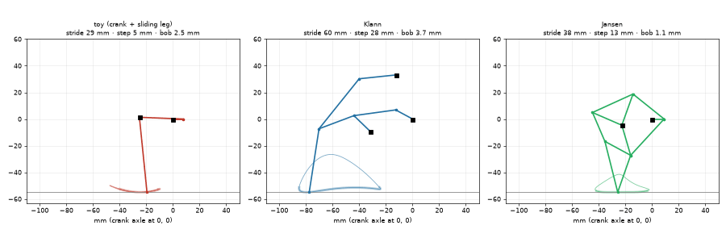

*Fig. 2 · The same three legs turning.*

| Leg | Stride per half turn (mm) | Body bob (mm) | Step height (mm) | Parts per leg |
|---|---|---|---|---|
| Toy | 29 | 2.5 | 5 | 1 |
| Klann | 60 | 3.7 | 28 | 4 |
| Jansen | 38 | 1.1 | 13 | 7 |

<details>
<summary>All the numbers</summary>

| Leg | Foot slips back on the ground | Foot speed peak / median | Crank radius (mm) | Leg size W × H (mm) | Pin joints per leg |
|---|---|---|---|---|---|
| Toy | yes | 1.4 | 7.7 | 55 × 63 | 2 |
| Klann | yes | 1.3 | 14.4 | 100 × 114 | 6 |
| Jansen | no | 1.2 | 9.0 | 73 × 75 | 10 |

</details>

- **Toy:** one part per leg, but in this flat model the foot barely lifts (5 mm) and drags back. Real toy spiders
  work in 3D (the foot also swings sideways and up), which this simulator does not model, so these numbers
  under-rate it.
- **Klann:** longest stride and highest step, and the leg arches above the body like a spider's. But it needs 4
  parts per leg and a bigger crank, the body bobs 3.7 mm, and small errors in the bar lengths change the foot path
  a lot.
- **Jansen:** the smoothest walk, but 7 parts and 10 pins per leg (56 parts for 8 legs), and it does not look like a
  spider leg.

#### Decisions

**Toy leg.** It is the simplest for a first robot: 8 leg parts against 32 for Klann, not sensitive to small
dimension errors, a small crank (about 7 mm, so less torque), and probably how the original toy walks. Klann's
real-size bars can be regenerated with `sim/legs.py` if needed.

**How the toy leg works.** Its inner end sits on a crank pin that turns in a circle. Further out, it passes through
a pivot on the body's edge that lets it slide and swivel. When the crank pin goes up, the foot goes down (a lever),
and when the pin moves in, the leg slides in: the foot traces a loop. The two gait groups of four legs are on crank
pins half a turn apart.

### Toy leg in 3D

**Phase 3 · Mechanisms · 2026-11-09** · Status: ✅ lateral axle

> **In short.** The toy leg was simulated in 3D on the whole robot, in its 8 real notches. We tried 6 ways to build
> it: the crank turning on 3 different axes, and the leg sliding either at the crank or at the body. Only one gets
> close to every target: **crank axle across the body (lateral), leg sliding at the crank**, with a 26 mm stride and
> 3.1 mm of bob. Each leg still has its own crank here; how one motor drives them all is the next step.

**Ways to build it.**
- **Crank axle:** **lateral** (across the body, left to right), **vertical**, or **longitudinal** (front to back).
- **Where the leg slides:** **at the crank**, where the leg turns about a fixed point on the body and the crank pin
  slides in a bore in its inner end; or **at the body**, where the leg sits on the crank pin and slides through a
  sleeve on the body's edge, as in the 2D model.

#### Steps

1. **Find the leg pivots.** The base rim has 8 notches, 4 per side, about 10 × 5 mm, 70–74 mm above the ground.
   Their positions were measured by slicing the base model.
2. **Model one leg** in [`sim/toy_leg_3d.py`](../sim/toy_leg_3d.py): a crank, an inner arm running from the crank pin
   through the pivot, a knee, and a shin bending down and leaning forward or back. All 8 notches use the same leg,
   mirrored on the left, and the two gait groups are half a turn apart.
3. **Walk the robot over one crank turn.** The body stays level, stands on its lowest feet, and moves forward by
   what the lowest foot moves.
4. **Search the best geometry** for each of the 6 combinations: the longest stride that meets the targets. Targets:
   step height ≥ 10 mm, bob ≤ 3 mm, 20–60 mm under the base, ≥ 3 mm between neighbouring legs, knee and foot outside
   the body, stable, footprint ≤ 270 × 185 mm, little foot slip.

<details>
<summary>How to reproduce</summary>

Pivot centres ([cad/carcass-120/](https://github.com/Morante-robotics/spider-bot-replica/tree/pre-redesign-2026-11-17/cad/carcass-120) coordinates: z = height above the ground, forward = −Y), right
side, front to rear: (89.5, −32.2), (95.9, −12.6), (96.1, 2.9), (82.6, 31.1). The left ones are their mirror about
x = 42.7 (the body axis). Measured by slicing `spideybot_base.stl` at z = 71 and 73 and subtracting the slice from
its convex hull.

Leg parameters: crank radius `r`; crank centre `D` mm inward from the pivot and `H` mm above it; inner `arm`
length; knee `bend` angle; shin `sweep` (forward/back lean) and length. The leg keeps its sideways axis horizontal
(a gimbal at the pivot).

Search: 3000 random tries + 750 refinement steps per combination, ranges r 3–12 mm, D 8–40 mm, H −20 to +8 mm,
arm 5–70 mm, bend 30–150°, sweep ±45°, shin 30–120 mm. The 6 searches ran in parallel, about 10 minutes in all.

```
python3 sim/toy_leg_3d.py --search 3000 --only lateral/crank --json lateral-crank.json   # one per combination
python3 sim/toy_leg_3d.py --params sim/toy_leg_3d.json --png sim/images/toy-3d-comparison.png --gif sim/images/toy-3d.gif
```

The 6 best geometries are in [`sim/toy_leg_3d.json`](https://github.com/Morante-robotics/spider-bot-replica/blob/pre-redesign-2026-11-17/sim/toy_leg_3d.json).

</details>

#### Result


*Fig. 1 · The best robot for each combination, from above (top row) and from the side (bottom row). The grey box is
the body and the loops are the foot paths. The two colours are the two sides.*


*Fig. 2 · The six combinations walking.*

| Crank axle | Slides at | Stride (mm) | Bob (mm) | Step height (mm) |
|---|---|---|---|---|
| **lateral** | **crank** | **26** | **3.1** | **12** |
| lateral | body | 11 | 3.8 | 10 |
| vertical | crank | 39 | 0.7 | 7 |
| vertical | body | 34 | 0.7 | 6 |
| longitudinal | crank | 13 | 3.1 | 10 |
| longitudinal | body | 8 | 4.5 | 10 |

Stride is per half turn. Knee and foot stay outside the body in all six.

<details>
<summary>All the numbers and geometries</summary>

Feet slip = how far, on average, each foot slides on the ground per turn against the foot carrying the body (it
includes touching down and lifting off).

| Crank axle | Slides at | Feet slip (mm per leg per turn) | Stable all turn (margin mm) | Gap between legs (mm) | Clearance under base (mm) | Footprint X × Y (mm) | Crank radius (mm) |
|---|---|---|---|---|---|---|---|
| lateral | crank | 39 | yes (15) | 8.0 | 49 | 190 × 133 | 10.0 |
| lateral | body | 15 | yes (21) | 15.5 | 48 | 222 × 133 | 3.3 |
| vertical | crank | 29 | yes (13) | 2.9 | 24 | 268 × 184 | 10.1 |
| vertical | body | 22 | yes (12) | 4.0 | 20 | 265 × 176 | 4.1 |
| longitudinal | crank | 39 | yes (6) | 15.5 | 21 | 171 × 133 | 9.1 |
| longitudinal | body | 16 | yes (14) | 15.5 | 29 | 249 × 150 | 3.0 |

| Crank axle / slides at | Geometry (mm, °) | Crank axle above ground (mm) | Slide travel (mm) | Pivot swing yaw / pitch | Leg to crank pin angle |
|---|---|---|---|---|---|
| lateral / crank | r 10.0, D 34.8, H −12.9, arm 23.1, bend 107, sweep 4, shin 79.3 | 62 | 13.9 | 32° / 29° | 7–35° |
| lateral / body | r 3.3, D 30.5, H −7.2, arm 58.7, bend 85, sweep 4, shin 79.7 | 67 | 4.4 | 12° / 12° | 10–22° |
| vertical / crank | r 10.1, D 38.2, H −6.0, arm 45.5, bend 71, sweep 21, shin 66.8 | 44 | 20.0 | 31° / 5° | 78–83° |
| vertical / body | r 4.1, D 17.6, H −2.6, arm 62.4, bend 72, sweep 22, shin 61.4 | 44 | 8.1 | 27° / 4° | 79–83° |
| longitudinal / crank | r 9.1, D 30.8, H −9.3, arm 17.2, bend 104, sweep 22, shin 52.6 | 38 | 18.1 | 6° / 33° | 77–83° |
| longitudinal / body | r 3.0, D 37.0, H −7.7, arm 52.6, bend 63, sweep 27, shin 78.8 | 48 | 6.0 | 2° / 9° | 80–81° |

</details>

- **Lateral axle, sliding at the crank** is the only one close to every target (bob 3.1 against 3). The crank pin
  points along the leg, so it can slide straight into a bore in the leg's inner end: probably the classic toy. Its
  feet slip the most, and the 8 cranks sit near the body centre, where the battery holder goes.
- **Vertical axle** gives the longest, smoothest stride but a low step (6–7 mm): it only lifts the feet by tilting
  the leg. Its legs come within 2.9 mm of each other, and the left cranks must turn the other way.
- **Longitudinal axle** is the weakest: the crank moves the leg's inner end sideways, which hardly makes a stride.
- **Limits of the model:** the body stays level (a real one tilts onto 3 feet), the legs are lines with no
  thickness, and nothing is checked against the inside of the carcass yet.

#### Decisions

Lateral axle, leg sliding at the crank (taken in the next entry, once one motor drives all the legs).

### Toy leg on one crankshaft

**Phase 3 · Mechanisms · 2026-11-09** · Status: ↩️ reversed by [Crankshaft against real parts](#crankshaft-against-real-parts)

> **In short.** In the previous step every leg had its own crank, and the cranks of each side ended up so close
> that they would hit each other. Here all 8 legs share **one crankshaft** across the body, and the legs are given
> a real 5 mm thickness. Stride halves to 14 mm and bob rises to 4.2 mm. The limit is the legs' inner arms bumping
> into each other inside the body, not the shaft. We accepted it, but the next step showed the layout fails anyway.

#### Steps

1. Add a **shaft** mode to [`sim/toy_leg_3d.py`](../sim/toy_leg_3d.py): one crankshaft across the body for all 8 legs,
   its 4 cranks per side in any order, mirrored on the left. The two gait groups are pins half a turn apart on the
   same shaft.
2. Keep the crankshaft below the battery holder and inside the base. The holder (64 × 49 × 16 mm) fills almost the
   whole body ([cad/layout/](https://github.com/Morante-robotics/spider-bot-replica/tree/pre-redesign-2026-11-17/cad/layout)), so the cranks must stay below it, inside the base with a 2 mm wall.
3. Use stricter rules: legs are 5 mm thick, so every pair of legs on a side keeps 6 mm between centre lines,
   including inside the body. Footprint at least 240 × 165 mm, close to the original's look.
4. Search again: the shaft with the leg sliding at the crank (3 seeds) and at the body, plus, for reference, one
   crank per leg under the same rules.

<details>
<summary>How to reproduce</summary>

Shaft at y = Y0, z = 72 + H. Cranks from XIN to XIN + 3 × PITCH mm from the body axis (PITCH ≥ 8 mm: crank web plus
leg end), in any of the 24 orders. 3000 random tries + 750 refinement steps; 5 searches in parallel, about 15
minutes.

```
python3 sim/toy_leg_3d.py --strict --search 3000 --seed 3 --only shaft/crank --json shaft-crank.json
python3 sim/toy_leg_3d.py --params sim/toy_leg_3d_strict.json --png sim/images/toy-3d-strict.png --gif sim/images/toy-3d-strict.gif
```

Best results: [`sim/toy_leg_3d_strict.json`](https://github.com/Morante-robotics/spider-bot-replica/blob/pre-redesign-2026-11-17/sim/toy_leg_3d_strict.json). Best crankshaft geometry (sliding at
crank): r 5.1, Y0 −12.9, H −6.4 (crank axle 60 mm above the ground), cranks at 6, 16, 26 and 36 mm from the body
axis (front leg innermost), arm 67.4, bend 114°, sweep −15°, shin 77.1 mm. Slide 10 mm, pivot swing 15° each way,
crank pin 2–17° off the leg's axis. The other two seeds gave strides of 9 and 7 mm.

</details>

#### Result


*Fig. 1 · The best layouts with real leg thickness, from above and from the side. In the top view, notice how the
inner arms converge from the notches towards the shaft: that is where they get too close.*

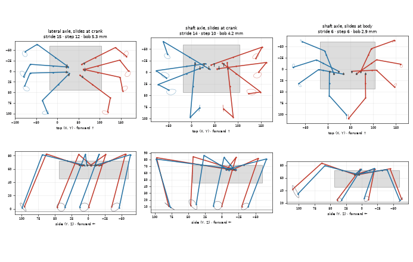

*Fig. 2 · The same, walking.*

| Cranks | Slides at | Stride (mm) | Bob (mm) | Step height (mm) | Gap between legs (mm, need 6) |
|---|---|---|---|---|---|
| one per leg (reference) | crank | 15 | 5.3 | 12 | 1.0 |
| **one crankshaft** | **crank** | **14** | **4.2** | **10** | **2.2** |
| one crankshaft | body | 6 | 2.9 | 6 | 1.4 |

<details>
<summary>All the numbers</summary>

| Cranks | Slides at | Feet slip (mm per leg per turn) | Stable all turn (margin mm) | Clearance under base (mm) | Footprint X × Y (mm) | Crank radius (mm) |
|---|---|---|---|---|---|---|
| one per leg, reference | crank | 18 | yes (7) | 49 | 261 × 166 | 3.0 |
| one crankshaft | crank | 17 | yes (5) | 40 | 241 × 165 | 5.1 |
| one crankshaft | body | 6 | yes (15) | 24 | 243 × 175 | 3.1 |

</details>

- With realistic room between legs, **no layout meets the targets**, not even one crank per leg. Stride halves
  (26 → 14–15 mm) and bob rises to 4–5 mm.
- **The cause:** every closest pair is two **inner arms inside the body**. They come in from notches 10–15 mm apart
  towards the cranks, almost in the same plane, and meet.
- One crankshaft costs almost nothing against one crank per leg (14 against 15 mm).
- **Limits:** the minimum footprint twisted the legs (the rear legs stretch about 100 mm back), and left and right
  legs were not checked against each other.

#### Decisions

**One crankshaft, leg sliding at the crank**, accepting 14 mm per half turn and 4.2 mm of bob: a slower walk, but the
simplest drive. *Reversed in the next entry:* with solid cranks the arms cut through them.

### Crankshaft against real parts

**Phase 3 · Mechanisms · 2026-11-09** · Status: ❌ one crankshaft ruled out

> **In short.** The simulator had checked legs against legs, but not legs against the crankshaft. Once the cranks
> are solid parts, every leg's inner arm cuts through the cranks of the legs further out, by up to 9.5 mm. A new
> search with that rule found no layout that passes. **One crankshaft for all 8 legs is ruled out**, and the drive is
> reopened.

#### Steps

1. **Measure the chosen geometry.** Every inner arm runs from its notch to its own crank, and on the way passes over
   the cranks of the legs further out. A crank reaches 7.1 mm from the shaft axis, and the leg is 5 mm thick, so the
   arm must stay about 10 mm from the axis. It comes as close as 1 mm (table below).
2. **Add the rule** to the simulator (`crank_clear`): every inner arm keeps 1 mm of free space from the cranks it
   does not ride on and from the bare shaft. The geometry of the previous entry fails by 9.5 mm.
3. **Search again** with the same settings: 3 seeds sliding at the crank and 2 sliding at the body.

<details>
<summary>How to reproduce</summary>

Distance from each arm to the shaft axis where it crosses another leg's crank (right side):

| Leg | Crosses the crank at (mm from the body axis) | Distance to shaft axis (mm) |
|---|---|---|
| front | 16 / 26 / 36 | 1–9 / 7–12 / 13–16 |
| middle front | 26 / 36 | 2–5 / 1–6 |
| middle rear | 36 | 3–9 |
| rear | — | — |

Rule: crank discs 4 mm either side of their centre, radius r + 2 (pin head); bare shaft 3 mm; legs 5 mm thick.
3000 tries + 750 refinement steps each, in parallel, about 15 minutes.

```
python3 sim/toy_leg_3d.py --strict --search 3000 --seed 1 --only shaft/crank --json crank-1.json
python3 sim/toy_leg_3d.py --params sim/toy_leg_3d_shaft_check.json --png sim/images/toy-3d-shaft-check.png
```

Results: [`sim/toy_leg_3d_shaft_check.json`](https://github.com/Morante-robotics/spider-bot-replica/blob/pre-redesign-2026-11-17/sim/toy_leg_3d_shaft_check.json).

</details>

#### Result


*Fig. 1 · The five searches with the new rule. To avoid the cranks, the search shrinks the stride to almost
nothing, and still fails.*

| Slides at | Seed | Stride (mm) | Bob (mm) | Gap between legs (mm, need 6) | Arm to crankshaft (mm, need 1) |
|---|---|---|---|---|---|
| crank | 2 | 8 | 2.6 | 2.1 | −7.3 |
| crank | 1 | 7 | 3.8 | 2.4 | −4.0 |
| crank | 3 | 2 | 0.7 | 1.7 | −3.9 |
| body | 1 | 3 | 1.8 | 2.1 | −4.2 |
| body | 2 | 0 | 0.5 | 4.6 | −1.8 |

A negative distance means the arm goes through the crank.

- **No layout passes.** Every one still has arms cutting through cranks and legs too close, and the stride drops to
  0–8 mm.
- **The cause is the layout itself.** 8 legs come in from the rim to one line across the body, so the outer cranks
  are always in the way of the inner legs' arms.

#### Decisions

One crankshaft for all 8 legs is ruled out. The drive has to be designed again, and simulated before any CAD.

### Two side crankshafts

**Phase 3 · Mechanisms · 2026-11-09** · Status: ❌ ruled out

> **In short.** To keep arms away from other legs' cranks, we tried two crankshafts running **front to back**, one
> per side, each crank level with its own leg. The parts fit, with room to spare, but the robot barely walks
> (1–2 mm per half turn): a crank turning on a front-to-back axis moves the foot sideways, not forward. The crank must
> turn on an axis **across** the body.

#### Steps

1. Add a **sides** mode to [`sim/toy_leg_3d.py`](../sim/toy_leg_3d.py): one front-to-back shaft per side, each leg's
   crank on it level with its notch. The two shafts turn opposite ways (a gear pair, with the motor between them),
   so the left side mirrors the right.
2. Same strict rules as the previous entry, including the arm-to-crankshaft check. 5 searches.

<details>
<summary>How to reproduce</summary>

Shaft XS mm from the body axis at z = 72 + H; each crank shifted DY mm along the shaft. Ranges: r 3–12, XS 10–50,
H −22 to 0, DY ±10 mm, leg as before. 5 searches in parallel, about 15 minutes.

```
python3 sim/toy_leg_3d.py --strict --search 3000 --seed 1 --only sides/crank --json crank-1.json
python3 sim/toy_leg_3d.py --params sim/toy_leg_3d_sides.json --png sim/images/toy-3d-sides.png --gif sim/images/toy-3d-sides.gif
```

The best three: [`sim/toy_leg_3d_sides.json`](https://github.com/Morante-robotics/spider-bot-replica/blob/pre-redesign-2026-11-17/sim/toy_leg_3d_sides.json).

</details>

#### Result

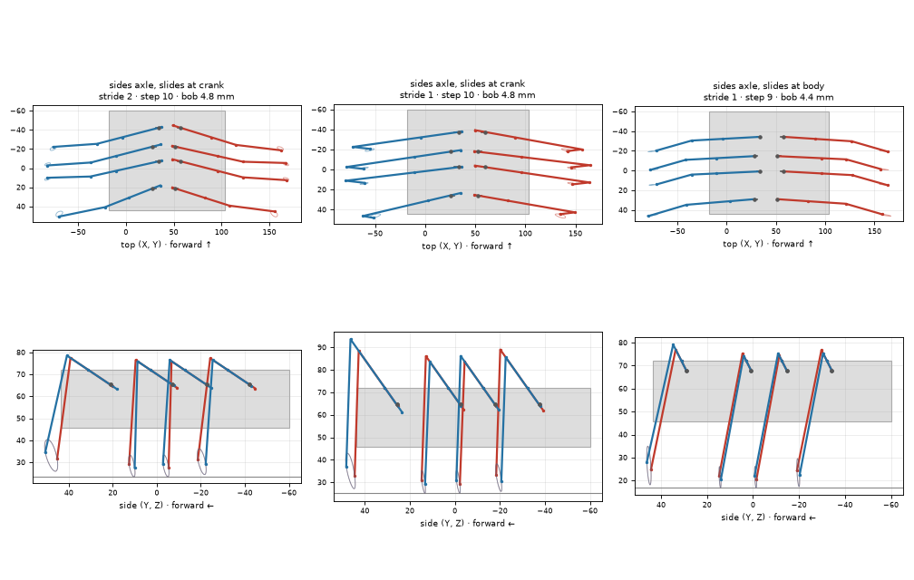

*Fig. 1 · Two side crankshafts. In the side view the foot loops are thin vertical lines: the feet go up and down
but hardly move forward.*

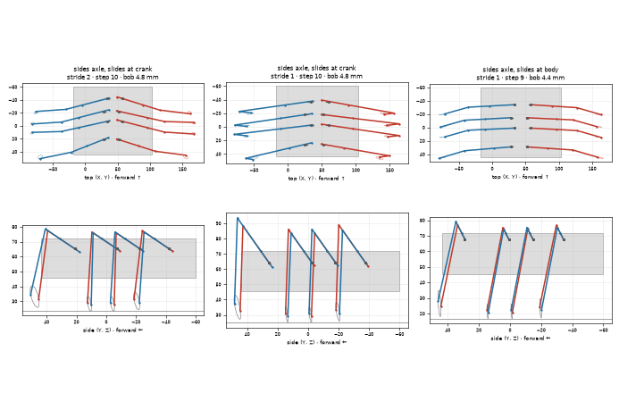

*Fig. 2 · The same, walking: the legs move in and out instead of forward.*

| Slides at | Seed | Stride (mm) | Bob (mm) | Gap between legs (mm, need 6) | Arm to crankshaft (mm, need 1) |
|---|---|---|---|---|---|
| crank | 2 | 2 | 4.8 | 13.0 | 9.2 |
| crank | 3 | 2 | 4.6 | 13.1 | 6.4 |
| crank | 1 | 1 | 4.8 | 13.2 | 11.1 |
| body | 1 | 1 | 4.4 | 14.8 | 13.1 |
| body | 2 | 1 | 4.2 | 14.1 | 9.5 |

<details>
<summary>All the numbers</summary>

| Slides at | Seed | Step height (mm) | Pivot swing yaw / pitch |
|---|---|---|---|
| crank | 2 | 10 | 2° / 8° |
| crank | 3 | 10 | 2° / 8° |
| crank | 1 | 10 | 2° / 11° |
| body | 1 | 9 | 0° / 8° |
| body | 2 | 9 | 1° / 8° |

</details>

- **The parts fit:** 13–15 mm between legs and 6–13 mm of free space to the cranks, the first layout to pass both.
- **The robot barely walks.** A crank on a front-to-back shaft moves the leg's inner end in and out and up and down,
  so the leg hardly swings forward. Forward stride needs the crank pin to move forward and back, so the crank has to
  turn on an axis across the body, as in [Toy leg in 3D](#toy-leg-in-3d).
- Bob is 4.2–4.8 mm, also above the 3 mm target.

#### Decisions

Ruled out for this leg: the parts fit, but the feet move sideways. The cranks must turn on an axis across the body
without lining all 8 up on one shaft.

### Four lateral crankshafts

**Phase 3 · Mechanisms · 2026-11-09** · Status: ✅ chosen

> **In short.** The cranks turn across the body again, but now on **four short shafts, one per pair of legs**, so
> each arm only reaches its own shaft. Gears between the shafts make them turn together. It is the first layout that
> fits and walks forward, but the stride is short: 9 mm per half turn, because a longer stride makes the body bob
> more than the 3 mm allowed. We chose it, keeping the 3 mm limit.

#### Steps

1. Add a **rows** mode to [`sim/toy_leg_3d.py`](../sim/toy_leg_3d.py): 4 shafts across the body, each level with its
   pair of notches. The left and right cranks of a shaft are half a turn apart (the two gait groups). Idler gears
   between neighbouring shafts make all four turn the same way (about 7 gears in a row, the motor on one of them;
   not simulated).
2. Same strict rules, with the arm-to-crankshaft check per shaft. 5 searches.
3. Take the best geometry and change the crank size, its height and its distance from the body axis by hand, to see
   which target holds the stride back.

<details>
<summary>How to reproduce</summary>

Each shaft shifted DY mm front or back of its notches, at z = 72 + H; cranks XC mm either side of the body axis.
Ranges: r 3–12, XC 6–45, H −22 to 0, DY ±10 mm, leg as before. 5 searches in parallel, about 15 minutes.

```
python3 sim/toy_leg_3d.py --strict --search 3000 --seed 1 --only rows/crank --json crank-1.json
python3 sim/toy_leg_3d.py --params sim/toy_leg_3d_rows.json --png sim/images/toy-3d-rows.png --gif sim/images/toy-3d-rows.gif
```

The best three: [`sim/toy_leg_3d_rows.json`](https://github.com/Morante-robotics/spider-bot-replica/blob/pre-redesign-2026-11-17/sim/toy_leg_3d_rows.json).

</details>

#### Result

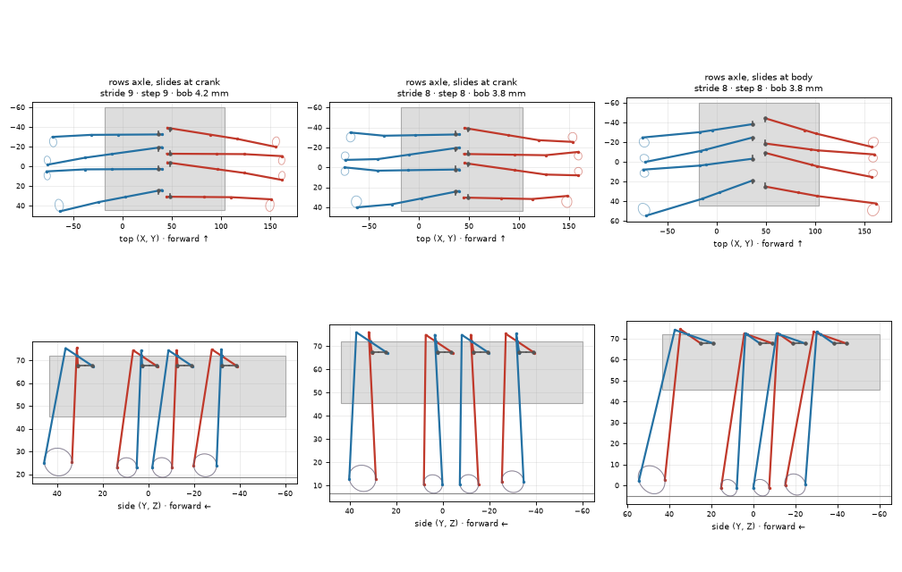

*Fig. 1 · Four lateral crankshafts. In the side view the foot loops lie along the ground: the feet move forward.
The cranks (short stubs near the body axis in the top view) stay clear of the other legs.*

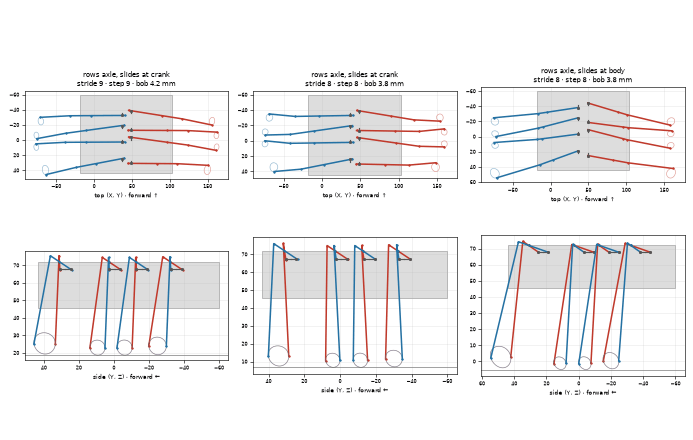

*Fig. 2 · The same, walking.*

| Slides at | Seed | Stride (mm) | Bob (mm) | Gap between legs (mm, need 6) | Arm to crankshaft (mm, need 1) |
|---|---|---|---|---|---|
| **crank** | **2** | **9** | **4.2** | **6.9** | **4.3** |
| crank | 1 | 8 | 3.8 | 7.5 | 4.6 |
| crank | 3 | 8 | 3.8 | 6.8 | 4.6 |
| body | 1 | 8 | 3.9 | 7.7 | 4.7 |
| body | 2 | 8 | 3.8 | 7.8 | 4.5 |

- **The parts fit and the feet loop forward**, the first layout to pass every check, with the cranks inside the base.
- **Stride is only 8–9 mm per half turn.** Every search ends at the smallest crank (3 mm) with the cranks next to
  the body axis.
- **The bob limit holds it back.** Changing the geometry by hand (table below), body bob grows with stride, about
  0.45 mm per mm. A bigger crank also brings the shins closer together and raises the cranks into the battery holder.

| Crank radius (mm) | Height H (mm) | Distance from axis XC (mm) | Stride (mm) | Bob (mm) | Gap between legs (mm) |
|---|---|---|---|---|---|
| 3.1 | −4.3 | 6 | 9 | 4.2 | 6.9 |
| 5 | −8 | 6 | 15 | 6.9 | 1.7 |
| 5 | −8 | 15 | 18 | 8.6 | 0.5 |
| 5 | −8 | 25 | 25 | 11.6 | 2.2 |
| 8 | −10 | 6 | 24 | 11.0 | 0.7 |

#### Decisions

**Four lateral crankshafts, leg sliding at the crank, keeping the 3 mm bob limit:** the best geometry above (the
first entry in [`sim/toy_leg_3d_rows.json`](https://github.com/Morante-robotics/spider-bot-replica/blob/pre-redesign-2026-11-17/sim/toy_leg_3d_rows.json)). The three options compared:

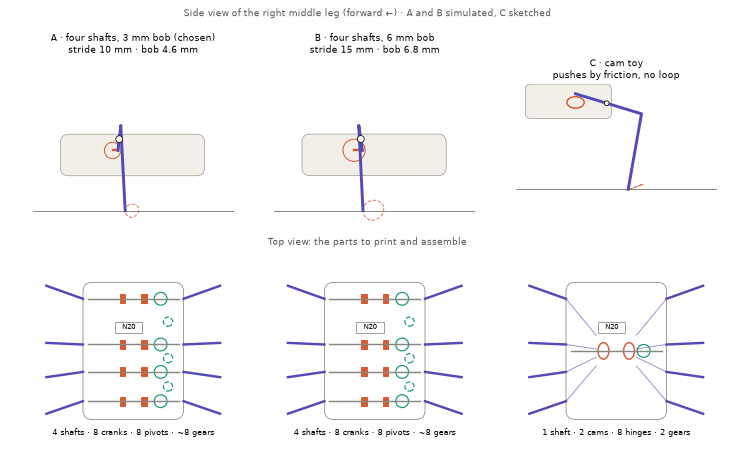

*Fig. 3 · Side view of one leg for each option, with the parts each needs. A and B are simulated; C is a sketch
([`tools/drive_options_gif.py`](https://github.com/Morante-robotics/spider-bot-replica/blob/pre-redesign-2026-11-17/tools/drive_options_gif.py)).*

| | A · Four shafts, 3 mm bob (chosen) | B · Four shafts, 6 mm bob | C · Cam toy |
|---|---|---|---|
| Walk | Short, smooth steps, slow | Steps almost twice as long; the body rocks visibly | Feet scrape; works on carpet, may slip on smooth floors |
| Like the original | Yes (the feet step) | Yes | Less (walks like a wind-up toy) |
| Parts | ~45: 8 legs, 4 shafts with 8 cranks, 8 pivots, ~8 gears | Same | ~15: 8 legs, 1 shaft, 2 cams, 2 gears |
| Printing | Small, precise parts | Same | Thick, tolerant parts |
| Fragile | Medium-high: a 3 mm PLA pin can snap; one jammed leg stops all | A bit more | Low |
| N20 motor | Plenty of torque | About 1.7 × the torque | Plenty of torque |

The **cam toy** (one shaft across the body, cams lift hinged legs, the feet push by leaning back) stays as a
fallback. The simulator cannot represent it (its feet slide), so it would be tested by printing a pair of legs.

### Legs and drive in CAD

**Phase 3 · Mechanisms · 2026-11-10** · Status: ✅ done

> **In short.** The legs and the four-crankshaft drive were modelled in Python code (build123d), with sizes taken
> from the simulator. The chosen geometry first had to be adjusted so a gear fits between each shaft's two cranks.
> A script then moved every part through a full crank turn and fixed each collision it found. The result: 25 printed
> parts with no collisions, exported for Onshape (STEP) and for printing (STL), plus a test frame for one leg.

#### Steps

1. **Install build123d** in a Python virtual environment at the repo root (Python 3.12: 3.14 has no CAD packages
   yet).
2. **Make the geometry buildable.** In the chosen geometry a shaft's two cranks were 12 mm apart, with no room for a
   gear and two bearing walls between them. The shafts were also so high that a gear could only be 4 mm in radius
   under the battery holder. A new search with these limits gives 10 mm per half turn and 4.6 mm of bob (Fig. 1).
3. **Model the parts** in `cad/drive/build.py` (since split into [`cad/legs/`](https://github.com/Morante-robotics/spider-bot-replica/tree/pre-redesign-2026-11-17/cad/legs), [`cad/crankshafts/`](https://github.com/Morante-robotics/spider-bot-replica/tree/pre-redesign-2026-11-17/cad/crankshafts), [`cad/gear-train-test/`](https://github.com/Morante-robotics/spider-bot-replica/tree/pre-redesign-2026-11-17/cad/gear-train-test) and [`cad/test-frame/`](https://github.com/Morante-robotics/spider-bot-replica/tree/pre-redesign-2026-11-17/cad/test-frame)): the leg (3 lengths × 2 sides), the pivot fork,
   one-piece crankshafts (gear, journals, cranks and balls), idler gears, the spine that holds them, and a test
   frame. The gears are standard involute gears, module 1.
4. **Check collisions** with [`cad/legs/check.py`](https://github.com/Morante-robotics/spider-bot-replica/blob/pre-redesign-2026-11-17/cad/legs/check.py): it places every part as the simulator
   moves it, every 30°, and measures how much each pair overlaps. Fix and repeat (table below).
5. **Make the STLs watertight.** The CAD kernel leaves a hairline gap where a sphere meets a box; `build.py` closes
   it. Bambu Studio: `manifold = yes` for all 17 files.

<details>
<summary>How to reproduce</summary>

```
uv venv --python python3.12 .venv
uv pip install --python .venv/bin/python build123d numpy scipy matplotlib pillow trimesh shapely networkx manifold3d rtree
python3 sim/toy_leg_3d.py --strict --search 3000 --seed 2 --only rows/crank --json crank-2.json
```

Limits added to the `rows` search: cranks at least 12 mm from the body axis (XC ≥ 12) and shafts at least 8 mm
below the pivots (H ≤ −8). 4 seeds; seed 2 (legs 5.9 mm apart, 30 mm under the base) is in
[`sim/toy_leg_3d_rows_cad.json`](../sim/toy_leg_3d_rows_cad.json). Parts and how they fit:
[cad/legs/](https://github.com/Morante-robotics/spider-bot-replica/tree/pre-redesign-2026-11-17/cad/legs) and [cad/crankshafts/](https://github.com/Morante-robotics/spider-bot-replica/tree/pre-redesign-2026-11-17/cad/crankshafts).

</details>


*Fig. 1 · The geometry used for the CAD, with room for the gears.*

What the collision check found, in order:

| Found | Fix |
|---|---|
| Ball not where the simulator puts it | Crankshaft turned the wrong way in the assembly (a placement bug) |
| Leg tube hitting the fork | The leg tilts up 6–23°: fork window sized for 28°, tube ends 8 mm before the pivot |
| Test frame upright in the leg's path | Upright moved beside the leg |
| Middle legs' tubes touching near the cranks | Smaller ball (Ø3.6), tube with flat sides 5.6 mm wide |
| Rear tube mouth on its crank; gear teeth on the spine's end blocks | Mouth 0.4 mm closer to the ball; end blocks 2 mm further out |
| Middle legs' feet and shins touching | Shin and foot 4.5 mm wide (legs 5 mm) |

#### Result

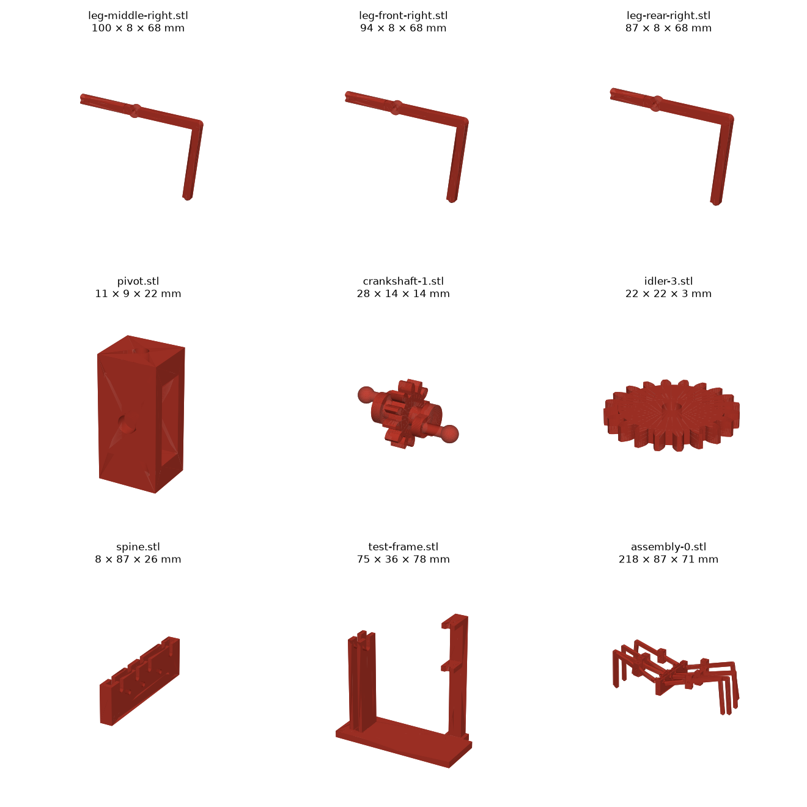

*Fig. 2 · The drive parts: three leg lengths, the pivot fork, a crankshaft, an idler gear, the spine, the test
frame, and the whole robot assembled.*

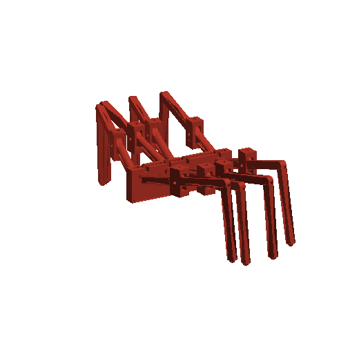

*Fig. 3 · All eight legs turning over a full crank turn, with no collisions.*

- **No collisions over a full turn.** The closest pairs are the designed clearances (0.1 mm a side for the balls
  and journals, 0.2 mm for the legs in their forks). The closest parts not meant to touch are the middle legs' shins
  (0.7 mm apart) and a rear leg against its crank (0.6 mm).
- **25 printed parts** (8 legs, 8 forks, 4 crankshafts, 3 idlers, spine), plus 8 × M3×12 screws with nuts,
  16 × M3×6 and 3 × 3 mm pins.
- The clearances are a guess (+0.2 mm on the diameter) until a clearance test is printed.

#### Decisions

- **One-piece printed crankshafts** (no steel shaft): the angle between the cranks is printed in, so it cannot slip.
- **Swivel axes are M3 screws:** the leg turns on one, and the fork turns on two driven into it.
- The CAD uses the search with buildable limits (10 mm stride, 4.6 mm bob) instead of the unbuildable geometry
  chosen in [Four lateral crankshafts](#four-lateral-crankshafts) (9 mm, 4.2 mm).

### Onshape assembly

**Phase 2 · CAD · 2026-11-10** · Status: ✅ done

> **In short.** One leg on its test frame was assembled in Onshape from the exported STEP files, with joints
> («mates») that let it move as the real one will, and animated through a full turn. It moves as expected. A
> step-by-step tutorial with pictures is in [cad/test-frame/onshape.md](https://github.com/Morante-robotics/spider-bot-replica/blob/pre-redesign-2026-11-17/cad/test-frame/onshape.md).

#### Steps

Full tutorial, with a picture of the edges to click for each mate: [cad/test-frame/onshape.md](https://github.com/Morante-robotics/spider-bot-replica/blob/pre-redesign-2026-11-17/cad/test-frame/onshape.md)
(pictures made by [`cad/test-frame/onshape_figures.py`](https://github.com/Morante-robotics/spider-bot-replica/blob/pre-redesign-2026-11-17/cad/test-frame/onshape_figures.py)). In short:

1. Import `test-frame`, `crankshaft-2`, `leg-middle-right` and `pivot` (STEP) into one document. Insert the test
   frame at the origin and **Fix** it, so the assembly uses the robot's coordinates.
2. Make a helper part, the slider (a Ø3 × 4 mm cylinder). Onshape has no mate for a ball that slides in a tube and
   tilts, so it is built in two steps: crankshaft → **Ball** → slider → **Slider** → leg.
3. Add five mates: three **Revolute** (crankshaft in the frame, fork in the frame, leg in the fork, offset by the
   designed clearances), **Ball** and **Slider**.
4. **Animate** the crankshaft's revolute, 0–360°.

Document (public): [Spider-Bot drive](https://cad.onshape.com/documents/07632681db3e0a6b5b785746/w/6c5d5bb7bfec5781a6827599/e/c59459f0a1ed69675318d6bb).

#### Result

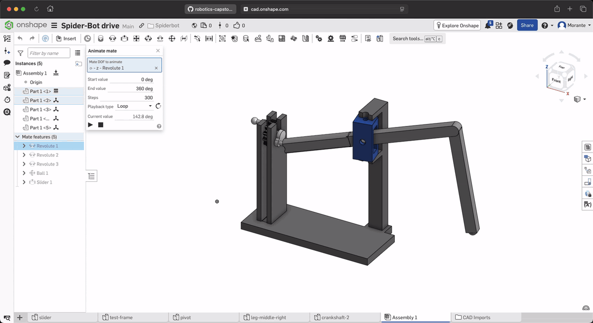

*Fig. 1 · The assembly animated in Onshape: turning the crankshaft moves the fork, the leg and the ball together.*

- The leg has a single degree of freedom, and the animation runs through the full turn.
- The mate offsets had to be negative: with positive ones the parts went into the walls. An offset is measured along
  the mate connector's Z axis, whose direction depends on the face clicked.
- The foot path was not compared with the simulator's. That check was later dropped ([Base v1 in CAD](#base-v1-in-cad)).

### Clearance test and test leg print plate

**Phase 2 · CAD · 2026-11-10** · Status: ✅ printed

> **In short.** Before printing the 25 drive parts, one print plate holds everything needed to turn one leg by
> hand, plus a block that tests how much bigger the holes must be on this printer. The leg had to be reshaped
> slightly so it lies flat on the bed. The plate takes 1 h 28 min and 29.6 g of PLA.

#### Steps

1. **Clearance test** ([`cad/clearance-test/`](https://github.com/Morante-robotics/spider-bot-replica/tree/pre-redesign-2026-11-17/cad/clearance-test), `build.py`): a block with sideways holes for
   the journal (Ø4.0), the ball (Ø3.6) and an M3 screw (Ø3.0), each 0.1, 0.2, 0.3 and 0.4 mm larger. It also has
   3 holes for M3 screws to cut their own thread (Ø2.3 / 2.5 / 2.7), and a pin with a Ø4.0 journal and a Ø3.6 ball,
   printed lying down like a crankshaft (Fig. 1).
2. **Lay the leg flat.** Turned on its side for printing, only the tube touched the bed: the tube is 5.6 mm wide and
   the rest of the leg 5.0 mm, so the arm hung 0.3 mm in the air, too little for supports.
   - Making the whole leg 5.6 mm wide brought the middle legs' knees to 0.09–0.21 mm from each other.
   - Instead, the leg stays 5.0 mm wide, and the arm, boss and knee move 0.3 mm (the shin 0.55 mm) towards the
     face on the bed, flush with the tube. The fork's window moves with it. The leg now touches the bed over
     567 mm² instead of 190 mm².
3. **Plate** ([`tools/bambu_plate.py`](../tools/bambu_plate.py)): orient the parts, then let Bambu Studio arrange and
   slice them with its standard settings (P2S 0.4 mm nozzle, 0.20 mm Standard, PLA Basic, Textured PEI plate).
   Supports are tree supports on the build plate only, so none go into the holes or the leg's bore. Then open it in
   Bambu Studio, check the support settings, slice and save. Details: [print/README.md](../print/README.md).

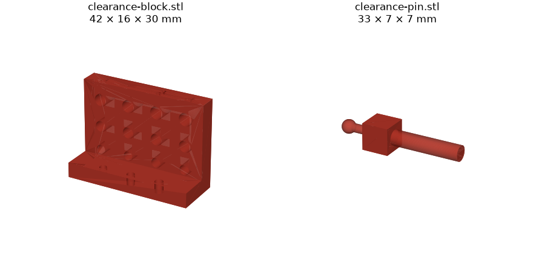

*Fig. 1 · The clearance block and its test pin.*

#### Result

<table>
<tr>
<td width="50%">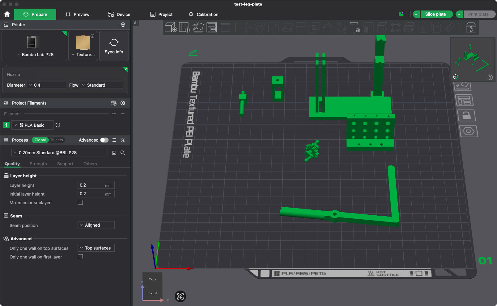</td>
<td width="50%">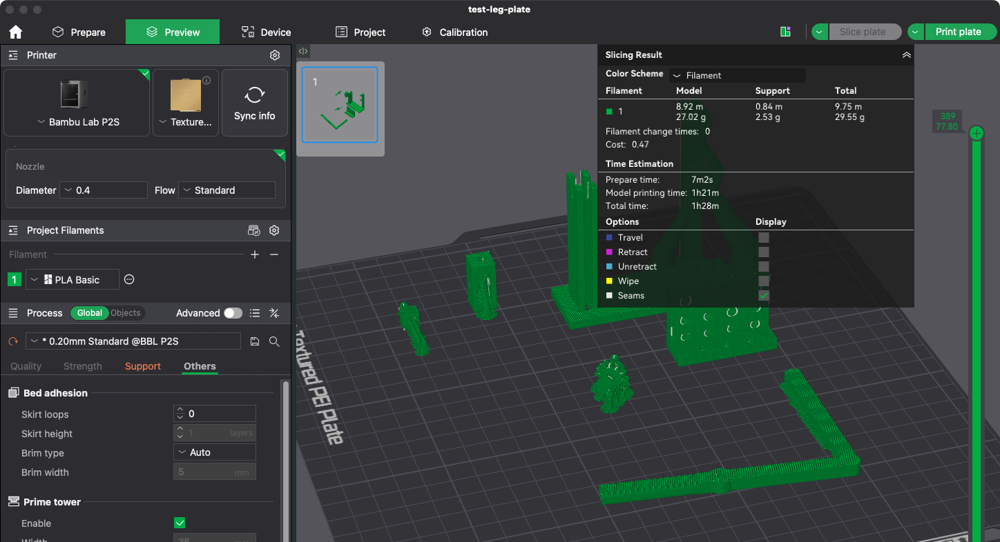</td>
</tr>
<tr>
<td><em>Fig. 2 · The plate in Bambu Studio: test frame, leg, fork, crankshaft, clearance block and pin.</em></td>
<td><em>Fig. 3 · Sliced, with the tree supports.</em></td>
</tr>
</table>

- [`print/test-leg-plate.3mf`](https://github.com/Morante-robotics/spider-bot-replica/blob/pre-redesign-2026-11-17/print/test-leg-plate.3mf): 1 h 28 min, 29.6 g of PLA (2.5 g of it support).
- Bambu Studio warns about 2 areas of the leg it cannot support. Both are the top of the 3.8 mm bore and its flared
  mouth inside the tube (9.8 mm²). They print as bridges.
- The collision check of the whole robot with the reshaped leg finds no collisions over a full turn.
- Bambu Studio dropped the support settings when the project was opened in the app. The tool now saves them as
  changed settings in the .3mf; not yet confirmed in the app.

#### Decisions

- One plate for the test only. The rest of the drive waits for the clearance result and for the base.
- The plate actually printed is the first version, with the leg 5.6 mm wide. For one leg on the test frame both
  versions behave the same, so the reshaped one is not printed separately.

### Test leg: first assembly and clearance result

**Phase 3 · Mechanisms · 2026-11-11** · Status: ✅ second version printed: [Test leg v2](#test-leg-v2-turning-by-hand)

> **In short.** Before printing all 25 drive parts, we printed just one leg with its own small stand to turn it by
> hand, and a block to measure how loose holes have to be on this printer. The leg could not be turned yet: the stand
> did not hold the fork in place, and the holes were too tight. The block showed the clearance needed (0.5 mm instead
> of 0.2 mm). The CAD now uses it, and the stand is redesigned with screws and nuts that hold every part.

**What is being tested.** The robot's leg is a single bent part. Its inner end slides over a ball on a crank, and
halfway along it passes through a **fork** (a small swivelling block) on the body's edge. When the crank turns, the
foot traces a loop. The **test frame** holds one crankshaft and one fork exactly where the robot's base will, so one
leg can be tried before the base exists. The **clearance block** has holes of the same sizes as the real ones,
each 0.1–0.4 mm larger, to find out which one turns freely.

#### Steps

1. Print [`print/test-leg-plate.3mf`](https://github.com/Morante-robotics/spider-bot-replica/blob/pre-redesign-2026-11-17/print/test-leg-plate.3mf). This was the first version, with the leg 5.6 mm wide.
2. Remove the supports, which are on the crankshaft and on one side of the leg (Fig. 2–3).
3. Assemble following the [diagram](https://github.com/Morante-robotics/spider-bot-replica/blob/pre-redesign-2026-11-17/cad/test-frame/README.md): the leg in the fork on an M3×16 and a nut, the fork between
   the frame's two arms, and the crankshaft in its slots with the ball inside the leg's tube (Fig. 4).
4. Push the clearance pin into each hole of the block and note how it turns (Fig. 6).

<table>
<tr>
<td width="50%">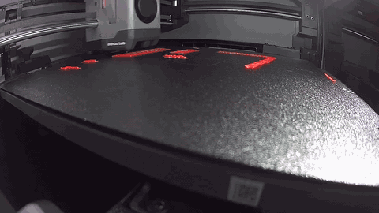</td>
<td width="50%">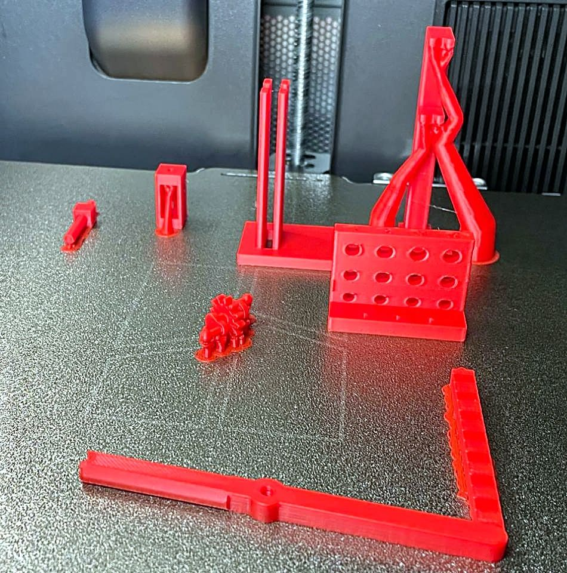</td>
</tr>
<tr>
<td><em>Fig. 1 · Printing <a href="../print/test-leg-plate.3mf"><code>print/test-leg-plate.3mf</code></a> (1 h 28 min,
29.6 g of PLA).</em></td>
<td><em>Fig. 2 · On the bed: clearance pin, fork, frame, clearance block, crankshaft (in its tree support) and the
leg lying flat.</em></td>
</tr>
<tr>
<td width="50%">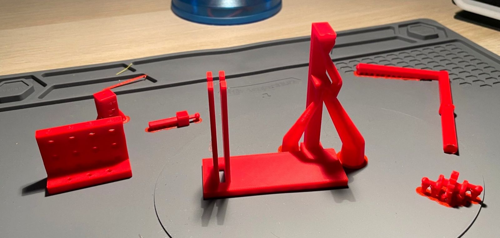</td>
<td width="50%">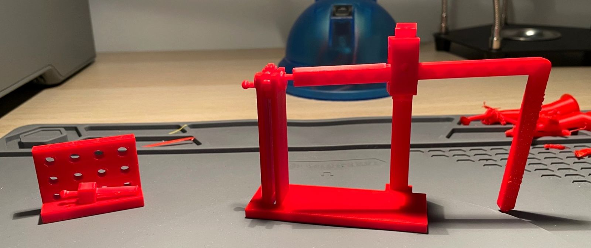</td>
</tr>
<tr>
<td><em>Fig. 3 · Off the bed, supports still on. On the frame, the two thin walls hold the crankshaft and the tall
post on the right holds the fork between its arms.</em></td>
<td><em>Fig. 4 · First assembly: the crankshaft (left) with its ball in the leg's tube, the fork on the right post.
On the left, the clearance pin in its block.</em></td>
</tr>
<tr>
<td width="50%">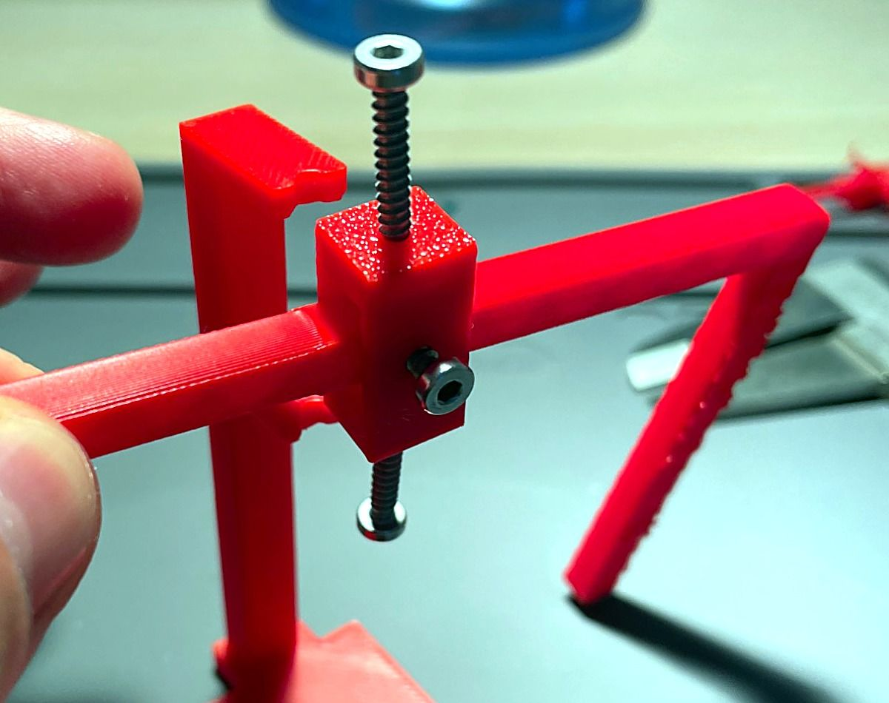</td>
<td width="50%">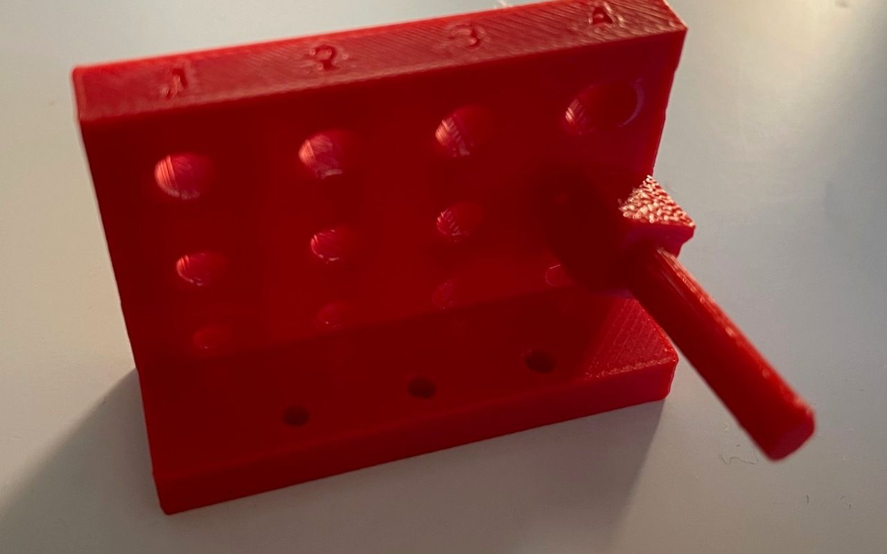</td>
</tr>
<tr>
<td><em>Fig. 5 · The fork has to be held by hand. The frame's upper arm (top left) ends in a half-open «C», so the
screw slides out. The screws in the fork are M2: M3 would not go in.</em></td>
<td><em>Fig. 6 · The clearance block. Columns 1–4 add +0.1 / +0.2 / +0.3 / +0.4 mm to the diameter. Rows, top to
bottom: crankshaft journal (Ø4.0), ball (Ø3.6), M3 screw (Ø3.0). The pin is in the +0.4 journal hole.</em></td>
</tr>
</table>

#### Result

| What | Expected | What happened | Why |
|---|---|---|---|
| Fork in the frame | Swivels on two screws, held by the frame's arms | Falls out; held by hand (Fig. 5) | The arms ended at the centre of their screw holes, leaving a half-open «C» |
| Screws into the fork (Ø2.5 holes) | M3 cuts its own thread | M3 would not go in; M2 used, loose | The hole is too small for M3 in PLA |
| Leg on the fork (M3×16) | Turns | Goes in fine | — |
| Crankshaft and ball | Turn freely with 0.2 mm of clearance | Too tight (see the block, Fig. 6) | 0.2 mm is too little for a printed part in a printed hole |

| Hole | +0.1 | +0.2 | +0.3 | +0.4 |
|---|---|---|---|---|
| Journal Ø4.0 (printed pin) | ✗ | ✗ | ✗ | goes in, turns in jerks |
| Ball Ø3.6 (printed pin) | ✗ | ✗ | ✗ | goes in, turns with difficulty |
| M3 screw (steel) | grips tight | threads easily | wobbles a little | — |

The clearance block, as tested by Morante (Fig. 6). ✗ = does not go in.

**Conclusion:** a printed part needs much more room in a printed hole than a steel screw does. The single 0.2 mm
used for every hole was far too tight for the printed ones.

#### Decisions and fixes

All of these are changes to `cad/drive/build.py` (since split into [`cad/legs/`](https://github.com/Morante-robotics/spider-bot-replica/tree/pre-redesign-2026-11-17/cad/legs), [`cad/crankshafts/`](https://github.com/Morante-robotics/spider-bot-replica/tree/pre-redesign-2026-11-17/cad/crankshafts), [`cad/gear-train-test/`](https://github.com/Morante-robotics/spider-bot-replica/tree/pre-redesign-2026-11-17/cad/gear-train-test) and [`cad/test-frame/`](https://github.com/Morante-robotics/spider-bot-replica/tree/pre-redesign-2026-11-17/cad/test-frame)):

- **Two clearances instead of one.** `CLR` = 0.5 mm for a printed part in a printed hole (journals, ball in the
  bore) and `CLR_STEEL` = 0.3 mm for a steel screw or pin in a printed hole. 0.5 is one step past the block's
  last hole, because +0.4 only turned roughly. The reprint will show whether it is enough.
- **Frame arms closed.** They now reach 5 mm past their holes.
- **Fork on screw tips, not self-tapped.** It now turns on the tips of two M3×10 screws, each locked to a frame arm
  by a nut, entering Ø3.3 blind holes in the fork. The arms moved 2.4 mm apart to make room for the nuts.
- **Keeper for the crankshaft.** It only sat in slots open at the top, so a knock or the leg's push lifted it out.
  A **keeper** (green in Fig. 7) now closes the slots from above and is held by two M3×12 into nuts.
- **Nylon lock nut** on the leg's M3×16, so the knocks do not loosen it.


*Fig. 7 · The redesigned test frame, exploded. Grey: frame. Orange: fork. Red: leg. Blue: crankshaft. Green: the
new keeper. Made by [`cad/test-frame/screws_figure.py`](https://github.com/Morante-robotics/spider-bot-replica/blob/pre-redesign-2026-11-17/cad/test-frame/screws_figure.py).*

<details>
<summary>Collision check of the new parts</summary>

`check.py` (which now includes the keeper), over a full turn: no overlaps. The shaft has 0.25 mm a side in the frame
and the keeper, and the keeper rests on the walls. The right rear leg comes to 0.15 mm from its crankshaft, less
than the bore's 0.25 mm a side: to look into before printing the rear legs.

</details>

### Test leg v2: turning by hand

**Phase 3 · Mechanisms · 2026-11-11** · Status: ✅ the leg turns

> **In short.** The redesigned test frame was printed and the leg now turns by hand: the crank goes round and the
> leg rises and falls in its fork, with the frame holding every part. The 0.5 mm clearance is enough for the
> crankshaft and the ball. The new fork came out too tight for the leg, so the fork from the first print was used.

#### Steps

1. Print [`print/test-frame-v2.3mf`](https://github.com/Morante-robotics/spider-bot-replica/blob/pre-redesign-2026-11-17/print/test-frame-v2.3mf): frame, keeper, fork and leg (Fig. 1). The crankshaft
   from the first print is kept.
2. Assemble following the [diagram](https://github.com/Morante-robotics/spider-bot-replica/blob/pre-redesign-2026-11-17/cad/test-frame/README.md) (Fig. 7 of the [previous entry](#test-leg-first-assembly-and-clearance-result)).
3. Turn the crankshaft by hand (Fig. 2).

<table>
<tr>
<td width="50%">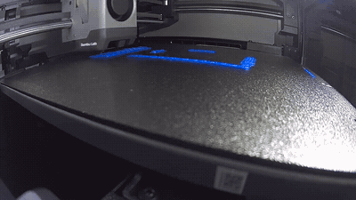</td>
<td width="50%">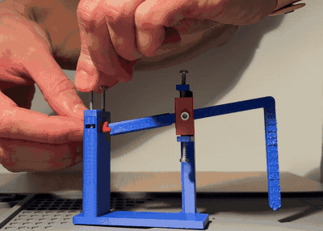</td>
</tr>
<tr>
<td><em>Fig. 1 · Printing <a href="../print/test-frame-v2.3mf"><code>print/test-frame-v2.3mf</code></a> (1 h 18 min,
25.6 g of PLA). The tree support under the frame's fork arms is the tall one at the back.</em></td>
<td><em>Fig. 2 · Turning the crankshaft by hand (left). The leg slides on the ball and tilts up and down in the
red fork, which swivels between the frame's two M3 pins. The red fork and crankshaft are from the first print.</em></td>
</tr>
</table>

#### Result

| What | Expected | What happened |
|---|---|---|
| Crankshaft in the frame, under the keeper | Turns, stays in its slots | Turns by hand and stays in place |
| Ball in the leg's tube (0.5 mm clearance) | Slides and tilts | The leg follows the crank all the way round |
| Fork between the frame's arms (M3×10 pins) | Swivels and stays | Swivels and stays |
| Leg into the fork | Goes in | Into the red fork (first print) yes; into the blue one (this print) no |

**Why the blue fork is too tight.** The fork's CAD did not change between the two prints. Measured with a caliper,
the red fork's walls are 2 mm (as modelled) and the blue one's a little thicker (less than 0.5 mm more), so its window
came out narrower than the leg. The leg goes in from the foot end (the shin is 4.5 mm across), and the window is only
0.2 mm wider than the leg on each side, so a small print variation is enough to stop it.

**Conclusion:** the 0.5 mm clearance works for a printed part in a printed hole, and the frame now holds the
mechanism. The test leg is done; the fork's window gets more room before the robot's 8 forks are printed.

The window now has 0.5 mm a side: [Base v1 in CAD](#base-v1-in-cad).

### Base v1 in CAD

**Phase 3 · Mechanisms · 2026-11-11** · Status: ✅ printed; faults in [Base v1: print and first fitting](#base-v1-print-and-first-fitting)

> **In short.** Before the base, two fixes from the test leg went into the CAD: the fork gets more room for the leg,
> and the rear crankshaft's crank arms are thinner, because the rear leg came 0.15 mm from them. Fitting the drive
> into the carcass then showed a bigger problem: the forks are 22 mm tall, and the body sits on the base right above
> the leg notches, so the top half of every fork went into the body. The body now sits 18.7 mm higher, on a **band**
> that is part of the new base. Base v1 is modelled, nothing collides over a full turn, and its print plate is ready
> (about 8 h).

**What the base has to do.** It holds the eight forks at the leg notches, carries the four crankshafts and the
idler gears, leaves room for every leg to swing, and still looks like the carcass from outside. It is made from
the carcass base's own mesh, by adding and cutting solids in code.

#### Steps

1. **Fork window.** The window the leg goes through is now 1.0 mm wider than the leg (0.5 mm a side, the clearance
   for printed parts) instead of 0.4 mm. Fork: 10.6 × 10.0 × 22.0 mm. The leg can now slide up to 1 mm along its
   screw, and the middle legs pass 0.7 mm apart, so an M3 washer on each side takes up the play where it fits.
2. **Rear crankshaft.** The closest point to the rear leg was the outer face of a crank arm, not the ball. The crank
   arms of crankshaft 4 are 1.5 mm thick instead of 2.0, so the rear leg is now 1 mm or more away from them. The
   drive's check over a full turn: no overlaps, the closest pairs are the designed clearances.
3. **Check the drive against the body.** The forks and legs were placed in the carcass body and moved over a full
   turn. Every fork overlapped the body (170–330 mm³ each), and the rear legs did too (60 mm³) (Fig. 1, left).
   Lifting the body clears the legs at 4 mm and the forks at 10 mm, but the fork's upper screw needs room above
   the fork as well.
4. **Choose a way out.** Three options were drawn: a new fork open at the top on a single screw from below, with
   the base 4 mm taller; a taller band that keeps the fork already tested; or eight notches cut into the body's lower
   edge. Morante chose the band.
5. **Model base v1** in [`cad/base/build.py`](https://github.com/Morante-robotics/spider-bot-replica/blob/pre-redesign-2026-11-17/cad/base/build.py), from the carcass base:
   - the bowl hollowed to 2 mm walls under a 2 mm deck at the old seam;
   - the **band**: the base's outline, with a lobe round each fork, up to the body's new height. The body, the front
     block inside its face and the two pegs that locate it go up 18.7 mm. The side lips (now inside the band) and
     two posts that stood where the battery holder goes were removed;
   - the spine's two walls built into the bowl, with a **keel** under the gears where they go lower than the bowl;
   - a pocket for each fork, open outwards so fork and leg slide in together; a boss under each fork; and the two
     swivel screws, each locked by a nut in a slot (Fig. 2);
   - the legs' path cut with 0.8 mm of room;
   - an opening in the deck over the spine, closed by a **cap** whose tongues hold the crankshafts in their slots
     (Fig. 3).
6. **Check over a full turn** with [`cad/base/check.py`](https://github.com/Morante-robotics/spider-bot-replica/blob/pre-redesign-2026-11-17/cad/base/check.py): legs, forks, crankshafts and idlers
   against the base, the cap, the front block and the lifted body, every 10°. Fix and repeat (table below).
7. **Print plate** with [`tools/bambu_plate.py`](../tools/bambu_plate.py): base, cap (upside down) and front block,
   tree supports on the build plate only.

<details>
<summary>How to reproduce</summary>

```
python3 cad/crankshafts/build.py
python3 cad/gear-train-test/build.py
python3 cad/test-frame/build.py
python3 cad/legs/build.py --assembly 0
python3 cad/legs/check.py --gaps
python3 cad/base/build.py
python3 cad/base/check.py --step 10
python3 cad/base/figures.py
python3 ../tools/bambu_plate.py print/base-v1.3mf cad/base/out/base-v1.stl cad/base/out/cap.stl@180,0,0 cad/base/out/front-block.stl \
    --set enable_support=1 "support_type=tree(auto)" support_on_build_plate_only=1 "curr_bed_type=Textured PEI Plate"
```

Band height: the upper screw (M3×10) goes 3 mm into the fork and its head (3.2 mm) sits flush with the band's top:
fork top (z 83.0) − 3 + 10 + 3.2, plus 0.25 mm, is z 93.5, 18.7 mm above the old seam (z 74.8). Parts and assembly:
[cad/base/](https://github.com/Morante-robotics/spider-bot-replica/tree/pre-redesign-2026-11-17/cad/base).

</details>

What the check found, in order:

| Found | Fix |
|---|---|
| Legs touching the underside of the deck, just inside the forks | The legs' path was cut from 15 mm inside the pivot; the tubes rise further in. Now cut from the leg's inner end |
| Rear legs' tubes 0.2 mm from the bowl's rear wall | Same fix |
| The band over both ends of the cap, so the cap could not come out | Band left open over the cap |
| The front block's stems over the opening the first crankshaft goes in through | Front block made a separate part that goes in after the cap |

#### Result

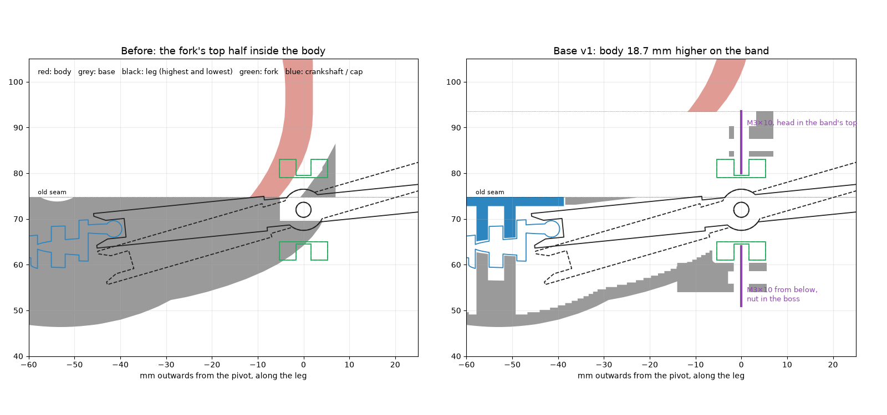

*Fig. 1 · Cut through a middle leg, along it. Left: the carcass as downloaded: the fork (green) goes into the body
(red). Right: base v1, with the body on the band. The two swivel screws are purple: the upper one comes down through
the band and the lower one up through the boss. Black: the leg at its highest and lowest.*

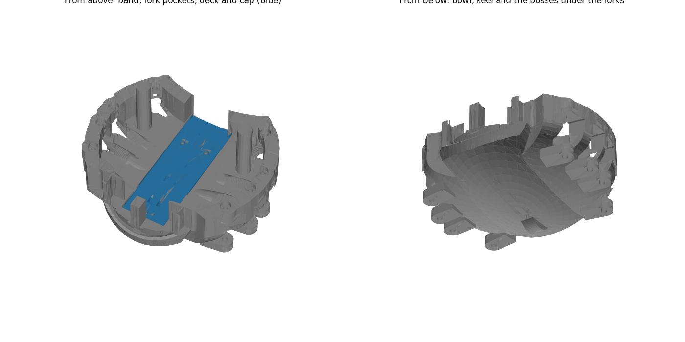

*Fig. 2 · Base v1. From above: the band with a pocket for each fork, the deck and the cap (blue). From below: the
bowl, the keel along the middle and the bosses under the forks.*

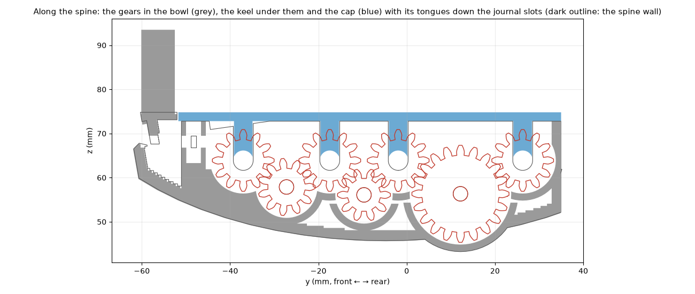

*Fig. 3 · Cut along the spine. The gears (red) turn in pockets in the bowl. The 20-tooth idler goes 2.4 mm below the
original bowl, inside the keel. The cap (blue) has a tongue down each journal slot.*

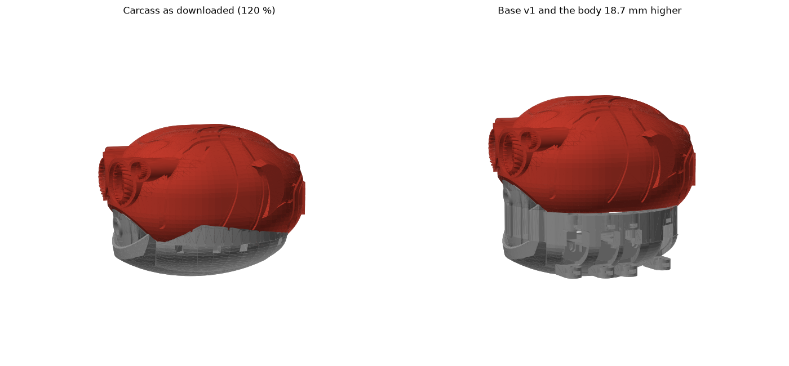

*Fig. 4 · From the side: the carcass as downloaded, and with the body on the band. The front block (the face
behind the eyes) sits inside the body in both. Base v1 is not shaped for looks yet: the band does not follow the
body's outline, and the screws and fork bosses show.*

| What | Result |
|---|---|
| Overlaps over a full turn (every 10°) | None |
| Closest pairs | Journals in their slots 0.25 mm a side, idlers 0.45 mm, legs 0.65 mm or more: the designed clearances |
| [`print/base-v1.3mf`](https://github.com/Morante-robotics/spider-bot-replica/blob/pre-redesign-2026-11-17/print/base-v1.3mf) | 7 h 57 min, 140.4 g of PLA (keel rebuilt for [gear train v2](#gear-train-v2-in-cad), cap for [the test cap fix](#gear-train-test-v2-the-cap)) |
| Hardware | 16 × M3×10 + nuts (fork swivels), 3 × M3×10 + nuts (cap) |

Full list: [`cad/base/check-result.txt`](https://github.com/Morante-robotics/spider-bot-replica/blob/pre-redesign-2026-11-17/cad/base/check-result.txt).

#### Decisions

- **Base v1 is a working prototype, not the final look.** It proves that the drive fits and turns; a later version
  makes it look like the carcass again (Open items).
- **Band, not a new fork or cuts in the body.** The fork tested on the test frame stays as it is. The robot is
  18.7 mm taller and has a band at the seam, where the legs come out.
- **Spine built into the base,** not screwed in: the crankshafts and the forks stay where the CAD puts them relative
  to each other, with no screws to align.
- **Fork and leg slide in from outside** and are held by the two screws only, as on the test frame.
- **Front block separate.** It stands on the deck and the cap. How it is fixed is decided with the carcass cuts.
- **The rim notches** are no longer a separate check: the legs' path is cut into the base with room to spare.
- **The printed leg's foot path will not be compared with the simulator's.** Morante dropped that check.

This entry closes four open items: the fork's window, the rear leg near its crankshaft, the rim notches and the
base. The foot-path comparison was dropped.

### Gear train test

**Phase 3 · Mechanisms · 2026-11-11** · Status: ✅ faults found; fixed in [Gear train v2 in CAD](#gear-train-v2-in-cad)

> **In short.** Before printing the base, the four crankshafts and the three gears between them (the **idlers**)
> were printed on a loose spine and turned by hand. They turn in jerks and jam, and the crankshafts lift out of
> their slots. A new check found why: nothing held the crankshafts down, and two of the three idlers cannot mesh
> with both of their crankshafts at once while the cranks keep their designed angles. The old check had never
> turned the gears. From now on every design is checked for both before it is printed.

**What is being tested.** The four crankshafts must turn together, at the same speed and in the same direction,
with their cranks keeping the angles that give the gait (neighbouring crankshafts 180° apart). Each crankshaft has a
12-tooth gear; an idler sits below and between every two of them. Here the spine is the loose part used only for
this test, without the base's cap, and the idlers turn on M3 screws used as axles.

#### Steps

1. Print [`print/gear-train-test.3mf`](https://github.com/Morante-robotics/spider-bot-replica/blob/pre-redesign-2026-11-17/print/gear-train-test.3mf): spine, 4 crankshafts, 3 idlers (Fig. 1).
2. Put each idler between the spine's walls and push its screw through both walls and the idler.
3. Drop the crankshafts into their slots from above, with the cranks as printed.
4. Turn one crankshaft by hand (Fig. 2).

<table>
<tr>
<td width="50%">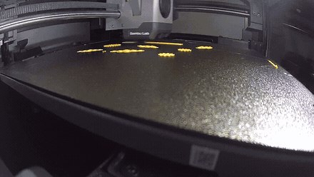</td>
<td width="50%">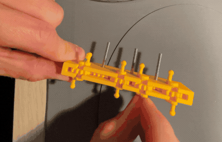</td>
</tr>
<tr>
<td><em>Fig. 1 · Printing <a href="../print/gear-train-test.3mf"><code>print/gear-train-test.3mf</code></a>: the spine
at the back, the crankshafts in their tree supports, the idlers flat.</em></td>
<td><em>Fig. 2 · Turning it by hand. The shafts move in jerks and stop; watch the crankshafts rise in their slots
when the teeth push against each other. The three screws sticking up are the idlers' axles.</em></td>
</tr>
</table>

#### Result

| What | Expected | What happened |
|---|---|---|
| The four crankshafts turn together | Smoothly, by hand | In jerks, and they jam |
| Crankshafts in their slots | Stay in | Lift out: the slots are open at the top and nothing closes them in this test |

**Why.** A new, general check, [`tools/cad_verify.py`](../tools/cad_verify.py), was run on this exact test
([spec](https://github.com/Morante-robotics/spider-bot-replica/blob/pre-redesign-2026-11-17/cad/gear-train-test/verify.py), [full report](https://github.com/Morante-robotics/spider-bot-replica/blob/pre-redesign-2026-11-17/cad/gear-train-test/verify-result.txt)). It turns every gear at its
real angle and pushes every moving part in 26 directions to see what stops it. It found three faults:

1. **Nothing holds the crankshafts down.** All four can rise 3 mm or more. In the robot the base's cap closes the
   slots, but this test had no cap, and the teeth pushing apart lift the shafts out.
2. **Idlers 1 and 2 cannot mesh with both of their crankshafts at once** (Fig. 3). Each crankshaft is printed with
   its teeth at a fixed angle to its cranks. With the cranks at their designed angles, there is no angle of the
   11-tooth or the 10-tooth idler at which its teeth fit between the teeth of both neighbours: at the best one,
   5.8 and 7.9 mm³ of tooth would have to pass through another. Each pair on its own meshes. The 20-tooth idler 3
   fits both. So the train jams unless a crankshaft is put in a tooth off, which shifts its crank by up to 15°.
3. **No backlash.** The gears sit exactly at their theoretical distance, so even meshing teeth touch on both sides
   (0.00 mm gap). Printed teeth are never exact, and teeth without play bind.

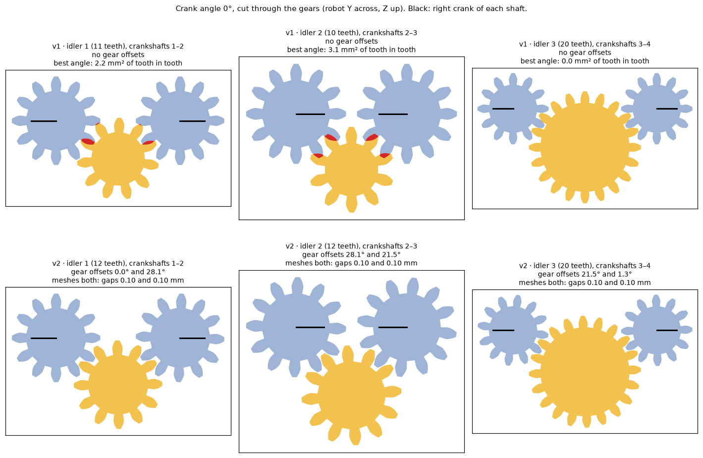

*Fig. 3 · Top row: each idler (yellow) turned to the angle that fits best between its two crankshafts (blue), with
the cranks at their designed angles. Red: tooth inside tooth. Idlers 1 and 2 cannot fit both neighbours; idler 3
can. The bottom row is the fix, in [Gear train v2 in CAD](#gear-train-v2-in-cad). Made by
[`cad/crankshafts/gear_phase_figure.py`](https://github.com/Morante-robotics/spider-bot-replica/blob/pre-redesign-2026-11-17/cad/crankshafts/gear_phase_figure.py).*

**Why the earlier check missed it.** [`cad/legs/check.py`](https://github.com/Morante-robotics/spider-bot-replica/blob/pre-redesign-2026-11-17/cad/legs/check.py) skipped every pair of gears, as
«touching on purpose», and left the idlers at one angle while the crankshafts turned. It never asked what holds
each part in place either.

<details>
<summary>How to reproduce</summary>

```
python3 cad/crankshafts/build.py
python3 cad/gear-train-test/build.py
cd cad/gear-train-test
python3 ../../tools/cad_verify.py verify.py --out verify-result.txt --render images/verify
python3 ../crankshafts/gear_phase_figure.py
```

The spec places the idlers at the angle that fits their two crankshafts best, then turns everything together every
10°. `images/verify/` holds a view of the assembly and two cuts through it.

</details>

#### Decisions

- **Every design is checked before printing** with [`tools/cad_verify.py`](../tools/cad_verify.py): each part a
  closed solid with walls of at least 0.8 mm, no collisions over the motion, gears turned at their real angles with
  some backlash, every moving part held in every direction it should not move, the parts can be assembled in order,
  and the overhangs to support. A design does not go to the printer until it passes.
- **A test rig holds its parts as the robot will.** The gear train is tested again with a cap over the slots.
- **Base v1 waits.** It has the same idlers and the same gear spacing, so it is not printed until the gear train
  turns.
- **Redesigned** in [Gear train v2 in CAD](#gear-train-v2-in-cad).

[↑ Contents](../build-log.md#contents)

### Gear train v2 in CAD

**Phase 3 · Mechanisms · 2026-11-11** · Status: ✅ printed; its cap fixed in [Gear train test v2: the cap](#gear-train-test-v2-the-cap)

> **In short.** The gear train was redesigned to fix the three faults of the [first test](#gear-train-test). Each
> crankshaft's gear is now turned on its shaft by its own angle, so every idler meshes with both of its
> crankshafts while the cranks keep their gait angles. The gears are set a little further apart for backlash, and
> a cap holds the crankshafts down, as the base's cap will. It passes the new check over a full turn; the test is
> printed again before the base.

**The idea.** A crankshaft is printed in one piece, so the angle between its gear's teeth and its cranks can be
anything. Before, it was the same on all four, and two idlers could not find an angle that fitted both neighbours.
Now each crankshaft gets its own **gear offset**, worked out from where the shafts and idlers sit, so that the teeth
of both neighbours line up with the idler's gaps.

#### Steps

1. Gear offsets: 0°, 28.1°, 21.5° and 1.3° for crankshafts 1 to 4, computed in `gear_offsets()` in
   [`cad/crankshafts/build.py`](https://github.com/Morante-robotics/spider-bot-replica/blob/pre-redesign-2026-11-17/cad/crankshafts/build.py).
2. Idlers: 12, 12 and 20 teeth (were 11, 10 and 20). Fewer than 12 teeth would need a modified tooth shape.
   Idlers 1 and 2 are now the same part.
3. Backlash: every pair of gears 0.275 mm further apart than in theory (`BACKLASH` = 0.2 mm). The crankshaft gears
   print lying down, so their teeth are rougher than the idlers'.
4. A **test cap** over the spine, with one tongue down each journal slot, like the base's cap. It is held by
   2 × M3×12 into nuts slid into the spine's end blocks. The spine got a foot so it stands on the desk.
5. Marks: with the offsets, each crankshaft fits in one place and one way round only. A shaft turned end for end
   would mesh with its cranks 2.5–13° off, which is hard to see. So each crankshaft has 1 to 4 small dots on its +X
   crank web (the side of the right legs), and the spine and the cap have the same dots by each slot.
6. The idlers' first layer is 0.2 mm smaller and their bore is chamfered at the bed, against the squashed first
   layer.
7. Base v1 was rebuilt: its keel follows the new idlers (0.57 mm deeper). Its plate was sliced again.
8. Check with [`tools/cad_verify.py`](../tools/cad_verify.py) every 5°, and a 2D gear check every 1°, then the
   whole drive against base v1, its cap and the body every 10°.


*Fig. 1 · The parts of the test. The spine has a foot and an M3 nut slot at each end; the cap's tongues go down the
journal slots. Each crankshaft is different: look at where its cranks point compared with its gear teeth. Made by
[`tools/stl_preview.py`](../tools/stl_preview.py).*

#### Result

The bottom row of Fig. 3 in [Gear train test](#gear-train-test) shows every idler meshing with both neighbours.

| Check | Result |
|---|---|
| [`verify-result.txt`](https://github.com/Morante-robotics/spider-bot-replica/blob/pre-redesign-2026-11-17/cad/gear-train-test/verify-result.txt): integrity, motion, gears, what holds each part, assembly order | PASS, 0 failures, 0 warnings |
| [`check-gear-train.txt`](https://github.com/Morante-robotics/spider-bot-replica/blob/pre-redesign-2026-11-17/cad/crankshafts/check-gear-train.txt): every mesh, every 1° | No tooth in tooth; backlash 0.21–0.22 mm |
| Crankshafts and idlers held | Only spin is free; at most 0.25 mm play (journals), 0.45 mm (idlers along their axle) |
| [Base v1](https://github.com/Morante-robotics/spider-bot-replica/blob/pre-redesign-2026-11-17/cad/base/check-result.txt) and [whole drive](https://github.com/Morante-robotics/spider-bot-replica/blob/pre-redesign-2026-11-17/cad/legs/check-result.txt) over a full turn | No overlaps; closest pairs are the designed clearances |
| [`print/gear-train-test-v2.3mf`](https://github.com/Morante-robotics/spider-bot-replica/blob/pre-redesign-2026-11-17/print/gear-train-test-v2.3mf) | 1 h 20 min, 33.7 g of PLA (1 h 19 min, 33.5 g with [the new cap](#gear-train-test-v2-the-cap)) |

<details>
<summary>How to reproduce</summary>

```
python3 cad/crankshafts/build.py
python3 cad/gear-train-test/build.py
python3 cad/test-frame/build.py
python3 cad/legs/build.py
cd cad/gear-train-test
python3 ../../tools/cad_verify.py verify.py --out verify-result.txt --render images/verify
python3 ../crankshafts/check_gear_train.py
python3 ../crankshafts/gear_phase_figure.py
python3 ../legs/check.py --gaps
cd ../base && python3 build.py && python3 check.py --step 10
```

The spec places each idler at the angle its formula gives (not the best fit), so a crankshaft a tooth off would show
as an overlap.

</details>

#### Decisions

- **Gear offsets, not new positions.** The shafts stay where the simulator put them; only the gear turns on its
  shaft.
- **About 0.2 mm of backlash** instead of 0.15: the check wants at least 0.08 mm free on each side of a tooth, and
  the crankshaft gears' teeth print stepped.
- **The test cap was redesigned** after the print, in [Gear train test v2: the cap](#gear-train-test-v2-the-cap).

[↑ Contents](../build-log.md#contents)

### Gear train test v2: the cap

**Phase 3 · Mechanisms · 2026-11-12** · Status: ✅ the train turns

> **In short.** The [gear train v2](#gear-train-v2-in-cad) was printed and assembled. Without its cap the four
> crankshafts turned together, but with the cap on, even half pushed in, nothing turned. The cap's tongues ran
> 0.25 mm from the gear faces, and only its screws kept the cap from sliding sideways onto them. A new cap keeps
> its tongues clear of the gears and is centred by four skirts; with it the train turns by hand. Base v1's cap had
> the same design and was fixed the same way.

#### Steps

1. Print [`print/gear-train-test-v2.3mf`](https://github.com/Morante-robotics/spider-bot-replica/blob/pre-redesign-2026-11-17/print/gear-train-test-v2.3mf) and assemble it as in
   [print/README](../print/README.md#gear-train-test-v2) (Fig. 1).
2. Turn crankshaft 1 by its crank, first without the cap, then with it.
3. With the cap jamming the train, measure the printed parts with a caliper. The journals came out 3.9–4.0 mm
   (designed 4.0), so the slots were not the problem.
4. Redesign the cap (below) and print it on its own: [`print/test-cap-v2.3mf`](https://github.com/Morante-robotics/spider-bot-replica/blob/pre-redesign-2026-11-17/print/test-cap-v2.3mf), 13 min,
   6.7 g. The full plate now carries the new cap.
5. Fit the new cap and turn crankshaft 1 by its crank (Fig. 2).


*Fig. 1 · Left: the parts pulled apart along the way each one goes in, numbered by assembly step. Right: the test
seen from the +X side (the side with the dots) with every crank level; the arrows show where each +X crank points
(front, rear, front, rear). Made by [`cad/gear-train-test/assembly_figure.py`](https://github.com/Morante-robotics/spider-bot-replica/blob/pre-redesign-2026-11-17/cad/gear-train-test/assembly_figure.py).*

#### Result

| What | Expected | What happened |
|---|---|---|
| Train without the cap | Turns | Turns; the shafts lift a little when the teeth push, as nothing holds them down |
| Train with the first cap | Turns | Does not turn at all, even with the cap half pushed in or with one tongue broken off |
| Train with the new cap | Turns | The four shafts turn together, smoothly (Fig. 2) |

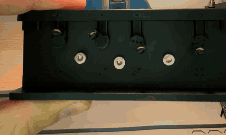

*Fig. 2 · Seen from the +X side with the new cap on: the cranks of the four shafts go round together. The
three bright washers are the idlers' axle screws.*

**Why the first cap jammed.** Each tongue went down a slot over a journal and covered the whole width of the wall,
up to 0.25 mm from the gear. Only the cap's two screws, in oversized holes, centred it, so it could sit 0.3 mm to
one side; the crankshafts can also slide 0.25 mm along their axis. At the worst position a tongue touched the face
of a turning gear and braked it. The check had placed every part only at its nominal position, saw a quarter of a
millimetre free and passed.

**The fix** (`test_cap()` in [`cad/gear-train-test/build.py`](https://github.com/Morante-robotics/spider-bot-replica/blob/pre-redesign-2026-11-17/cad/gear-train-test/build.py)):

- **Tongues only over the outer part of each wall**, 1.1 mm wide instead of 2.5. With the cap and the shafts at
  their worst positions, they stay 0.9 mm from the gear faces.
- **Four skirts** at the ends of the cap come down outside the walls, 0.2 mm off each side, so the cap sits centred
  on the spine and cannot slide onto the gears. They are by the end blocks, away from everything that turns.
- **The check poses loose parts at their extremes now.** [`tools/cad_verify.py`](../tools/cad_verify.py) has a
  keep-out zone around each gear face (its play plus 0.8 mm), and [the spec](https://github.com/Morante-robotics/spider-bot-replica/blob/pre-redesign-2026-11-17/cad/gear-train-test/verify.py) turns
  the train with the cap shifted 0.2 mm either way. The first cap fails it in three places; the new one passes
  ([report](https://github.com/Morante-robotics/spider-bot-replica/blob/pre-redesign-2026-11-17/cad/gear-train-test/verify-result.txt)).
- **Base v1's cap** had the same tongues and now has the same narrow ones ([`cad/base/build.py`](https://github.com/Morante-robotics/spider-bot-replica/blob/pre-redesign-2026-11-17/cad/base/build.py)).

<details>
<summary>How to reproduce</summary>

```
python3 cad/crankshafts/build.py
python3 cad/gear-train-test/build.py
cd cad/gear-train-test
python3 ../../tools/cad_verify.py verify.py --out verify-result.txt --render images/verify
python3 assembly_figure.py
cd ../base && python3 build.py
```

`VERIFY_STEP=30` in front of the verifier gives a quick run every 30° instead of every 5°.

</details>

#### Decisions

- **A cover is never located by its screws alone:** a skirt, a lip or the edge of an opening places it, and a
  spinning gear face keeps at least 0.8 mm from any fixed printed face, counting the play of every loose part.
- **The gear faces still run 0.25 mm from the spine's walls.** The train turns without the cap, so they were left
  as they are; they are the first place to look if the drive drags in the base.
- **Base v1 is printed next**, with the new cap.

This entry closes the open item «Print the gear train test v2 and turn it by hand».

[↑ Contents](../build-log.md#contents)

### Base v1: print and first fitting

**Phase 3 · Mechanisms · 2026-11-13** · Status: ✅ faults found; base v2 next

> **In short.** [Base v1](#base-v1-in-cad) was printed with its cap and front block, and its parts were tried
> together. It could not be assembled: the cap was so tight that its tongues broke while it was pressed in, the
> front block was not fixed and both its thin pegs and the posts they sit on broke, the idlers' steel pins could not
> be reached, the big gear stood about a quarter of its width out of its seat, support stayed trapped in the
> recesses, and nothing marked how the gears go in. Each of these is now a CAD rule or an
> automatic check, and base v2 is designed with them.

#### Steps

1. Print [`print/base-v1.3mf`](https://github.com/Morante-robotics/spider-bot-replica/blob/pre-redesign-2026-11-17/print/base-v1.3mf): the base, the cap upside down and the front block, tree
   supports on the build plate only (Fig. 1).
2. Remove the supports.
3. Try the parts in the base: the cap over the spine (pressed in by hand), the front block, the gears and the
   idlers' 3 mm steel pins.


*Fig. 1 · The plate printing: the base on tree supports (left), the front block (right) and the cap with its four
pairs of tongues (front).*

| Part | Part (g) | Support (g) |
|---|---|---|
| Base | 82.3 | 26.0 |
| Front block | 23.4 | 2.9 |
| Cap | 5.8 | 0 |
| Plate | 7 h 57 min, 140.4 g in all | 28.8 |

<details>
<summary>How to reproduce</summary>

```
python3 tools/print_report.py print/base-v1.3mf
python3 cad/base/cap_failure_figure.py
```

The plate and its settings: [print/README](../print/README.md#base-v1).

</details>

#### Result

<table>
<tr>
<td width="50%">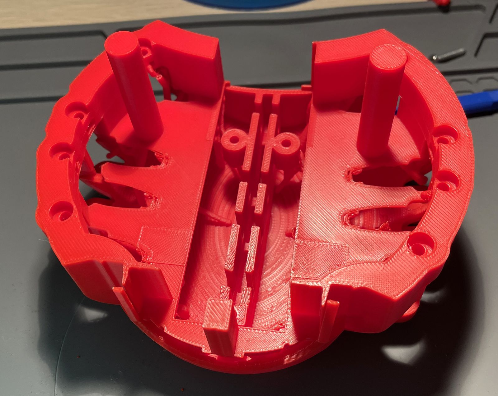</td>
<td width="50%">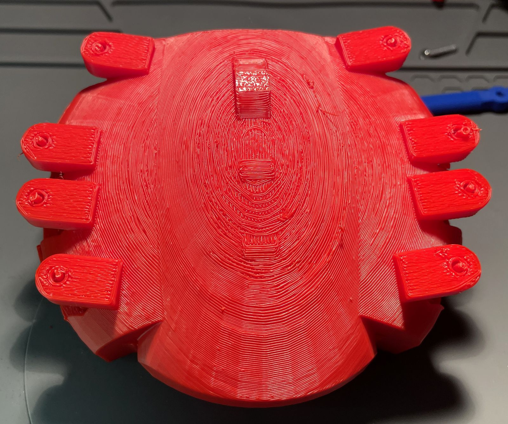</td>
</tr>
<tr>
<td><em>Fig. 2a · From above: the band with the fork pockets, the two tall round pegs that locate the body, and the
spine down the middle.</em></td>
<td><em>Fig. 2b · From below: the bowl with the eight fork bosses and the keel along the middle.</em></td>
</tr>
<tr>
<td width="50%">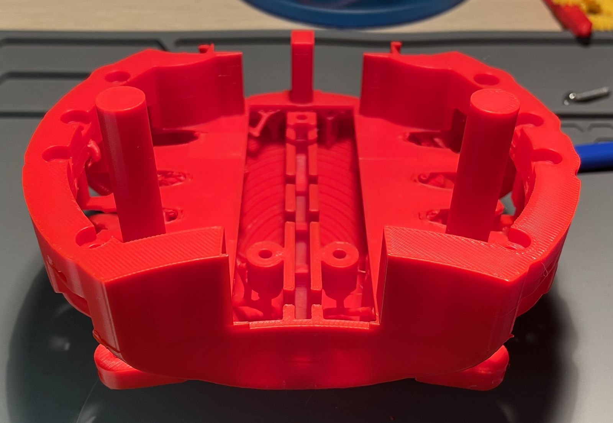</td>
<td width="50%">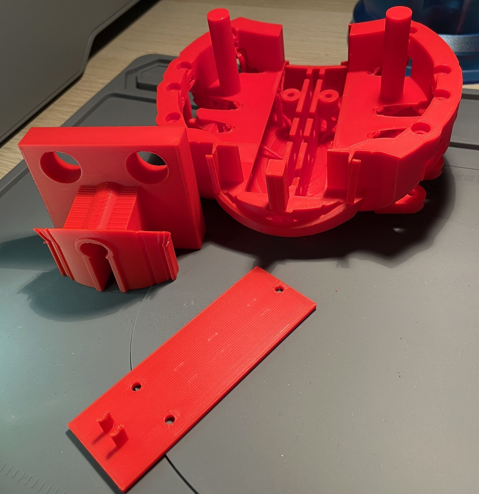</td>
</tr>
<tr>
<td><em>Fig. 2c · From the rear. Branches of tree support are still inside the bowl, at the top left of the
spine.</em></td>
<td><em>Fig. 2d · The front block (left) and the cap (front): only one pair of the cap's tongues is left
(Fig. 3).</em></td>
</tr>
</table>

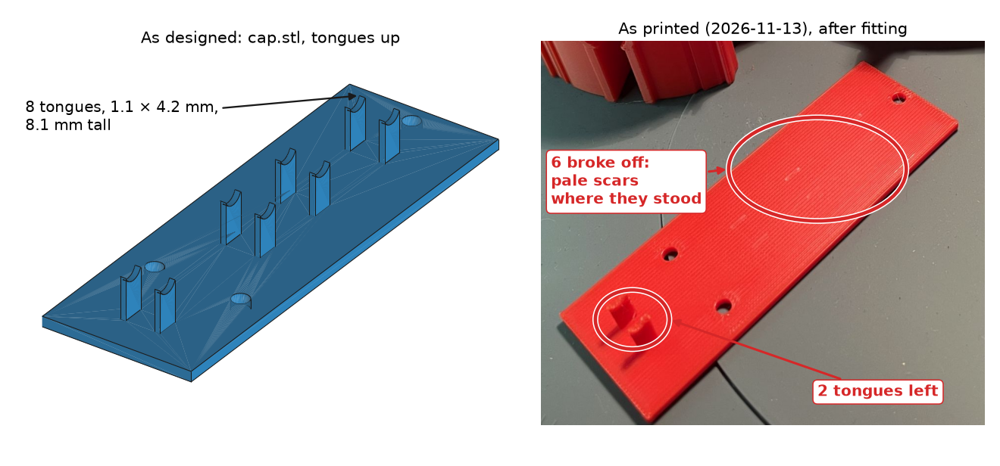

*Fig. 3 · The cap as designed (left) and as printed (right). Its tongues go down the journal slots of the spine;
the cap went in only when pressed hard, and six of the eight broke off at their root while it was pressed in. Made by
[`cad/base/cap_failure_figure.py`](https://github.com/Morante-robotics/spider-bot-replica/blob/pre-redesign-2026-11-17/cad/base/cap_failure_figure.py).*

| What | What happened | In the photos |
|---|---|---|
| Cap | Very tight: it went in only when pressed hard, and its tongues broke while it was pressed in | Fig. 2d, 3 |
| Front block | Not fixed; its thin pegs and the posts they sit on both broke | No |
| Idler pins | The 3 mm steel pins, which go in sideways through both spine walls, could not be reached | No |
| Big gear | Stood out of its seat by about a quarter of its width (estimated by eye). Two possible causes, not told apart: the design, or support left inside that could not be removed | No |
| Support | Trapped in the recesses | Fig. 2c |
| Gears | No marks to show how they go in | No |

**Against the CAD check.** The [check over a full turn](#base-v1-in-cad) found no overlaps, and it was right
about that: none of these faults is two parts in the same place. They are about how the parts go in (tight fits,
pins out of reach, a gear not seated, no marks), how they are held (a loose block on thin pegs) and how the base
prints (support where it cannot be removed): things a check for overlaps over a full turn does not measure.

#### Decisions

- **Base v2, not a repaired v1.** The faults are in the design, so v1 is not patched or reprinted.
- **Every lesson is a rule or a check before base v2.** They are in the design rules
  ([cad/README.md](../cad/README.md#a-design-folder)) and in [`tools/cad_verify.py`](../tools/cad_verify.py)
  ([commit 7663ecf](https://github.com/Morante-robotics/spider-bot-replica/commit/7663ecf)), so base v2 is checked
  against them before it is printed.

This entry closes the open item «Base v1 was printed … write its entry»; designing base v2 stays open.
Base v2 is now designed as part of the whole robot: [Whole robot first](#whole-robot-first-motor-sizing-and-chassis-plan).

[↑ Contents](../build-log.md#contents)

### Whole robot first: motor sizing and chassis plan

**Phase 3 · Mechanisms · 2026-11-14** · Status: ✅ plan approved; Part A modelled in [Chassis Part A](#chassis-part-a-master-model-and-drive-module)

> **In short.** Base v1 had no place for the motor or the batteries, so even a corrected base v2 could not test the
> motor, and more partial prints would follow. From now on the whole robot, in its final looks, is modelled and
> checked in CAD before anything else is printed. The motor was sized first: a Pololu N20 HP 6 V 380:1, with a
> margin of 3.1 on flat batteries. Then a plan for the whole robot was written and approved: the motor sits over
> the last idler, the batteries ride in the body, and the printed teeth are the fuse that protects the gearbox if a
> leg jams. Nothing is modelled or bought yet.

[Base v1](#base-v1-print-and-first-fitting) showed that the drive works only as part of a robot: the base had no
seat for the motor, no place for the battery holder, no way to hold the front block or the body. Each fix would
have been one more test print (v2, v3…), each testing a part of the robot and none the motor. The new order:
model the whole robot, check it as one design, then print one batch of small test pieces (coupons) for every fit
not yet measured, then the working chassis (**v0**) with its motor. A failure changes that one design, which is
checked again as a whole. The parts most likely to need a fix (motor clamp, cap, front block) are separate and
screwed on, so a fix reprints a few grams, not the base.

#### Steps

1. **Size the motor** with [`sim/motor_sizing.py`](../sim/motor_sizing.py): the robot's mass from the printed parts
   and catalogue values, the torque the four crankshafts need over one turn (from the
   [3D toy leg](#toy-leg-in-3d) model), the speed for a desk-toy walk, and Pololu's N20 data scaled to the battery
   voltage. A motor passes if its stall torque is at least 3 times the worst working torque (a **margin** of 3,
   with the printed gears taken at 50 % efficiency) on flat batteries (4.0 V), and if the robot still walks at
   1.8 cm/s or more on 4.8 V. Output: [`sim/motor-sizing-result.txt`](https://github.com/Morante-robotics/spider-bot-replica/blob/pre-redesign-2026-11-17/sim/motor-sizing-result.txt).
2. **Plan the whole robot** in [`cad/chassis/design-plan.md`](https://github.com/Morante-robotics/spider-bot-replica/blob/pre-redesign-2026-11-17/cad/chassis/design-plan.md): where the motor,
   the battery holder, the switch and the eyes board go, how each part is held and assembled, which fits are still
   untested and which coupon tests each. A design review checked it twice; each pass asked for changes, which went
   into revisions 3 and 4. Morante approved revision 4.
3. **Estimate the mass** of the final robot and of v0 with
   [`cad/chassis/mass_estimate.py`](https://github.com/Morante-robotics/spider-bot-replica/blob/pre-redesign-2026-11-17/cad/chassis/mass_estimate.py), adding a contingency to each mass by how
   sure it is.
4. **Work out what breaks if a leg jams**: the motor can push harder than its own gearbox can take, so something
   printed must give first (Fig. 5).

<details>
<summary>How to reproduce</summary>

```
uv sync
.venv/bin/python sim/motor_sizing.py > sim/motor-sizing-result.txt
.venv/bin/python sim/motor_sizing_figure.py
cd cad/chassis
../../.venv/bin/python plan_figure.py        # --lang es: Spanish copies for the workshop kit
../../.venv/bin/python mass_estimate.py      # --lang es as well
```

`plan_figure.py` needs base v1's meshes (`cad/base/build.py`). Assumptions of the sizing, all in its docstring and
output: the body stands on the feet within 2 mm of the lowest; friction 0.35 printed on printed, 0.25 screw on
printed, 0.4–0.6 foot on the desk; centre of mass anywhere within ±5 mm of the body axis; 800 mAh NiMH cells and
0.3 Ω in the battery, switch and wires.

</details>

#### Result

**Motor.** The worst torque the cranks need over a turn is 57 N·mm (Table 1). The motor drives a 12-tooth pinion
on the 20-tooth idler 3, and the idlers only reverse the direction, so the crankshafts turn at the motor's speed
and the motor needs 57 / 0.5 = 113 N·mm at its shaft. Of Pololu's N20s, only the HP 380:1 passes (Fig. 1).

| What | Value |
|---|---|
| Robot mass, measured parts and estimates | 403 g; with 15 % margin 463 g |
| Worst crank torque over a turn | 57 N·mm: lifting the body 23.5, feet slipping 14.5, friction in the joints 18.5 |
| Typical peak crank torque | 45 N·mm |
| Distance walked per crank turn | 19.3 mm |
| Chosen motor: [Pololu Micro Metal Gearmotor HP 6 V 380:1](https://www.pololu.com/product/4794) | 84 rpm and 5.5 kg·cm stall at 6 V, 1.6 A stall |
| With it | Margin 3.8 at 4.8 V and 3.1 at 4.0 V; 1.9 cm/s at 4.8 V; 2.5–3 h on 800 mAh |

*Table 1 · The motor sizing ([full output](https://github.com/Morante-robotics/spider-bot-replica/blob/pre-redesign-2026-11-17/sim/motor-sizing-result.txt)).*

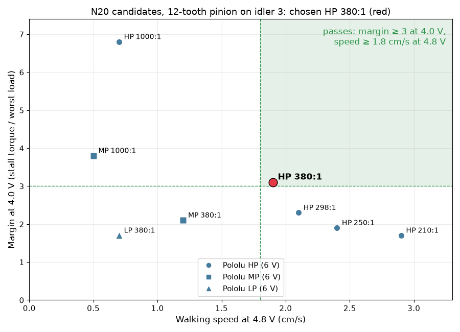

*Fig. 1 · Each N20 that could fit, by its margin on flat batteries (up) and its walking speed (right). Only the HP
380:1 lands in the green zone. The HP 298:1 is faster but has a margin of 2.3; the medium- and low-power (MP, LP)
motors are too weak at the same ratio; the HP 1000:1 is strong but walks at 0.7 cm/s. Generic N20s sold as
«1:298, 50 rpm» use a slower motor of the MP and LP class, and fail too. Made by
[`sim/motor_sizing_figure.py`](https://github.com/Morante-robotics/spider-bot-replica/blob/pre-redesign-2026-11-17/sim/motor_sizing_figure.py).*

**Where the motor goes.** The sizing found no room under the deck between the legs' arms: a pinion meshing with
idler 3 sits above the deck. So the N20 lies along X over idler 3, partly through the deck, held by a clamp from
above (Fig. 2, 3). Over a full turn every 10°, it stays 1.5–2.0 mm from the legs, 2.0–2.5 mm from the crankshafts,
and its pinion's teeth 2.28 mm from the gears of crankshafts 3 and 4.

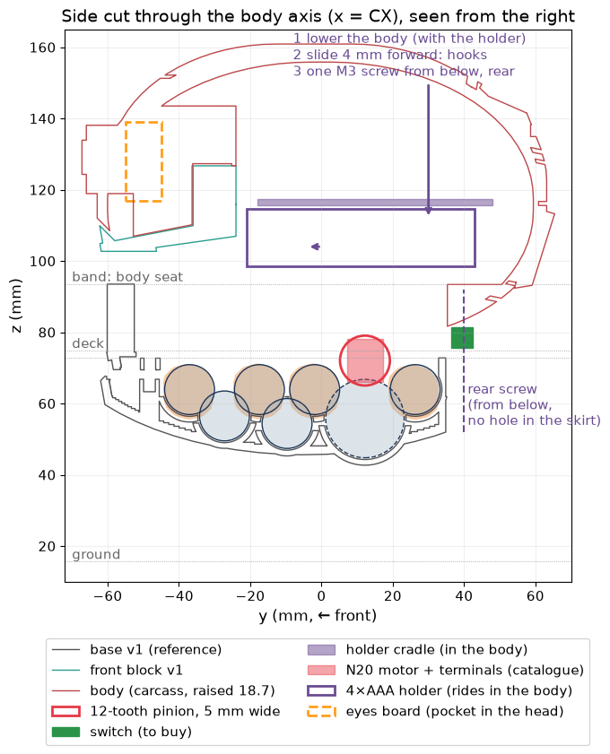

*Fig. 2 · Side cut through the middle of the robot. The pinion (red circle) sits on idler 3, partly through the
deck. The battery holder (purple box) rides in the body. The arrows show how the body goes on: down, 4 mm forward
onto two hooks, then one M3 screw from below at the rear. The switch (green) is recessed at the rear. The eyes
board (orange) goes in a pocket cut into the head. Orange and blue fills: everything the legs and the
crankshafts sweep over a turn. Made by [`cad/chassis/plan_figure.py`](https://github.com/Morante-robotics/spider-bot-replica/blob/pre-redesign-2026-11-17/cad/chassis/plan_figure.py), which also
draws the [view from above](https://github.com/Morante-robotics/spider-bot-replica/blob/pre-redesign-2026-11-17/cad/chassis/images/plan-top.png?raw=true).*

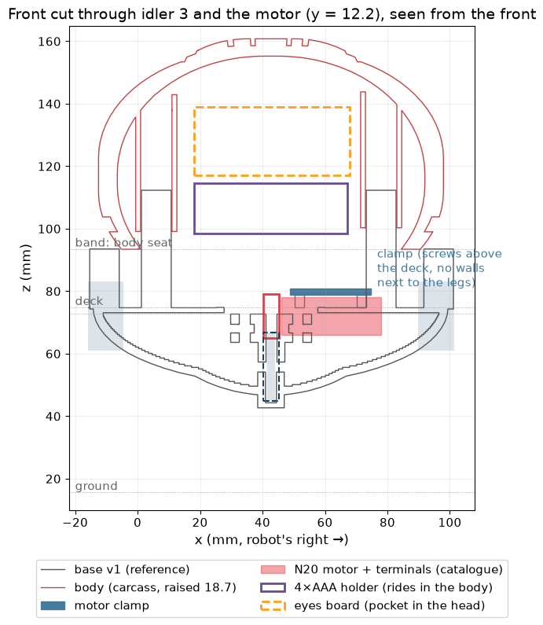

*Fig. 3 · Front cut through idler 3 and the motor. The N20 (red box) lies along X with its pinion at the gear
plane; the clamp (blue bar) and its screws are above the deck, away from the legs' paths.*

**The plan's main choices** ([plan](https://github.com/Morante-robotics/spider-bot-replica/blob/pre-redesign-2026-11-17/cad/chassis/design-plan.md)):

- **Drive module.** The spine with the crankshafts and idlers, the motor seat, the clamp and the cap are one
  separate part, assembled on the bench and lowered into the chassis with 4 screws. Idler 3 is reprinted 5 mm wide
  for the pinion; the printed crankshafts, idlers 1 and 2, legs and forks are reused if the whole-robot check passes
  them.
- **Batteries in the body.** The 4×AAA holder rides in a cradle inside the body; body and holder lift off together
  and a 2-pin connector (JST-XH) joins them to the chassis. To change the batteries: one screw out from below,
  slide the body back 4 mm, lift it. There is no hatch.
- **Switch and eyes.** A small slide switch (SS12D00) recessed at the rear; the eyes board (2 LEDs and their
  resistors) in a 50 × 22 × 10 mm pocket cut into the solid head.
- **v0 is printed as the looks chassis**, not as a plain test base, and walks with about 125 g of steel ballast in
  a frame placed at the final robot's centre of mass, so the motor is tested at the final weight. ↩️ Dropped on
  2026-11-16: [one robot, the looks one](#chassis-part-b1-part-c-check-and-the-friction-clutch).

**Mass.** With the parts the plan adds (drive module, front block v2, cradle, paint, the screws for each joint), the
final robot comes to 445 g as summed, with its centre of mass 0.4 mm and 2.5 mm off the body axis (Fig. 4). With
a contingency by source (+15 % on plan estimates, +10 % on catalogue values, +5 % on masses from the shell model of
a mesh) the design mass is **486 g: margin 2.96, 8 g over the 478 g at which the HP 380:1 keeps a margin of 3.0**.
The margin here is scaled from the sizing as 1/mass, a first approximation; both scripts are rerun once the parts
are modelled and their contingency drops. The plan lists ways out if it is still over (lighter printed parts, a
measured gear efficiency, another ratio); none is chosen.

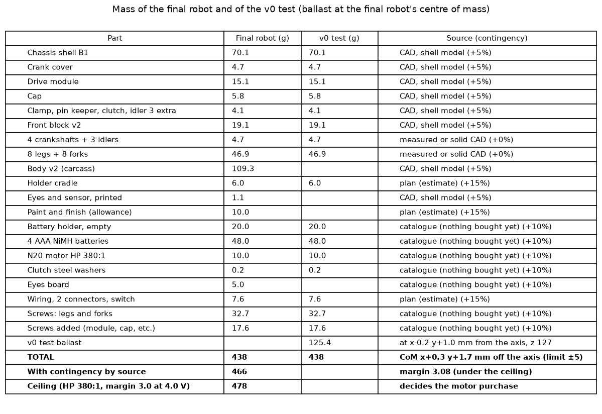

*Fig. 4 · Mass of each part of the final robot and of v0, with where each number comes from. The ballast row is
what v0 carries so that it weighs and balances like the final robot. Made by
[`cad/chassis/mass_estimate.py`](https://github.com/Morante-robotics/spider-bot-replica/blob/pre-redesign-2026-11-17/cad/chassis/mass_estimate.py); the figure is made again as parts are modelled,
so it shows the latest values ([Chassis Part A](#chassis-part-a-master-model-and-drive-module)).*

**If a leg jams.** The motor then pushes up to its stall torque, 360–503 N·mm (4.0–5.6 V), more than any printed
tooth and more than the gearbox's own limit, 245 N·mm (Pololu's figure for the 380:1). The pinion is pressed on
the motor's D-shaped shaft and cannot slip, so a printed tooth must break first, below 245. Estimated with PLA at
50 MPa, the teeth of idlers 1 and 2 break at about 191 N·mm and those of the crank gears at about 220 (Fig. 5).

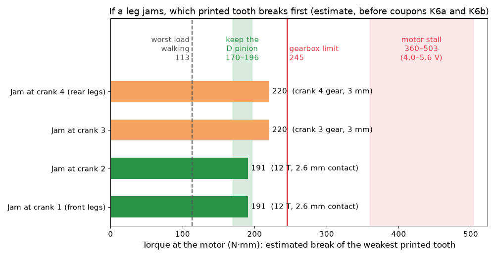

*Fig. 5 · For a jam at each crankshaft, the torque at the motor at which the weakest printed tooth in the path
breaks (estimate). Green band: where the plain D-bore pinion is kept. A jam at the front cranks breaks a tooth
inside the band; at the rear cranks (3 and 4) the estimate is above it, still under the gearbox's limit. Made by
[`sim/motor_sizing_figure.py`](https://github.com/Morante-robotics/spider-bot-replica/blob/pre-redesign-2026-11-17/sim/motor_sizing_figure.py).*

**Coupons.** Each untested fit gets a small test piece cut from the robot's own geometry, printed in one batch
once the whole robot passes (about 40 g, 3 h 15 min in all):

| Coupon | Tests | Waits for |
|---|---|---|
| K1 pinion | The pinion's D-bore on the motor shaft (3 sizes) | The whole robot and the motor |
| K2 motor stage | The motor seat and clamp, loaded to the worst design torque | The whole robot and the motor |
| K3 cap tongues | The cap on a slice of the spine: on and off 5 times | The whole robot |
| K4, K5 | The module's fit in the chassis; the body's hooks and rear screw | The whole robot |
| K6a, K6b | The break torque of an idler tooth and of a crank-gear tooth, with weights on a 30 mm lever | The whole robot |

The gear train's efficiency (test T1) is measured on the assembled module once the motor is there.

#### Decisions

- **The whole robot is modelled and checked in CAD before anything else is printed**, then one batch of coupons,
  then v0. No new partial test rigs.
- **Motor: Pololu N20 HP 6 V 380:1**, on catalogue values for now. Nothing is bought (motor, holder, batteries,
  switch, connectors) until the first looks version passes in CAD and its mass confirms the sizing; then the bought
  parts are measured and their values replace the catalogue ones.
  The purchase now waits for the weight and size review too: [Chassis Part A](#chassis-part-a-master-model-and-drive-module).
- **Stall protection: a plain D-bore pinion**, kept if every measured break (K6a, K6b) is at most 196 N·mm
  (0.8 × 245) and at least 170 N·mm (1.5 × the 113 N·mm worst design load, so teeth do not break while walking).
  Otherwise the fallback becomes the design: the pinion carried on a hub that slips on a friction face at 170 N·mm.

This entry closes the open item «N20 gear ratio and motor stage». The item «Base for looks, once the v0 chassis
walks» is now part of the whole-robot item, as v0 is printed as the looks chassis.

[↑ Contents](../build-log.md#contents)

### Chassis Part A: master model and drive module

**Phase 3 · Mechanisms · 2026-11-15** · Status: ✅ modelled and checked; Part B next

> **In short.** The first part of the whole robot is in CAD: a master model that holds the robot's reference
> heights and the joints between its designs, and the **drive module**, a gearbox of its own that carries the four
> crankshafts, the idlers and the N20 motor with its pinion, and screws into the chassis. Checked against the
> carcass, its first version hung 10 mm under the robot's belly; its gear pockets were cut flat, and a new check now
> keeps every part inside the carcass. After three design reviews it passes the full check with no failures. The
> robot's design mass is 484 g, 6 g over what the chosen motor carries with its margin of 3, so a weight and size
> review comes before the motor is bought.

The [plan](#whole-robot-first-motor-sizing-and-chassis-plan) models the whole robot in parts, each checked before
the next. Part A is everything that turns and what holds it: the crankshafts and idlers (reused as printed), the
motor and its pinion, and the module they sit in. The parts that give the robot its looks (Part B) are built round
it. The motor, battery holder and switch are not bought yet, so their sizes are catalogue values, marked as such in
the model until they are measured.

#### Steps

1. **Master model** ([`cad/robot.py`](https://github.com/Morante-robotics/spider-bot-replica/blob/pre-redesign-2026-11-17/cad/robot.py)): the reference heights (ground z 15.6, leg pivots 72.0,
   deck 72.8–74.8, body seat 93.5), the carcass as the envelope everything must fit in, the twelve interfaces I1–I12
   between designs (which fit and which screws join them), and the envelopes of the bought parts. Every design
   takes these numbers from here instead of copying them.
2. **The drive module and its parts** in [`cad/chassis/build.py`](https://github.com/Morante-robotics/spider-bot-replica/blob/pre-redesign-2026-11-17/cad/chassis/build.py) (Fig. 1, 2):

   | Part | What it does | g |
   |---|---|---|
   | Drive module | Two walls with the crankshafts' slots, the idlers' pin holes and the gear pockets; a pad, a V-shaped saddle and an end wall for the motor; 4 nut traps to screw it to the chassis from below | 15.1 |
   | Cap | Holds the crankshafts down (the tongues and skirts of the [test cap](#gear-train-test-v2-the-cap)), cut round the pinion | 5.8 |
   | Motor clamp | A bar over the motor: it presses the gearbox down and its cheeks hold the gearbox's flat sides against the motor's torque | 2.3 |
   | Pinion | 12 teeth, 5 mm wide, pressed on the motor's D-shaped shaft | 0.6 |
   | Idler 3 v2 | Idler 3 widened to 5 mm, to match the pinion | 1.4 |
   | Pin keeper | Holds the three steel idler pins in | 0.7 |
   | Press jig, gauge fork, press cup | Bench tools, not in the robot: they press the pinion on the shaft square and 0.8 mm from the gearbox | 7.7 |

3. **New fits** in [`cad/fits.py`](../cad/fits.py). Two are measured, from the gear train test v2 that turned
   without its cap (rows added to [`measurements.csv`](../measurements.csv)): 0.25 mm a side between a crank gear
   and the walls, 0.45 mm for an idler. Five are assumed, each with the coupon that will measure it: the pinion's
   D-bore at the shaft's size (K1), the motor's seat and clamp cheeks at 0.2 mm and the clamp pad pressed 0.3 mm
   into the gearbox (K2), the cap's tongues at 0.3 mm a side and 0.5 mm round every gear tip in its pocket (K3).
4. **The check** ([`cad/chassis/verify.py`](https://github.com/Morante-robotics/spider-bot-replica/blob/pre-redesign-2026-11-17/cad/chassis/verify.py), the start of the whole-robot check): every
   part turned over a full crank turn in 10° steps with the 8 legs swept past the module, the gears over one tooth
   in 1° steps, also with the motor lifted 0.2 mm under its clamp; what holds each part; the assembly order with the
   finger or tool for each screw and nut; and every part kept inside the carcass.
5. **Three design reviews**, each answered by a new revision of the model:

   | Review | Found | Fixed |
   |---|---|---|
   | 1 | The module had never been checked against the carcass: its pointed gear pockets hung 10 mm under the carcass's bottom, taking the ground clearance from 30 to 20 mm (Fig. 3), and it stuck out at the rear and under the motor. Also: two thin posts took the motor's torque; the motor could slide about 1 mm along its axis; the clamp sat on the pinion's keep-out zone; the assembly order could not be done (the pinion dropped in alone, then the motor) | Gear pockets cut flat; a new keep-in check in [`tools/cad_verify.py`](../tools/cad_verify.py); the clamp's cheeks take the torque and its pad presses the gearbox; the clamp hollowed over the pinion |
   | 2 | 7 of 8 points closed. Still: the assembly order (its pictures become the workshop kit); the 0.8 mm gauge was not a part; the module's rear end reaches the carcass's rear face (Fig. 4) | The pinion pressed on the motor on the bench, then motor and pinion dropped in together (Fig. 5); the press jig and gauge fork; Part B's shell bulges 2 mm at the rear |
   | 3 | Small points: the keep-in check measured the front against the head instead of the carcass top; a measurement that could not be taken; the jig did not square the motor; a 0.31 mm skin over one screw hole; the numbering of the exploded view | All fixed |

6. **Mass** rerun with the module, cap and small parts from their CAD files
   ([`mass_estimate.py`](https://github.com/Morante-robotics/spider-bot-replica/blob/pre-redesign-2026-11-17/cad/chassis/mass_estimate.py)).

<details>
<summary>How to reproduce</summary>

```
uv sync
cd cad/chassis
../../.venv/bin/python build.py
../../.venv/bin/python ../../tools/cad_verify.py verify.py --out verify-result.txt --render images/verify
../../.venv/bin/python mass_estimate.py
../../.venv/bin/python part_a_figures.py
cd ../.. && .venv/bin/python -m pytest tools/tests
```

`build.py` writes every part to `out/` (STEP and STL); the parts, hardware, screw lengths and the bench assembly are
in the folder's [README](https://github.com/Morante-robotics/spider-bot-replica/blob/pre-redesign-2026-11-17/cad/chassis/README.md), and the answers of the last review, each with its number, in
[`design-review.md`](https://github.com/Morante-robotics/spider-bot-replica/blob/pre-redesign-2026-11-17/cad/chassis/design-review.md). The keep-in check takes the carcass inset by 2 mm (the
chassis shell's wall) below the deck, with three named exceptions, each with a bound: the keel (lowest point
z ≥ 42.7, base v1's keel), the rear end (inside the carcass's outer face), and the band under the head where the
carcass's top dips below the deck (at most 4.38 mm out, where Part B's flat deck replaces the carcass top).

</details>

#### Result


*Fig. 1 · The drive module in the robot. The four crankshafts sit in its slots under the cap (blue); the motor lies
along the module behind the clamp (yellow), over idler 3. The module's top is level with the deck, so it fills the
deck's opening; the chassis around it is Part B. Made by
[`cad/chassis/part_a_figures.py`](https://github.com/Morante-robotics/spider-bot-replica/blob/pre-redesign-2026-11-17/cad/chassis/part_a_figures.py), as Fig. 2–5.*

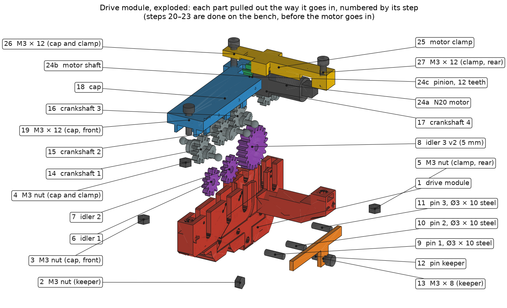

*Fig. 2 · Every part and fastener of the module, pulled out the way it goes in and numbered by its assembly step.
Nuts first (2–5), then the idlers on their steel pins from the right (6–13), the crankshafts and the cap from above
(14–19), the motor with its pinion (24) and the clamp (25–27). All 27 steps, one panel each:
[`images/verify/assembly-steps.png`](https://github.com/Morante-robotics/spider-bot-replica/blob/pre-redesign-2026-11-17/cad/chassis/images/verify/assembly-steps.png?raw=true).*

| Check ([`verify-result.txt`](https://github.com/Morante-robotics/spider-bot-replica/blob/pre-redesign-2026-11-17/cad/chassis/verify-result.txt)) | Result |
|---|---|
| Whole check | PASS, 0 failures, 39 warnings |
| Gears | Every crank–idler mesh keeps a 0.10 mm gap between teeth; pinion on idler 3 v2 0.10–0.18 mm, also with the motor lifted |
| Legs | Every leg stays at least 1.0 mm from the module, cap, clamp, keeper and motor over a full turn |
| Held | Each of the 12 loose parts is held; only the gears are free, to spin |
| Inside the carcass | Below the deck, every fixed part at least 2 mm inside the carcass, apart from the three bounded exceptions |
| Assembly | 27 steps, each along a straight line, 4 of them on the bench; every screw and nut reached by its tool |
| Tool tests | 26 pass ([`tools/tests/`](../tools/tests/)) |

Of the 39 warnings, 27 belong to the reused crankshafts and legs (printed and working). The other 12: six joints with
an assumed fit, each waiting for its coupon; knife edges where two gear pockets meet and on the clamp, which carry no
load; the gauge fork, 0.8 mm thick by design; two 1.3 mm ribs beside the slots of crankshafts 3 and 4, now out of
the motor's torque path; and 837 mm² of the module printed over air when it prints upside down: the flat pocket
floors and the saddle's underside, bridged, then nut-pocket roofs, the motor's pad and small ledges.

**The keel.** The module prints upside down, so its gear pockets were drawn as teardrops whose 50° sides print
without support. Their points hung far below the carcass (Fig. 3). Cut flat at the bottom of each gear's circle,
they print as short bridges instead (10.7 mm under idler 3), and the module's lowest point is z 42.77, where base
v1's keel was: 27.2 mm above the table, against 20.3 mm with the points.

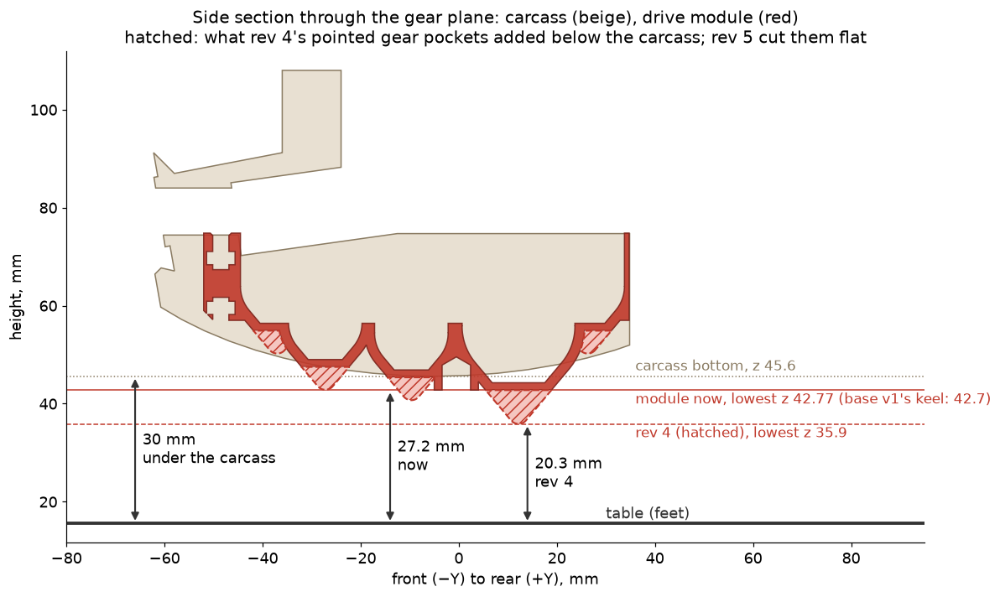

*Fig. 3 · Side section through the gear plane. Beige: the carcass; red: the module. Hatched: what the first
version's pointed pockets added below today's module (redrawn from the same pockets). The arrows are the height
above the table under the carcass, under the module now and under the first version.*

**The rear end.** Crankshaft 4 sits where the simulator put it, so the module's rear wall, 0.95 mm behind its gear's
room, ends at the carcass's rear face (Fig. 4). Part B's shell bulges about 2 mm there and covers it, about
8.5 × 18 mm.

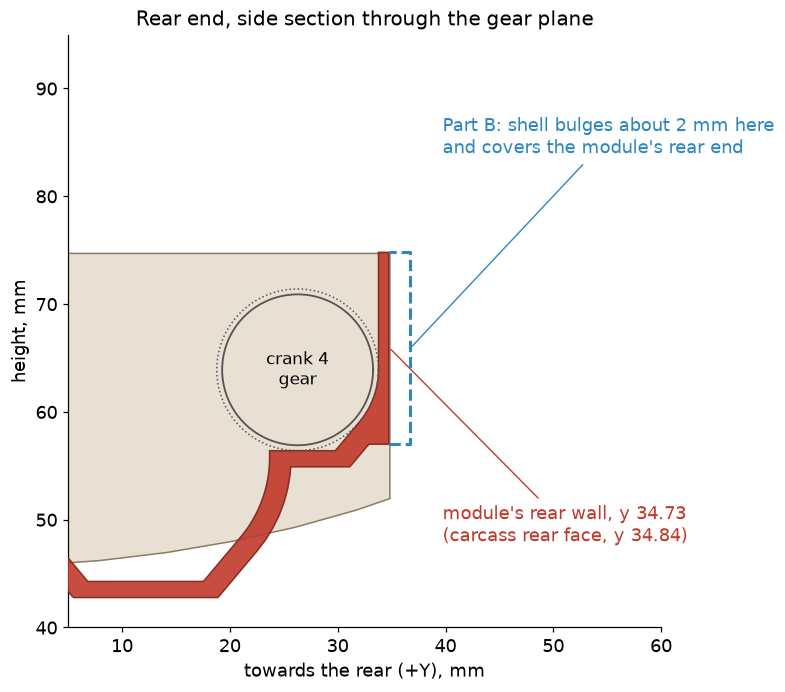

*Fig. 4 · The rear end, in the same section. The circle is crankshaft 4's gear, the dotted circle its room. The
module's thin rear wall reaches the carcass's rear face; the dashed blue box is the bump Part B adds.*

**The pinion.** It is pressed on the motor's D-shaped shaft and must end 0.8 mm from the gearbox, but once the motor
is in the module nothing can reach that gap. So the press is done on the bench (Fig. 5): a jig holds the pinion and
squares the motor, and a 0.8 mm fork between them stops the press. The fork must come out and go back in snug
before the motor goes in.

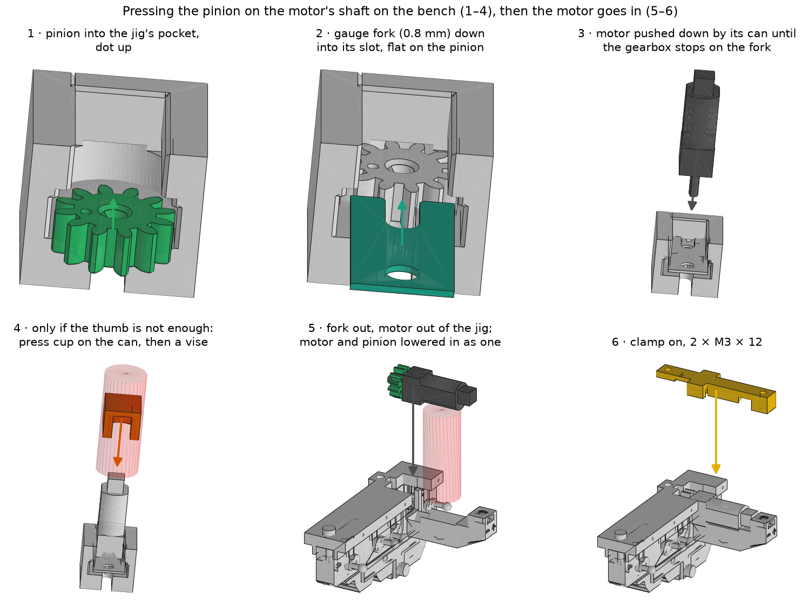

*Fig. 5 · Pressing the pinion on the bench, as it is done by hand: the jig stands on the table with its open side
towards you. Grey: what is already there; in colour: the part going in, with its arrow; the pink cylinders are the
finger the check uses to reach it. After step 4 the fork is pulled out and the motor slides out of the jig with its
pinion.*

**Mass.** With the module's parts from CAD instead of the plan's estimates, the robot as summed stays at 445 g and
its design mass, with the contingency by source, drops 2 g:

| | Plan (2026-11-14) | Now |
|---|---|---|
| Drive module | 14 g, estimate (+15 %) | 15.1 g, CAD (+5 %) |
| Clamp, keeper, pinion, idler 3's extra width | 5.1 g, estimate | 4.1 g, CAD |
| Design mass | 486 g | **484 g** (445.3 + 38.8) |
| Over the 478 g at which the HP 380:1 keeps a margin of 3.0 | 8 g | 6 g (margin 2.96) |

About 1 % over: small, but a real excess, not rounding. Most of the 38.8 g of contingency (32 g) sits on parts not
modelled or not bought yet, and Part B gets a mass budget: looks shell at most 86 g, front block 15 g, holder cradle
6 g, paint 10 g.

#### Decisions

- **Keel cut flat**, rather than leaving pointed pockets under the robot: the module goes no lower than base v1 did.
- **A design must stay inside the carcass**, and this is now a check for every design (`KEEP_IN`, section 12 of
  [`cad_verify.py`](../tools/cad_verify.py)): a part may stand out only where an exception names why and bounds how
  far; an exception without a bound is a warning.
- **Rear end: a 2 mm bump in Part B's shell**, rather than a window in the shell or a thicker module.
- **The pinion is pressed on the bench**, with the jig and the 0.8 mm fork, and the motor goes in with it in one
  drop. The check now handles parts moved in as one body and steps done on the bench.
- **Six changes from the plan**, accepted by the review because the plan's version could not be built:
  - no flange slot for the motor: the +X wall's steps and the V saddle place it;
  - the clamp runs along the motor, not across it;
  - the cap has 2 screws, not 3 (one shared with the clamp: there is no room for a third);
  - the module is screwed to the chassis from below;
  - the idler pins are Ø3 × 10, a stock length;
  - no stop face on the motor's front: the pinion leaves no room for one, so the clamp's pressure and a stop behind
    the motor hold it along its axis (tested by coupon K2).
- **A weight and size review (Part D)** comes after the looks robot passes in CAD: every part made lighter where it
  can be (thinner walls, hollow or ribbed parts, interiors and exteriors rethought), and a check of whether the
  whole robot can be smaller and still needs the 120 % scale. The motor purchase and the coupons wait for it. Part B
  is drawn at 120 %; the scale is decided in Part D.

This entry closes the open item «Robot master model».

[↑ Contents](../build-log.md#contents)

### Chassis Part B1, Part C check and the friction clutch

**Phase 3 · Mechanisms · 2026-11-16** · Status: ✅ chassis built and checked, clutch modelled

> **In short.** The chassis shell (B1) is built and its mass is measured from the model: 70.1 g against an 86 g
> budget, which brings the robot's design mass to 466 g, under the 478 g the chosen motor carries with its margin of
> 3 (it was 484 g). The three checks of the whole robot are now one spec and it passes. A friction clutch on the
> motor's output shaft is also modelled: it slips before the gearbox or a printed tooth can break, and a stack of
> thin steel shims sets the torque at which it slips. The order of what is left changed: the walking robot is
> checked in CAD, then the clutch, the weight review and the looks parts, and only then is anything bought or
> printed, as one robot.

The [plan](#whole-robot-first-motor-sizing-and-chassis-plan) models the whole robot in parts, each checked before the
next. Part A, the drive module, is [done](#chassis-part-a-master-model-and-drive-module); this entry adds the chassis
shell it screws into (B1), the whole-robot check (C, step 1) and a torque limiter for the motor.

#### Steps

1. **Chassis shell B1 and its mass.** [`mass_estimate.py`](https://github.com/Morante-robotics/spider-bot-replica/blob/pre-redesign-2026-11-17/cad/chassis/mass_estimate.py) now takes the masses of
   the shell, the crank cover and the front block from the STL files in `out/` instead of from estimates:

   | Part | Built mass | Budget or estimate |
   |---|---|---|
   | Chassis shell | 70.1 g | 86 g budget |
   | Front block v2 | 19.1 g | 13–15 g in the plan (opened at its rear face to get here) |
   | Crank cover | 4.7 g | |

   With these and the clutch's steel parts, the robot sums to 438 g and its design mass, with the contingency by
   source, is **466 g**: margin 3.08 against 3.0 required, 12 g under the ceiling. The motor stays the HP 380:1
   (decision Q5, option A1b). It closes the weight worry of [Part A](#chassis-part-a-master-model-and-drive-module);
   the weight and size review still comes (Part D), because every gram under the ceiling is margin.
2. **One check for the walking robot (Part C, step 1).** `verify_b1.py` and `verify_fb.py` are merged into
   [`cad/chassis/verify.py`](https://github.com/Morante-robotics/spider-bot-replica/blob/pre-redesign-2026-11-17/cad/chassis/verify.py), which now checks the drive module, the chassis shell, the
   front block and the clutch together. Full check: PASS ([`verify-result.txt`](https://github.com/Morante-robotics/spider-bot-replica/blob/pre-redesign-2026-11-17/cad/chassis/verify-result.txt)). This closes the open item «One `cad_verify` spec for the whole robot».
3. **The clutch plan** ([`design-plan-clutch.md`](https://github.com/Morante-robotics/spider-bot-replica/blob/pre-redesign-2026-11-17/cad/chassis/design-plan-clutch.md)). A jam of the legs would
   push the motor past what its gearbox tolerates (stall is 360–503 N·mm, the gearbox's limit 245), so something
   must slip first. Three places and three candidates were compared with numbers (Fig. 1). The design reviewer asked
   for changes on revision 1 (8 objections: a PTC fuse does not separate a slip from walking, the pinion was not
   centred, the collar had no way to be pressed by hand…); revision 2 was approved with Morante's answers:

   | Question | Answer |
   |---|---|
   | Slip window | 129–196 N·mm (walking needs at most 117, the gearbox 245) |
   | Module change | A notch in the module's -X wall and the motor axis 0.1 mm further out; the nut trap stays |
   | Audible clicker | No |
   | Pinion face | 4 mm instead of 5 |

4. **The clutch in CAD.** A sleeve pressed on the motor's D-shaft carries the pinion, which turns on it; a steel wave
   washer (DIN 137 B M3) presses the pinion against the sleeve's shoulder through steel shims (DIN 988 3 × 6, 0.1 mm
   steps), and a collar pressed on the shaft's tip holds the stack. Slip torque is set on the bench by adding or
   taking away a shim. Modelled in [`build.py`](https://github.com/Morante-robotics/spider-bot-replica/blob/pre-redesign-2026-11-17/cad/chassis/build.py), the interface I6 of
   [`robot.py`](https://github.com/Morante-robotics/spider-bot-replica/blob/pre-redesign-2026-11-17/cad/robot.py) and a new assumed fit, `SLIP_BORE` (0.1 mm a side) in
   [`fits.py`](../cad/fits.py). Full check: `cad_verify: PASS (0 failures, 94 warnings)`; the four warnings it added (90 to 94) are
   explained in [`design-review.md`](https://github.com/Morante-robotics/spider-bot-replica/blob/pre-redesign-2026-11-17/cad/chassis/design-review.md). One change from the plan: the sleeve and the
   collar are pressed in one push in the jig (step 6 of the README), not one after the other.
5. **Coupons.** CL1 (the clutch on the real shaft), CL1-heat (60 s with the crank blocked), CL2 and CL3 (two
   other ways to get the same slip, kept as fair alternatives: a printed detent and O-rings) and K1 (the pinion's
   D-bore, now also the collar's pull-off) are updated in
   [`coupons_clutch.py`](https://github.com/Morante-robotics/spider-bot-replica/blob/pre-redesign-2026-11-17/cad/chassis/coupons_clutch.py); they print in the one coupon batch.
6. **Hardware** added to [`hardware.md`](../hardware.md), bought with the motor: the wave washer, the shims and the
   O-rings.

#### Result


*Fig. 1 · The clutch in half section along the motor's shaft. Yellow: sleeve and collar, pressed on the steel shaft;
green: the pinion, which turns on the sleeve; red: wave washer and shims; the two red bars are the friction faces.
The dashed red box is the notch cut in the module's -X wall; the blue line is the tip of idler 3, which the clutch
stays clear of. Drawn at the plan stage, from the same numbers; it is not yet re-rendered from the built parts.*

| | Before | Now |
|---|---|---|
| Design mass | 484 g (Part A) | 466 g, margin 3.08 (ceiling 478 g) |
| Whole-robot check | three specs | one: PASS, 0 failures, 94 warnings |
| Stall protection | teeth break first | friction clutch, 129–196 N·mm |

What this proves is only that the parts exist, fit and clear each other in CAD. The clutch's numbers (the slip
torque, whether the collar's 1.2 mm of grip on the shaft holds under the spring) are predictions until the coupons
are printed.

#### Decisions

- **One robot, the looks one.** Morante dropped the functional body, the ballast frame and the v0 print with
  ballast: nothing is printed until the looks parts are modelled. This reverses the plan's v0 (see the note in
  [Whole robot first](#whole-robot-first-motor-sizing-and-chassis-plan)).
- **New order:** the walking robot checked in CAD; the friction clutch; Part D, the weight and size review (kept,
  scale included; the scale study was dropped the next day, see [Part D](#chassis-part-d-the-weight-review)); the looks parts in CAD (body v2 with the holder cradle, the eyes); then the motor, battery holder,
  switch and clutch hardware are bought and measured, one coupon batch is printed, and the one robot.
- **Friction clutch over a PTC fuse**, because a slip draws only 2.1 times the walking current and a PTC cannot tell
  them apart; no clicker; the pinion face is 4 mm.

[↑ Contents](../build-log.md#contents)

### Chassis Part D: the weight review

**Phase 3 · Mechanisms · 2026-11-17** · Status: ✅ 459 g, looks parts next

> **In short.** Every part of the robot was reviewed for weight. The printed parts turned out to be near their floor
> (each carries under 0.7 g of infill), so only two thinner walls and a recount of the screws were kept: the design
> mass falls from 466 g to 459 g, margin 3.12 against 3.0 required, 19 g under the 478 g ceiling. The 120 % print
> scale and the 4×AAA holder stay: Morante dropped the scale study. The big saving is still to come, in the body
> v2: it gets a 90 g budget, about 20 g under the scanned body. Nothing is printed.

[Part B1](#chassis-part-b1-part-c-check-and-the-friction-clutch) left the robot 12 g under the motor's ceiling, and
every gram below it is margin. The review looked at each part for a lighter wall, a hollow or a ribbed section, and
ranked the levers in three sets (safe, moderate, aggressive).

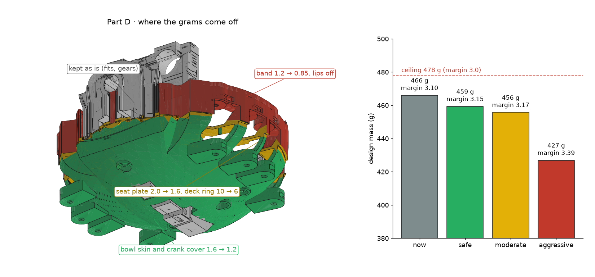

*Fig. 1 · The plan. Left: the shell from below; green is thinned in the safe set, yellow in the moderate one, red in
the aggressive one, grey stays. Right: design mass of each set against the 478 g ceiling; the margins printed are the
plan's estimates.*

#### Steps

1. **The plan** ([`design-plan-d.md`](https://github.com/Morante-robotics/spider-bot-replica/blob/pre-redesign-2026-11-17/cad/chassis/design-plan-d.md)): infill and wall-loop changes, or hollowing
   the thick parts, save under 1.5 g in all, so they were rejected. Sets: safe 459 g, moderate 456 g (3.6 g more
   than safe, but a recut coupon, new hardware and stiffness risk), aggressive 427 g (needs aluminium screws, no side
   lips and windows in the belly). A bug turned up: the stage cache in [`tools/stage_cache.py`](../tools/stage_cache.py)
   did not see parameters read inside project modules, so a thinner wall would have reused the old shape.
2. **The review** asked for changes on nine points: the cache hole was wider than the wall setting; the crank cover
   carries the switch cradle and the front block reads its thickness; the grams of thinned parts must come from the
   Bambu slice, not a home-made per-layer model; moderate buys little over safe.
3. **Morante chose** the safe set, no new hardware, lips kept, no belly windows, and a 90 g budget for body v2. The
   cover stays 1.6 mm under the switch cradle and its posts and is 1.2 mm on the free span. With no 0.01 g scale,
   legs, forks and screws keep their catalogue and plate masses.
4. **The fix.** The stage cache now follows project-module functions (test
   [`tools/tests/test_stage_cache.py`](../tools/tests/test_stage_cache.py)). The shell was rebuilt round the 4 mm
   pinion and the clutch, which removes the old 5 mm pinion's cut (Part C leftover), with the bowl skin 1.6 → 1.2 mm;
   the crank cover is 1.2 mm on its free span; the front block was rebuilt against the new cover. The screws were
   recounted in [`mass_estimate.py`](https://github.com/Morante-robotics/spider-bot-replica/blob/pre-redesign-2026-11-17/cad/chassis/mass_estimate.py), and the shell's export retries other
   tolerances if its STL reads back open.

#### Result


*Fig. 2 · The mass table after the review, from the built parts.*

| | Before | Now |
|---|---|---|
| Chassis shell | 70.1 g | 65.2 g |
| Crank cover | 4.7 g | 3.8 g |
| Front block v2 | 19.1 g | 19.1 g |
| Sum, no contingency | 438 g | 431 g |
| Design mass (contingency by source) | 466 g | 459 g |
| Margin (ceiling 478 g) | 3.08 | 3.12 |

The full check of the whole robot passes: `cad_verify: PASS (0 failures, 94 warnings)`, the same warnings as before
([`verify-result.txt`](https://github.com/Morante-robotics/spider-bot-replica/blob/pre-redesign-2026-11-17/cad/chassis/verify-result.txt)). It proves the lighter parts exist and still fit and clear
each other in CAD. The thinner skin's strength and printability are predictions until the coupons.

#### Decisions

- **Safe set only.** The moderate set adds 3.6 g for new hardware and a recut; the aggressive one reverses a looks
  choice.
- **Scale study dropped** (2026-11-16): 120 % and the 4×AAA holder stay.
- **Body v2 budget of 90 g** at a 1.6 mm wall: the largest lever left in the robot. Changed in
  [Part B2](#chassis-part-b2-the-looks-parts): the body keeps the scanned skin and the slicer lightens it (≈ 93 g).

### Chassis Part B2: the looks parts

**Phase 3 · Mechanisms · 2026-11-17** · Status: 🔄 whole robot passes in CAD; buying next

> **In short.** The looks parts are modelled: body v2 is the scanned carcass skin as it is, with a cradle for the
> battery holder, a lug that screws it to the chassis and a small tab that holds the eyes board. The first full check
> of the whole robot failed in 13 places; four fix passes brought it to zero failures. The robot weighs 420.2 g and
> its design mass is 457 g against the motor's 478 g ceiling (margin 3.14, 3.0 needed), and the motor sizing still
> passes. That releases the purchase of the motor, the holder, the switch, the connectors and the clutch hardware.
> Nothing is printed yet.

[Part D](#chassis-part-d-the-weight-review) left the body for last: it is the biggest part, and it carries what
Morante sees (the skin) and what the robot needs (the battery holder, the switch's wires, the eyes). Instead of
rebuilding the skin thinner, which would have redrawn the whole scan, it is used as it is and the slicer lightens it
(one wall loop, 10 % gyroid infill, about 93 g). The design is checked as one robot: every part against every other,
every screw reachable by a tool, every part able to go in by hand.

#### Steps

1. **The first check.** The spec of the looks parts went into [`verify.py`](https://github.com/Morante-robotics/spider-bot-replica/blob/pre-redesign-2026-11-17/cad/chassis/verify.py) and the full
   check ran: 13 failures. The eyes screw's nut touched the board, one bench assembly could not be done and some
   tools could not reach a nut.
2. **Pass 1.** A new part, the **eyes tab** (a 2 mm plate under the eyes boss that carries the screw), and wider nut
   slots (open mouths 25 mm long) took the failures from 13 to 7.
3. **Pass 2 and 3.** The body was first cut 0.2 mm clear of the shell where it rests, then lifted further sideways;
   each made the build slower (4 minutes) and left slivers. The coordinator stopped it: the approved plan says the
   body **bears** on the band's top at the sides and front ([design-plan-b.md](https://github.com/Morante-robotics/spider-bot-replica/blob/pre-redesign-2026-11-17/cad/chassis/design-plan-b.md)).
   The seat was trimmed flat at the band top (z = 93.5 mm) with 13 flat layers carried 4 mm along the slide, and
   declared a **designed sliding contact** in the spec. The body builds in 8 s and its way in (down 30 mm, then 4 mm
   toward the front) passes.
4. **Pass 4.** Four tool-access failures were left. Three reliefs were cut inside the body (Fig. 1): a rod of
   r 5.2 mm along the body lug's two nut slots and along the eyes nut slot (the pliers' Ø10 rod pushes the nut along
   its slot), and a cylinder of r 3.05 mm under the cradle block's floor (the hex key's room). Together they remove
   at most 0.6 cm³ and touch no outer face.


*Fig. 1 · Body v2 (purple, translucent) on the chassis from behind and the left. The seat is the band top the body
rests on. The coloured rods are the reliefs cut inside the body: red, the lug's nut slots; orange, the eyes nut slot;
green, under the cradle block (the cylinders show the cut's extent). Made by
[`part_b2_figure.py`](https://github.com/Morante-robotics/spider-bot-replica/blob/pre-redesign-2026-11-17/cad/chassis/part_b2_figure.py).*

#### Result

`cad_verify: PASS (0 failures, 100 warnings)` ([`verify-result.txt`](https://github.com/Morante-robotics/spider-bot-replica/blob/pre-redesign-2026-11-17/cad/chassis/verify-result.txt)). Most of the
extra warnings are body v2's own print warnings; each is explained in
[`design-review.md`](https://github.com/Morante-robotics/spider-bot-replica/blob/pre-redesign-2026-11-17/cad/chassis/design-review.md).

| | Part D | Now |
|---|---|---|
| Robot, built parts | n/a | 420.2 g |
| Design mass (contingency by source) | 459 g | 457 g |
| Ceiling for the HP 1:380 motor | 478 g | 478 g |
| Margin (3.0 needed) | 3.12 | 3.14 |

`sim/motor_sizing.py` on the final masses: PASS, R 1.0 with the HP 1:380
([`motor-sizing-result.txt`](https://github.com/Morante-robotics/spider-bot-replica/blob/pre-redesign-2026-11-17/sim/motor-sizing-result.txt)). This proves the looks parts exist, fit and can be
assembled and reached by hand in CAD. The body's strength, its printed weight (about 93 g is the slicer's estimate)
and its print are predictions until it is printed.

#### Decisions

- **Scanned skin kept as it is,** lightened by the slicer, not rebuilt at 1.6 mm: the budget is met without redrawing
  the scan.
- **A contact the plan designs is declared, not cleared.** Clearing the seat by 0.2 mm broke the plan and cost minutes
  of build time; declaring it as a sliding contact keeps the body resting on the band.
- **Reliefs inside the body, not a different tool or order:** the failures were fixed with geometry that touches no
  outer face.

#### Next

- The pre-print gate takes two reviewer notes: an unidentified body strip at z 99.25–101.25 that the cradle-screw
  key relief cuts, and the print-plater confirming 3 extra loops on the two thin upright features at z 94.4–97.2
  (x 10.4 and 74.6, y −27.6).
- Buying and measuring the motor, holder, switch, connectors and clutch hardware, then the coupon batch.

[↑ Contents](../build-log.md#contents)

### Chassis Part E: the looks pass, planned and paused

**Phase 3 · Mechanisms · 2026-11-17** · Status: 🔄 planned, paused until the legs are rethought

> **In short.** Three small items were closed, and the looks pass was planned and then paused. The whole robot works
> in CAD but looks functional, not like the toy: plain bar legs, a ribbed base with visible screws, an open front
> block. Plan E went through one review round (7 objections) and a second version. Then Morante saw that neither leg
> option looks like the thick, curved legs of the reference photo of the toy (kept outside the repo), so the legs
> become a new step and Part E waits for it. Nothing is modelled or printed.

#### Small items closed

- **Body v2 strip:** the strip at z 99.25 to 101.25 is a scan-skin ring boss under the cradle block. It is harmless
  and no geometry changes ([design-review.md](https://github.com/Morante-robotics/spider-bot-replica/blob/pre-redesign-2026-11-17/cad/chassis/design-review.md)).
- **Gear train test:** [`verify.py`](https://github.com/Morante-robotics/spider-bot-replica/blob/pre-redesign-2026-11-17/cad/gear-train-test/verify.py) now meets the spec standard, full check PASS
  (0 failures, 12 print warnings). The cap that went on with 0.15 mm a side per tongue gave a measured fit,
  `TONGUE_SHORT` in [`fits.py`](../cad/fits.py), with its row in [`measurements.csv`](../measurements.csv). It is
  valid for short tongues only; base v1's 70 mm cap keeps its 0.3 mm.
- **Workshop kit tools:** a spec can give the bench pose (words such as «down» for a part standing on its end) and the
  Measure sheet shows when each measurement is taken. 36 tool tests pass. Two findings: one pose for the whole
  chassis spec is wrong (the press jig, cradle and eyes benches differ), so it must be per step; and the chassis
  `MEASURE` entries lack the keys `figures.measure_sheet` expects and 28 of 34 have no «when». The chassis kit's Measure
  sheet never finished rendering (stopped after 15 minutes).

#### Part E

[Plan E](https://github.com/Morante-robotics/spider-bot-replica/blob/pre-redesign-2026-11-17/cad/chassis/design-plan-e.md) (rev 1, then rev 2 after the reviewer's 7 objections) proposed a skin on the
base, a face wall on the front block, a separate dome and shells over the legs. Morante's decisions after rev 2:

- **Legs:** rethought as a new step, thicker and curved as in the photo. The black legs are straight 5 × 6 mm bars
  and the middle shins sit 0.8 mm apart, so shells cannot get there. Shape, spacing, mechanism, mass and motor margin
  may all change.
- **Base skin all-round** (+8.6 g) and **lever V4** accepted (SEAT_T 1.6, RING 6, −1.6 g).
- **Front block:** to be reviewed as a separate part at all (large, heavy, it mainly covers).
- **Colours** are painted in the slicer by Morante, so colour no longer justifies splitting parts. The separate dome,
  its joint and the cut faces' solid layers (+3.8 to +6.1 g, +2.0 to +3.0 g) are probably not needed; the next plan
  confirms. The blue/red boundary follows the toy's panel line.
- **Eyes** are out of scope.

### Legs v2: three plan rounds, paused

**Phase 3 · Mechanisms · 2026-11-17** · Status: 🔄 paused, a new direction (mass audit first)

> **In short.** Part E's first item was to rethink the legs so they look like the thick, curved legs of the toy.
> Three plan rounds found that the leg turns as one rigid body, so its shape between fork and foot does not change
> the gait, and that a thick leg fits the motor if it prints at 10 % infill; but every option that fits the 478 g
> ceiling made the legs thinner than the toy's. Morante rejected them. The legs are not traded for weight: first
> every other printed part is audited for grams, and the legs come back with what that frees. Nothing is modelled
> or printed.

The plan is in [`design-plan-v2.md`](https://github.com/Morante-robotics/spider-bot-replica/blob/pre-redesign-2026-11-17/cad/legs/design-plan-v2.md); the figure and its geometry are in
[`plan_v2_figure.py`](https://github.com/Morante-robotics/spider-bot-replica/blob/pre-redesign-2026-11-17/cad/legs/plan_v2_figure.py) and [`plan_v2_geom.py`](https://github.com/Morante-robotics/spider-bot-replica/blob/pre-redesign-2026-11-17/cad/legs/plan_v2_geom.py). The
reference photo of the toy is private and is not in the repo. The probe scripts (clearance sweeps, grams, levers,
gait) are kept outside the repo.

#### Rounds

1. **Rev 1** compared four candidates: **A** (one-piece arched leg, 5 mm across, same feet), **B** (8 mm across, feet
   spread along the body), **C** (today's leg plus a screwed shell) and **D** (the middle forks moved). Key finding:
   the leg turns as one rigid body about its pivot, so its shape between fork and foot does not change the gait. C
   and D collide with the neighbouring legs. Morante kept A and B.
2. **Rev 2** recommended A: 8.2 g for leg and fork, design mass 475.5 to 479.8 g, the HP 380:1 motor at R 1.0 with
   margin 3.6 / 3.0 / 6.7 (4.8 V, 4.0 V, mean). The design-reviewer asked for changes (6 objections): A passes only if
   body and dome are one piece; the support is a 0.3 to 3.1 mm wedge under the shin; the middle gap of 0.64 mm is
   from a refined sweep; the base skin was not probed; A reads as sticks from the 3/4 and side views; B was drawn
   unfairly. Plan E rev 2 had quoted the margin at R 0.6, while the built drive is R 1.0.
3. **Morante's decisions:** body and dome are one piece (as plan E decision 5); legs print at 10 % infill; the
   shin is never flat on the bed (at least 1 mm above it); A is rejected as too thin.
4. **Rev 3** worked the B family with a sweep per leg (new flags `--leg-g` and `--sweep` in
   [`motor_sizing.py`](../sim/motor_sizing.py), see [`sim/README.md`](../sim/README.md)). Gait with the per-leg
   sweep: the same support feet, stride 0.2 to 0.3 mm shorter.

#### Result


*Fig. 1 · Today's 5 × 6 mm bar legs (top) and the three B candidates, shin raised 1 mm, in the four standard views;
the bars show printed leg + fork in grams. All three are visibly thinner than the toy's legs.*

| | B″ (±14/10, shin 8) | Bs (±5, shin 6.5) | Bb (+2/−8, shin 7) |
|---|---|---|---|
| Middle gap (mm; needs ≥ 0.8) | 1.87 | 1.84 | **0.61** (0.59 on the refined sweep) |
| Leg to fork (design 0.5) | 0.22 | 0.31 | 0.50 |
| Design mass at 10 % infill (g; ceiling 478) | 483.4 | 480.0 | 481.0 |
| Margin at 4.0 V (needs 3) | 3.1 | 3.1 | 3.0 |

Coarse probe, grid 1; margin computed with `--mass 478`. B″ and Bs must print the front and middle-1 legs on the +Y
face once the shin is raised, which leaves support that cannot be removed at the fork bar; Bb avoids that but fails
the middle gap. None meets the mass ceiling and the looks together.

#### Decisions

- **Morante's verdict** (2026-11-17): «No me convence. Las patas son muy finas y pierdo todo el encanto. Quiero patas
  como las del dibujo y si hay que adelgazar que sea en la base y la carcasa/cuerpo. Analiza los volúmenes para ver
  si sobra algo. No podemos estar sacrificando constantemente el diseño exterior, especialmente de las patas.»
  (In English: «I am not convinced. The legs are very thin and I lose all the charm. I want legs like the drawing,
  and if something has to get thinner let it be the base and the shell/body. Analyse the volumes to see if anything
  is spare. We cannot keep sacrificing the exterior design, especially the legs.»)
- **New direction:** the legs are as thick and wide as the toy's and are not traded for weight. The weight comes from
  the other parts.
- Morante also said that the function and size of some parts are unclear to him, the front block v2 among them: the
  audit explains those first.

#### Next

- Mass and purpose audit, then legs v3, then the motor side only if needed. See Open items.

### Redesign: looks first

**Phase 3 · Mechanisms · 2026-11-17** · Status: 🔄 in progress

> **In short.** The robot had drifted away from the toy: the dome sat on a tall black base with the gear box under it,
> and the legs hung like stilts. Every design change also took days, because the checks chased under a millimetre and
> a degree on shapes that were not yet decided. So the design restarts looks-first, with three levels of detail so a
> change costs seconds, and the size is worked out again from the smallest motor and the button cells that can feed
> it. A coarse estimate puts the scale at 60 to 80 %, not 120 %. The next step is to measure the original toy.

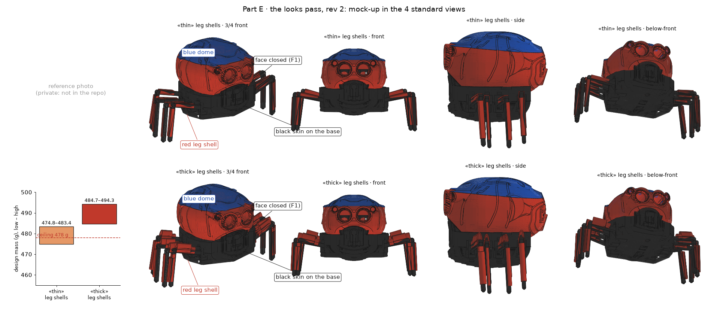

*Fig. 1 · The archived Part E mock-up. Look at the tall black base under the dome and at the thin legs: this is what
the redesign leaves behind.*

#### Decisions

- **Why.** Morante: the robot no longer looks like the toy. The dome sits on a tall black base (the gear box under
  it) and the legs hang like stilts.
- **Looks first.** The toy and jenscolt's model, legs included, are the specification. Only parts with their final
  looks are modelled. The walking legs stay.
- **Three levels of detail**, with the times measured on Morante's Mac:
  - **N0, mock-up in simple shapes.** 8 legs × 24 poses collision check: 1.8 s; 4-view render: 0.8 s.
  - **N1, the real body mesh** simplified to 25k triangles, 24 poses: 4 s per check. It uses manifold3d's `min_gap`
    instead of build123d.
  - **N2, build123d and the full `cad_verify`**, once per part, just before printing.
- **Sizing reopened from the bottom up:** the smallest motor, then the button cells that can feed it, then the
  smallest robot they allow, then back to the motor. Morante's own Spider-Bot runs on button cells; LiPo is ruled out.
  A coarse estimate puts the scale between 60 and 80 % (about 100 to 170 g, peak crank torque 6 to 14 N·mm), against
  457 g and 56 N·mm at 120 %. The limit is the cells' current and the motor's no-load current, not the torque.
- **Cleanup.** 319 tracked files became 56. Everything earlier is kept in the tag
  [`pre-redesign-2026-11-17`](https://github.com/Morante-robotics/spider-bot-replica/tree/pre-redesign-2026-11-17),
  and every link to it now points there.
- This reverses the direction of the Part A to Part E entries above; they stay as the record of what was built.

#### Next

- Measure the original toy (model, cells, mass, size, current), then size motor, cells and scale. See Open items.

### N0 mock-up: the looks robot in simple shapes

**Phase 3 · Mechanisms · 2026-11-18** · Status: ✅ N0 look approved, N1 next

> **In short.** The first level of the redesign is built: a mock-up of the whole robot in simple shapes, with
> jenscolt's body and base at 60 %, eight legs shaped like his, the toy leg's motion, and the motor, six button cells
> and switch inside. One run draws four views and checks 24 crank poses in about 2 seconds. Every check is inside the
> 5 mm tolerance of this level, and the robot reads as the toy: the legs are thick and curved, the body sits low.
> Next is N1, the real looking parts as light meshes.

The mock-up is the N0 of the [redesign](#redesign-looks-first): a change of shape costs seconds, so the look can be
settled before any real part is modelled. The scale of 60 % comes from the bottom-up sizing in
[`cad/mockup/sizing.py`](../cad/mockup/sizing.py): the smallest body that holds the N10 motor and six AG13 cells.


*Fig. 1 · The mock-up, default parameters, crank pose 0. Look at the thick legs rising level from the base and then
bending up to the knee, the blade coming down to the foot, and the base standing clear of the ground. The grey frame
is the ground plane.*

#### Steps

1. Take jenscolt's body and base at 60 % ([`n0.py`](../cad/mockup/n0.py), parameters `P0`).
2. Model each of the 8 legs as a swept tube (a chain of spheres of varying radius): the inner arm from the crank pin
   to the pivot, an upper leg that goes out level and then up to the knee, and a blade from just above the knee down
   to the foot, shaped like jenscolt's `spideybot_L_leg1` and `leg2`.
3. Move them like the toy leg of [`sim/toy_leg_3d.py`](../sim/toy_leg_3d.py): four lateral crankshafts, the leg
   sliding at the crank. One change: the leg may bend up at its pivot, so the knees sit high like the toy's.
4. Put the inside in as boxes: gear strip (module about 0.6) and the four crankshafts, the N10 (12 × 10 × 24 mm plus
   a 10 mm D-shaft), six AG13 as three stacks of two (2S3P, 3 V) and the SS12D00 switch.
5. Check over 24 crank poses, in numpy only: the legs against the body, neighbouring legs, the inner arms against the
   boxes, the boxes inside the wall and apart. Draw four views ([`n0_render.py`](../cad/mockup/n0_render.py)).

The legs are checked against a 2 mm voxel distance field of the real body and base surface (cached in
`cad/mockup/.cache/`, not in git), not against a convex hull: the dome overhangs the base, and the hull filled the
room the legs come out under.

<details><summary>How to reproduce</summary>

```
uv run python cad/mockup/n0.py                              # checks + timing
uv run python cad/mockup/n0.py --png out.png --lang en      # four views
uv run python cad/mockup/n0.py --set knee_z=44 foot_r=60    # change parameters
```

</details>

#### Result

| Measure | Value |
|---|---|
| Size with legs | 145 × 113 mm |
| Base above the ground (lowest foot, 24 poses) | ≈ 13 mm |
| Body bob over a turn | 4.6 mm |
| Foot lift | 6.9 mm |
| Knee below the dome top | 3 mm |
| Shell window for each leg root | ≈ 10 mm |

| Gap checked | Gap | |
|---|---|---|
| Legs ↔ body | −0.8 mm | grazes |
| Legs ↔ legs | 1.8 mm | ok |
| Inner arms ↔ boxes | 1.4 mm | ok |
| Boxes inside the wall | 0.0 mm | grazes |
| Boxes apart | 0.3 mm | grazes |

All five are inside the 5 mm tolerance of N0; N1 refines them. On Morante's 2-core Mac the checks take 0.5 s, the
four-view render 1.3 s, and the whole run about 2 s (the first run adds 10 s for the cache). Morante compared the four
views with his photo of the toy and approved the look: «La imagen me parece bien».

Three faults came up and each was found by the check in seconds: at 60 % the middle notches are only about 8 mm
apart, so the leg root became Ø6; the rear legs hit the dome overhang, so the legs now go out level first and the
knees are wider (44 mm); the crankshafts were raised because the base's bowl is narrow below.

#### Decisions

- **Distance field, no mesh booleans.** Mesh booleans are too slow for N0; distance fields and half-spaces in numpy
  keep every change at seconds.
- **The look is approved at N0.** The legs stay thick and curved; the body and base give way, not the legs.
- **Knees 3 mm below the dome top,** about 10 mm of shell window per leg root: both are carried into N1 as targets.

### N1 form: the real looking parts as light meshes

**Phase 3 · Mechanisms · 2026-11-19** · Status: ✅ N1 look approved, N2 next

> **In short.** The second level of the redesign is built: jenscolt's real body, eyes, base and legs at 60 %, simplified
> to light meshes, moving on the N0 motion with the motor, cells and switch inside. The legs are his own, stretched to
> reach N0's knee path, and each leg root has a window in the body and base. The 24-pose check passes within 1 mm
> (the legs graze the base by 0.4 mm), a run takes about 10 seconds, and Morante compared the views with his photo of
> the toy and approved the look. Next is N2, the print detail.

N1 is the second of the [three levels](#redesign-looks-first). It keeps everything N0 decided
([`P0`](../cad/mockup/n0.py): scale, leg path, crank, boxes) and swaps the simple shapes for the real parts, so the
look can be judged on the real surfaces and the collisions checked against them before any part is modelled for print.

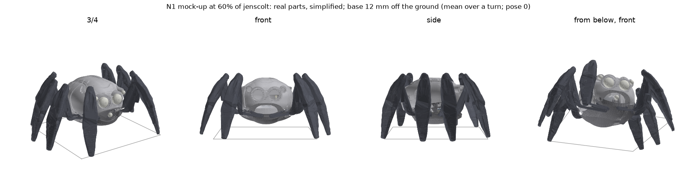

*Fig. 1 · The N1 mock-up, crank pose 0. Look at the real dome with its two eyes, two small eyes and front dome, at
the thick curved legs that now have jenscolt's shape, and at the base standing 12 mm off the ground. The windows are
hidden behind the legs. The grey frame is the ground plane.*

#### Steps

1. Load jenscolt's body (with two eyes, two small eyes and the front dome) and base, scale them to 60 % and
   vertex-cluster each to at most 25k triangles ([`n1.py`](../cad/mockup/n1.py)).
2. Take the legs from his `L_leg2` (hub, inner arm, upper leg) and `L_leg1` (blade) and warp them onto N0's leg path,
   the left legs mirrored from the right. Against his 60 % size the parts are stretched ×1.53 (inner arm), ×2.86
   (upper leg) and ×1.20 (blade), so the knee stays high as approved at N0. The hub and inner arm are thinned
   (scale 0.20 across and 0.15 in the plane) because the middle pivots are only 7.7 mm apart; the thin root grows into
   the upper leg over 14 mm.
3. Empty the base. His base is a solid display base: inner posts, mounts for his lights and 8 tabs inside the rim
   that hold his static legs. All of that is removed, keeping the bowl skin and the rim notches. The rim top is a bit
   ragged at this level and is rebuilt at N2.
4. Cut one window per leg root in the body and base: the hull of the leg within 9 mm of its pivot, swept over the 24
   poses, plus 1 mm.
5. Move the motor 1 mm up (N10 centre z 21 → 22 mm) so the crank hubs clear it. Raising the crank axis too made the
   legs hit the base, so the axis stays.
6. Check the 24 poses on the meshes (surfaces sampled at 0.6 mm for body and base, 1.0 mm for the legs, 0.4 mm of
   sampling slack taken off every gap) and draw four views ([`n1_render.py`](../cad/mockup/n1_render.py)).

<details><summary>How to reproduce</summary>

```
uv run python cad/mockup/n1.py                              # checks + timing (first run builds the cache)
uv run python cad/mockup/n1.py --png out.png --lang en      # four views
uv run python cad/mockup/n1.py --set COLLAR=12              # change a parameter
```

The body, base and legs are third party (CC BY-NC-SA, see [`cad/carcass-jenscolt/`](../cad/carcass-jenscolt/)).

</details>

#### Result

| Measure | N1 | N0 |
|---|---|---|
| Size with legs | 141 × 105 × 68 mm | 145 × 113 mm |
| Base above the ground (24 poses) | 11.7 mm | ≈ 13 mm |
| Body bob over a turn | 4.5 mm | 4.6 mm |
| Foot lift | 6.7 mm | 6.9 mm |
| Knee below the dome top | 2.4 mm | 3 mm |

| Gap checked | Gap | |
|---|---|---|
| Legs ↔ body | +0.4 mm | ok |
| Legs ↔ base | −0.4 mm | grazes, within 1 mm |
| Legs ↔ legs | +1.4 mm | ok |
| Inner arms ↔ parts inside | +1.6 mm | ok |
| Parts inside the wall | +0.4 mm | ok |
| Parts apart | +0.5 mm | ok |

| Window for each leg root (front to rear) | Size |
|---|---|
| Legs 1 to 4 | 16×12×12, 20×8×12, 20×10×12, 19×13×13 mm |

Triangles: body 24.7k, base 2.7k, eyes 6.9k, legs 30.7k. The check takes about 6 s and the run with the drawing about
10 s on Morante's Mac; the first run builds a cache.

The windows missed the target of about 10 mm from N0: their size is set by how far the root swings, not by its
thickness. A collar of 12 mm gave windows of 21 to 25 mm; 9 mm gives about 20 mm; 7 mm makes the legs hit the base
(−1.6 mm). They are hidden behind the legs in the views. Eye positions are estimated from the socket rings of the
body. Morante compared the four views with his photo of the toy and approved: «Sí, apruebo N1». On the eyes he said
«está ok».

#### Decisions

- **The look is approved at N1.** The real parts, the thick curved legs and the high knees stay.
- **Windows of about 20 × 12 mm, not 10.** Kept at COLLAR 9 mm: smaller makes the legs hit the base. To be resolved
  at 0.1 mm at N2.
- **Legs ↔ base −0.4 mm** is accepted at this level (within 1 mm); N2 settles it.
- **Base emptied of all jenscolt's supports and pillars.** Morante: «quita todos esos soportes y pilares que tenía
  jenscolt. No los necesitamos».
- **Motor 1 mm higher** instead of a higher crank axis.

### N2 rev 5: the inside does not fit at 65 %

**Phase 3 · Mechanisms · 2026-11-19** · Status: 🔄 paused for Morante's decision

> **In short.** The N2 robot now runs on the design-rounds harness, and its plan was laid out again inside the
> unchanged look at 65 %. Nine layouts were tried and none fits: the best has its tightest pair 1.75 mm too close, and
> with real shapes instead of boxes 20 pairs still overlap. A sweep for the one scale at which everything fits and can
> be assembled found a second problem at 65 %: the motor sits over the spine cap, so the cap, its screws and the
> crankshafts cannot go in after it. Scale does not fix that, so N2 is paused until Morante decides how to change
> the assembly order.

The N1 look is fixed (scale ceiling S 0.70, «never grown» to fix a fit). N2 puts the mechanism inside it: motor, gears,
two cell packs, switch, wires. This entry is the fourth plan revision's fit check, and the setup that will be used for
the rest of N2.


*Fig. 1 · The plan, rev 5, exploded (labels in Spanish). Coloured blocks are parts not yet modelled; the grey bowl is
the base and the yellow shapes the legs. Look at the purple and green blocks crowded between the crankshafts and the
dome: that is where the fit fails.*

#### Steps

1. **Rounds harness.** The N2 robot got a [`spec.json`](../cad/robot/spec.json) (level N2, S 0.65, the toy photo as the
   looks judge's reference, 0 refine rounds) and a [`plan.json`](../cad/robot/plan.json) that validates
   (`tools/rounds.py validate` PASS; the readable plan [`design-plan.md`](../cad/robot/design-plan.md) is generated from
   it). `rounds.py validate` and `check` now exit with their verdict, 0 PASS, 1 FAIL, 2 ERROR. No round has run yet.
2. **Nine layouts.** The inside was laid out again nine ways ([`probes.py layouts5`](../cad/robot/probes.py)), each
   with every box placed (body wall 3.0 mm; one also at 1.6) and the least gap measured over the 24 poses.
3. **Real shapes.** The best layout was measured again with real shapes instead of boxes (`probes.py real`).
4. **Sweep at S 0.65.** A sweep (`probes.py sweep`) checks one scale completely: every screw, pin, keeper, contact and
   wire, +1.0 mm margin, the assembly paths, access for a Ø6 × 30 mm tool, and the gear train with 17–60 tooth idlers.
   The cells as one block of 2 × 3 (layout F2s-1b) were used. It was run at S 0.65 only and then stopped.

#### Result

| Layout (wall 3.0) | Least gap | Tightest pair |
|---|---|---|
| T1 · toy-style, motor across (a guess: the toy cannot be opened) | −9.00 mm | cell holder nut lug ↔ shell |
| R4 · rev 4 as fixed | −2.74 mm | cell holder A ↔ shell |
| F2s · motor in a closed sleeve, strip gear for crank 1 | −1.64 mm | motor crown ↔ shell |
| **F2s-sw · F2s + switch under the base** | **−1.75 mm** | strip gear 2 ↔ arms |

With the strip gear exempt from the arms (as the strip itself is), F2s-sw gives −1.64 mm, crown ↔ shell. With real
shapes F2s-sw is −1.74 mm and 20 pairs still overlap; only the curved pairs improve (crown ↔ shell −1.64 → −0.53 mm).
**No layout fits.** The sweep at S 0.65 gave −5.25 mm (cells block ↔ spine cap screw) and the assembly order fails:
the motor sits over the strip, so the spine cap, its screws and the crankshafts cannot be inserted from +z once the
motor is in. A larger scale makes room but does not change the order.

<details>
<summary>All nine layouts and the files that hold the numbers</summary>

| Layout | Wall | Least gap (mm) | Tightest pair |
|---|---|---|---|
| B1 · crown at the rear, 1 transfer idler | 3.0 | −5.10 | motor ↔ switch |
| B2 · B1 with 2 transfer idlers | 3.0 | −3.14 | motor clamp ear ↔ shell |
| B2s · B2 + sleeve seat, strip gear | 3.0 | −2.60 | motor ↔ switch |
| F1 · crown in front, 1 transfer idler | 3.0 | −2.74 | holder A ↔ shell |
| F2 · crown in front, 2 transfer idlers | 3.0 | −2.74 | holder A ↔ shell |
| R4 · rev 4 as fixed | 1.6 | −1.77 | motor idler ↔ arms |
| R4s · R4 + sleeve seat, free bosses | 3.0 | −2.96 | motor crown ↔ boss body |
| F2s | 1.6 | −1.78 | holder B ↔ shell |

Results are in `cad/robot/out/.cache/layouts5_<name>_<wall>.json` (`probes.py layouts5 table` lists them), the real-shape
run in `real_F2s-sw_3.0.json` and the sweep in `sweep_0.65.json`; the cache is not in git.

</details>

#### Decisions

- **Switch under the base**, pressed in from inside into a pocket closed below except the lever slot (glue
  optional). It protrudes 5.52 mm, leaving 3.37 mm to the ground at the lowest walk height; the lever is the
  shortest, recessed in the slot.
- **Motor in a closed sleeve**, no clamp ears.
- **The gear meshing crank 1 is a fifth strip gear** (coupon K3c).
- **LEDs 5 mm**, base rim up, one keeper per side.
- **The scale is to be the definitive one:** the scale at which everything fits and can be assembled, never grown
  later. The ceiling S 0.70 stands.

#### Next

Fix the assembly order, either the motor off the spine cap's column or the cap before the motor, then run
`probes.py sweep 0.65 0.70 …` as an overnight batch (about 1.5–2 h) to get the definitive S. Or another direction
Morante chooses.

[↑ Contents](../build-log.md#contents)
