# Spider-Bot · Legs and drive

Part of the [build log](../build-log.md): its [contents](../build-log.md#contents), [open items](../build-log.md#open-items) and [glossary](../build-log.md#glossary).

## Legs and drive

The Spider-Bot walks on eight legs driven by one motor, so the core problem is the mechanism. The steps so far:

1. **Which leg?** A simulator compared three leg mechanisms. We chose the simplest, the **toy leg**: one bent part
   per leg, pushed by a crank.
2. **Which drive?** Then came the hard part: how one motor turns eight cranks without the legs hitting each other.
   - **One crankshaft** across the body for all eight legs looked good until the cranks were given real thickness.
     The legs' inner arms then cut through the other legs' cranks.
   - **Two side crankshafts** (front to back) fit, but the feet move sideways and the robot barely walks.
   - **Four crankshafts** across the body, one per pair of legs, linked by gears, is the first layout that fits and
     walks forward. Its stride is short (about 10 mm per half turn), because the body must not bob more than 3 mm.
3. **CAD and first print.** The parts were modelled in code, checked for collisions over a full turn, assembled in
   Onshape, and one leg was printed on a small test frame. It showed that holes need much more clearance than
   expected (0.5 mm), and the frame was redesigned. On the second print the leg turns by hand.
4. **The base.** The forks turned out to be too tall for the carcass: their top half went into the body. The body
   now sits 18.7 mm higher, on a band that is part of the new base. Base v1 carries the forks, the crankshafts and
   the gears; it is modelled and checked over a full turn.
5. **The gears.** Printed on their own, the four crankshafts jammed and lifted out of their slots. A new check that
   turns the gears found that two of the idlers cannot mesh with both of their crankshafts at the designed crank
   angles, and that the gears have no backlash. In the redesign each crankshaft's gear is turned on its shaft so
   that every idler meshes with both neighbours, the gears have backlash, and a cap holds the shafts in the test.
   Printed, the new train turned by hand without its cap, but the cap jammed it: its tongues ran a quarter of a
   millimetre from the gear faces. With a new cap, centred by skirts and with its tongues kept clear of the gears,
   the four shafts turn together. Base v1 is next.
6. **Base v1 printed.** It printed but could not be assembled: the cap's tongues broke, the front block was not
   held, the pins could not be reached, a gear did not seat and support stayed trapped. These lessons are now CAD
   rules and checks, and base v2 is next.
7. **The whole robot first.** Rather than a base v2 that still could not test the motor, the whole robot, in its
   final looks, is now modelled and checked in CAD before anything else is printed. The motor is sized (an N20,
   380:1) and the plan for the whole robot is approved: the motor sits over the last idler, the batteries ride in
   the body. Modelling is next.

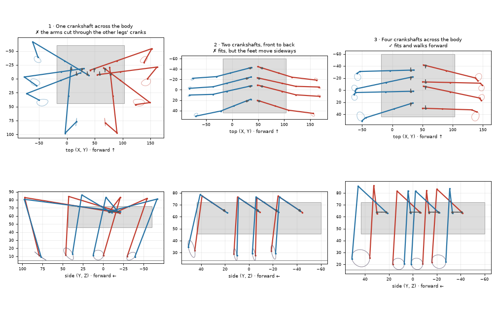

*The three drives tried, from above (top) and from the side (bottom). The grey box is the body; the grey stubs are
the cranks; the loops are the paths of the feet. In 1, the inner arms cross the cranks of the other legs. In 2, the
loops seen from the side are thin and upright: the feet go up and down but hardly forward. In 3, every arm reaches
only its own crank and the loops lie along the ground. Made by
[`tools/drive_attempts_figure.py`](../tools/drive_attempts_figure.py).*

### Leg simulator and comparison

**Phase 3 · Mechanisms · 2026-11-09** · Status: ✅ toy leg chosen

> **In short.** A 2D simulator compared three ways to build a leg turned by a crank: the **toy leg** (one part),
> **Klann** (4 parts) and **Jansen** (7 parts). Klann gives the longest stride and Jansen the smoothest walk, but we
> chose the toy leg: one part per leg, and forgiving of small printing errors. The simulator under-rates it,
> because the real toy leg also moves in 3D, which was checked in the next step.

**The three candidates.** In the **toy leg**, one bent part sits on a crank pin at its inner end and slides through
a pivot on the body's edge. **Klann** and **Jansen** are classic walking linkages with 4 and 7 moving parts per
leg (Jansen's is the one in the Strandbeest sculptures).

#### Steps

1. Take the bar lengths: Klann from his patent, as redrawn by
   [DIY Walkers](https://www.diywalkers.com/klann-linkage-optimizer.html); Jansen's published «holy numbers»; and for
   the toy leg, the best of 4000 random tries (longest stride with less than 3 mm of body bob), so that it is
   compared at its best.
2. Run [`sim/legs.py`](../sim/legs.py). It turns the crank in 0.5° steps, works out where each joint is, and scales
   every leg so the crank axle is 55 mm above the ground (the body bottom is about 46 mm up at 120 %).
3. Measure each leg over the half turn it carries the body: with two gait groups half a turn apart, every leg holds
   the body for half a turn.

<details>
<summary>How to reproduce</summary>

```
python3 sim/legs.py --png sim/images/foot-paths.png --gif sim/images/legs.gif
```

Klann: crank = 3, frame pivots at (7.4, 16.9) and (3.4, 8.03) with the crank at (10, 10), knee bent 30°, upper bar
bent 12.8°. Its driving four-bar (frame O-P2, crank, bar A-M, rocker M-P2): s + l = 9.88774, p + q = 10.19, a
crank-rocker, so its crank turns fully. Jansen: crank = 15.

</details>

#### Result


*Fig. 1 · The three legs at one crank angle (black squares are the fixed pivots) and the path of each foot over a
full turn. The flat bottom of each loop is where the foot pushes the robot; the higher the loop, the higher the step.*

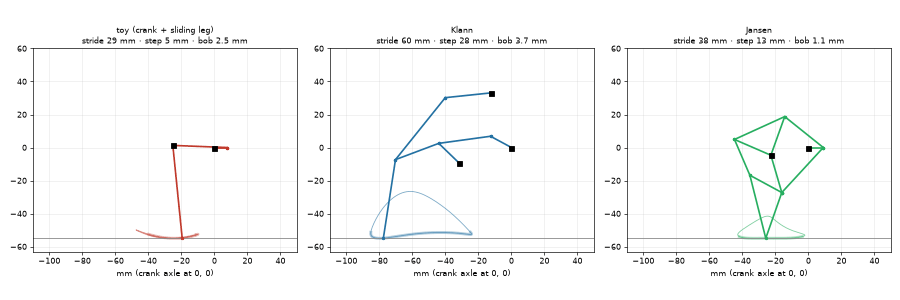

*Fig. 2 · The same three legs turning.*

| Leg | Stride per half turn (mm) | Body bob (mm) | Step height (mm) | Parts per leg |
|---|---|---|---|---|
| Toy | 29 | 2.5 | 5 | 1 |
| Klann | 60 | 3.7 | 28 | 4 |
| Jansen | 38 | 1.1 | 13 | 7 |

<details>
<summary>All the numbers</summary>

| Leg | Foot slips back on the ground | Foot speed peak / median | Crank radius (mm) | Leg size W × H (mm) | Pin joints per leg |
|---|---|---|---|---|---|
| Toy | yes | 1.4 | 7.7 | 55 × 63 | 2 |
| Klann | yes | 1.3 | 14.4 | 100 × 114 | 6 |
| Jansen | no | 1.2 | 9.0 | 73 × 75 | 10 |

</details>

- **Toy:** one part per leg, but in this flat model the foot barely lifts (5 mm) and drags back. Real toy spiders
  work in 3D (the foot also swings sideways and up), which this simulator does not model, so these numbers
  under-rate it.
- **Klann:** longest stride and highest step, and the leg arches above the body like a spider's. But it needs 4
  parts per leg and a bigger crank, the body bobs 3.7 mm, and small errors in the bar lengths change the foot path
  a lot.
- **Jansen:** the smoothest walk, but 7 parts and 10 pins per leg (56 parts for 8 legs), and it does not look like a
  spider leg.

#### Decisions

**Toy leg.** It is the simplest for a first robot: 8 leg parts against 32 for Klann, not sensitive to small
dimension errors, a small crank (about 7 mm, so less torque), and probably how the original toy walks. Klann's
real-size bars can be regenerated with `sim/legs.py` if needed.

**How the toy leg works.** Its inner end sits on a crank pin that turns in a circle. Further out, it passes through
a pivot on the body's edge that lets it slide and swivel. When the crank pin goes up, the foot goes down (a lever),
and when the pin moves in, the leg slides in: the foot traces a loop. The two gait groups of four legs are on crank
pins half a turn apart.

### Toy leg in 3D

**Phase 3 · Mechanisms · 2026-11-09** · Status: ✅ lateral axle

> **In short.** The toy leg was simulated in 3D on the whole robot, in its 8 real notches. We tried 6 ways to build
> it: the crank turning on 3 different axes, and the leg sliding either at the crank or at the body. Only one gets
> close to every target: **crank axle across the body (lateral), leg sliding at the crank**, with a 26 mm stride and
> 3.1 mm of bob. Each leg still has its own crank here; how one motor drives them all is the next step.

**Ways to build it.**
- **Crank axle:** **lateral** (across the body, left to right), **vertical**, or **longitudinal** (front to back).
- **Where the leg slides:** **at the crank**, where the leg turns about a fixed point on the body and the crank pin
  slides in a bore in its inner end; or **at the body**, where the leg sits on the crank pin and slides through a
  sleeve on the body's edge, as in the 2D model.

#### Steps

1. **Find the leg pivots.** The base rim has 8 notches, 4 per side, about 10 × 5 mm, 70–74 mm above the ground.
   Their positions were measured by slicing the base model.
2. **Model one leg** in [`sim/toy_leg_3d.py`](../sim/toy_leg_3d.py): a crank, an inner arm running from the crank pin
   through the pivot, a knee, and a shin bending down and leaning forward or back. All 8 notches use the same leg,
   mirrored on the left, and the two gait groups are half a turn apart.
3. **Walk the robot over one crank turn.** The body stays level, stands on its lowest feet, and moves forward by
   what the lowest foot moves.
4. **Search the best geometry** for each of the 6 combinations: the longest stride that meets the targets. Targets:
   step height ≥ 10 mm, bob ≤ 3 mm, 20–60 mm under the base, ≥ 3 mm between neighbouring legs, knee and foot outside
   the body, stable, footprint ≤ 270 × 185 mm, little foot slip.

<details>
<summary>How to reproduce</summary>

Pivot centres ([cad/carcass-120/](../cad/carcass-120/) coordinates: z = height above the ground, forward = −Y), right
side, front to rear: (89.5, −32.2), (95.9, −12.6), (96.1, 2.9), (82.6, 31.1). The left ones are their mirror about
x = 42.7 (the body axis). Measured by slicing `spideybot_base.stl` at z = 71 and 73 and subtracting the slice from
its convex hull.

Leg parameters: crank radius `r`; crank centre `D` mm inward from the pivot and `H` mm above it; inner `arm`
length; knee `bend` angle; shin `sweep` (forward/back lean) and length. The leg keeps its sideways axis horizontal
(a gimbal at the pivot).

Search: 3000 random tries + 750 refinement steps per combination, ranges r 3–12 mm, D 8–40 mm, H −20 to +8 mm,
arm 5–70 mm, bend 30–150°, sweep ±45°, shin 30–120 mm. The 6 searches ran in parallel, about 10 minutes in all.

```
python3 sim/toy_leg_3d.py --search 3000 --only lateral/crank --json lateral-crank.json   # one per combination
python3 sim/toy_leg_3d.py --params sim/toy_leg_3d.json --png sim/images/toy-3d-comparison.png --gif sim/images/toy-3d.gif
```

The 6 best geometries are in [`sim/toy_leg_3d.json`](../sim/toy_leg_3d.json).

</details>

#### Result

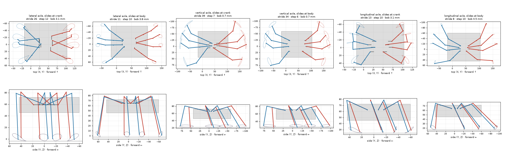

*Fig. 1 · The best robot for each combination, from above (top row) and from the side (bottom row). The grey box is
the body and the loops are the foot paths. The two colours are the two sides.*

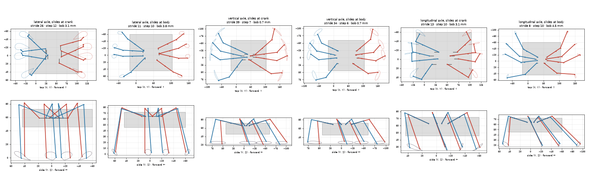

*Fig. 2 · The six combinations walking.*

| Crank axle | Slides at | Stride (mm) | Bob (mm) | Step height (mm) |
|---|---|---|---|---|
| **lateral** | **crank** | **26** | **3.1** | **12** |
| lateral | body | 11 | 3.8 | 10 |
| vertical | crank | 39 | 0.7 | 7 |
| vertical | body | 34 | 0.7 | 6 |
| longitudinal | crank | 13 | 3.1 | 10 |
| longitudinal | body | 8 | 4.5 | 10 |

Stride is per half turn. Knee and foot stay outside the body in all six.

<details>
<summary>All the numbers and geometries</summary>

Feet slip = how far, on average, each foot slides on the ground per turn against the foot carrying the body (it
includes touching down and lifting off).

| Crank axle | Slides at | Feet slip (mm per leg per turn) | Stable all turn (margin mm) | Gap between legs (mm) | Clearance under base (mm) | Footprint X × Y (mm) | Crank radius (mm) |
|---|---|---|---|---|---|---|---|
| lateral | crank | 39 | yes (15) | 8.0 | 49 | 190 × 133 | 10.0 |
| lateral | body | 15 | yes (21) | 15.5 | 48 | 222 × 133 | 3.3 |
| vertical | crank | 29 | yes (13) | 2.9 | 24 | 268 × 184 | 10.1 |
| vertical | body | 22 | yes (12) | 4.0 | 20 | 265 × 176 | 4.1 |
| longitudinal | crank | 39 | yes (6) | 15.5 | 21 | 171 × 133 | 9.1 |
| longitudinal | body | 16 | yes (14) | 15.5 | 29 | 249 × 150 | 3.0 |

| Crank axle / slides at | Geometry (mm, °) | Crank axle above ground (mm) | Slide travel (mm) | Pivot swing yaw / pitch | Leg to crank pin angle |
|---|---|---|---|---|---|
| lateral / crank | r 10.0, D 34.8, H −12.9, arm 23.1, bend 107, sweep 4, shin 79.3 | 62 | 13.9 | 32° / 29° | 7–35° |
| lateral / body | r 3.3, D 30.5, H −7.2, arm 58.7, bend 85, sweep 4, shin 79.7 | 67 | 4.4 | 12° / 12° | 10–22° |
| vertical / crank | r 10.1, D 38.2, H −6.0, arm 45.5, bend 71, sweep 21, shin 66.8 | 44 | 20.0 | 31° / 5° | 78–83° |
| vertical / body | r 4.1, D 17.6, H −2.6, arm 62.4, bend 72, sweep 22, shin 61.4 | 44 | 8.1 | 27° / 4° | 79–83° |
| longitudinal / crank | r 9.1, D 30.8, H −9.3, arm 17.2, bend 104, sweep 22, shin 52.6 | 38 | 18.1 | 6° / 33° | 77–83° |
| longitudinal / body | r 3.0, D 37.0, H −7.7, arm 52.6, bend 63, sweep 27, shin 78.8 | 48 | 6.0 | 2° / 9° | 80–81° |

</details>

- **Lateral axle, sliding at the crank** is the only one close to every target (bob 3.1 against 3). The crank pin
  points along the leg, so it can slide straight into a bore in the leg's inner end: probably the classic toy. Its
  feet slip the most, and the 8 cranks sit near the body centre, where the battery holder goes.
- **Vertical axle** gives the longest, smoothest stride but a low step (6–7 mm): it only lifts the feet by tilting
  the leg. Its legs come within 2.9 mm of each other, and the left cranks must turn the other way.
- **Longitudinal axle** is the weakest: the crank moves the leg's inner end sideways, which hardly makes a stride.
- **Limits of the model:** the body stays level (a real one tilts onto 3 feet), the legs are lines with no
  thickness, and nothing is checked against the inside of the carcass yet.

#### Decisions

Lateral axle, leg sliding at the crank (taken in the next entry, once one motor drives all the legs).

### Toy leg on one crankshaft

**Phase 3 · Mechanisms · 2026-11-09** · Status: ↩️ reversed by [Crankshaft against real parts](#crankshaft-against-real-parts)

> **In short.** In the previous step every leg had its own crank, and the cranks of each side ended up so close
> that they would hit each other. Here all 8 legs share **one crankshaft** across the body, and the legs are given
> a real 5 mm thickness. Stride halves to 14 mm and bob rises to 4.2 mm. The limit is the legs' inner arms bumping
> into each other inside the body, not the shaft. We accepted it, but the next step showed the layout fails anyway.

#### Steps

1. Add a **shaft** mode to [`sim/toy_leg_3d.py`](../sim/toy_leg_3d.py): one crankshaft across the body for all 8 legs,
   its 4 cranks per side in any order, mirrored on the left. The two gait groups are pins half a turn apart on the
   same shaft.
2. Keep the crankshaft below the battery holder and inside the base. The holder (64 × 49 × 16 mm) fills almost the
   whole body ([cad/layout/](../cad/layout/)), so the cranks must stay below it, inside the base with a 2 mm wall.
3. Use stricter rules: legs are 5 mm thick, so every pair of legs on a side keeps 6 mm between centre lines,
   including inside the body. Footprint at least 240 × 165 mm, close to the original's look.
4. Search again: the shaft with the leg sliding at the crank (3 seeds) and at the body, plus, for reference, one
   crank per leg under the same rules.

<details>
<summary>How to reproduce</summary>

Shaft at y = Y0, z = 72 + H. Cranks from XIN to XIN + 3 × PITCH mm from the body axis (PITCH ≥ 8 mm: crank web plus
leg end), in any of the 24 orders. 3000 random tries + 750 refinement steps; 5 searches in parallel, about 15
minutes.

```
python3 sim/toy_leg_3d.py --strict --search 3000 --seed 3 --only shaft/crank --json shaft-crank.json
python3 sim/toy_leg_3d.py --params sim/toy_leg_3d_strict.json --png sim/images/toy-3d-strict.png --gif sim/images/toy-3d-strict.gif
```

Best results: [`sim/toy_leg_3d_strict.json`](../sim/toy_leg_3d_strict.json). Best crankshaft geometry (sliding at
crank): r 5.1, Y0 −12.9, H −6.4 (crank axle 60 mm above the ground), cranks at 6, 16, 26 and 36 mm from the body
axis (front leg innermost), arm 67.4, bend 114°, sweep −15°, shin 77.1 mm. Slide 10 mm, pivot swing 15° each way,
crank pin 2–17° off the leg's axis. The other two seeds gave strides of 9 and 7 mm.

</details>

#### Result

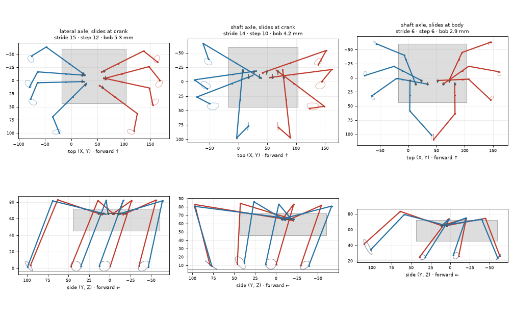

*Fig. 1 · The best layouts with real leg thickness, from above and from the side. In the top view, notice how the
inner arms converge from the notches towards the shaft: that is where they get too close.*

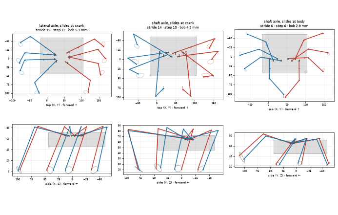

*Fig. 2 · The same, walking.*

| Cranks | Slides at | Stride (mm) | Bob (mm) | Step height (mm) | Gap between legs (mm, need 6) |
|---|---|---|---|---|---|
| one per leg (reference) | crank | 15 | 5.3 | 12 | 1.0 |
| **one crankshaft** | **crank** | **14** | **4.2** | **10** | **2.2** |
| one crankshaft | body | 6 | 2.9 | 6 | 1.4 |

<details>
<summary>All the numbers</summary>

| Cranks | Slides at | Feet slip (mm per leg per turn) | Stable all turn (margin mm) | Clearance under base (mm) | Footprint X × Y (mm) | Crank radius (mm) |
|---|---|---|---|---|---|---|
| one per leg, reference | crank | 18 | yes (7) | 49 | 261 × 166 | 3.0 |
| one crankshaft | crank | 17 | yes (5) | 40 | 241 × 165 | 5.1 |
| one crankshaft | body | 6 | yes (15) | 24 | 243 × 175 | 3.1 |

</details>

- With realistic room between legs, **no layout meets the targets**, not even one crank per leg. Stride halves
  (26 → 14–15 mm) and bob rises to 4–5 mm.
- **The cause:** every closest pair is two **inner arms inside the body**. They come in from notches 10–15 mm apart
  towards the cranks, almost in the same plane, and meet.
- One crankshaft costs almost nothing against one crank per leg (14 against 15 mm).
- **Limits:** the minimum footprint twisted the legs (the rear legs stretch about 100 mm back), and left and right
  legs were not checked against each other.

#### Decisions

**One crankshaft, leg sliding at the crank**, accepting 14 mm per half turn and 4.2 mm of bob: a slower walk, but the
simplest drive. *Reversed in the next entry:* with solid cranks the arms cut through them.

### Crankshaft against real parts

**Phase 3 · Mechanisms · 2026-11-09** · Status: ❌ one crankshaft ruled out

> **In short.** The simulator had checked legs against legs, but not legs against the crankshaft. Once the cranks
> are solid parts, every leg's inner arm cuts through the cranks of the legs further out, by up to 9.5 mm. A new
> search with that rule found no layout that passes. **One crankshaft for all 8 legs is ruled out**, and the drive is
> reopened.

#### Steps

1. **Measure the chosen geometry.** Every inner arm runs from its notch to its own crank, and on the way passes over
   the cranks of the legs further out. A crank reaches 7.1 mm from the shaft axis, and the leg is 5 mm thick, so the
   arm must stay about 10 mm from the axis. It comes as close as 1 mm (table below).
2. **Add the rule** to the simulator (`crank_clear`): every inner arm keeps 1 mm of free space from the cranks it
   does not ride on and from the bare shaft. The geometry of the previous entry fails by 9.5 mm.
3. **Search again** with the same settings: 3 seeds sliding at the crank and 2 sliding at the body.

<details>
<summary>How to reproduce</summary>

Distance from each arm to the shaft axis where it crosses another leg's crank (right side):

| Leg | Crosses the crank at (mm from the body axis) | Distance to shaft axis (mm) |
|---|---|---|
| front | 16 / 26 / 36 | 1–9 / 7–12 / 13–16 |
| middle front | 26 / 36 | 2–5 / 1–6 |
| middle rear | 36 | 3–9 |
| rear | — | — |

Rule: crank discs 4 mm either side of their centre, radius r + 2 (pin head); bare shaft 3 mm; legs 5 mm thick.
3000 tries + 750 refinement steps each, in parallel, about 15 minutes.

```
python3 sim/toy_leg_3d.py --strict --search 3000 --seed 1 --only shaft/crank --json crank-1.json
python3 sim/toy_leg_3d.py --params sim/toy_leg_3d_shaft_check.json --png sim/images/toy-3d-shaft-check.png
```

Results: [`sim/toy_leg_3d_shaft_check.json`](../sim/toy_leg_3d_shaft_check.json).

</details>

#### Result

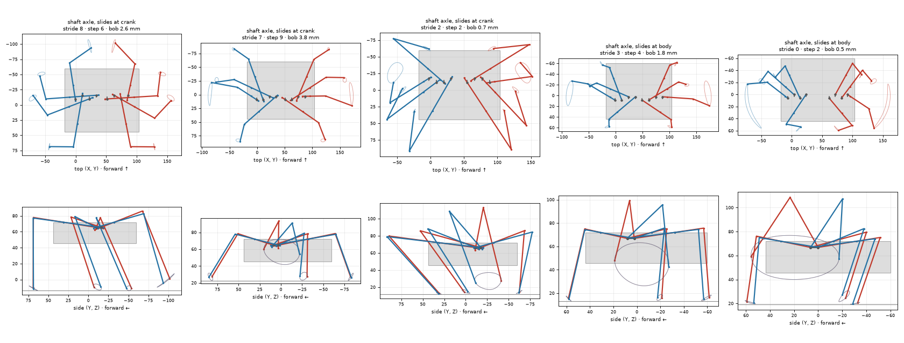

*Fig. 1 · The five searches with the new rule. To avoid the cranks, the search shrinks the stride to almost
nothing, and still fails.*

| Slides at | Seed | Stride (mm) | Bob (mm) | Gap between legs (mm, need 6) | Arm to crankshaft (mm, need 1) |
|---|---|---|---|---|---|
| crank | 2 | 8 | 2.6 | 2.1 | −7.3 |
| crank | 1 | 7 | 3.8 | 2.4 | −4.0 |
| crank | 3 | 2 | 0.7 | 1.7 | −3.9 |
| body | 1 | 3 | 1.8 | 2.1 | −4.2 |
| body | 2 | 0 | 0.5 | 4.6 | −1.8 |

A negative distance means the arm goes through the crank.

- **No layout passes.** Every one still has arms cutting through cranks and legs too close, and the stride drops to
  0–8 mm.
- **The cause is the layout itself.** 8 legs come in from the rim to one line across the body, so the outer cranks
  are always in the way of the inner legs' arms.

#### Decisions

One crankshaft for all 8 legs is ruled out. The drive has to be designed again, and simulated before any CAD.

### Two side crankshafts

**Phase 3 · Mechanisms · 2026-11-09** · Status: ❌ ruled out

> **In short.** To keep arms away from other legs' cranks, we tried two crankshafts running **front to back**, one
> per side, each crank level with its own leg. The parts fit, with room to spare, but the robot barely walks
> (1–2 mm per half turn): a crank turning on a front-to-back axis moves the foot sideways, not forward. The crank must
> turn on an axis **across** the body.

#### Steps

1. Add a **sides** mode to [`sim/toy_leg_3d.py`](../sim/toy_leg_3d.py): one front-to-back shaft per side, each leg's
   crank on it level with its notch. The two shafts turn opposite ways (a gear pair, with the motor between them),
   so the left side mirrors the right.
2. Same strict rules as the previous entry, including the arm-to-crankshaft check. 5 searches.

<details>
<summary>How to reproduce</summary>

Shaft XS mm from the body axis at z = 72 + H; each crank shifted DY mm along the shaft. Ranges: r 3–12, XS 10–50,
H −22 to 0, DY ±10 mm, leg as before. 5 searches in parallel, about 15 minutes.

```
python3 sim/toy_leg_3d.py --strict --search 3000 --seed 1 --only sides/crank --json crank-1.json
python3 sim/toy_leg_3d.py --params sim/toy_leg_3d_sides.json --png sim/images/toy-3d-sides.png --gif sim/images/toy-3d-sides.gif
```

The best three: [`sim/toy_leg_3d_sides.json`](../sim/toy_leg_3d_sides.json).

</details>

#### Result

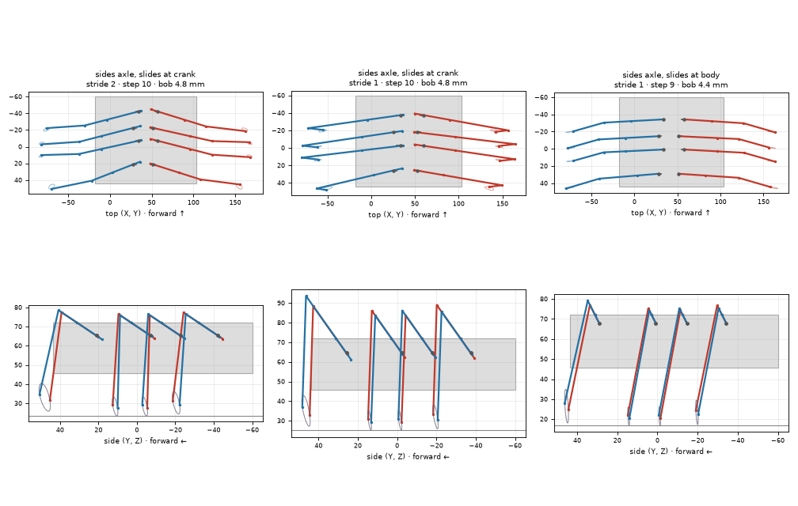

*Fig. 1 · Two side crankshafts. In the side view the foot loops are thin vertical lines: the feet go up and down
but hardly move forward.*

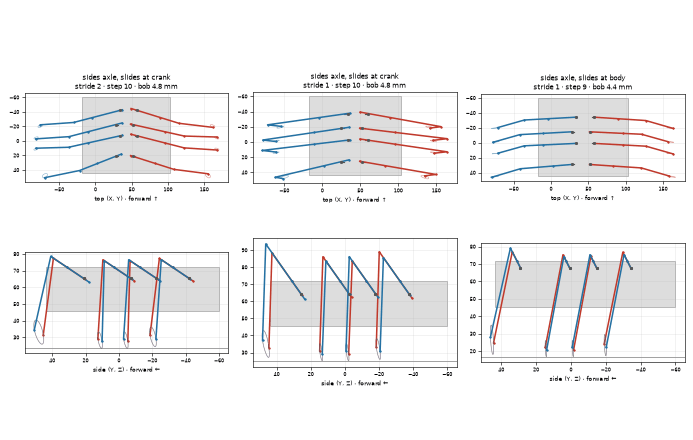

*Fig. 2 · The same, walking: the legs move in and out instead of forward.*

| Slides at | Seed | Stride (mm) | Bob (mm) | Gap between legs (mm, need 6) | Arm to crankshaft (mm, need 1) |
|---|---|---|---|---|---|
| crank | 2 | 2 | 4.8 | 13.0 | 9.2 |
| crank | 3 | 2 | 4.6 | 13.1 | 6.4 |
| crank | 1 | 1 | 4.8 | 13.2 | 11.1 |
| body | 1 | 1 | 4.4 | 14.8 | 13.1 |
| body | 2 | 1 | 4.2 | 14.1 | 9.5 |

<details>
<summary>All the numbers</summary>

| Slides at | Seed | Step height (mm) | Pivot swing yaw / pitch |
|---|---|---|---|
| crank | 2 | 10 | 2° / 8° |
| crank | 3 | 10 | 2° / 8° |
| crank | 1 | 10 | 2° / 11° |
| body | 1 | 9 | 0° / 8° |
| body | 2 | 9 | 1° / 8° |

</details>

- **The parts fit:** 13–15 mm between legs and 6–13 mm of free space to the cranks, the first layout to pass both.
- **The robot barely walks.** A crank on a front-to-back shaft moves the leg's inner end in and out and up and down,
  so the leg hardly swings forward. Forward stride needs the crank pin to move forward and back, so the crank has to
  turn on an axis across the body, as in [Toy leg in 3D](#toy-leg-in-3d).
- Bob is 4.2–4.8 mm, also above the 3 mm target.

#### Decisions

Ruled out for this leg: the parts fit, but the feet move sideways. The cranks must turn on an axis across the body
without lining all 8 up on one shaft.

### Four lateral crankshafts

**Phase 3 · Mechanisms · 2026-11-09** · Status: ✅ chosen

> **In short.** The cranks turn across the body again, but now on **four short shafts, one per pair of legs**, so
> each arm only reaches its own shaft. Gears between the shafts make them turn together. It is the first layout that
> fits and walks forward, but the stride is short: 9 mm per half turn, because a longer stride makes the body bob
> more than the 3 mm allowed. We chose it, keeping the 3 mm limit.

#### Steps

1. Add a **rows** mode to [`sim/toy_leg_3d.py`](../sim/toy_leg_3d.py): 4 shafts across the body, each level with its
   pair of notches. The left and right cranks of a shaft are half a turn apart (the two gait groups). Idler gears
   between neighbouring shafts make all four turn the same way (about 7 gears in a row, the motor on one of them;
   not simulated).
2. Same strict rules, with the arm-to-crankshaft check per shaft. 5 searches.
3. Take the best geometry and change the crank size, its height and its distance from the body axis by hand, to see
   which target holds the stride back.

<details>
<summary>How to reproduce</summary>

Each shaft shifted DY mm front or back of its notches, at z = 72 + H; cranks XC mm either side of the body axis.
Ranges: r 3–12, XC 6–45, H −22 to 0, DY ±10 mm, leg as before. 5 searches in parallel, about 15 minutes.

```
python3 sim/toy_leg_3d.py --strict --search 3000 --seed 1 --only rows/crank --json crank-1.json
python3 sim/toy_leg_3d.py --params sim/toy_leg_3d_rows.json --png sim/images/toy-3d-rows.png --gif sim/images/toy-3d-rows.gif
```

The best three: [`sim/toy_leg_3d_rows.json`](../sim/toy_leg_3d_rows.json).

</details>

#### Result

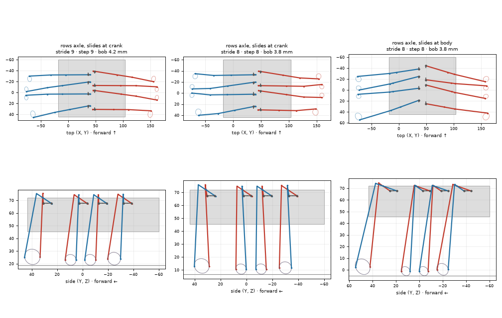

*Fig. 1 · Four lateral crankshafts. In the side view the foot loops lie along the ground: the feet move forward.
The cranks (short stubs near the body axis in the top view) stay clear of the other legs.*

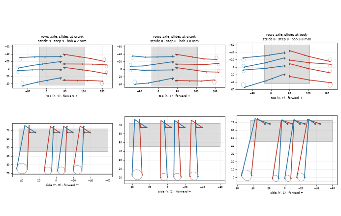

*Fig. 2 · The same, walking.*

| Slides at | Seed | Stride (mm) | Bob (mm) | Gap between legs (mm, need 6) | Arm to crankshaft (mm, need 1) |
|---|---|---|---|---|---|
| **crank** | **2** | **9** | **4.2** | **6.9** | **4.3** |
| crank | 1 | 8 | 3.8 | 7.5 | 4.6 |
| crank | 3 | 8 | 3.8 | 6.8 | 4.6 |
| body | 1 | 8 | 3.9 | 7.7 | 4.7 |
| body | 2 | 8 | 3.8 | 7.8 | 4.5 |

- **The parts fit and the feet loop forward**, the first layout to pass every check, with the cranks inside the base.
- **Stride is only 8–9 mm per half turn.** Every search ends at the smallest crank (3 mm) with the cranks next to
  the body axis.
- **The bob limit holds it back.** Changing the geometry by hand (table below), body bob grows with stride, about
  0.45 mm per mm. A bigger crank also brings the shins closer together and raises the cranks into the battery holder.

| Crank radius (mm) | Height H (mm) | Distance from axis XC (mm) | Stride (mm) | Bob (mm) | Gap between legs (mm) |
|---|---|---|---|---|---|
| 3.1 | −4.3 | 6 | 9 | 4.2 | 6.9 |
| 5 | −8 | 6 | 15 | 6.9 | 1.7 |
| 5 | −8 | 15 | 18 | 8.6 | 0.5 |
| 5 | −8 | 25 | 25 | 11.6 | 2.2 |
| 8 | −10 | 6 | 24 | 11.0 | 0.7 |

#### Decisions

**Four lateral crankshafts, leg sliding at the crank, keeping the 3 mm bob limit:** the best geometry above (the
first entry in [`sim/toy_leg_3d_rows.json`](../sim/toy_leg_3d_rows.json)). The three options compared:

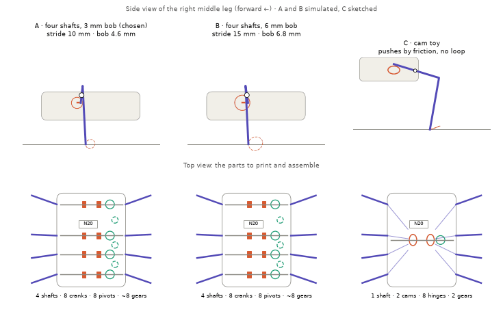

*Fig. 3 · Side view of one leg for each option, with the parts each needs. A and B are simulated; C is a sketch
([`tools/drive_options_gif.py`](../tools/drive_options_gif.py)).*

| | A · Four shafts, 3 mm bob (chosen) | B · Four shafts, 6 mm bob | C · Cam toy |
|---|---|---|---|
| Walk | Short, smooth steps, slow | Steps almost twice as long; the body rocks visibly | Feet scrape; works on carpet, may slip on smooth floors |
| Like the original | Yes (the feet step) | Yes | Less (walks like a wind-up toy) |
| Parts | ~45: 8 legs, 4 shafts with 8 cranks, 8 pivots, ~8 gears | Same | ~15: 8 legs, 1 shaft, 2 cams, 2 gears |
| Printing | Small, precise parts | Same | Thick, tolerant parts |
| Fragile | Medium-high: a 3 mm PLA pin can snap; one jammed leg stops all | A bit more | Low |
| N20 motor | Plenty of torque | About 1.7 × the torque | Plenty of torque |

The **cam toy** (one shaft across the body, cams lift hinged legs, the feet push by leaning back) stays as a
fallback. The simulator cannot represent it (its feet slide), so it would be tested by printing a pair of legs.

### Legs and drive in CAD

**Phase 3 · Mechanisms · 2026-11-10** · Status: ✅ done

> **In short.** The legs and the four-crankshaft drive were modelled in Python code (build123d), with sizes taken
> from the simulator. The chosen geometry first had to be adjusted so a gear fits between each shaft's two cranks.
> A script then moved every part through a full crank turn and fixed each collision it found. The result: 25 printed
> parts with no collisions, exported for Onshape (STEP) and for printing (STL), plus a test frame for one leg.

#### Steps

1. **Install build123d** in a Python virtual environment at the repo root (Python 3.12: 3.14 has no CAD packages
   yet).
2. **Make the geometry buildable.** In the chosen geometry a shaft's two cranks were 12 mm apart, with no room for a
   gear and two bearing walls between them. The shafts were also so high that a gear could only be 4 mm in radius
   under the battery holder. A new search with these limits gives 10 mm per half turn and 4.6 mm of bob (Fig. 1).
3. **Model the parts** in `cad/drive/build.py` (since split into [`cad/legs/`](../cad/legs/), [`cad/crankshafts/`](../cad/crankshafts/), [`cad/gear-train-test/`](../cad/gear-train-test/) and [`cad/test-frame/`](../cad/test-frame/)): the leg (3 lengths × 2 sides), the pivot fork,
   one-piece crankshafts (gear, journals, cranks and balls), idler gears, the spine that holds them, and a test
   frame. The gears are standard involute gears, module 1.
4. **Check collisions** with [`cad/legs/check.py`](../cad/legs/check.py): it places every part as the simulator
   moves it, every 30°, and measures how much each pair overlaps. Fix and repeat (table below).
5. **Make the STLs watertight.** The CAD kernel leaves a hairline gap where a sphere meets a box; `build.py` closes
   it. Bambu Studio: `manifold = yes` for all 17 files.

<details>
<summary>How to reproduce</summary>

```
uv venv --python python3.12 .venv
uv pip install --python .venv/bin/python build123d numpy scipy matplotlib pillow trimesh shapely networkx manifold3d rtree
python3 sim/toy_leg_3d.py --strict --search 3000 --seed 2 --only rows/crank --json crank-2.json
```

Limits added to the `rows` search: cranks at least 12 mm from the body axis (XC ≥ 12) and shafts at least 8 mm
below the pivots (H ≤ −8). 4 seeds; seed 2 (legs 5.9 mm apart, 30 mm under the base) is in
[`sim/toy_leg_3d_rows_cad.json`](../sim/toy_leg_3d_rows_cad.json). Parts and how they fit:
[cad/legs/](../cad/legs/) and [cad/crankshafts/](../cad/crankshafts/).

</details>

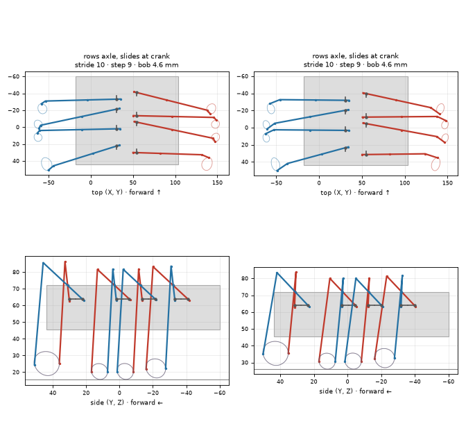

*Fig. 1 · The geometry used for the CAD, with room for the gears.*

What the collision check found, in order:

| Found | Fix |
|---|---|
| Ball not where the simulator puts it | Crankshaft turned the wrong way in the assembly (a placement bug) |
| Leg tube hitting the fork | The leg tilts up 6–23°: fork window sized for 28°, tube ends 8 mm before the pivot |
| Test frame upright in the leg's path | Upright moved beside the leg |
| Middle legs' tubes touching near the cranks | Smaller ball (Ø3.6), tube with flat sides 5.6 mm wide |
| Rear tube mouth on its crank; gear teeth on the spine's end blocks | Mouth 0.4 mm closer to the ball; end blocks 2 mm further out |
| Middle legs' feet and shins touching | Shin and foot 4.5 mm wide (legs 5 mm) |

#### Result

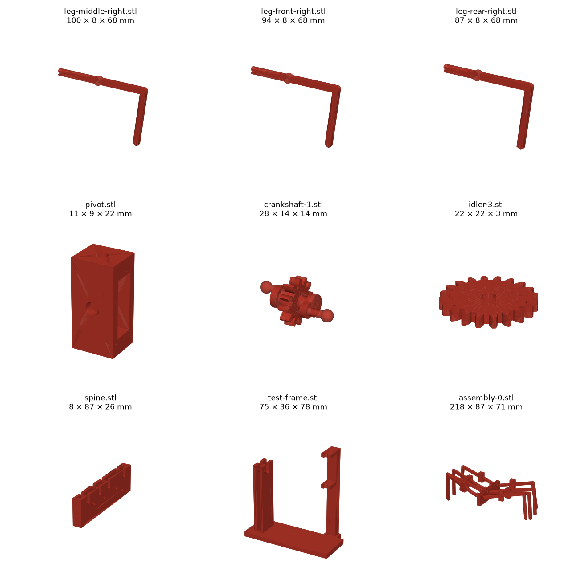

*Fig. 2 · The drive parts: three leg lengths, the pivot fork, a crankshaft, an idler gear, the spine, the test
frame, and the whole robot assembled.*

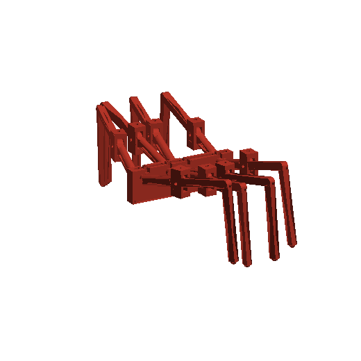

*Fig. 3 · All eight legs turning over a full crank turn, with no collisions.*

- **No collisions over a full turn.** The closest pairs are the designed clearances (0.1 mm a side for the balls
  and journals, 0.2 mm for the legs in their forks). The closest parts not meant to touch are the middle legs' shins
  (0.7 mm apart) and a rear leg against its crank (0.6 mm).
- **25 printed parts** (8 legs, 8 forks, 4 crankshafts, 3 idlers, spine), plus 8 × M3×12 screws with nuts,
  16 × M3×6 and 3 × 3 mm pins.
- The clearances are a guess (+0.2 mm on the diameter) until a clearance test is printed.

#### Decisions

- **One-piece printed crankshafts** (no steel shaft): the angle between the cranks is printed in, so it cannot slip.
- **Swivel axes are M3 screws:** the leg turns on one, and the fork turns on two driven into it.
- The CAD uses the search with buildable limits (10 mm stride, 4.6 mm bob) instead of the unbuildable geometry
  chosen in [Four lateral crankshafts](#four-lateral-crankshafts) (9 mm, 4.2 mm).

### Onshape assembly

**Phase 2 · CAD · 2026-11-10** · Status: ✅ done

> **In short.** One leg on its test frame was assembled in Onshape from the exported STEP files, with joints
> («mates») that let it move as the real one will, and animated through a full turn. It moves as expected. A
> step-by-step tutorial with pictures is in [cad/test-frame/onshape.md](../cad/test-frame/onshape.md).

#### Steps

Full tutorial, with a picture of the edges to click for each mate: [cad/test-frame/onshape.md](../cad/test-frame/onshape.md)
(pictures made by [`cad/test-frame/onshape_figures.py`](../cad/test-frame/onshape_figures.py)). In short:

1. Import `test-frame`, `crankshaft-2`, `leg-middle-right` and `pivot` (STEP) into one document. Insert the test
   frame at the origin and **Fix** it, so the assembly uses the robot's coordinates.
2. Make a helper part, the slider (a Ø3 × 4 mm cylinder). Onshape has no mate for a ball that slides in a tube and
   tilts, so it is built in two steps: crankshaft → **Ball** → slider → **Slider** → leg.
3. Add five mates: three **Revolute** (crankshaft in the frame, fork in the frame, leg in the fork, offset by the
   designed clearances), **Ball** and **Slider**.
4. **Animate** the crankshaft's revolute, 0–360°.

Document (public): [Spider-Bot drive](https://cad.onshape.com/documents/07632681db3e0a6b5b785746/w/6c5d5bb7bfec5781a6827599/e/c59459f0a1ed69675318d6bb).

#### Result

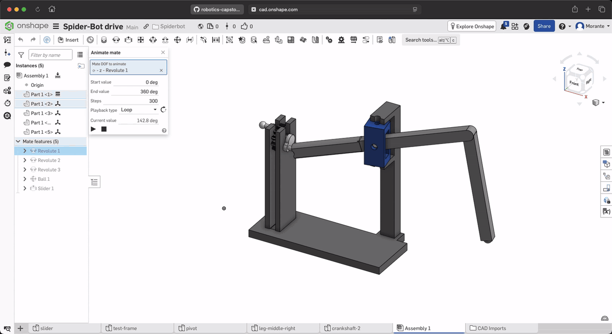

*Fig. 1 · The assembly animated in Onshape: turning the crankshaft moves the fork, the leg and the ball together.*

- The leg has a single degree of freedom, and the animation runs through the full turn.
- The mate offsets had to be negative: with positive ones the parts went into the walls. An offset is measured along
  the mate connector's Z axis, whose direction depends on the face clicked.
- The foot path was not compared with the simulator's. That check was later dropped ([Base v1 in CAD](#base-v1-in-cad)).

### Clearance test and test leg print plate

**Phase 2 · CAD · 2026-11-10** · Status: ✅ printed

> **In short.** Before printing the 25 drive parts, one print plate holds everything needed to turn one leg by
> hand, plus a block that tests how much bigger the holes must be on this printer. The leg had to be reshaped
> slightly so it lies flat on the bed. The plate takes 1 h 28 min and 29.6 g of PLA.

#### Steps

1. **Clearance test** ([`cad/clearance-test/`](../cad/clearance-test/), `build.py`): a block with sideways holes for
   the journal (Ø4.0), the ball (Ø3.6) and an M3 screw (Ø3.0), each 0.1, 0.2, 0.3 and 0.4 mm larger. It also has
   3 holes for M3 screws to cut their own thread (Ø2.3 / 2.5 / 2.7), and a pin with a Ø4.0 journal and a Ø3.6 ball,
   printed lying down like a crankshaft (Fig. 1).
2. **Lay the leg flat.** Turned on its side for printing, only the tube touched the bed: the tube is 5.6 mm wide and
   the rest of the leg 5.0 mm, so the arm hung 0.3 mm in the air, too little for supports.
   - Making the whole leg 5.6 mm wide brought the middle legs' knees to 0.09–0.21 mm from each other.
   - Instead, the leg stays 5.0 mm wide, and the arm, boss and knee move 0.3 mm (the shin 0.55 mm) towards the
     face on the bed, flush with the tube. The fork's window moves with it. The leg now touches the bed over
     567 mm² instead of 190 mm².
3. **Plate** ([`tools/bambu_plate.py`](../tools/bambu_plate.py)): orient the parts, then let Bambu Studio arrange and
   slice them with its standard settings (P2S 0.4 mm nozzle, 0.20 mm Standard, PLA Basic, Textured PEI plate).
   Supports are tree supports on the build plate only, so none go into the holes or the leg's bore. Then open it in
   Bambu Studio, check the support settings, slice and save. Details: [print/README.md](../print/README.md).

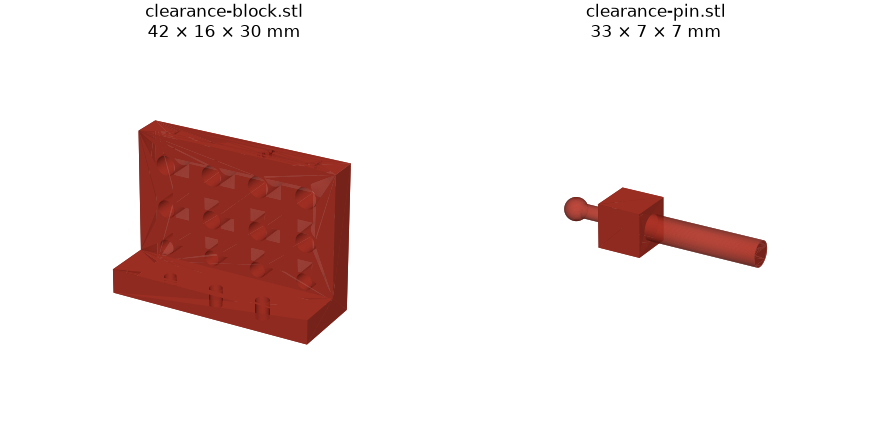

*Fig. 1 · The clearance block and its test pin.*

#### Result

<table>
<tr>
<td width="50%">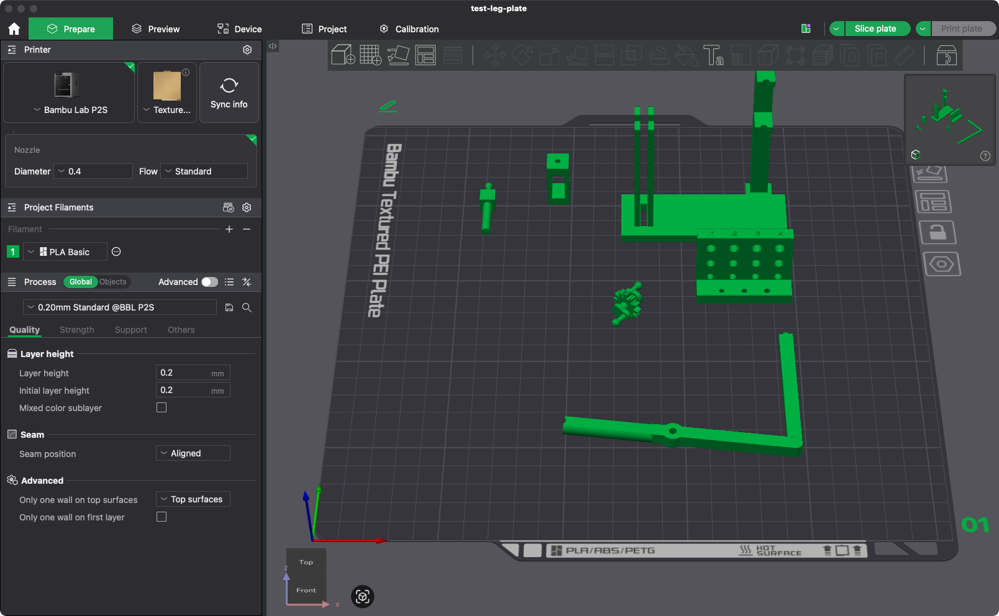</td>
<td width="50%">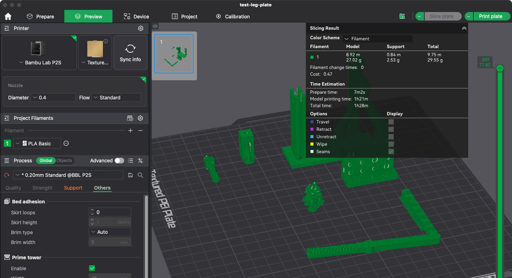</td>
</tr>
<tr>
<td><em>Fig. 2 · The plate in Bambu Studio: test frame, leg, fork, crankshaft, clearance block and pin.</em></td>
<td><em>Fig. 3 · Sliced, with the tree supports.</em></td>
</tr>
</table>

- [`print/test-leg-plate.3mf`](../print/test-leg-plate.3mf): 1 h 28 min, 29.6 g of PLA (2.5 g of it support).
- Bambu Studio warns about 2 areas of the leg it cannot support. Both are the top of the 3.8 mm bore and its flared
  mouth inside the tube (9.8 mm²). They print as bridges.
- The collision check of the whole robot with the reshaped leg finds no collisions over a full turn.
- Bambu Studio dropped the support settings when the project was opened in the app. The tool now saves them as
  changed settings in the .3mf; not yet confirmed in the app.

#### Decisions

- One plate for the test only. The rest of the drive waits for the clearance result and for the base.
- The plate actually printed is the first version, with the leg 5.6 mm wide. For one leg on the test frame both
  versions behave the same, so the reshaped one is not printed separately.

### Test leg: first assembly and clearance result

**Phase 3 · Mechanisms · 2026-11-11** · Status: ✅ second version printed: [Test leg v2](#test-leg-v2-turning-by-hand)

> **In short.** Before printing all 25 drive parts, we printed just one leg with its own small stand to turn it by
> hand, and a block to measure how loose holes have to be on this printer. The leg could not be turned yet: the stand
> did not hold the fork in place, and the holes were too tight. The block showed the clearance needed (0.5 mm instead
> of 0.2 mm). The CAD now uses it, and the stand is redesigned with screws and nuts that hold every part.

**What is being tested.** The robot's leg is a single bent part. Its inner end slides over a ball on a crank, and
halfway along it passes through a **fork** (a small swivelling block) on the body's edge. When the crank turns, the
foot traces a loop. The **test frame** holds one crankshaft and one fork exactly where the robot's base will, so one
leg can be tried before the base exists. The **clearance block** has holes of the same sizes as the real ones,
each 0.1–0.4 mm larger, to find out which one turns freely.

#### Steps

1. Print [`print/test-leg-plate.3mf`](../print/test-leg-plate.3mf). This was the first version, with the leg 5.6 mm wide.
2. Remove the supports, which are on the crankshaft and on one side of the leg (Fig. 2–3).
3. Assemble following the [diagram](../cad/test-frame/README.md): the leg in the fork on an M3×16 and a nut, the fork between
   the frame's two arms, and the crankshaft in its slots with the ball inside the leg's tube (Fig. 4).
4. Push the clearance pin into each hole of the block and note how it turns (Fig. 6).

<table>
<tr>
<td width="50%">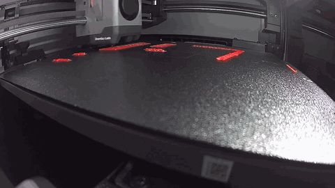</td>
<td width="50%">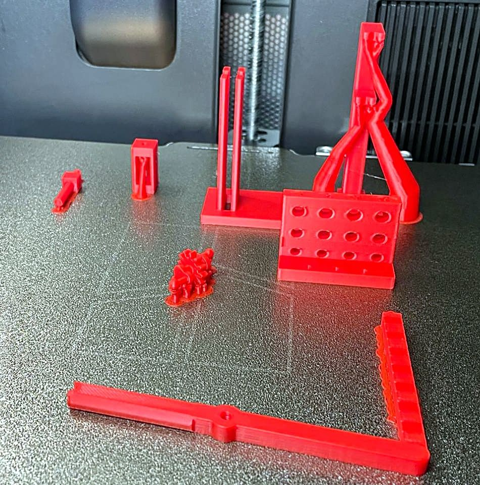</td>
</tr>
<tr>
<td><em>Fig. 1 · Printing <a href="../print/test-leg-plate.3mf"><code>print/test-leg-plate.3mf</code></a> (1 h 28 min,
29.6 g of PLA).</em></td>
<td><em>Fig. 2 · On the bed: clearance pin, fork, frame, clearance block, crankshaft (in its tree support) and the
leg lying flat.</em></td>
</tr>
<tr>
<td width="50%">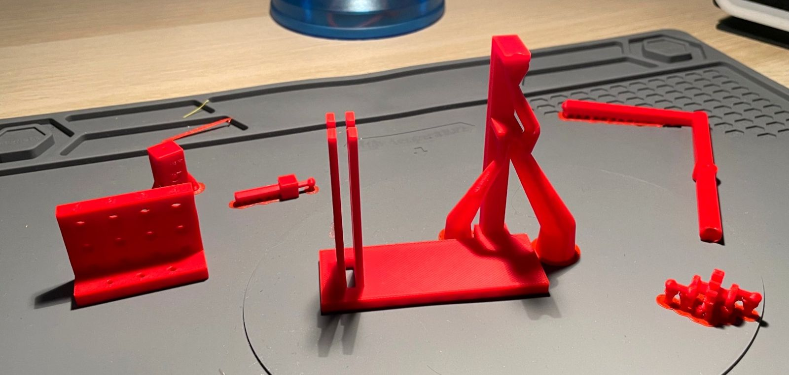</td>
<td width="50%">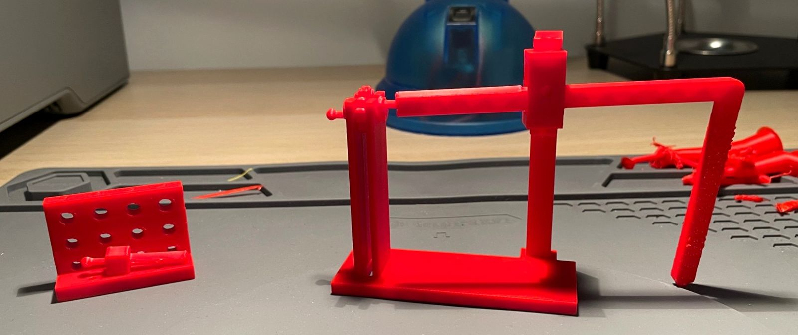</td>
</tr>
<tr>
<td><em>Fig. 3 · Off the bed, supports still on. On the frame, the two thin walls hold the crankshaft and the tall
post on the right holds the fork between its arms.</em></td>
<td><em>Fig. 4 · First assembly: the crankshaft (left) with its ball in the leg's tube, the fork on the right post.
On the left, the clearance pin in its block.</em></td>
</tr>
<tr>
<td width="50%">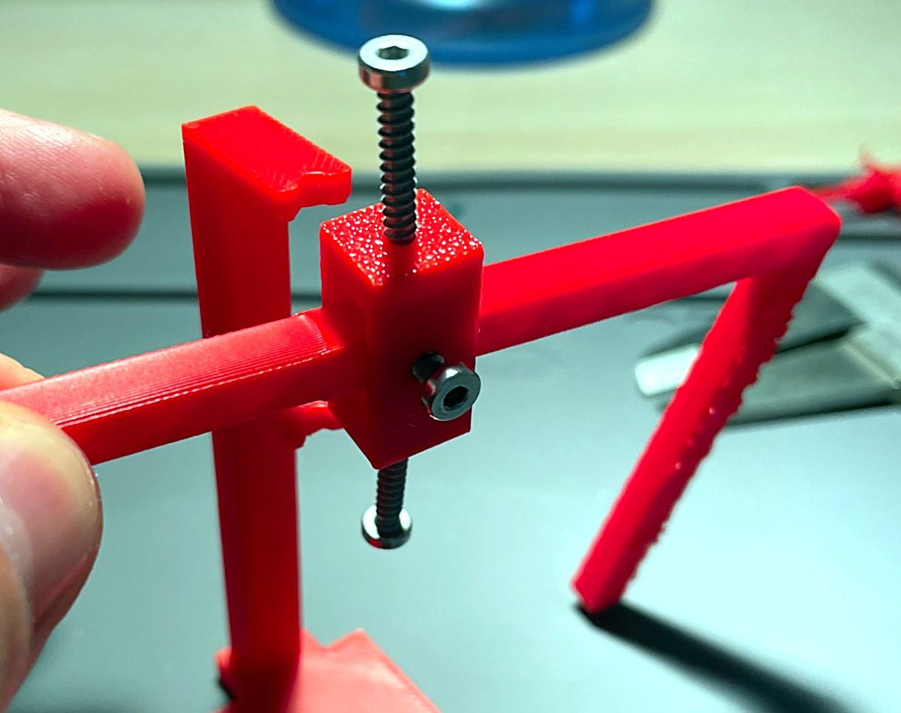</td>
<td width="50%">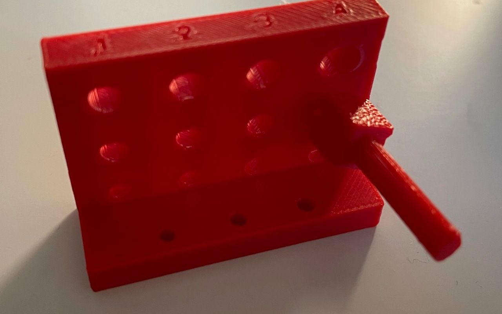</td>
</tr>
<tr>
<td><em>Fig. 5 · The fork has to be held by hand. The frame's upper arm (top left) ends in a half-open «C», so the
screw slides out. The screws in the fork are M2: M3 would not go in.</em></td>
<td><em>Fig. 6 · The clearance block. Columns 1–4 add +0.1 / +0.2 / +0.3 / +0.4 mm to the diameter. Rows, top to
bottom: crankshaft journal (Ø4.0), ball (Ø3.6), M3 screw (Ø3.0). The pin is in the +0.4 journal hole.</em></td>
</tr>
</table>

#### Result

| What | Expected | What happened | Why |
|---|---|---|---|
| Fork in the frame | Swivels on two screws, held by the frame's arms | Falls out; held by hand (Fig. 5) | The arms ended at the centre of their screw holes, leaving a half-open «C» |
| Screws into the fork (Ø2.5 holes) | M3 cuts its own thread | M3 would not go in; M2 used, loose | The hole is too small for M3 in PLA |
| Leg on the fork (M3×16) | Turns | Goes in fine | — |
| Crankshaft and ball | Turn freely with 0.2 mm of clearance | Too tight (see the block, Fig. 6) | 0.2 mm is too little for a printed part in a printed hole |

| Hole | +0.1 | +0.2 | +0.3 | +0.4 |
|---|---|---|---|---|
| Journal Ø4.0 (printed pin) | ✗ | ✗ | ✗ | goes in, turns in jerks |
| Ball Ø3.6 (printed pin) | ✗ | ✗ | ✗ | goes in, turns with difficulty |
| M3 screw (steel) | grips tight | threads easily | wobbles a little | — |

The clearance block, as tested by Morante (Fig. 6). ✗ = does not go in.

**Conclusion:** a printed part needs much more room in a printed hole than a steel screw does. The single 0.2 mm
used for every hole was far too tight for the printed ones.

#### Decisions and fixes

All of these are changes to `cad/drive/build.py` (since split into [`cad/legs/`](../cad/legs/), [`cad/crankshafts/`](../cad/crankshafts/), [`cad/gear-train-test/`](../cad/gear-train-test/) and [`cad/test-frame/`](../cad/test-frame/)):

- **Two clearances instead of one.** `CLR` = 0.5 mm for a printed part in a printed hole (journals, ball in the
  bore) and `CLR_STEEL` = 0.3 mm for a steel screw or pin in a printed hole. 0.5 is one step past the block's
  last hole, because +0.4 only turned roughly. The reprint will show whether it is enough.
- **Frame arms closed.** They now reach 5 mm past their holes.
- **Fork on screw tips, not self-tapped.** It now turns on the tips of two M3×10 screws, each locked to a frame arm
  by a nut, entering Ø3.3 blind holes in the fork. The arms moved 2.4 mm apart to make room for the nuts.
- **Keeper for the crankshaft.** It only sat in slots open at the top, so a knock or the leg's push lifted it out.
  A **keeper** (green in Fig. 7) now closes the slots from above and is held by two M3×12 into nuts.
- **Nylon lock nut** on the leg's M3×16, so the knocks do not loosen it.

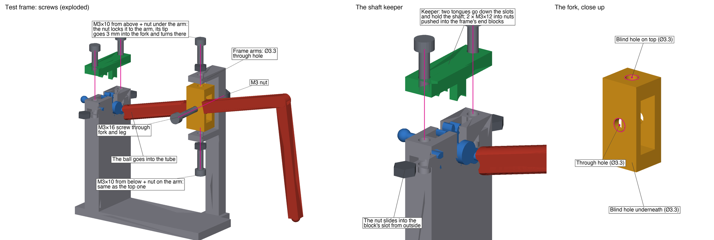

*Fig. 7 · The redesigned test frame, exploded. Grey: frame. Orange: fork. Red: leg. Blue: crankshaft. Green: the
new keeper. Made by [`cad/test-frame/screws_figure.py`](../cad/test-frame/screws_figure.py).*

<details>
<summary>Collision check of the new parts</summary>

`check.py` (which now includes the keeper), over a full turn: no overlaps. The shaft has 0.25 mm a side in the frame
and the keeper, and the keeper rests on the walls. The right rear leg comes to 0.15 mm from its crankshaft, less
than the bore's 0.25 mm a side: to look into before printing the rear legs.

</details>

### Test leg v2: turning by hand

**Phase 3 · Mechanisms · 2026-11-11** · Status: ✅ the leg turns

> **In short.** The redesigned test frame was printed and the leg now turns by hand: the crank goes round and the
> leg rises and falls in its fork, with the frame holding every part. The 0.5 mm clearance is enough for the
> crankshaft and the ball. The new fork came out too tight for the leg, so the fork from the first print was used.

#### Steps

1. Print [`print/test-frame-v2.3mf`](../print/test-frame-v2.3mf): frame, keeper, fork and leg (Fig. 1). The crankshaft
   from the first print is kept.
2. Assemble following the [diagram](../cad/test-frame/README.md) (Fig. 7 of the [previous entry](#test-leg-first-assembly-and-clearance-result)).
3. Turn the crankshaft by hand (Fig. 2).

<table>
<tr>
<td width="50%">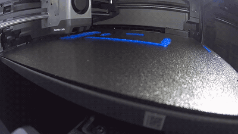</td>
<td width="50%">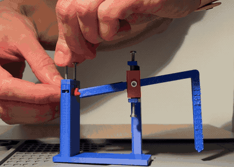</td>
</tr>
<tr>
<td><em>Fig. 1 · Printing <a href="../print/test-frame-v2.3mf"><code>print/test-frame-v2.3mf</code></a> (1 h 18 min,
25.6 g of PLA). The tree support under the frame's fork arms is the tall one at the back.</em></td>
<td><em>Fig. 2 · Turning the crankshaft by hand (left). The leg slides on the ball and tilts up and down in the
red fork, which swivels between the frame's two M3 pins. The red fork and crankshaft are from the first print.</em></td>
</tr>
</table>

#### Result

| What | Expected | What happened |
|---|---|---|
| Crankshaft in the frame, under the keeper | Turns, stays in its slots | Turns by hand and stays in place |
| Ball in the leg's tube (0.5 mm clearance) | Slides and tilts | The leg follows the crank all the way round |
| Fork between the frame's arms (M3×10 pins) | Swivels and stays | Swivels and stays |
| Leg into the fork | Goes in | Into the red fork (first print) yes; into the blue one (this print) no |

**Why the blue fork is too tight.** The fork's CAD did not change between the two prints. Measured with a caliper,
the red fork's walls are 2 mm (as modelled) and the blue one's a little thicker (less than 0.5 mm more), so its window
came out narrower than the leg. The leg goes in from the foot end (the shin is 4.5 mm across), and the window is only
0.2 mm wider than the leg on each side, so a small print variation is enough to stop it.

**Conclusion:** the 0.5 mm clearance works for a printed part in a printed hole, and the frame now holds the
mechanism. The test leg is done; the fork's window gets more room before the robot's 8 forks are printed.

The window now has 0.5 mm a side: [Base v1 in CAD](#base-v1-in-cad).

### Base v1 in CAD

**Phase 3 · Mechanisms · 2026-11-11** · Status: ✅ printed; faults in [Base v1: print and first fitting](#base-v1-print-and-first-fitting)

> **In short.** Before the base, two fixes from the test leg went into the CAD: the fork gets more room for the leg,
> and the rear crankshaft's crank arms are thinner, because the rear leg came 0.15 mm from them. Fitting the drive
> into the carcass then showed a bigger problem: the forks are 22 mm tall, and the body sits on the base right above
> the leg notches, so the top half of every fork went into the body. The body now sits 18.7 mm higher, on a **band**
> that is part of the new base. Base v1 is modelled, nothing collides over a full turn, and its print plate is ready
> (about 8 h).

**What the base has to do.** It holds the eight forks at the leg notches, carries the four crankshafts and the
idler gears, leaves room for every leg to swing, and still looks like the carcass from outside. It is made from
the carcass base's own mesh, by adding and cutting solids in code.

#### Steps

1. **Fork window.** The window the leg goes through is now 1.0 mm wider than the leg (0.5 mm a side, the clearance
   for printed parts) instead of 0.4 mm. Fork: 10.6 × 10.0 × 22.0 mm. The leg can now slide up to 1 mm along its
   screw, and the middle legs pass 0.7 mm apart, so an M3 washer on each side takes up the play where it fits.
2. **Rear crankshaft.** The closest point to the rear leg was the outer face of a crank arm, not the ball. The crank
   arms of crankshaft 4 are 1.5 mm thick instead of 2.0, so the rear leg is now 1 mm or more away from them. The
   drive's check over a full turn: no overlaps, the closest pairs are the designed clearances.
3. **Check the drive against the body.** The forks and legs were placed in the carcass body and moved over a full
   turn. Every fork overlapped the body (170–330 mm³ each), and the rear legs did too (60 mm³) (Fig. 1, left).
   Lifting the body clears the legs at 4 mm and the forks at 10 mm, but the fork's upper screw needs room above
   the fork as well.
4. **Choose a way out.** Three options were drawn: a new fork open at the top on a single screw from below, with
   the base 4 mm taller; a taller band that keeps the fork already tested; or eight notches cut into the body's lower
   edge. Morante chose the band.
5. **Model base v1** in [`cad/base/build.py`](../cad/base/build.py), from the carcass base:
   - the bowl hollowed to 2 mm walls under a 2 mm deck at the old seam;
   - the **band**: the base's outline, with a lobe round each fork, up to the body's new height. The body, the front
     block inside its face and the two pegs that locate it go up 18.7 mm. The side lips (now inside the band) and
     two posts that stood where the battery holder goes were removed;
   - the spine's two walls built into the bowl, with a **keel** under the gears where they go lower than the bowl;
   - a pocket for each fork, open outwards so fork and leg slide in together; a boss under each fork; and the two
     swivel screws, each locked by a nut in a slot (Fig. 2);
   - the legs' path cut with 0.8 mm of room;
   - an opening in the deck over the spine, closed by a **cap** whose tongues hold the crankshafts in their slots
     (Fig. 3).
6. **Check over a full turn** with [`cad/base/check.py`](../cad/base/check.py): legs, forks, crankshafts and idlers
   against the base, the cap, the front block and the lifted body, every 10°. Fix and repeat (table below).
7. **Print plate** with [`tools/bambu_plate.py`](../tools/bambu_plate.py): base, cap (upside down) and front block,
   tree supports on the build plate only.

<details>
<summary>How to reproduce</summary>

```
python3 cad/crankshafts/build.py
python3 cad/gear-train-test/build.py
python3 cad/test-frame/build.py
python3 cad/legs/build.py --assembly 0
python3 cad/legs/check.py --gaps
python3 cad/base/build.py
python3 cad/base/check.py --step 10
python3 cad/base/figures.py
python3 ../tools/bambu_plate.py print/base-v1.3mf cad/base/out/base-v1.stl cad/base/out/cap.stl@180,0,0 cad/base/out/front-block.stl \
    --set enable_support=1 "support_type=tree(auto)" support_on_build_plate_only=1 "curr_bed_type=Textured PEI Plate"
```

Band height: the upper screw (M3×10) goes 3 mm into the fork and its head (3.2 mm) sits flush with the band's top:
fork top (z 83.0) − 3 + 10 + 3.2, plus 0.25 mm, is z 93.5, 18.7 mm above the old seam (z 74.8). Parts and assembly:
[cad/base/](../cad/base/).

</details>

What the check found, in order:

| Found | Fix |
|---|---|
| Legs touching the underside of the deck, just inside the forks | The legs' path was cut from 15 mm inside the pivot; the tubes rise further in. Now cut from the leg's inner end |
| Rear legs' tubes 0.2 mm from the bowl's rear wall | Same fix |
| The band over both ends of the cap, so the cap could not come out | Band left open over the cap |
| The front block's stems over the opening the first crankshaft goes in through | Front block made a separate part that goes in after the cap |

#### Result

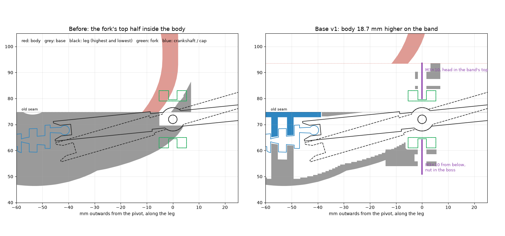

*Fig. 1 · Cut through a middle leg, along it. Left: the carcass as downloaded: the fork (green) goes into the body
(red). Right: base v1, with the body on the band. The two swivel screws are purple: the upper one comes down through
the band and the lower one up through the boss. Black: the leg at its highest and lowest.*

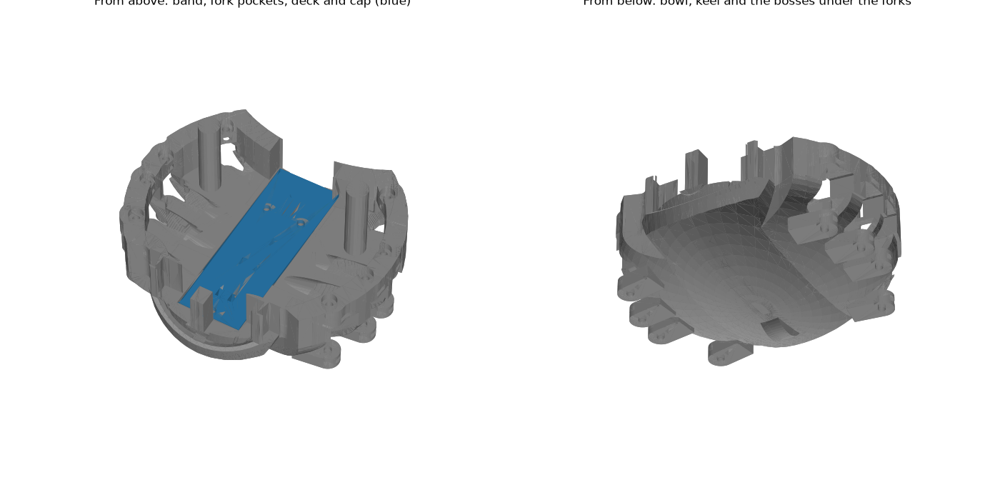

*Fig. 2 · Base v1. From above: the band with a pocket for each fork, the deck and the cap (blue). From below: the
bowl, the keel along the middle and the bosses under the forks.*

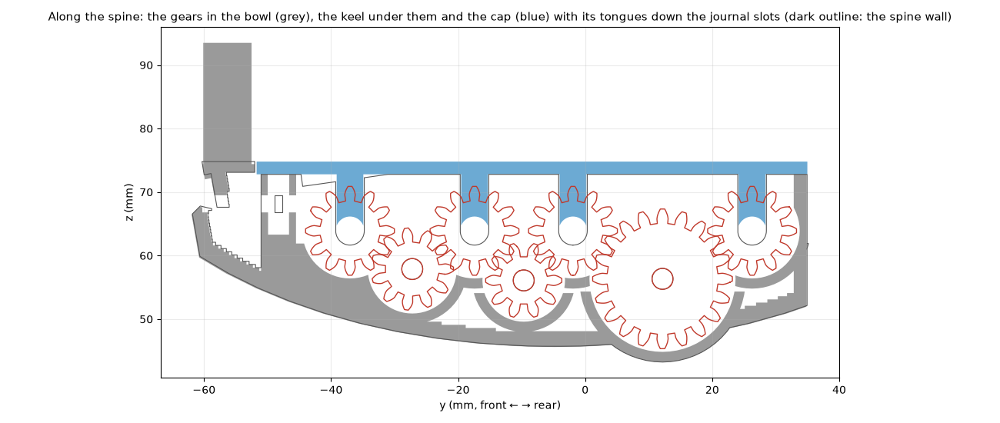

*Fig. 3 · Cut along the spine. The gears (red) turn in pockets in the bowl. The 20-tooth idler goes 2.4 mm below the
original bowl, inside the keel. The cap (blue) has a tongue down each journal slot.*

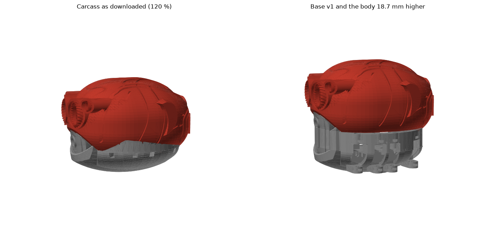

*Fig. 4 · From the side: the carcass as downloaded, and with the body on the band. The front block (the face
behind the eyes) sits inside the body in both. Base v1 is not shaped for looks yet: the band does not follow the
body's outline, and the screws and fork bosses show.*

| What | Result |
|---|---|
| Overlaps over a full turn (every 10°) | None |
| Closest pairs | Journals in their slots 0.25 mm a side, idlers 0.45 mm, legs 0.65 mm or more: the designed clearances |
| [`print/base-v1.3mf`](../print/base-v1.3mf) | 7 h 57 min, 140.4 g of PLA (keel rebuilt for [gear train v2](#gear-train-v2-in-cad), cap for [the test cap fix](#gear-train-test-v2-the-cap)) |
| Hardware | 16 × M3×10 + nuts (fork swivels), 3 × M3×10 + nuts (cap) |

Full list: [`cad/base/check-result.txt`](../cad/base/check-result.txt).

#### Decisions

- **Base v1 is a working prototype, not the final look.** It proves that the drive fits and turns; a later version
  makes it look like the carcass again (Open items).
- **Band, not a new fork or cuts in the body.** The fork tested on the test frame stays as it is. The robot is
  18.7 mm taller and has a band at the seam, where the legs come out.
- **Spine built into the base,** not screwed in: the crankshafts and the forks stay where the CAD puts them relative
  to each other, with no screws to align.
- **Fork and leg slide in from outside** and are held by the two screws only, as on the test frame.
- **Front block separate.** It stands on the deck and the cap. How it is fixed is decided with the carcass cuts.
- **The rim notches** are no longer a separate check: the legs' path is cut into the base with room to spare.
- **The printed leg's foot path will not be compared with the simulator's.** Morante dropped that check.

This entry closes four open items: the fork's window, the rear leg near its crankshaft, the rim notches and the
base. The foot-path comparison was dropped.

### Gear train test

**Phase 3 · Mechanisms · 2026-11-11** · Status: ✅ faults found; fixed in [Gear train v2 in CAD](#gear-train-v2-in-cad)

> **In short.** Before printing the base, the four crankshafts and the three gears between them (the **idlers**)
> were printed on a loose spine and turned by hand. They turn in jerks and jam, and the crankshafts lift out of
> their slots. A new check found why: nothing held the crankshafts down, and two of the three idlers cannot mesh
> with both of their crankshafts at once while the cranks keep their designed angles. The old check had never
> turned the gears. From now on every design is checked for both before it is printed.

**What is being tested.** The four crankshafts must turn together, at the same speed and in the same direction,
with their cranks keeping the angles that give the gait (neighbouring crankshafts 180° apart). Each crankshaft has a
12-tooth gear; an idler sits below and between every two of them. Here the spine is the loose part used only for
this test, without the base's cap, and the idlers turn on M3 screws used as axles.

#### Steps

1. Print [`print/gear-train-test.3mf`](../print/gear-train-test.3mf): spine, 4 crankshafts, 3 idlers (Fig. 1).
2. Put each idler between the spine's walls and push its screw through both walls and the idler.
3. Drop the crankshafts into their slots from above, with the cranks as printed.
4. Turn one crankshaft by hand (Fig. 2).

<table>
<tr>
<td width="50%">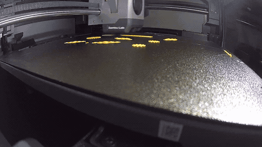</td>
<td width="50%">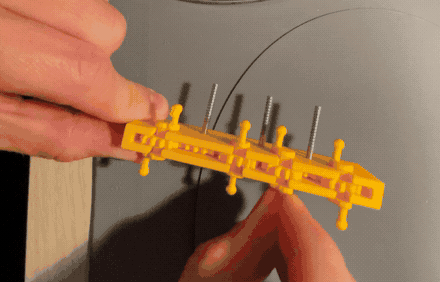</td>
</tr>
<tr>
<td><em>Fig. 1 · Printing <a href="../print/gear-train-test.3mf"><code>print/gear-train-test.3mf</code></a>: the spine
at the back, the crankshafts in their tree supports, the idlers flat.</em></td>
<td><em>Fig. 2 · Turning it by hand. The shafts move in jerks and stop; watch the crankshafts rise in their slots
when the teeth push against each other. The three screws sticking up are the idlers' axles.</em></td>
</tr>
</table>

#### Result

| What | Expected | What happened |
|---|---|---|
| The four crankshafts turn together | Smoothly, by hand | In jerks, and they jam |
| Crankshafts in their slots | Stay in | Lift out: the slots are open at the top and nothing closes them in this test |

**Why.** A new, general check, [`tools/cad_verify.py`](../tools/cad_verify.py), was run on this exact test
([spec](../cad/gear-train-test/verify.py), [full report](../cad/gear-train-test/verify-result.txt)). It turns every gear at its
real angle and pushes every moving part in 26 directions to see what stops it. It found three faults:

1. **Nothing holds the crankshafts down.** All four can rise 3 mm or more. In the robot the base's cap closes the
   slots, but this test had no cap, and the teeth pushing apart lift the shafts out.
2. **Idlers 1 and 2 cannot mesh with both of their crankshafts at once** (Fig. 3). Each crankshaft is printed with
   its teeth at a fixed angle to its cranks. With the cranks at their designed angles, there is no angle of the
   11-tooth or the 10-tooth idler at which its teeth fit between the teeth of both neighbours: at the best one,
   5.8 and 7.9 mm³ of tooth would have to pass through another. Each pair on its own meshes. The 20-tooth idler 3
   fits both. So the train jams unless a crankshaft is put in a tooth off, which shifts its crank by up to 15°.
3. **No backlash.** The gears sit exactly at their theoretical distance, so even meshing teeth touch on both sides
   (0.00 mm gap). Printed teeth are never exact, and teeth without play bind.

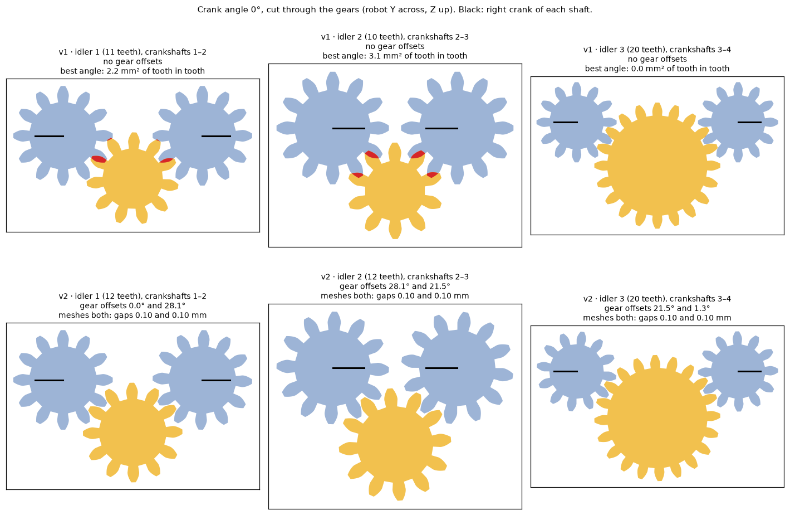

*Fig. 3 · Top row: each idler (yellow) turned to the angle that fits best between its two crankshafts (blue), with
the cranks at their designed angles. Red: tooth inside tooth. Idlers 1 and 2 cannot fit both neighbours; idler 3
can. The bottom row is the fix, in [Gear train v2 in CAD](#gear-train-v2-in-cad). Made by
[`cad/crankshafts/gear_phase_figure.py`](../cad/crankshafts/gear_phase_figure.py).*

**Why the earlier check missed it.** [`cad/legs/check.py`](../cad/legs/check.py) skipped every pair of gears, as
«touching on purpose», and left the idlers at one angle while the crankshafts turned. It never asked what holds
each part in place either.

<details>
<summary>How to reproduce</summary>

```
python3 cad/crankshafts/build.py
python3 cad/gear-train-test/build.py
cd cad/gear-train-test
python3 ../../tools/cad_verify.py verify.py --out verify-result.txt --render images/verify
python3 ../crankshafts/gear_phase_figure.py
```

The spec places the idlers at the angle that fits their two crankshafts best, then turns everything together every
10°. `images/verify/` holds a view of the assembly and two cuts through it.

</details>

#### Decisions

- **Every design is checked before printing** with [`tools/cad_verify.py`](../tools/cad_verify.py): each part a
  closed solid with walls of at least 0.8 mm, no collisions over the motion, gears turned at their real angles with
  some backlash, every moving part held in every direction it should not move, the parts can be assembled in order,
  and the overhangs to support. A design does not go to the printer until it passes.
- **A test rig holds its parts as the robot will.** The gear train is tested again with a cap over the slots.
- **Base v1 waits.** It has the same idlers and the same gear spacing, so it is not printed until the gear train
  turns.
- **Redesigned** in [Gear train v2 in CAD](#gear-train-v2-in-cad).

[↑ Contents](../build-log.md#contents)

### Gear train v2 in CAD

**Phase 3 · Mechanisms · 2026-11-11** · Status: ✅ printed; its cap fixed in [Gear train test v2: the cap](#gear-train-test-v2-the-cap)

> **In short.** The gear train was redesigned to fix the three faults of the [first test](#gear-train-test). Each
> crankshaft's gear is now turned on its shaft by its own angle, so every idler meshes with both of its
> crankshafts while the cranks keep their gait angles. The gears are set a little further apart for backlash, and
> a cap holds the crankshafts down, as the base's cap will. It passes the new check over a full turn; the test is
> printed again before the base.

**The idea.** A crankshaft is printed in one piece, so the angle between its gear's teeth and its cranks can be
anything. Before, it was the same on all four, and two idlers could not find an angle that fitted both neighbours.
Now each crankshaft gets its own **gear offset**, worked out from where the shafts and idlers sit, so that the teeth
of both neighbours line up with the idler's gaps.

#### Steps

1. Gear offsets: 0°, 28.1°, 21.5° and 1.3° for crankshafts 1 to 4, computed in `gear_offsets()` in
   [`cad/crankshafts/build.py`](../cad/crankshafts/build.py).
2. Idlers: 12, 12 and 20 teeth (were 11, 10 and 20). Fewer than 12 teeth would need a modified tooth shape.
   Idlers 1 and 2 are now the same part.
3. Backlash: every pair of gears 0.275 mm further apart than in theory (`BACKLASH` = 0.2 mm). The crankshaft gears
   print lying down, so their teeth are rougher than the idlers'.
4. A **test cap** over the spine, with one tongue down each journal slot, like the base's cap. It is held by
   2 × M3×12 into nuts slid into the spine's end blocks. The spine got a foot so it stands on the desk.
5. Marks: with the offsets, each crankshaft fits in one place and one way round only. A shaft turned end for end
   would mesh with its cranks 2.5–13° off, which is hard to see. So each crankshaft has 1 to 4 small dots on its +X
   crank web (the side of the right legs), and the spine and the cap have the same dots by each slot.
6. The idlers' first layer is 0.2 mm smaller and their bore is chamfered at the bed, against the squashed first
   layer.
7. Base v1 was rebuilt: its keel follows the new idlers (0.57 mm deeper). Its plate was sliced again.
8. Check with [`tools/cad_verify.py`](../tools/cad_verify.py) every 5°, and a 2D gear check every 1°, then the
   whole drive against base v1, its cap and the body every 10°.

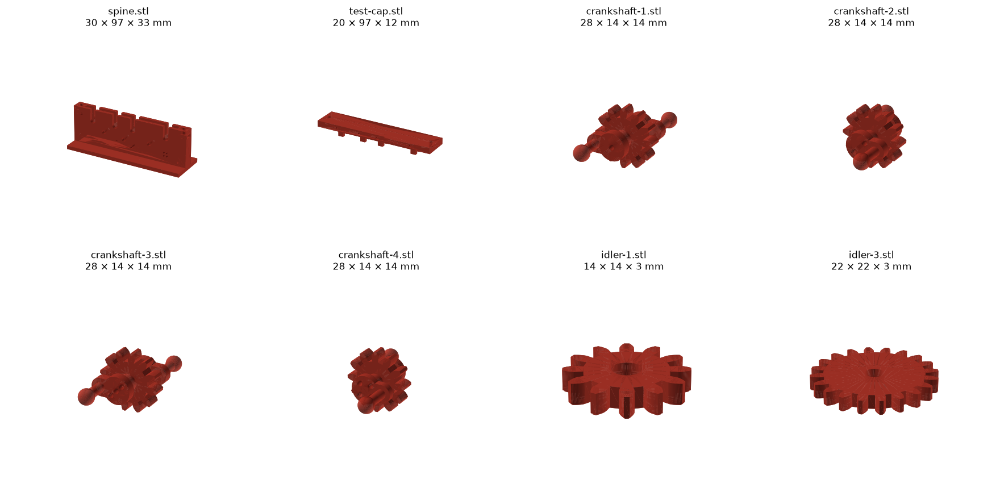

*Fig. 1 · The parts of the test. The spine has a foot and an M3 nut slot at each end; the cap's tongues go down the
journal slots. Each crankshaft is different: look at where its cranks point compared with its gear teeth. Made by
[`tools/stl_preview.py`](../tools/stl_preview.py).*

#### Result

The bottom row of Fig. 3 in [Gear train test](#gear-train-test) shows every idler meshing with both neighbours.

| Check | Result |
|---|---|
| [`verify-result.txt`](../cad/gear-train-test/verify-result.txt): integrity, motion, gears, what holds each part, assembly order | PASS, 0 failures, 0 warnings |
| [`check-gear-train.txt`](../cad/crankshafts/check-gear-train.txt): every mesh, every 1° | No tooth in tooth; backlash 0.21–0.22 mm |
| Crankshafts and idlers held | Only spin is free; at most 0.25 mm play (journals), 0.45 mm (idlers along their axle) |
| [Base v1](../cad/base/check-result.txt) and [whole drive](../cad/legs/check-result.txt) over a full turn | No overlaps; closest pairs are the designed clearances |
| [`print/gear-train-test-v2.3mf`](../print/gear-train-test-v2.3mf) | 1 h 20 min, 33.7 g of PLA (1 h 19 min, 33.5 g with [the new cap](#gear-train-test-v2-the-cap)) |

<details>
<summary>How to reproduce</summary>

```
python3 cad/crankshafts/build.py
python3 cad/gear-train-test/build.py
python3 cad/test-frame/build.py
python3 cad/legs/build.py
cd cad/gear-train-test
python3 ../../tools/cad_verify.py verify.py --out verify-result.txt --render images/verify
python3 ../crankshafts/check_gear_train.py
python3 ../crankshafts/gear_phase_figure.py
python3 ../legs/check.py --gaps
cd ../base && python3 build.py && python3 check.py --step 10
```

The spec places each idler at the angle its formula gives (not the best fit), so a crankshaft a tooth off would show
as an overlap.

</details>

#### Decisions

- **Gear offsets, not new positions.** The shafts stay where the simulator put them; only the gear turns on its
  shaft.
- **About 0.2 mm of backlash** instead of 0.15: the check wants at least 0.08 mm free on each side of a tooth, and
  the crankshaft gears' teeth print stepped.
- **The test cap was redesigned** after the print, in [Gear train test v2: the cap](#gear-train-test-v2-the-cap).

[↑ Contents](../build-log.md#contents)

### Gear train test v2: the cap

**Phase 3 · Mechanisms · 2026-11-12** · Status: ✅ the train turns

> **In short.** The [gear train v2](#gear-train-v2-in-cad) was printed and assembled. Without its cap the four
> crankshafts turned together, but with the cap on, even half pushed in, nothing turned. The cap's tongues ran
> 0.25 mm from the gear faces, and only its screws kept the cap from sliding sideways onto them. A new cap keeps
> its tongues clear of the gears and is centred by four skirts; with it the train turns by hand. Base v1's cap had
> the same design and was fixed the same way.

#### Steps

1. Print [`print/gear-train-test-v2.3mf`](../print/gear-train-test-v2.3mf) and assemble it as in
   [print/README](../print/README.md#gear-train-test-v2) (Fig. 1).
2. Turn crankshaft 1 by its crank, first without the cap, then with it.
3. With the cap jamming the train, measure the printed parts with a caliper. The journals came out 3.9–4.0 mm
   (designed 4.0), so the slots were not the problem.
4. Redesign the cap (below) and print it on its own: [`print/test-cap-v2.3mf`](../print/test-cap-v2.3mf), 13 min,
   6.7 g. The full plate now carries the new cap.
5. Fit the new cap and turn crankshaft 1 by its crank (Fig. 2).

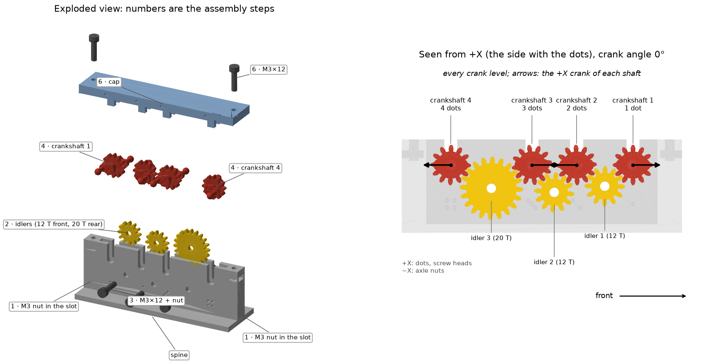

*Fig. 1 · Left: the parts pulled apart along the way each one goes in, numbered by assembly step. Right: the test
seen from the +X side (the side with the dots) with every crank level; the arrows show where each +X crank points
(front, rear, front, rear). Made by [`cad/gear-train-test/assembly_figure.py`](../cad/gear-train-test/assembly_figure.py).*

#### Result

| What | Expected | What happened |
|---|---|---|
| Train without the cap | Turns | Turns; the shafts lift a little when the teeth push, as nothing holds them down |
| Train with the first cap | Turns | Does not turn at all, even with the cap half pushed in or with one tongue broken off |
| Train with the new cap | Turns | The four shafts turn together, smoothly (Fig. 2) |

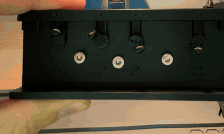

*Fig. 2 · Seen from the +X side with the new cap on: the cranks of the four shafts go round together. The
three bright washers are the idlers' axle screws.*

**Why the first cap jammed.** Each tongue went down a slot over a journal and covered the whole width of the wall,
up to 0.25 mm from the gear. Only the cap's two screws, in oversized holes, centred it, so it could sit 0.3 mm to
one side; the crankshafts can also slide 0.25 mm along their axis. At the worst position a tongue touched the face
of a turning gear and braked it. The check had placed every part only at its nominal position, saw a quarter of a
millimetre free and passed.

**The fix** (`test_cap()` in [`cad/gear-train-test/build.py`](../cad/gear-train-test/build.py)):

- **Tongues only over the outer part of each wall**, 1.1 mm wide instead of 2.5. With the cap and the shafts at
  their worst positions, they stay 0.9 mm from the gear faces.
- **Four skirts** at the ends of the cap come down outside the walls, 0.2 mm off each side, so the cap sits centred
  on the spine and cannot slide onto the gears. They are by the end blocks, away from everything that turns.
- **The check poses loose parts at their extremes now.** [`tools/cad_verify.py`](../tools/cad_verify.py) has a
  keep-out zone around each gear face (its play plus 0.8 mm), and [the spec](../cad/gear-train-test/verify.py) turns
  the train with the cap shifted 0.2 mm either way. The first cap fails it in three places; the new one passes
  ([report](../cad/gear-train-test/verify-result.txt)).
- **Base v1's cap** had the same tongues and now has the same narrow ones ([`cad/base/build.py`](../cad/base/build.py)).

<details>
<summary>How to reproduce</summary>

```
python3 cad/crankshafts/build.py
python3 cad/gear-train-test/build.py
cd cad/gear-train-test
python3 ../../tools/cad_verify.py verify.py --out verify-result.txt --render images/verify
python3 assembly_figure.py
cd ../base && python3 build.py
```

`VERIFY_STEP=30` in front of the verifier gives a quick run every 30° instead of every 5°.

</details>

#### Decisions

- **A cover is never located by its screws alone:** a skirt, a lip or the edge of an opening places it, and a
  spinning gear face keeps at least 0.8 mm from any fixed printed face, counting the play of every loose part.
- **The gear faces still run 0.25 mm from the spine's walls.** The train turns without the cap, so they were left
  as they are; they are the first place to look if the drive drags in the base.
- **Base v1 is printed next**, with the new cap.

This entry closes the open item «Print the gear train test v2 and turn it by hand».

[↑ Contents](../build-log.md#contents)

### Base v1: print and first fitting

**Phase 3 · Mechanisms · 2026-11-13** · Status: ✅ faults found; base v2 next

> **In short.** [Base v1](#base-v1-in-cad) was printed with its cap and front block, and its parts were tried
> together. It could not be assembled: the cap was so tight that its tongues broke while it was pressed in, the
> front block was not fixed and both its thin pegs and the posts they sit on broke, the idlers' steel pins could not
> be reached, the big gear stood about a quarter of its width out of its seat, support stayed trapped in the
> recesses, and nothing marked how the gears go in. Each of these is now a CAD rule or an
> automatic check, and base v2 is designed with them.

#### Steps

1. Print [`print/base-v1.3mf`](../print/base-v1.3mf): the base, the cap upside down and the front block, tree
   supports on the build plate only (Fig. 1).
2. Remove the supports.
3. Try the parts in the base: the cap over the spine (pressed in by hand), the front block, the gears and the
   idlers' 3 mm steel pins.

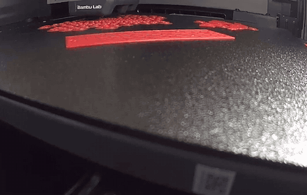

*Fig. 1 · The plate printing: the base on tree supports (left), the front block (right) and the cap with its four
pairs of tongues (front).*

| Part | Part (g) | Support (g) |
|---|---|---|
| Base | 82.3 | 26.0 |
| Front block | 23.4 | 2.9 |
| Cap | 5.8 | 0 |
| Plate | 7 h 57 min, 140.4 g in all | 28.8 |

<details>
<summary>How to reproduce</summary>

```
python3 tools/print_report.py print/base-v1.3mf
python3 cad/base/cap_failure_figure.py
```

The plate and its settings: [print/README](../print/README.md#base-v1).

</details>

#### Result

<table>
<tr>
<td width="50%">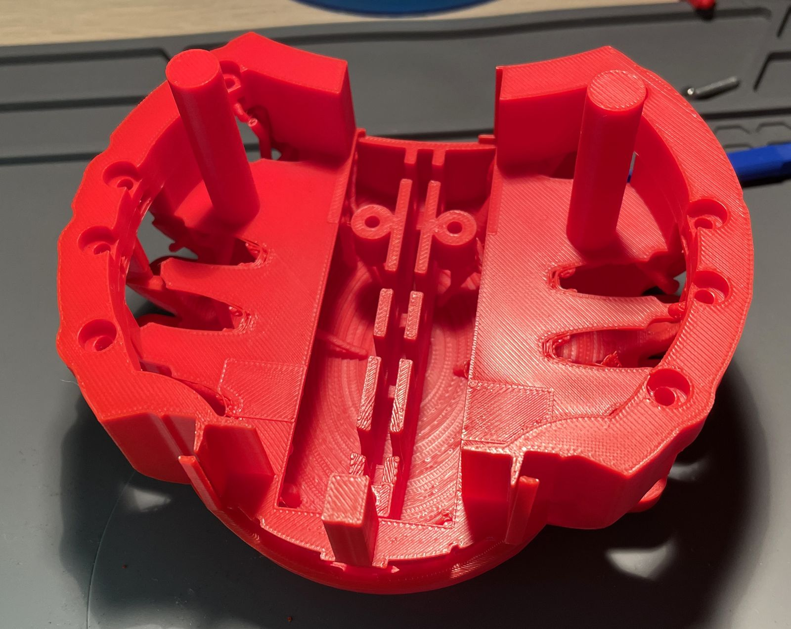</td>
<td width="50%">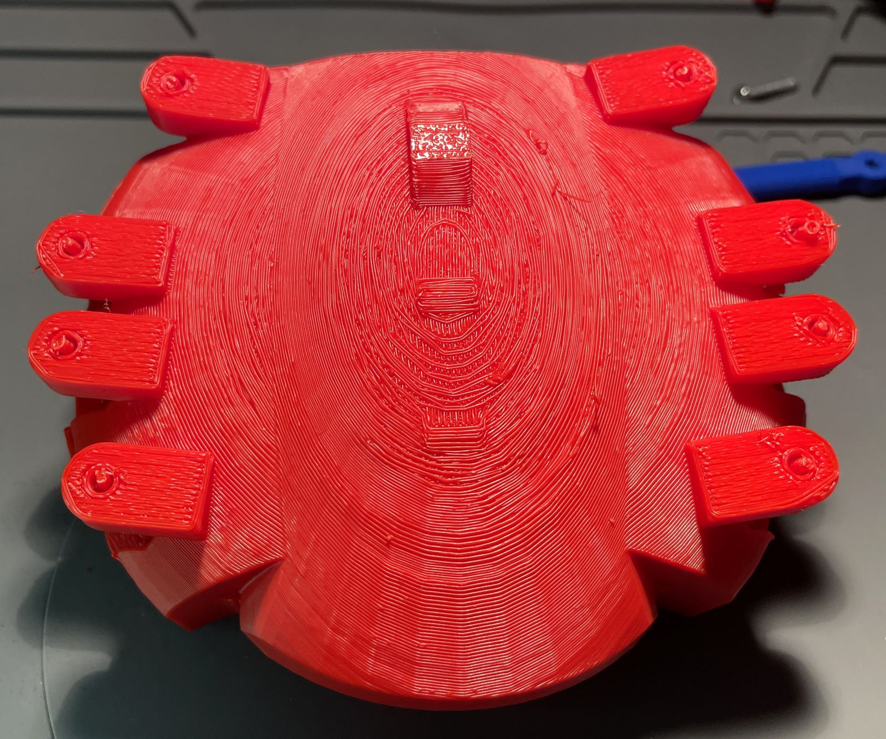</td>
</tr>
<tr>
<td><em>Fig. 2a · From above: the band with the fork pockets, the two tall round pegs that locate the body, and the
spine down the middle.</em></td>
<td><em>Fig. 2b · From below: the bowl with the eight fork bosses and the keel along the middle.</em></td>
</tr>
<tr>
<td width="50%">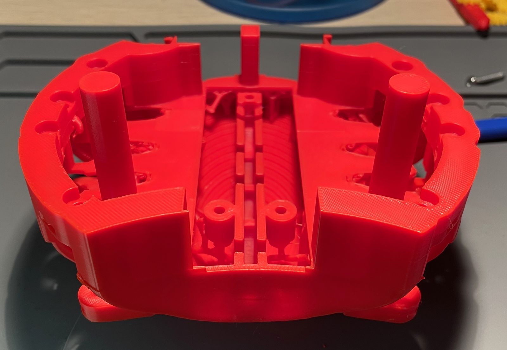</td>
<td width="50%">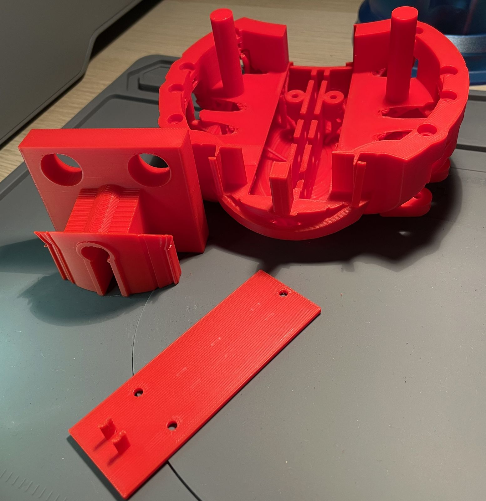</td>
</tr>
<tr>
<td><em>Fig. 2c · From the rear. Branches of tree support are still inside the bowl, at the top left of the
spine.</em></td>
<td><em>Fig. 2d · The front block (left) and the cap (front): only one pair of the cap's tongues is left
(Fig. 3).</em></td>
</tr>
</table>

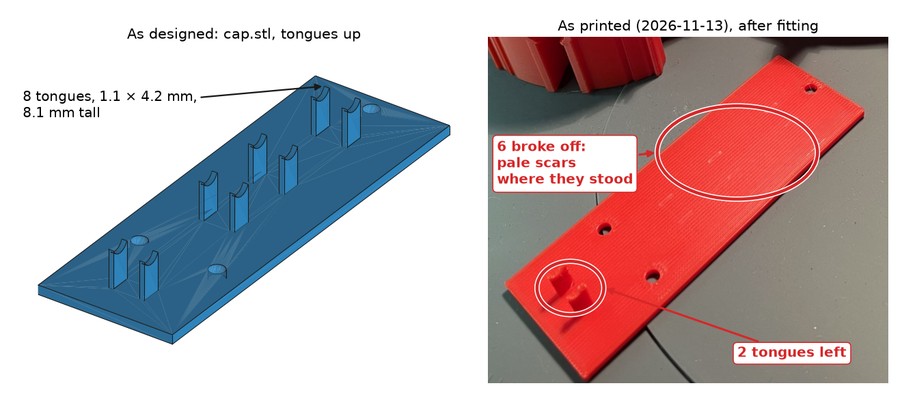

*Fig. 3 · The cap as designed (left) and as printed (right). Its tongues go down the journal slots of the spine;
the cap went in only when pressed hard, and six of the eight broke off at their root while it was pressed in. Made by
[`cad/base/cap_failure_figure.py`](../cad/base/cap_failure_figure.py).*

| What | What happened | In the photos |
|---|---|---|
| Cap | Very tight: it went in only when pressed hard, and its tongues broke while it was pressed in | Fig. 2d, 3 |
| Front block | Not fixed; its thin pegs and the posts they sit on both broke | No |
| Idler pins | The 3 mm steel pins, which go in sideways through both spine walls, could not be reached | No |
| Big gear | Stood out of its seat by about a quarter of its width (estimated by eye). Two possible causes, not told apart: the design, or support left inside that could not be removed | No |
| Support | Trapped in the recesses | Fig. 2c |
| Gears | No marks to show how they go in | No |

**Against the CAD check.** The [check over a full turn](#base-v1-in-cad) found no overlaps, and it was right
about that: none of these faults is two parts in the same place. They are about how the parts go in (tight fits,
pins out of reach, a gear not seated, no marks), how they are held (a loose block on thin pegs) and how the base
prints (support where it cannot be removed): things a check for overlaps over a full turn does not measure.

#### Decisions

- **Base v2, not a repaired v1.** The faults are in the design, so v1 is not patched or reprinted.
- **Every lesson is a rule or a check before base v2.** They are in the design rules
  ([cad/README.md](../cad/README.md#a-design-folder)) and in [`tools/cad_verify.py`](../tools/cad_verify.py)
  ([commit 7663ecf](https://github.com/Morante-robotics/spider-bot-replica/commit/7663ecf)), so base v2 is checked
  against them before it is printed.

This entry closes the open item «Base v1 was printed … write its entry»; designing base v2 stays open.
Base v2 is now designed as part of the whole robot: [Whole robot first](#whole-robot-first-motor-sizing-and-chassis-plan).

[↑ Contents](../build-log.md#contents)

### Whole robot first: motor sizing and chassis plan

**Phase 3 · Mechanisms · 2026-11-14** · Status: 🔄 plan approved; modelling next

> **In short.** Base v1 had no place for the motor or the batteries, so even a corrected base v2 could not test the
> motor, and more partial prints would follow. From now on the whole robot, in its final looks, is modelled and
> checked in CAD before anything else is printed. The motor was sized first: a Pololu N20 HP 6 V 380:1, with a
> margin of 3.1 on flat batteries. Then a plan for the whole robot was written and approved: the motor sits over
> the last idler, the batteries ride in the body, and the printed teeth are the fuse that protects the gearbox if a
> leg jams. Nothing is modelled or bought yet.

[Base v1](#base-v1-print-and-first-fitting) showed that the drive works only as part of a robot: the base had no
seat for the motor, no place for the battery holder, no way to hold the front block or the body. Each fix would
have been one more test print (v2, v3…), each testing a part of the robot and none the motor. The new order:
model the whole robot, check it as one design, then print one batch of small test pieces (coupons) for every fit
not yet measured, then the working chassis (**v0**) with its motor. A failure changes that one design, which is
checked again as a whole. The parts most likely to need a fix (motor clamp, cap, front block) are separate and
screwed on, so a fix reprints a few grams, not the base.

#### Steps

1. **Size the motor** with [`sim/motor_sizing.py`](../sim/motor_sizing.py): the robot's mass from the printed parts
   and catalogue values, the torque the four crankshafts need over one turn (from the
   [3D toy leg](#toy-leg-in-3d) model), the speed for a desk-toy walk, and Pololu's N20 data scaled to the battery
   voltage. A motor passes if its stall torque is at least 3 times the worst working torque (a **margin** of 3,
   with the printed gears taken at 50 % efficiency) on flat batteries (4.0 V), and if the robot still walks at
   1.8 cm/s or more on 4.8 V. Output: [`sim/motor-sizing-result.txt`](../sim/motor-sizing-result.txt).
2. **Plan the whole robot** in [`cad/chassis/design-plan.md`](../cad/chassis/design-plan.md): where the motor,
   the battery holder, the switch and the eyes board go, how each part is held and assembled, which fits are still
   untested and which coupon tests each. A design review checked it twice; each pass asked for changes, which went
   into revisions 3 and 4. Morante approved revision 4.
3. **Estimate the mass** of the final robot and of v0 with
   [`cad/chassis/mass_estimate.py`](../cad/chassis/mass_estimate.py), adding a contingency to each mass by how
   sure it is.
4. **Work out what breaks if a leg jams**: the motor can push harder than its own gearbox can take, so something
   printed must give first (Fig. 5).

<details>
<summary>How to reproduce</summary>

```
uv sync
.venv/bin/python sim/motor_sizing.py > sim/motor-sizing-result.txt
.venv/bin/python sim/motor_sizing_figure.py
cd cad/chassis
../../.venv/bin/python plan_figure.py        # --lang es: Spanish copies for the workshop kit
../../.venv/bin/python mass_estimate.py      # --lang es as well
```

`plan_figure.py` needs base v1's meshes (`cad/base/build.py`). Assumptions of the sizing, all in its docstring and
output: the body stands on the feet within 2 mm of the lowest; friction 0.35 printed on printed, 0.25 screw on
printed, 0.4–0.6 foot on the desk; centre of mass anywhere within ±5 mm of the body axis; 800 mAh NiMH cells and
0.3 Ω in the battery, switch and wires.

</details>

#### Result

**Motor.** The worst torque the cranks need over a turn is 57 N·mm (Table 1). The motor drives a 12-tooth pinion
on the 20-tooth idler 3, and the idlers only reverse the direction, so the crankshafts turn at the motor's speed
and the motor needs 57 / 0.5 = 113 N·mm at its shaft. Of Pololu's N20s, only the HP 380:1 passes (Fig. 1).

| What | Value |
|---|---|
| Robot mass, measured parts and estimates | 403 g; with 15 % margin 463 g |
| Worst crank torque over a turn | 57 N·mm: lifting the body 23.5, feet slipping 14.5, friction in the joints 18.5 |
| Typical peak crank torque | 45 N·mm |
| Distance walked per crank turn | 19.3 mm |
| Chosen motor: [Pololu Micro Metal Gearmotor HP 6 V 380:1](https://www.pololu.com/product/4794) | 84 rpm and 5.5 kg·cm stall at 6 V, 1.6 A stall |
| With it | Margin 3.8 at 4.8 V and 3.1 at 4.0 V; 1.9 cm/s at 4.8 V; 2.5–3 h on 800 mAh |

*Table 1 · The motor sizing ([full output](../sim/motor-sizing-result.txt)).*

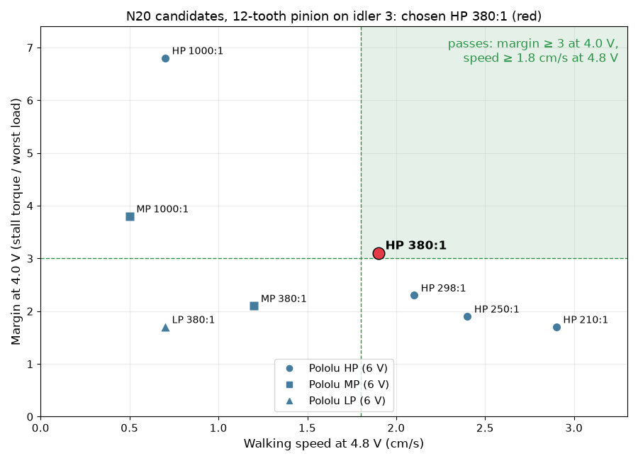

*Fig. 1 · Each N20 that could fit, by its margin on flat batteries (up) and its walking speed (right). Only the HP
380:1 lands in the green zone. The HP 298:1 is faster but has a margin of 2.3; the medium- and low-power (MP, LP)
motors are too weak at the same ratio; the HP 1000:1 is strong but walks at 0.7 cm/s. Generic N20s sold as
«1:298, 50 rpm» use a slower motor of the MP and LP class, and fail too. Made by
[`sim/motor_sizing_figure.py`](../sim/motor_sizing_figure.py).*

**Where the motor goes.** The sizing found no room under the deck between the legs' arms: a pinion meshing with
idler 3 sits above the deck. So the N20 lies along X over idler 3, partly through the deck, held by a clamp from
above (Fig. 2, 3). Over a full turn every 10°, it stays 1.5–2.0 mm from the legs, 2.0–2.5 mm from the crankshafts,
and its pinion's teeth 2.28 mm from the gears of crankshafts 3 and 4.

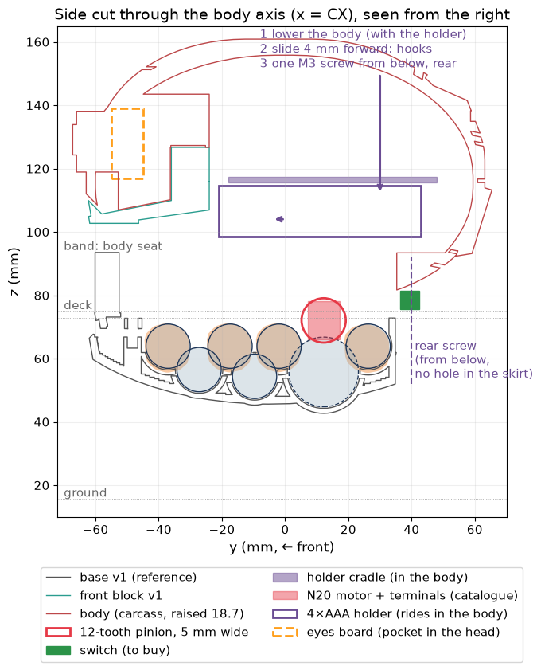

*Fig. 2 · Side cut through the middle of the robot. The pinion (red circle) sits on idler 3, partly through the
deck. The battery holder (purple box) rides in the body. The arrows show how the body goes on: down, 4 mm forward
onto two hooks, then one M3 screw from below at the rear. The switch (green) is recessed at the rear. The eyes
board (orange) goes in a pocket cut into the head. Orange and blue fills: everything the legs and the
crankshafts sweep over a turn. Made by [`cad/chassis/plan_figure.py`](../cad/chassis/plan_figure.py), which also
draws the [view from above](../cad/chassis/images/plan-top.png).*

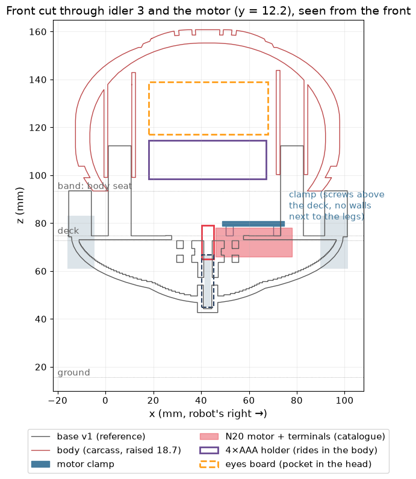

*Fig. 3 · Front cut through idler 3 and the motor. The N20 (red box) lies along X with its pinion at the gear
plane; the clamp (blue bar) and its screws are above the deck, away from the legs' paths.*

**The plan's main choices** ([plan](../cad/chassis/design-plan.md)):

- **Drive module.** The spine with the crankshafts and idlers, the motor seat, the clamp and the cap are one
  separate part, assembled on the bench and lowered into the chassis with 4 screws. Idler 3 is reprinted 5 mm wide
  for the pinion; the printed crankshafts, idlers 1 and 2, legs and forks are reused if the whole-robot check passes
  them.
- **Batteries in the body.** The 4×AAA holder rides in a cradle inside the body; body and holder lift off together
  and a 2-pin connector (JST-XH) joins them to the chassis. To change the batteries: one screw out from below,
  slide the body back 4 mm, lift it. There is no hatch.
- **Switch and eyes.** A small slide switch (SS12D00) recessed at the rear; the eyes board (2 LEDs and their
  resistors) in a 50 × 22 × 10 mm pocket cut into the solid head.
- **v0 is printed as the looks chassis**, not as a plain test base, and walks with about 125 g of steel ballast in
  a frame placed at the final robot's centre of mass, so the motor is tested at the final weight.

**Mass.** With the parts the plan adds (drive module, front block v2, cradle, paint, the screws for each joint), the
final robot comes to 445 g as summed, with its centre of mass 0.4 mm and 2.5 mm off the body axis (Fig. 4). With
a contingency by source (+15 % on plan estimates, +10 % on catalogue values, +5 % on masses from the shell model of
a mesh) the design mass is **486 g: margin 2.96, 8 g over the 478 g at which the HP 380:1 keeps a margin of 3.0**.
The margin here is scaled from the sizing as 1/mass, a first approximation; both scripts are rerun once the parts
are modelled and their contingency drops. The plan lists ways out if it is still over (lighter printed parts, a
measured gear efficiency, another ratio); none is chosen.

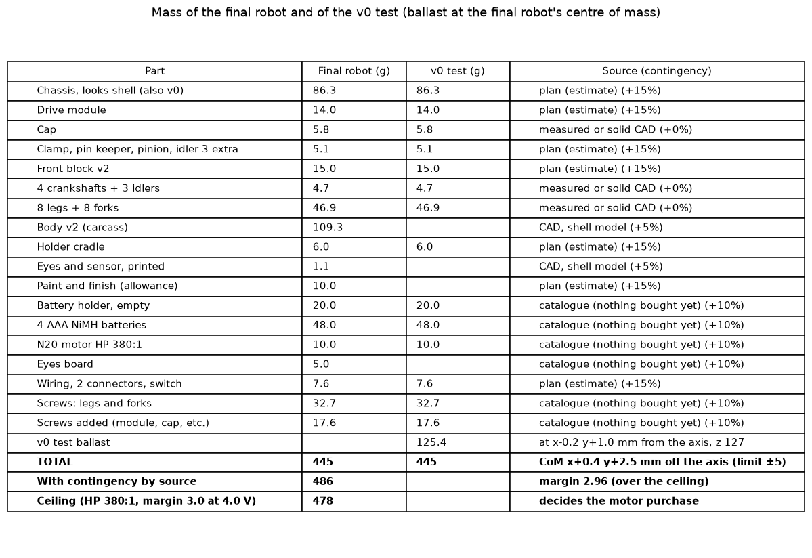

*Fig. 4 · Mass of each part of the final robot and of v0, with where each number comes from. The ballast row is
what v0 carries so that it weighs and balances like the final robot. Made by
[`cad/chassis/mass_estimate.py`](../cad/chassis/mass_estimate.py).*

**If a leg jams.** The motor then pushes up to its stall torque, 360–503 N·mm (4.0–5.6 V), more than any printed
tooth and more than the gearbox's own limit, 245 N·mm (Pololu's figure for the 380:1). The pinion is pressed on
the motor's D-shaped shaft and cannot slip, so a printed tooth must break first, below 245. Estimated with PLA at
50 MPa, the teeth of idlers 1 and 2 break at about 191 N·mm and those of the crank gears at about 220 (Fig. 5).

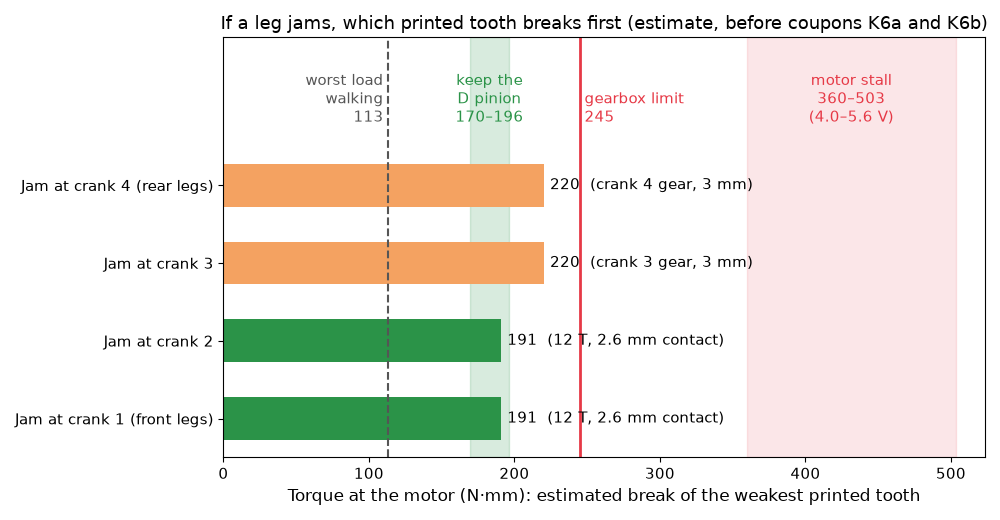

*Fig. 5 · For a jam at each crankshaft, the torque at the motor at which the weakest printed tooth in the path
breaks (estimate). Green band: where the plain D-bore pinion is kept. A jam at the front cranks breaks a tooth
inside the band; at the rear cranks (3 and 4) the estimate is above it, still under the gearbox's limit. Made by
[`sim/motor_sizing_figure.py`](../sim/motor_sizing_figure.py).*

**Coupons.** Each untested fit gets a small test piece cut from the robot's own geometry, printed in one batch
once the whole robot passes (about 40 g, 3 h 15 min in all):

| Coupon | Tests | Waits for |
|---|---|---|
| K1 pinion | The pinion's D-bore on the motor shaft (3 sizes) | The whole robot and the motor |
| K2 motor stage | The motor seat and clamp, loaded to the worst design torque | The whole robot and the motor |
| K3 cap tongues | The cap on a slice of the spine: on and off 5 times | The whole robot |
| K4, K5 | The module's fit in the chassis; the body's hooks and rear screw | The whole robot |
| K6a, K6b | The break torque of an idler tooth and of a crank-gear tooth, with weights on a 30 mm lever | The whole robot |

The gear train's efficiency (test T1) is measured on the assembled module once the motor is there.

#### Decisions

- **The whole robot is modelled and checked in CAD before anything else is printed**, then one batch of coupons,
  then v0. No new partial test rigs.
- **Motor: Pololu N20 HP 6 V 380:1**, on catalogue values for now. Nothing is bought (motor, holder, batteries,
  switch, connectors) until the first looks version passes in CAD and its mass confirms the sizing; then the bought
  parts are measured and their values replace the catalogue ones.
- **Stall protection: a plain D-bore pinion**, kept if every measured break (K6a, K6b) is at most 196 N·mm
  (0.8 × 245) and at least 170 N·mm (1.5 × the 113 N·mm worst design load, so teeth do not break while walking).
  Otherwise the fallback becomes the design: the pinion carried on a hub that slips on a friction face at 170 N·mm.

#### Next

Modelling goes in three parts, each checked before the next ([plan](../cad/chassis/design-plan.md#status-and-next-steps)):

- **A:** the master model `cad/robot.py` (datums, carcass envelope, interface table, bought parts' envelopes); the
  drive module (spine, idler pins and keeper, idler 3 v2, motor saddle and pad, flange slot, clamp, cap with a
  window over the pinion, pinion); the new fits in [`cad/fits.py`](../cad/fits.py) with their rows in
  [`measurements.csv`](../measurements.csv); the start of the whole-robot spec `cad/chassis/verify.py`.
- **B:** the looks chassis, body v2 with the holder cradle and rear lug, front block v2 with the hooks, the ballast
  frame, the eyes pocket.
- **C:** the whole-robot check with a full PASS; `mass_estimate.py` and `motor_sizing.py` rerun on the CAD masses
  (this decides the motor purchase); the coupon batch and its workshop kit.

This entry closes the open item «N20 gear ratio and motor stage». The item «Base for looks, once the v0 chassis
walks» is now part of the whole-robot item, as v0 is printed as the looks chassis.

[↑ Contents](../build-log.md#contents)
