# Spider-Bot · Legs and drive

Part of the [build log](../build-log.md): its [contents](../build-log.md#contents), [open items](../build-log.md#open-items) and [glossary](../build-log.md#glossary).

## Legs and drive

The first design of the Spider-Bot: eight legs driven by one motor. A simulator chose the **toy leg** (one bent part
per leg, pushed by a crank); the drive had to be found by elimination (one crankshaft, then two side ones, failed)
and ended as **four crankshafts across the body**, linked by gears, with a short stride so the body does not bob.
It was modelled in code, printed as a test leg, a gear train and a base (clearance 0.5 mm, a cap that jammed, a base
that could not be assembled), then grown into a whole-robot plan: motor sized, chassis, clutch, weight review. The
legs came out thinner than the toy's, Morante rejected them, and the design was replaced on 2026-11-17 by
[Looks first](4-looks-first.md). Each entry below is shortened to its summary; the full text is in git (links).

*The three drives tried, from above (top) and from the side (bottom). The grey box is the body; the grey stubs are
the cranks; the loops are the paths of the feet. In 1, the inner arms cross the cranks of the other legs. In 2, the
loops seen from the side are thin and upright: the feet go up and down but hardly forward. In 3, every arm reaches
only its own crank and the loops lie along the ground. Made by
[`tools/drive_attempts_figure.py`](https://github.com/Morante-robotics/spider-bot-replica/blob/pre-redesign-2026-11-17/tools/drive_attempts_figure.py).*

### Leg simulator and comparison

**Phase 3 · Mechanisms · 2026-11-09** · Status: ✅ toy leg chosen

> **In short.** A 2D simulator compared three ways to build a leg turned by a crank: the **toy leg** (one part),
> **Klann** (4 parts) and **Jansen** (7 parts). Klann gives the longest stride and Jansen the smoothest walk, but we
> chose the toy leg: one part per leg, and forgiving of small printing errors. The simulator under-rates it,
> because the real toy leg also moves in 3D, which was checked in the next step.

*Fig. 1 · The three legs at one crank angle (black squares are the fixed pivots) and the path of each foot over a
full turn. The flat bottom of each loop is where the foot pushes the robot; the higher the loop, the higher the step.*

[Full entry](https://github.com/Morante-robotics/spider-bot-replica/blob/pre-redesign-2026-11-17/build-log/3-legs-and-drive.md#leg-simulator-and-comparison) (archived text, with steps, figures and data).

### Toy leg in 3D

**Phase 3 · Mechanisms · 2026-11-09** · Status: ✅ lateral axle

> **In short.** The toy leg was simulated in 3D on the whole robot, in its 8 real notches. We tried 6 ways to build
> it: the crank turning on 3 different axes, and the leg sliding either at the crank or at the body. Only one gets
> close to every target: **crank axle across the body (lateral), leg sliding at the crank**, with a 26 mm stride and
> 3.1 mm of bob. Each leg still has its own crank here; how one motor drives them all is the next step.

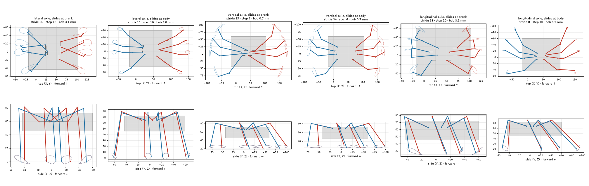

*Fig. 1 · The best robot for each combination, from above (top row) and from the side (bottom row). The grey box is
the body and the loops are the foot paths. The two colours are the two sides.*

[Full entry](https://github.com/Morante-robotics/spider-bot-replica/blob/pre-redesign-2026-11-17/build-log/3-legs-and-drive.md#toy-leg-in-3d) (archived text, with steps, figures and data).

### Toy leg on one crankshaft

**Phase 3 · Mechanisms · 2026-11-09** · Status: ↩️ reversed by [Crankshaft against real parts](#crankshaft-against-real-parts)

> **In short.** In the previous step every leg had its own crank, and the cranks of each side ended up so close
> that they would hit each other. Here all 8 legs share **one crankshaft** across the body, and the legs are given
> a real 5 mm thickness. Stride halves to 14 mm and bob rises to 4.2 mm. The limit is the legs' inner arms bumping
> into each other inside the body, not the shaft. We accepted it, but the next step showed the layout fails anyway.

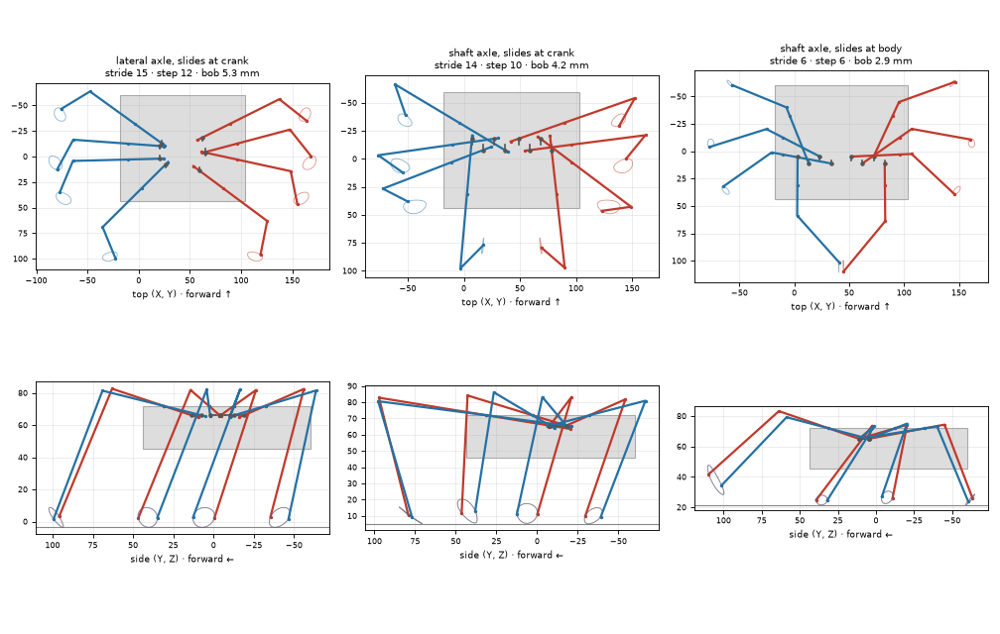

*Fig. 1 · The best layouts with real leg thickness, from above and from the side. In the top view, notice how the
inner arms converge from the notches towards the shaft: that is where they get too close.*

[Full entry](https://github.com/Morante-robotics/spider-bot-replica/blob/pre-redesign-2026-11-17/build-log/3-legs-and-drive.md#toy-leg-on-one-crankshaft) (archived text, with steps, figures and data).

### Crankshaft against real parts

**Phase 3 · Mechanisms · 2026-11-09** · Status: ❌ one crankshaft ruled out

> **In short.** The simulator had checked legs against legs, but not legs against the crankshaft. Once the cranks
> are solid parts, every leg's inner arm cuts through the cranks of the legs further out, by up to 9.5 mm. A new
> search with that rule found no layout that passes. **One crankshaft for all 8 legs is ruled out**, and the drive is
> reopened.

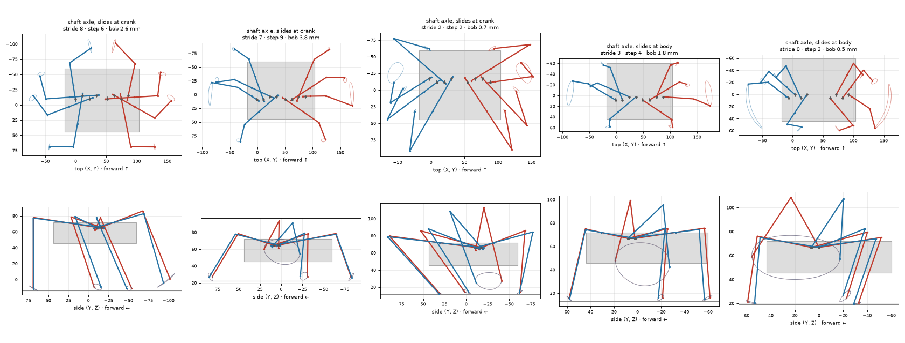

*Fig. 1 · The five searches with the new rule. To avoid the cranks, the search shrinks the stride to almost
nothing, and still fails.*

[Full entry](https://github.com/Morante-robotics/spider-bot-replica/blob/pre-redesign-2026-11-17/build-log/3-legs-and-drive.md#crankshaft-against-real-parts) (archived text, with steps, figures and data).

### Two side crankshafts

**Phase 3 · Mechanisms · 2026-11-09** · Status: ❌ ruled out

> **In short.** To keep arms away from other legs' cranks, we tried two crankshafts running **front to back**, one
> per side, each crank level with its own leg. The parts fit, with room to spare, but the robot barely walks
> (1–2 mm per half turn): a crank turning on a front-to-back axis moves the foot sideways, not forward. The crank must
> turn on an axis **across** the body.

*Fig. 1 · Two side crankshafts. In the side view the foot loops are thin vertical lines: the feet go up and down
but hardly move forward.*

[Full entry](https://github.com/Morante-robotics/spider-bot-replica/blob/pre-redesign-2026-11-17/build-log/3-legs-and-drive.md#two-side-crankshafts) (archived text, with steps, figures and data).

### Four lateral crankshafts

**Phase 3 · Mechanisms · 2026-11-09** · Status: ✅ chosen

> **In short.** The cranks turn across the body again, but now on **four short shafts, one per pair of legs**, so
> each arm only reaches its own shaft. Gears between the shafts make them turn together. It is the first layout that
> fits and walks forward, but the stride is short: 9 mm per half turn, because a longer stride makes the body bob
> more than the 3 mm allowed. We chose it, keeping the 3 mm limit.

*Fig. 1 · Four lateral crankshafts. In the side view the foot loops lie along the ground: the feet move forward.
The cranks (short stubs near the body axis in the top view) stay clear of the other legs.*

[Full entry](https://github.com/Morante-robotics/spider-bot-replica/blob/pre-redesign-2026-11-17/build-log/3-legs-and-drive.md#four-lateral-crankshafts) (archived text, with steps, figures and data).

### Legs and drive in CAD

**Phase 3 · Mechanisms · 2026-11-10** · Status: ✅ done

> **In short.** The legs and the four-crankshaft drive were modelled in Python code (build123d), with sizes taken
> from the simulator. The chosen geometry first had to be adjusted so a gear fits between each shaft's two cranks.
> A script then moved every part through a full crank turn and fixed each collision it found. The result: 25 printed
> parts with no collisions, exported for Onshape (STEP) and for printing (STL), plus a test frame for one leg.

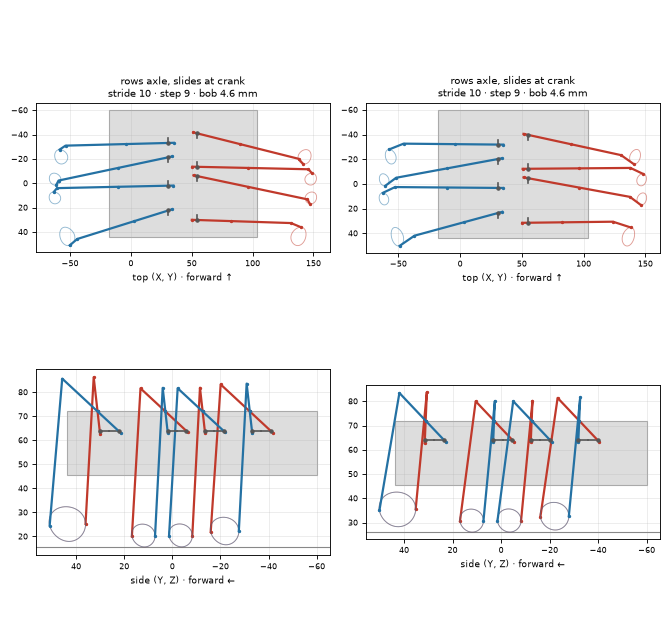

*Fig. 1 · The geometry used for the CAD, with room for the gears.*

[Full entry](https://github.com/Morante-robotics/spider-bot-replica/blob/pre-redesign-2026-11-17/build-log/3-legs-and-drive.md#legs-and-drive-in-cad) (archived text, with steps, figures and data).

### Onshape assembly

**Phase 2 · CAD · 2026-11-10** · Status: ✅ done

> **In short.** One leg on its test frame was assembled in Onshape from the exported STEP files, with joints
> («mates») that let it move as the real one will, and animated through a full turn. It moves as expected. A
> step-by-step tutorial with pictures is in [cad/test-frame/onshape.md](https://github.com/Morante-robotics/spider-bot-replica/blob/pre-redesign-2026-11-17/cad/test-frame/onshape.md).

*Fig. 1 · The assembly animated in Onshape: turning the crankshaft moves the fork, the leg and the ball together.*

[Full entry](https://github.com/Morante-robotics/spider-bot-replica/blob/pre-redesign-2026-11-17/build-log/3-legs-and-drive.md#onshape-assembly) (archived text, with steps, figures and data).

### Clearance test and test leg print plate

**Phase 2 · CAD · 2026-11-10** · Status: ✅ printed

> **In short.** Before printing the 25 drive parts, one print plate holds everything needed to turn one leg by
> hand, plus a block that tests how much bigger the holes must be on this printer. The leg had to be reshaped
> slightly so it lies flat on the bed. The plate takes 1 h 28 min and 29.6 g of PLA.

*Fig. 1 · The clearance block and its test pin.*

[Full entry](https://github.com/Morante-robotics/spider-bot-replica/blob/pre-redesign-2026-11-17/build-log/3-legs-and-drive.md#clearance-test-and-test-leg-print-plate) (archived text, with steps, figures and data).

### Test leg: first assembly and clearance result

**Phase 3 · Mechanisms · 2026-11-11** · Status: ✅ second version printed: [Test leg v2](#test-leg-v2-turning-by-hand)

> **In short.** Before printing all 25 drive parts, we printed just one leg with its own small stand to turn it by
> hand, and a block to measure how loose holes have to be on this printer. The leg could not be turned yet: the stand
> did not hold the fork in place, and the holes were too tight. The block showed the clearance needed (0.5 mm instead
> of 0.2 mm). The CAD now uses it, and the stand is redesigned with screws and nuts that hold every part.

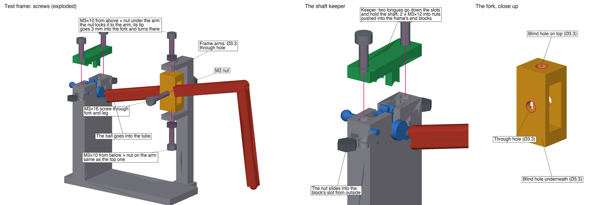

*Fig. 1 · The redesigned test frame, exploded. Grey: frame. Orange: fork. Red: leg. Blue: crankshaft. Green: the
new keeper. Made by [`cad/test-frame/screws_figure.py`](https://github.com/Morante-robotics/spider-bot-replica/blob/pre-redesign-2026-11-17/cad/test-frame/screws_figure.py).*

[Full entry](https://github.com/Morante-robotics/spider-bot-replica/blob/pre-redesign-2026-11-17/build-log/3-legs-and-drive.md#test-leg-first-assembly-and-clearance-result) (archived text, with steps, figures and data).

### Test leg v2: turning by hand

**Phase 3 · Mechanisms · 2026-11-11** · Status: ✅ the leg turns

> **In short.** The redesigned test frame was printed and the leg now turns by hand: the crank goes round and the
> leg rises and falls in its fork, with the frame holding every part. The 0.5 mm clearance is enough for the
> crankshaft and the ball. The new fork came out too tight for the leg, so the fork from the first print was used.

[Full entry](https://github.com/Morante-robotics/spider-bot-replica/blob/pre-redesign-2026-11-17/build-log/3-legs-and-drive.md#test-leg-v2-turning-by-hand) (archived text, with steps, figures and data).

### Base v1 in CAD

**Phase 3 · Mechanisms · 2026-11-11** · Status: ✅ printed; faults in [Base v1: print and first fitting](#base-v1-print-and-first-fitting)

> **In short.** Before the base, two fixes from the test leg went into the CAD: the fork gets more room for the leg,
> and the rear crankshaft's crank arms are thinner, because the rear leg came 0.15 mm from them. Fitting the drive
> into the carcass then showed a bigger problem: the forks are 22 mm tall, and the body sits on the base right above
> the leg notches, so the top half of every fork went into the body. The body now sits 18.7 mm higher, on a **band**
> that is part of the new base. Base v1 is modelled, nothing collides over a full turn, and its print plate is ready
> (about 8 h).

*Fig. 1 · Cut through a middle leg, along it. Left: the carcass as downloaded: the fork (green) goes into the body
(red). Right: base v1, with the body on the band. The two swivel screws are purple: the upper one comes down through
the band and the lower one up through the boss. Black: the leg at its highest and lowest.*

[Full entry](https://github.com/Morante-robotics/spider-bot-replica/blob/pre-redesign-2026-11-17/build-log/3-legs-and-drive.md#base-v1-in-cad) (archived text, with steps, figures and data).

### Gear train test

**Phase 3 · Mechanisms · 2026-11-11** · Status: ✅ faults found; fixed in [Gear train v2 in CAD](#gear-train-v2-in-cad)

> **In short.** Before printing the base, the four crankshafts and the three gears between them (the **idlers**)
> were printed on a loose spine and turned by hand. They turn in jerks and jam, and the crankshafts lift out of
> their slots. A new check found why: nothing held the crankshafts down, and two of the three idlers cannot mesh
> with both of their crankshafts at once while the cranks keep their designed angles. The old check had never
> turned the gears. From now on every design is checked for both before it is printed.

*Fig. 1 · Top row: each idler (yellow) turned to the angle that fits best between its two crankshafts (blue), with
the cranks at their designed angles. Red: tooth inside tooth. Idlers 1 and 2 cannot fit both neighbours; idler 3
can. The bottom row is the fix, in [Gear train v2 in CAD](#gear-train-v2-in-cad). Made by
[`cad/crankshafts/gear_phase_figure.py`](https://github.com/Morante-robotics/spider-bot-replica/blob/pre-redesign-2026-11-17/cad/crankshafts/gear_phase_figure.py).*

[Full entry](https://github.com/Morante-robotics/spider-bot-replica/blob/pre-redesign-2026-11-17/build-log/3-legs-and-drive.md#gear-train-test) (archived text, with steps, figures and data).

### Gear train v2 in CAD

**Phase 3 · Mechanisms · 2026-11-11** · Status: ✅ printed; its cap fixed in [Gear train test v2: the cap](#gear-train-test-v2-the-cap)

> **In short.** The gear train was redesigned to fix the three faults of the [first test](#gear-train-test). Each
> crankshaft's gear is now turned on its shaft by its own angle, so every idler meshes with both of its
> crankshafts while the cranks keep their gait angles. The gears are set a little further apart for backlash, and
> a cap holds the crankshafts down, as the base's cap will. It passes the new check over a full turn; the test is
> printed again before the base.

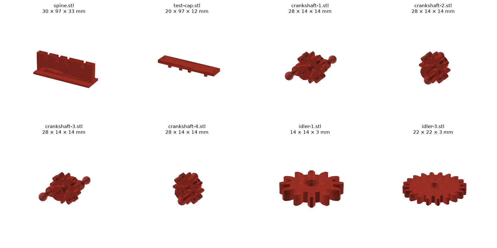

*Fig. 1 · The parts of the test. The spine has a foot and an M3 nut slot at each end; the cap's tongues go down the
journal slots. Each crankshaft is different: look at where its cranks point compared with its gear teeth. Made by
[`tools/stl_preview.py`](https://github.com/Morante-robotics/spider-bot-replica/blob/pre-redesign-2026-11-17/tools/stl_preview.py).*

[Full entry](https://github.com/Morante-robotics/spider-bot-replica/blob/pre-redesign-2026-11-17/build-log/3-legs-and-drive.md#gear-train-v2-in-cad) (archived text, with steps, figures and data).

### Gear train test v2: the cap

**Phase 3 · Mechanisms · 2026-11-12** · Status: ✅ the train turns

> **In short.** The [gear train v2](#gear-train-v2-in-cad) was printed and assembled. Without its cap the four
> crankshafts turned together, but with the cap on, even half pushed in, nothing turned. The cap's tongues ran
> 0.25 mm from the gear faces, and only its screws kept the cap from sliding sideways onto them. A new cap keeps
> its tongues clear of the gears and is centred by four skirts; with it the train turns by hand. Base v1's cap had
> the same design and was fixed the same way.

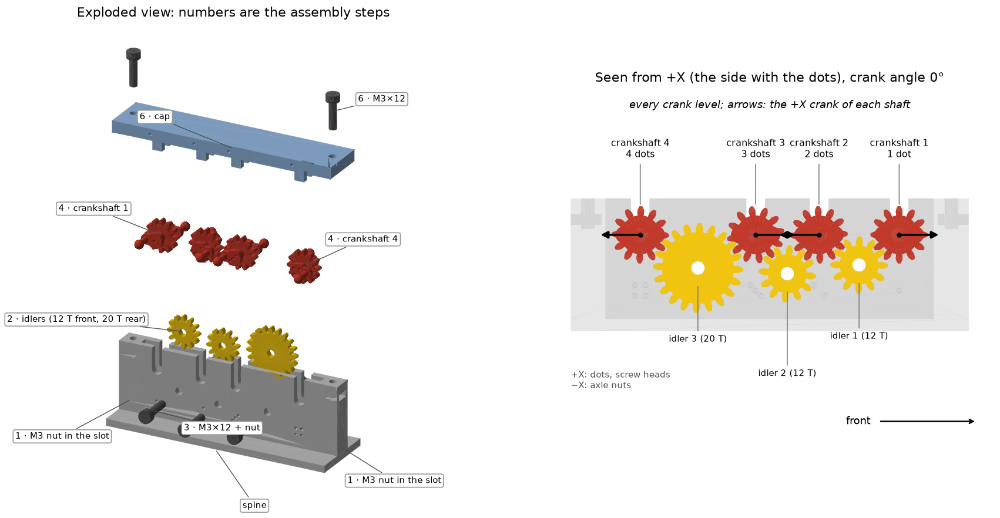

*Fig. 1 · Left: the parts pulled apart along the way each one goes in, numbered by assembly step. Right: the test
seen from the +X side (the side with the dots) with every crank level; the arrows show where each +X crank points
(front, rear, front, rear). Made by [`cad/gear-train-test/assembly_figure.py`](https://github.com/Morante-robotics/spider-bot-replica/blob/pre-redesign-2026-11-17/cad/gear-train-test/assembly_figure.py).*

[Full entry](https://github.com/Morante-robotics/spider-bot-replica/blob/pre-redesign-2026-11-17/build-log/3-legs-and-drive.md#gear-train-test-v2-the-cap) (archived text, with steps, figures and data).

### Base v1: print and first fitting

**Phase 3 · Mechanisms · 2026-11-13** · Status: ✅ faults found; base v2 next

> **In short.** [Base v1](#base-v1-in-cad) was printed with its cap and front block, and its parts were tried
> together. It could not be assembled: the cap was so tight that its tongues broke while it was pressed in, the
> front block was not fixed and both its thin pegs and the posts they sit on broke, the idlers' steel pins could not
> be reached, the big gear stood about a quarter of its width out of its seat, support stayed trapped in the
> recesses, and nothing marked how the gears go in. Each of these is now a CAD rule or an
> automatic check, and base v2 is designed with them.

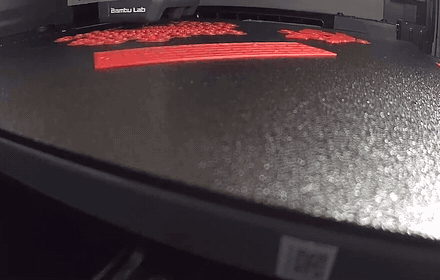

*Fig. 1 · The plate printing: the base on tree supports (left), the front block (right) and the cap with its four
pairs of tongues (front).*

[Full entry](https://github.com/Morante-robotics/spider-bot-replica/blob/pre-redesign-2026-11-17/build-log/3-legs-and-drive.md#base-v1-print-and-first-fitting) (archived text, with steps, figures and data).

### Whole robot first: motor sizing and chassis plan

**Phase 3 · Mechanisms · 2026-11-14** · Status: ✅ plan approved; Part A modelled in [Chassis Part A](#chassis-part-a-master-model-and-drive-module)

> **In short.** Base v1 had no place for the motor or the batteries, so even a corrected base v2 could not test the
> motor, and more partial prints would follow. From now on the whole robot, in its final looks, is modelled and
> checked in CAD before anything else is printed. The motor was sized first: a Pololu N20 HP 6 V 380:1, with a
> margin of 3.1 on flat batteries. Then a plan for the whole robot was written and approved: the motor sits over
> the last idler, the batteries ride in the body, and the printed teeth are the fuse that protects the gearbox if a
> leg jams. Nothing is modelled or bought yet.

*Fig. 1 · Each N20 that could fit, by its margin on flat batteries (up) and its walking speed (right). Only the HP
380:1 lands in the green zone. The HP 298:1 is faster but has a margin of 2.3; the medium- and low-power (MP, LP)
motors are too weak at the same ratio; the HP 1000:1 is strong but walks at 0.7 cm/s. Generic N20s sold as
«1:298, 50 rpm» use a slower motor of the MP and LP class, and fail too. Made by
[`sim/motor_sizing_figure.py`](https://github.com/Morante-robotics/spider-bot-replica/blob/pre-redesign-2026-11-17/sim/motor_sizing_figure.py).*

[Full entry](https://github.com/Morante-robotics/spider-bot-replica/blob/pre-redesign-2026-11-17/build-log/3-legs-and-drive.md#whole-robot-first-motor-sizing-and-chassis-plan) (archived text, with steps, figures and data).

### Chassis Part A: master model and drive module

**Phase 3 · Mechanisms · 2026-11-15** · Status: ✅ modelled and checked; Part B next

> **In short.** The first part of the whole robot is in CAD: a master model that holds the robot's reference
> heights and the joints between its designs, and the **drive module**, a gearbox of its own that carries the four
> crankshafts, the idlers and the N20 motor with its pinion, and screws into the chassis. Checked against the
> carcass, its first version hung 10 mm under the robot's belly; its gear pockets were cut flat, and a new check now
> keeps every part inside the carcass. After three design reviews it passes the full check with no failures. The
> robot's design mass is 484 g, 6 g over what the chosen motor carries with its margin of 3, so a weight and size
> review comes before the motor is bought.

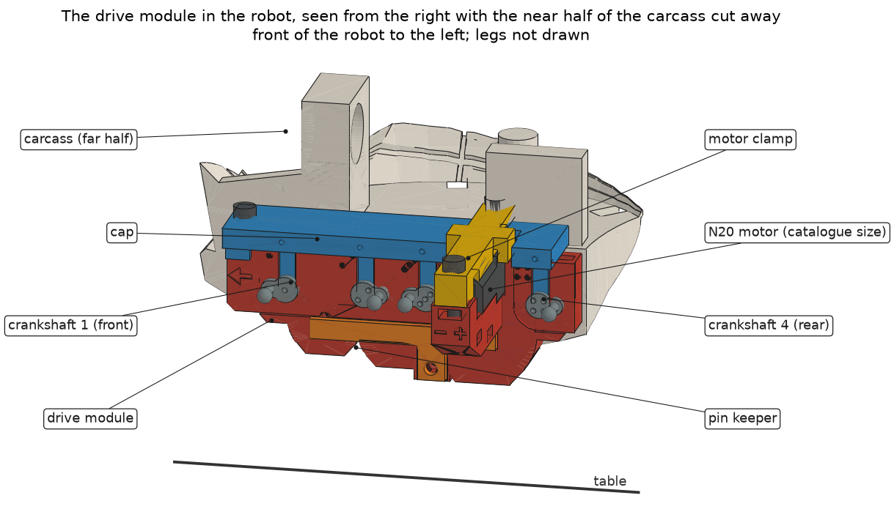

*Fig. 1 · The drive module in the robot. The four crankshafts sit in its slots under the cap (blue); the motor lies
along the module behind the clamp (yellow), over idler 3. The module's top is level with the deck, so it fills the
deck's opening; the chassis around it is Part B. Made by
[`cad/chassis/part_a_figures.py`](https://github.com/Morante-robotics/spider-bot-replica/blob/pre-redesign-2026-11-17/cad/chassis/part_a_figures.py), as Fig. 2–5.*

[Full entry](https://github.com/Morante-robotics/spider-bot-replica/blob/pre-redesign-2026-11-17/build-log/3-legs-and-drive.md#chassis-part-a-master-model-and-drive-module) (archived text, with steps, figures and data).

### Chassis Part B1, Part C check and the friction clutch

**Phase 3 · Mechanisms · 2026-11-16** · Status: ✅ chassis built and checked, clutch modelled

> **In short.** The chassis shell (B1) is built and its mass is measured from the model: 70.1 g against an 86 g
> budget, which brings the robot's design mass to 466 g, under the 478 g the chosen motor carries with its margin of
> 3 (it was 484 g). The three checks of the whole robot are now one spec and it passes. A friction clutch on the
> motor's output shaft is also modelled: it slips before the gearbox or a printed tooth can break, and a stack of
> thin steel shims sets the torque at which it slips. The order of what is left changed: the walking robot is
> checked in CAD, then the clutch, the weight review and the looks parts, and only then is anything bought or
> printed, as one robot.

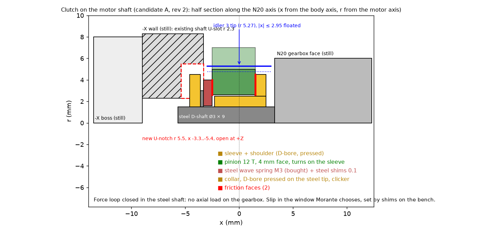

*Fig. 1 · The clutch in half section along the motor's shaft. Yellow: sleeve and collar, pressed on the steel shaft;
green: the pinion, which turns on the sleeve; red: wave washer and shims; the two red bars are the friction faces.
The dashed red box is the notch cut in the module's -X wall; the blue line is the tip of idler 3, which the clutch
stays clear of. Drawn at the plan stage, from the same numbers; it is not yet re-rendered from the built parts.*

[Full entry](https://github.com/Morante-robotics/spider-bot-replica/blob/pre-redesign-2026-11-17/build-log/3-legs-and-drive.md#chassis-part-b1-part-c-check-and-the-friction-clutch) (archived text, with steps, figures and data).

### Chassis Part D: the weight review

**Phase 3 · Mechanisms · 2026-11-17** · Status: ✅ 459 g, looks parts next

> **In short.** Every part of the robot was reviewed for weight. The printed parts turned out to be near their floor
> (each carries under 0.7 g of infill), so only two thinner walls and a recount of the screws were kept: the design
> mass falls from 466 g to 459 g, margin 3.12 against 3.0 required, 19 g under the 478 g ceiling. The 120 % print
> scale and the 4×AAA holder stay: Morante dropped the scale study. The big saving is still to come, in the body
> v2: it gets a 90 g budget, about 20 g under the scanned body. Nothing is printed.

*Fig. 1 · The plan. Left: the shell from below; green is thinned in the safe set, yellow in the moderate one, red in
the aggressive one, grey stays. Right: design mass of each set against the 478 g ceiling; the margins printed are the
plan's estimates.*

[Full entry](https://github.com/Morante-robotics/spider-bot-replica/blob/pre-redesign-2026-11-17/build-log/3-legs-and-drive.md#chassis-part-d-the-weight-review) (archived text, with steps, figures and data).

### Chassis Part B2: the looks parts

**Phase 3 · Mechanisms · 2026-11-17** · Status: 🔄 whole robot passes in CAD; buying next

> **In short.** The looks parts are modelled: body v2 is the scanned carcass skin as it is, with a cradle for the
> battery holder, a lug that screws it to the chassis and a small tab that holds the eyes board. The first full check
> of the whole robot failed in 13 places; four fix passes brought it to zero failures. The robot weighs 420.2 g and
> its design mass is 457 g against the motor's 478 g ceiling (margin 3.14, 3.0 needed), and the motor sizing still
> passes. That releases the purchase of the motor, the holder, the switch, the connectors and the clutch hardware.
> Nothing is printed yet.

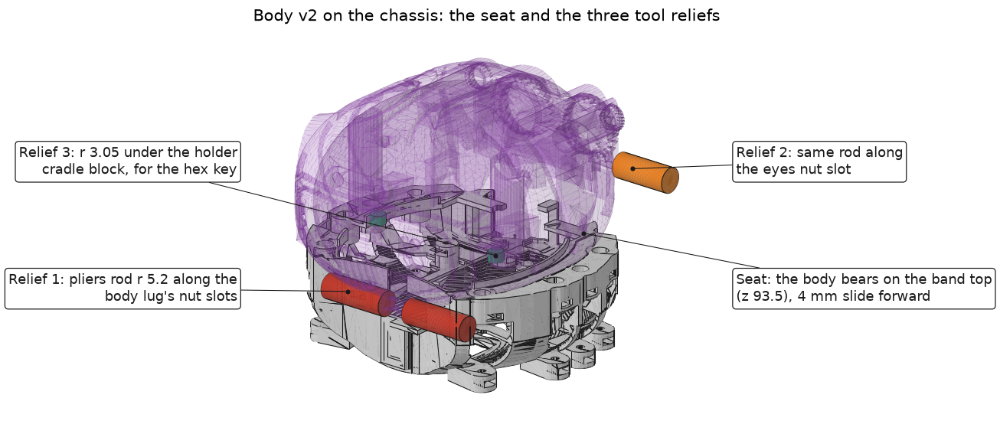

*Fig. 1 · Body v2 (purple, translucent) on the chassis from behind and the left. The seat is the band top the body
rests on. The coloured rods are the reliefs cut inside the body: red, the lug's nut slots; orange, the eyes nut slot;
green, under the cradle block (the cylinders show the cut's extent). Made by
[`part_b2_figure.py`](https://github.com/Morante-robotics/spider-bot-replica/blob/pre-redesign-2026-11-17/cad/chassis/part_b2_figure.py).*

[Full entry](https://github.com/Morante-robotics/spider-bot-replica/blob/pre-redesign-2026-11-17/build-log/3-legs-and-drive.md#chassis-part-b2-the-looks-parts) (archived text, with steps, figures and data).

### Chassis Part E: the looks pass, planned and paused

**Phase 3 · Mechanisms · 2026-11-17** · Status: 🔄 planned, paused until the legs are rethought

> **In short.** Three small items were closed, and the looks pass was planned and then paused. The whole robot works
> in CAD but looks functional, not like the toy: plain bar legs, a ribbed base with visible screws, an open front
> block. Plan E went through one review round (7 objections) and a second version. Then Morante saw that neither leg
> option looks like the thick, curved legs of the reference photo of the toy (kept outside the repo), so the legs
> become a new step and Part E waits for it. Nothing is modelled or printed.

[Full entry](https://github.com/Morante-robotics/spider-bot-replica/blob/pre-redesign-2026-11-17/build-log/3-legs-and-drive.md#chassis-part-e-the-looks-pass-planned-and-paused) (archived text, with steps, figures and data).

### Legs v2: three plan rounds, paused

**Phase 3 · Mechanisms · 2026-11-17** · Status: 🔄 paused, a new direction (mass audit first)

> **In short.** Part E's first item was to rethink the legs so they look like the thick, curved legs of the toy.
> Three plan rounds found that the leg turns as one rigid body, so its shape between fork and foot does not change
> the gait, and that a thick leg fits the motor if it prints at 10 % infill; but every option that fits the 478 g
> ceiling made the legs thinner than the toy's. Morante rejected them. The legs are not traded for weight: first
> every other printed part is audited for grams, and the legs come back with what that frees. Nothing is modelled
> or printed.

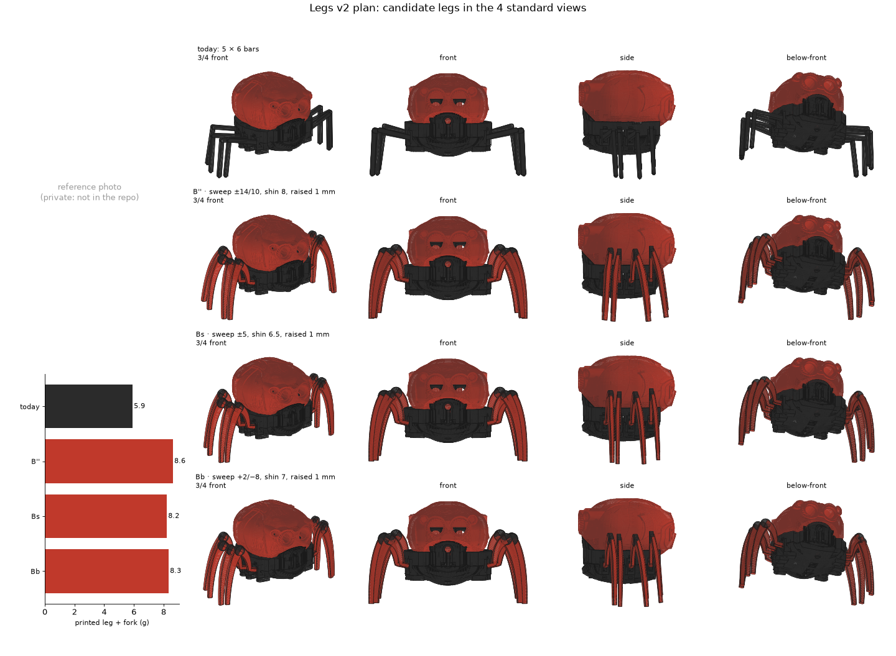

*Fig. 1 · Today's 5 × 6 mm bar legs (top) and the three B candidates, shin raised 1 mm, in the four standard views;
the bars show printed leg + fork in grams. All three are visibly thinner than the toy's legs.*

[Full entry](https://github.com/Morante-robotics/spider-bot-replica/blob/pre-redesign-2026-11-17/build-log/3-legs-and-drive.md#legs-v2-three-plan-rounds-paused) (archived text, with steps, figures and data).

[↑ Contents](../build-log.md#contents)
