# Spider-Bot · Looks first

Part of the [build log](../build-log.md): its [contents](../build-log.md#contents), [open items](../build-log.md#open-items) and [glossary](../build-log.md#glossary).

## Looks first

The second design, started on 2026-11-17 after the first ([Legs and drive](3-legs-and-drive.md)) drifted away from the
toy: the specification is now the toy and jenscolt's model, and the mechanism is fitted inside the looking parts. It
went through a mock-up in simple shapes (N0), the real parts as light meshes (N1), and a first print-detail attempt
that did not fit at 65 % (N2 rev 5). Meshes then proved a dead end, so every part was rebuilt as parameters and only
those measure. Round r00 of N2 designed the inside (drive and power); the shells then took an hour to build, so their
leg clearances were redesigned as simple shapes and every build and check came under 40 s, with 0 failures. Then the unused front sensor was removed and the mouth closed with a front panel, and the robot was split into one print plate per colour for a first test batch. Older
entries are shortened to their summary; the full text is in git (links).

### Redesign: looks first

**Phase 3 · Mechanisms · 2026-11-17** · Status: ✅ done; carried out by the entries below

> **In short.** The robot had drifted away from the toy: the dome sat on a tall black base with the gear box under it,
> and the legs hung like stilts. Every design change also took days, because the checks chased under a millimetre and
> a degree on shapes that were not yet decided. So the design restarts looks-first, with three levels of detail so a
> change costs seconds, and the size is worked out again from the smallest motor and the button cells that can feed
> it. A coarse estimate puts the scale at 60 to 80 %, not 120 %. The next step is to measure the original toy.

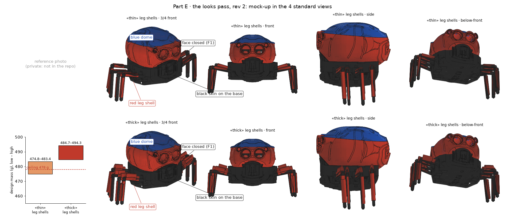

*Fig. 1 · The archived Part E mock-up. Look at the tall black base under the dome and at the thin legs: this is what
the redesign leaves behind.*

[Full entry](https://github.com/Morante-robotics/spider-bot-replica/blob/14d512996da3c506c01acb43c4fcb56bd19c3970/build-log/3-legs-and-drive.md#redesign-looks-first) (archived text, with steps, figures and data).

### N0 mock-up: the looks robot in simple shapes

**Phase 3 · Mechanisms · 2026-11-18** · Status: ✅ N0 look approved, N1 next

> **In short.** The first level of the redesign is built: a mock-up of the whole robot in simple shapes, with
> jenscolt's body and base at 60 %, eight legs shaped like his, the toy leg's motion, and the motor, six button cells
> and switch inside. One run draws four views and checks 24 crank poses in about 2 seconds. Every check is inside the
> 5 mm tolerance of this level, and the robot reads as the toy: the legs are thick and curved, the body sits low.
> Next is N1, the real looking parts as light meshes.

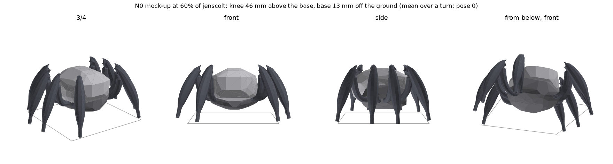

*Fig. 1 · The mock-up, default parameters, crank pose 0. Look at the thick legs rising level from the base and then
bending up to the knee, the blade coming down to the foot, and the base standing clear of the ground. The grey frame
is the ground plane.*

[Full entry](https://github.com/Morante-robotics/spider-bot-replica/blob/14d512996da3c506c01acb43c4fcb56bd19c3970/build-log/3-legs-and-drive.md#n0-mock-up-the-looks-robot-in-simple-shapes) (archived text, with steps, figures and data).

### N1 form: the real looking parts as light meshes

**Phase 3 · Mechanisms · 2026-11-19** · Status: ✅ N1 look approved, N2 next

> **In short.** The second level of the redesign is built: jenscolt's real body, eyes, base and legs at 60 %, simplified
> to light meshes, moving on the N0 motion with the motor, cells and switch inside. The legs are his own, stretched to
> reach N0's knee path, and each leg root has a window in the body and base. The 24-pose check passes within 1 mm
> (the legs graze the base by 0.4 mm), a run takes about 10 seconds, and Morante compared the views with his photo of
> the toy and approved the look. Next is N2, the print detail.

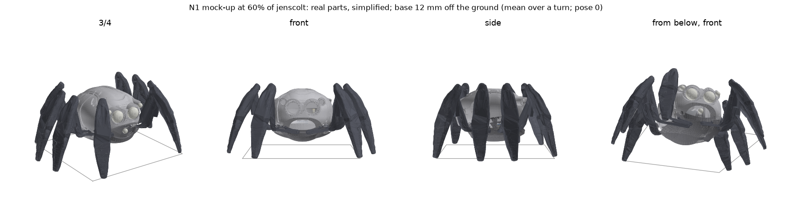

*Fig. 1 · The N1 mock-up, crank pose 0. Look at the real dome with its two eyes, two small eyes and front dome, at
the thick curved legs that now have jenscolt's shape, and at the base standing 12 mm off the ground. The windows are
hidden behind the legs. The grey frame is the ground plane.*

[Full entry](https://github.com/Morante-robotics/spider-bot-replica/blob/14d512996da3c506c01acb43c4fcb56bd19c3970/build-log/3-legs-and-drive.md#n1-form-the-real-looking-parts-as-light-meshes) (archived text, with steps, figures and data).

### N2 rev 5: the inside does not fit at 65 %

**Phase 3 · Mechanisms · 2026-11-19** · Status: ↩️ restarted from scratch ([Only the parametric parts measure](#only-the-parametric-parts-measure))

> **In short.** The N2 robot now runs on the design-rounds harness, and its plan was laid out again inside the
> unchanged look at 65 %. Nine layouts were tried and none fits: the best has its tightest pair 1.75 mm too close, and
> with real shapes instead of boxes 20 pairs still overlap. A sweep for the one scale at which everything fits and can
> be assembled found a second problem at 65 %: the motor sits over the spine cap, so the cap, its screws and the
> crankshafts cannot go in after it. Scale does not fix that, so N2 is paused until Morante decides how to change
> the assembly order.

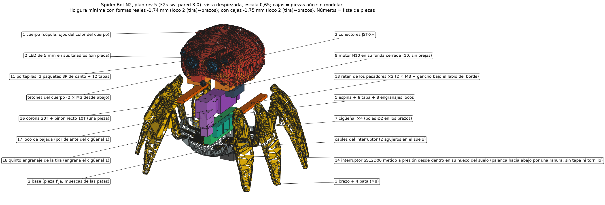

*Fig. 1 · The plan, rev 5, exploded (labels in Spanish). Coloured blocks are parts not yet modelled; the grey bowl is
the base and the yellow shapes the legs. Look at the purple and green blocks crowded between the crankshafts and the
dome: that is where the fit fails.*

[Full entry](https://github.com/Morante-robotics/spider-bot-replica/blob/14d512996da3c506c01acb43c4fcb56bd19c3970/build-log/3-legs-and-drive.md#n2-rev-5-the-inside-does-not-fit-at-65-) (archived text, with steps, figures and data).

### Meshes become parameters

**Phase 3 · Mechanisms · 2026-11-20** · Status: ✅ parts converted

> **In short.** Building on jenscolt's STL meshes stopped working: the legs came out warped, the body is 102k
> triangles, a STEP sewn from a mesh weighs 50–180 MB, and scale and wall thickness cannot be changed apart.
> Morante decided to stay on build123d and convert every mesh into parameters once, keeping the meshes only as
> references. A new tool measures how far a rebuild is from its reference, and the eyes, base, body and legs are
> converted and pass (0.92, 0.83, 0.69, 0.89). N1 has to be rebuilt on these parts next.

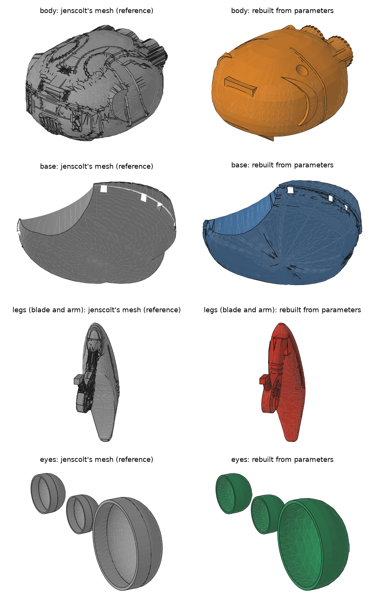

*Fig. 1 · Reference (grey) and rebuild (colour) of the body, the base seen from below, one leg (blade and arm) and the
three eyes, same view for both. The reference's scribbles and spikes are mesh noise; the rebuild is smooth. Look at the
body: the rebuild has the eye barrels, side scoop and rear lip but not the curved panel lines on top.*

[Full entry](https://github.com/Morante-robotics/spider-bot-replica/blob/14d512996da3c506c01acb43c4fcb56bd19c3970/build-log/3-legs-and-drive.md#meshes-become-parameters) (archived text, with steps, figures and data).

### Only the parametric parts measure

**Phase 3 · Mechanisms · 2026-11-20** · Status: ✅ done; N2 continues in [N2 round r00](#n2-round-r00-the-inside-and-the-leg-hold)

> **In short.** After the conversion, the N0 and N1 mock-ups and every N2 fit probe still measured jenscolt's
> meshes. They were removed, and N2 starts again from scratch on the four parametric parts; the approved motion
> (scale, crank, leg path) moved to a small module that reads no mesh. Checks now refuse an STL older than the model
> it was exported from, the fidelity limit grows with the part's size, and a part departs from a rule only through an
> exception Morante approves. Under the new limit the eyes and the leg blade pass; the leg arm and the base do not yet.

[Full entry](https://github.com/Morante-robotics/spider-bot-replica/blob/14d512996da3c506c01acb43c4fcb56bd19c3970/build-log/3-legs-and-drive.md#only-the-parametric-parts-measure) (archived text, with steps, figures and data).

### N2 round r00: the inside and the leg hold

**Phase 3 · Mechanisms · 2026-11-23** · Status: ✅ r00 is the robot, printing next

> **In short.** The robot's shells had taken 71 minutes to build and its fit check 19, and the design was stuck on
> tolerances of a few tenths of a millimetre in places that are not critical. Morante asked to relax them; with that,
> the inside (drive and power) was designed for the first time and the whole-robot check came out with 0 failing and
> 4 at tolerance of 318. The smoke check found one real fault: with the body on, a leg could slide outward along its
> crank pin and come off; a snap groove on the pin fixed it. The full `cad_verify` of the whole robot then passed
> with 0 failing, the looks judge gave 0.66 (threshold 0.6) and Morante said «se parece»: r00 is the robot, with no
> refine round, and he goes straight to printing it.

Context: the robot is `cad/robot/` at scale 0.70 (see [Open items](../build-log.md#open-items)). Each part is built
from parameters, and the shells (base, body, legs) are carved by the legs' sweeps, which is hundreds of solid
operations; the fit check then tests every pair of parts over 24 crank poses. Before this entry the inside did not
exist, so the smoke check could only say «not held».

#### Steps

1. **Relaxed two checks** (Morante: «se laxó con tolerancias muy pequeñas en sitios no críticos para poder avanzar»).
   A new fit `LEG_OPEN` (0.4 mm) is used for the leg's neck in the open-top window of all 8 legs: leg 3 measured 0.41
   against the 0.5 of `LEG_PATH`, and the leg is located by its pin, the window only clears it. In `cad_verify`, a
   zero-area face on a mesh that is otherwise watertight is a warning, not a failure.
2. **Shells made cheaper to rebuild.** Every stage (base, body, legs) has its own cache key made from its source, so
   an edit to the body leaves the base and the legs warm (a warm re-export takes 40 s, a rebuild 35 minutes).
   The leg bores are widened by the drift of each leg over the 24 poses (0.12 / 0.07 / 0.09 / 0.17 mm), the base
   keel has screw bosses with counterbores, and the body has 5 mm LED bores at the big eyes (the small eyes' bores
   are vented), a switch slot with its keeper (throw 1.5 mm, a standard value: the SS12D00 datasheet has to
   confirm it) and the power pockets. A bug where `clean()` changed its input and left an invalid body is fixed. The
   body is now 35.3 cm³ (≈ 44 g), one valid solid.
3. **Designed the inside**, in two modules that each have their own check, merged by `interior.py`:
   - **Drive** (`drive.py`): the spine (1.4 g), the four cranks with the legs' pins (0.33 g each), idlers 1–3,
     sleeves, the 15/20-tooth transfer gear, the drive unit (1.8 g), the pinion (0.22 g), the N10 motor as a box and
     the M2 screws.
   - **Power** (`power.py`): the cell holder (4.1 g), 2 × 3 AG13 cells with springs and locating rings, a nickel
     strip, a lid with snap lips and a key pocket, the SS12D00 switch, the LEDs at the big eyes, the resistors
     upright and the JST connector glued.
4. **Hardware changed** (see [`hardware.md`](../hardware.md)): the holder screw is M2 × 6 (was × 8), the keel
   screws M2 × 4 (was × 6), all with flush heads, and a transfer axle M2 × 12 was added, which the plan's count did
   not have.
5. **Ran the checks.** `verify.py` merges the gears, the pair gaps and the keep-out zones of both modules and orders
   the assembly by the plan's steps (interior up to step 9, legs, holder, motor, cells, lid, body). The
   whole-robot fit check (`check.py`, 19 min on a shared CPU) gives 0 failing and 4 at tolerance of 318. The smoke
   check fails on the leg hold (below) and has 4 hairlines, «gap 0.20 < 0.2», accepted under the relaxed rules.

#### Result

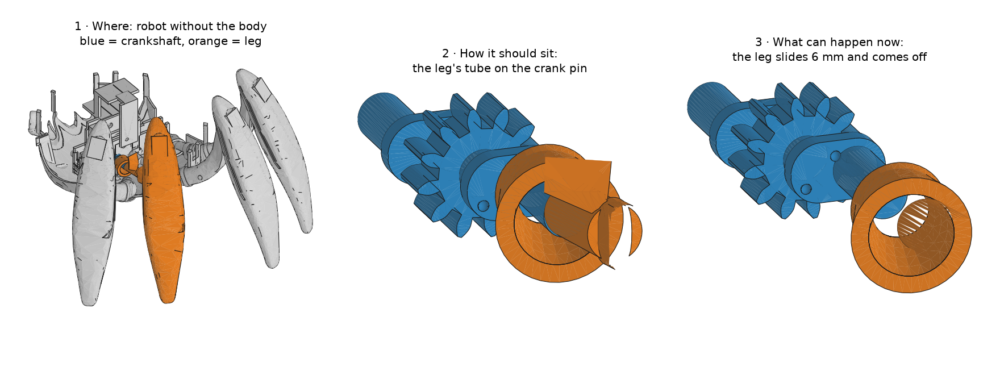

*Fig. 1 · The leg hold. Left: the robot without the body, crankshafts in blue and one leg in orange. Middle: the
leg's tube seated on its crank pin, as it should be. Right: the same tube slid 6 mm outward and off the pin, which
nothing stops once the body is on. Real CAD, rendered from the exported parts.*

The four at tolerance are paths and fits within 0.1 mm of their limit: the drive unit's assembly path against the
spine (0.01), idler axles 1 and 2 against the drive unit (0.0 each) and the cells' path past the nickel strip (0.0).

**The leg hold.** With the body on, a leg slides outward along its crank pin by up to 6.25 mm (leg 1) while the pin
engages only 3.7 mm. The leg's window in the body is the union of its 24 poses, so it leaves 1.5–6 mm of slack.
Two fixes were tried and failed: a collar on the pin's tip cannot fit, because the leg's own arm lies on the pin's
axis past the tube, and a post on the body also failed. Separately, leg 2's end tube is detached in
its STL (joint radius 1.75 against a bore of 1.84): a model bug to fix whichever option is chosen.

#### Decisions

- Tolerances relaxed in places that are not critical, to keep moving (Morante, 2026-11-23).
- Options for the leg hold (the fix chosen afterwards is option A, commit
  [77161ac](https://github.com/Morante-robotics/spider-bot-replica/commit/77161ac)):
  - **A (recommended):** a snap groove on the pin (Ø3 → Ø2.3, 0.8 wide at x = 7) with a bead in the leg's bore and
    a slit, tried first on a 3 g coupon.
  - **B:** a pin 1 mm longer; it does not solve leg 1.
  - **C:** a tab on the body; it depends on the pose and rebuilds body and base.

#### Close of round r00

`rounds.py status cad/robot`, 2026-11-23:

| Round | Gates | Score | Passed | Caps |
|---|---|---|---|---|
| r00 | PASS | 0.66 | yes | none |

- **Gates:** `cad_verify` of the whole robot, 0 FAIL (`verify-result.txt`). Two bookkeeping fixes: its section keys
  are now the heading's first word («assembly order» became «assembly»), and plan m13 reads the «motion» check. Plan
  m14 stays «failed» only because the judge cannot see code; checked by hand, the meshes are read only by `views.py`.
- **Looks judge:** 0.66 against 0.6, passed, so no refine round was asked.
- **Morante:** «se parece». r00 is the robot.
- **Coupons skipped:** Morante prints the whole robot instead of the coupons. The leg snap is tested on the first
  plate (the base and one leg) before the other seven legs are printed.
- **Shopping list:** [`hardware.md`](../hardware.md) now counts every bought item from the code (motor, 6 cells,
  3 springs, nickel strip, switch, JST-XH 3-pin, 2 LEDs with resistors and 7 M2 screws in four lengths).

#### Next

Print the robot: see [Print plates by colour](#print-plates-by-colour).

[↑ Contents](../build-log.md#contents)

### Fast shells: clearances designed, not computed

**Phase 3 · Mechanisms · 2026-11-23** · Status: ✅ every build and check under 40 s, whole-robot check 0 FAIL

> **In short.** The base took 28 minutes to build and the body about an hour, because the room each leg needs was
> computed: hundreds of convex hulls around sampled leg points, cut one by one from curved skins. Each leg's room is
> now one simple prism whose outline is measured from the leg's motion, and each shell is one fuse and one cut. The
> base builds in 22 s, the body in 28 s and the check of the whole robot runs in 37 s with 0 failures (5 before).
> Morante chose the shapes on three comparison sheets.

Context: Morante set the rule that any build or check over 40 s is a bug (aim for 10 s). The causes were measured in
the previous session (base 1669 s, body ≈ 3500 s, `body.step` 152 MB); this entry is the fix.

#### Steps

1. **A window from the motion.** For each leg, the base wall points that the leg comes within its clearance of
   (WR 0.9 mm, at its 24 crank poses and along the slide onto its pin) are seen along the wall's normal; their lowest
   point per 0.25 mm column is the window's floor, open to the top. The outline, buffered and simplified, has 11–13
   straight sides and is cut through the wall as one prism ([`cutters.py`](../cad/robot/cutters.py)). Wall left
   between two windows narrower than 4 nozzle lines joins the first window. Prototyped on meshes (seconds per try),
   then built in OpenCascade.
2. **The body the same way.** A notch from the rim for each leg (its 24 poses, and the body pressed on from above at
   crank pose 12), and a shallow pocket where a leg nears a face below the rim (the rear tab, legs 3 and 7). What does
   not depend on the legs (shell, eye cups, snap fingers, switch keeper, bores, pockets round the power parts as
   boxes) is one cached stage. The x-stop posts were found once and frozen.
3. **Proof on meshes, inside the build.** Every leg is checked against the built shell at every pose and along its
   path with manifold3d (a few seconds). This replaced a volume check around every boolean.
4. **The checks.** `cad_verify` remembers the legs' frames (11 000 calls had rebuilt each leg's shape: 9 s), measures
   joints with one gap query, advances assembly paths by the free gap, runs retention and print in a second process,
   and lets an assembly step set the crank pose it is done at.
5. **Removed**: the hull and offset code of `shells.py` (768 → 450 lines), the stage-cache tool, 1.6 GB of caches.

#### Result

| What | Before | After |
|---|---|---|
| Base build | 1669 s | 22 s |
| Body build | ≈ 3500 s | 28 s (40 s when its fixed stage is rebuilt) |
| Whole robot, each part | — | ≤ 26 s (80 s for all 34 parts) |
| `cad_verify verify.py --quick` | 70 s, 5 FAIL | 37–40 s, 0 FAIL |

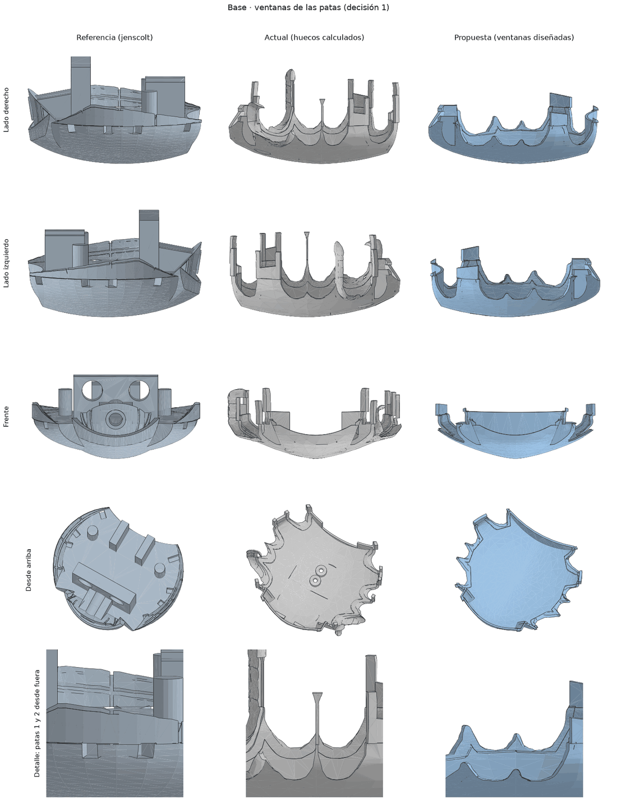

*Fig. 1 · Decision 1, the base windows: reference, computed (before), designed (accepted). The floors stay at the
same height; the thin posts the old pads left above the rim are gone.*

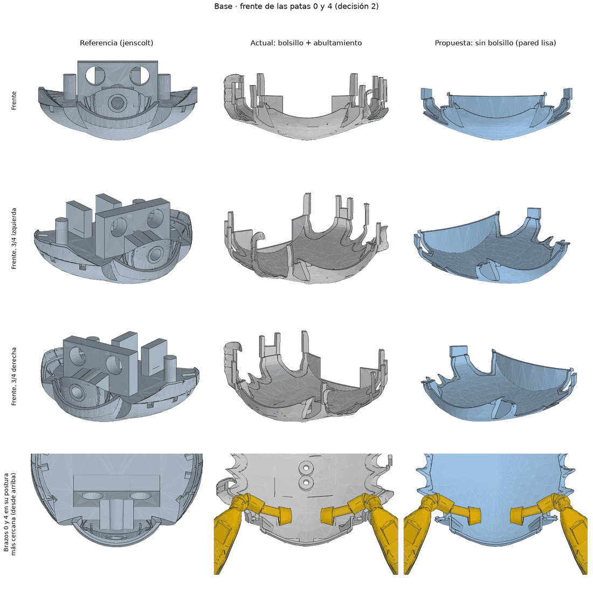

*Fig. 2 · Decision 2, the front of legs 0 and 4: the relief and bulge are dropped; the arms clear the smooth wall by
0.40 mm (bottom row).*

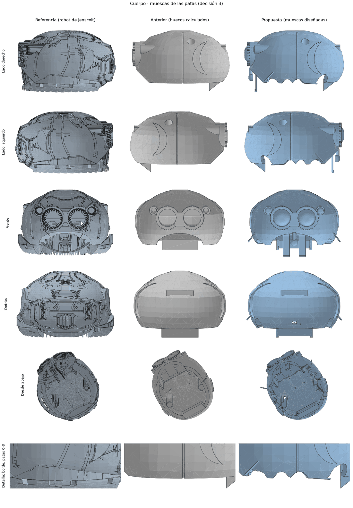

*Fig. 3 · Decision 3, the body: a notch at the rim for each leg, a shallow pocket on the rear tab, the x-stop posts.
The middle column is the body as the viewer had it, before its rim cuts.*

#### Decisions

- Windows as designed; smooth base front, no relief («Lisa»); body notches, tab pocket and frozen posts (Morante).
- No 1.2 mm pads round the windows: open-top windows carry no load (the leg is held by its pin). With a 1.2 mm wall
  the front arms came within 0.14 mm.
- Legs 1, 2, 4–7 go on with the crank at pose 0; after half a turn, legs 0 and 3 and the body.
- Legs 0 and 7 may slide 1.65 mm towards their crank at pose 0 (Morante: «Aceptar 1,6 mm hacia dentro»).
- The back pocket is a cup (the bare sheet came loose), and the switch keeper's bar no longer overhangs the switch.
- Carving on meshes (STL only) was not needed: the STEP for Onshape is kept.

#### Next

Round r00: the looks judge and Morante's «se parece»; the half turn in the workshop kit.

[↑ Contents](../build-log.md#contents)

### Front sensor removed, mouth closed

**Phase 3 · Mechanisms · 2026-11-24** · Status: ✅ done, before plating

> **In short.** jenscolt's front «sensor» (a ball on a stem hanging in the mouth) does nothing in the toy, so it is
> no longer placed. The mouth is now closed at the front face by a 1.2 mm panel flush with the body's skin, which also
> hides the body's two front snap fingers. Body valid, whole-robot check still PASS, 0 FAIL.

Morante, looking at the robot before plating: «elimina ese palo y la bola, que no sirven para nada». The two vertical
columns he saw in the mouth are the body's two front snap fingers (x ±6, 0.8 × 5 mm, flexing length 8 mm) under ribs
on the base's front wall. With the rear tab they are the only retention of the body ([decision m22](#n2-round-r00-the-inside-and-the-leg-hold)), so
they stay, but behind a cover.

#### Result

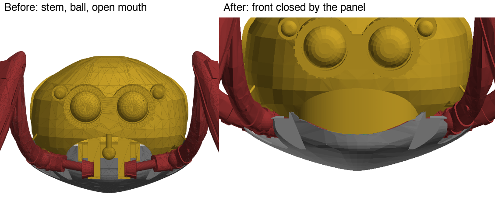

*Fig. 1 · Left: before, with the stem and ball and the open mouth. Right: after (closer view), the panel closes the
front down to the base. The two views are at different zoom.*

- `eye_cups()` no longer places the sensor and `body_static()` no longer adds its stem (`cad/robot/shells.py`);
  `cad/eyes` still builds the sensor as a converted part, it is just not placed.
- `front_panel()` (same file) is fused into the body: 1.2 mm thick (the minimum loaded wall, rules 3.2), x ±18, z ≈ 13.2–27.3, its outer
  face the skin's front swept down, flush round the chin arch and covering the arch and the slit below it, down to
  0.2 mm above the base's front top (the same seam as between body and base). The snap fingers keep their flexing
  length free (about 1.7 mm of room in front of them).
- Body: 1 valid solid, 35 416 mm³ (35 002 before). Leg gaps ≥ 0.53 mm over 24 poses, lift ≥ 0.55 mm. A ray scan from
  the front finds no ray through the panel, only the 0.2 mm seam at its bottom edge.
- Full check: PASS, 0 FAIL, 95 WARN (the same rows as before), [`verify-result.txt`](../cad/robot/verify-result.txt).

#### Decisions

- **Close at the front, not inside.** A first try cut the chin arch as a 1.4 mm recess closed behind it. Morante:
  «No está bien. Tiene que cerrar por delante no por dentro». The panel version: «Me gusta».
- `cad/body/build.py` is unchanged (its chin arch cut stays): the panel is a feature of the robot frame.

[↑ Contents](../build-log.md#contents)

### Print plates by colour

**Phase 5 · Final build · 2026-11-24** · Status: 🔄 plates ready, batch 1 not printed yet

> **In short.** The robot is printed in three colours, so the parts are split into one plate per colour: red for the
> body and the eight legs, yellow for the inner mechanisms, blue for the base. Every part is its own object, so
> Morante chooses in Bambu Studio which ones to print. The first batch is the test: the blue and yellow plates whole
> and only leg 4 from the red one, to see that the leg snaps onto its crank pin and that the M2 screws bite in
> their pilot holes. The rest of the red plate follows when leg 4 works.

Morante's rule: carcass and legs red, base blue, inner mechanisms yellow. The plates are made with
[`tools/bambu_plate.py`](../tools/bambu_plate.py) with the repo's standard settings ([`print/README.md`](../print/README.md)).
Support is tree(auto), on the build plate only.

#### Result

<table>
<tr>
<td width="33%">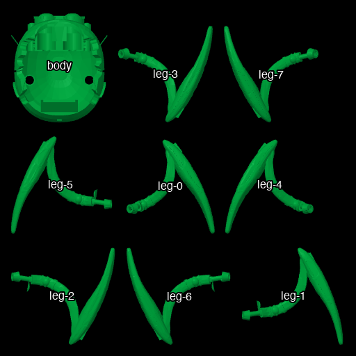</td>
<td width="33%">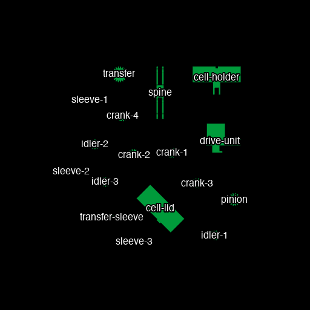</td>
<td width="33%">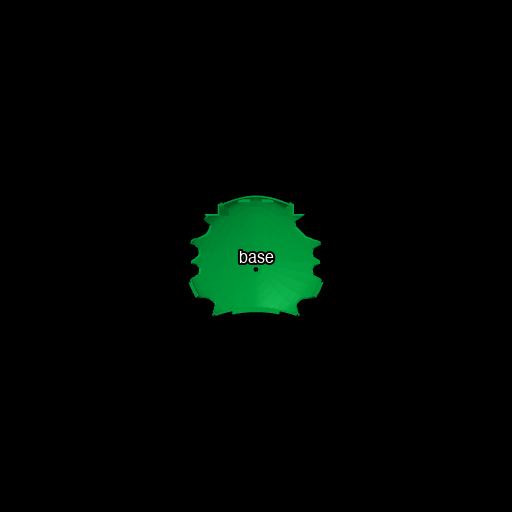</td>
</tr>
<tr>
<td><em>Fig. 1a · Red: the body and legs 0 to 7 (leg 3 is the second piece of the top row).</em></td>
<td><em>Fig. 1b · Yellow: the 17 inner parts, each labelled.</em></td>
<td><em>Fig. 1c · Blue: the base, foot down.</em></td>
</tr>
</table>

*Previews are labelled by part and drawn in green; the colours are chosen in Bambu Studio.*

| Plate | Parts | Time | PLA | Support |
|---|---|---|---|---|
| [`robot-red.3mf`](../print/robot-red.3mf) | body and legs 0–7 (legs 4–7 mirrored) | 5 h 25 min | 86.81 g | 13.35 g (18 %) |
| [`robot-yellow-inner.3mf`](../print/robot-yellow-inner.3mf) | spine, cranks 1–4, idlers 1–3, sleeves 1–3, transfer gear and sleeve, drive unit, pinion, cell holder, cell lid | 1 h 16 min | 14.27 g | 4.17 g (41 %) |
| [`robot-blue-base.3mf`](../print/robot-blue-base.3mf) | base, foot down | 52 min | 8.02 g | 4.24 g (112 %, outside the bowl) |

Leg 3 alone is 26 min 33 s and 6.48 g; Bambu Studio names it `leg-3-7.stl` (a suffix from the tool). Support over
30 % of the part's weight is on the base, the cranks (about 140 %), the drive unit (66 %), the transfer gear (46 %)
and the spine (30 %).

#### Decisions

- **Support marks stay.** Morante: «Me vale así». The marks are on non-functional faces and get sanded.
- **No pre-print review.** Morante: «No sé para qué sirve esta revisión. Lo tengo que imprimir igual, diga lo que
  diga el revisor, ¿no?». Right: the first batch is itself the test, so the review is dropped.
- **Batch 1** (≈ 2 h 35 min): blue plate, yellow plate and leg 3 from the red one. Check the crank pins, snap bead and
  collar for support residue, the bore of leg 3 for roundness, and that sleeves and idlers stuck to the bed.
- **Batch 2** (≈ 5 h): the rest of the red plate, after leg 3 snaps well.
- **Kits in the repo.** Morante liked the workshop kit enough to keep it: «quiero que a partir de ahora los kits
  formen parte del repo». From now on every kit is made in English in [`kits/`](../kits/README.md), one folder per
  step, served by GitHub Pages. This step's kit: [`kits/01-batch-1-test-leg`](../kits/01-batch-1-test-leg/)
  ([open it](https://morante-robotics.github.io/spider-bot-replica/kits/01-batch-1-test-leg/kit.html)): the two
  batches, 37 assembly steps with a picture each, what to measure and what to film.

[↑ Contents](../build-log.md#contents)
