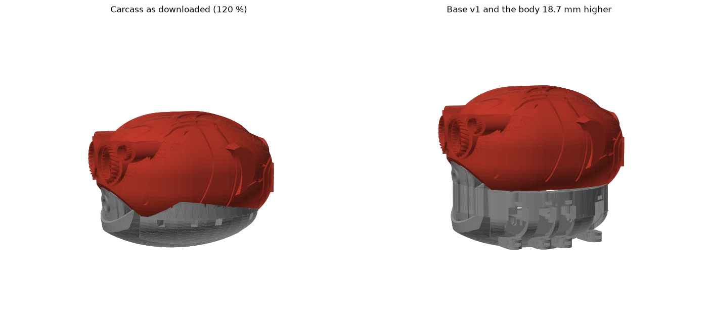
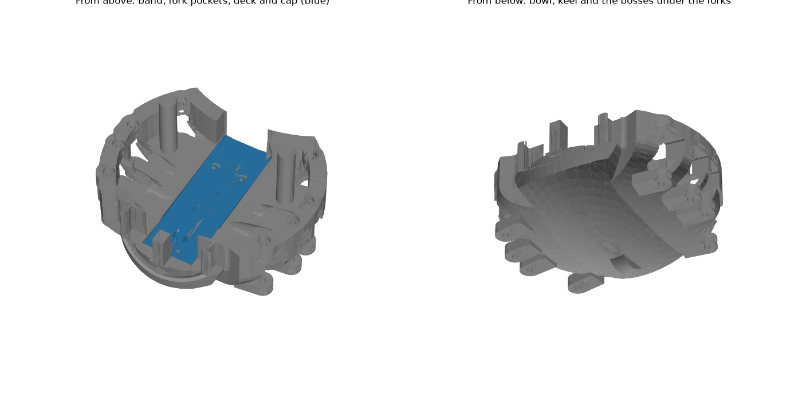
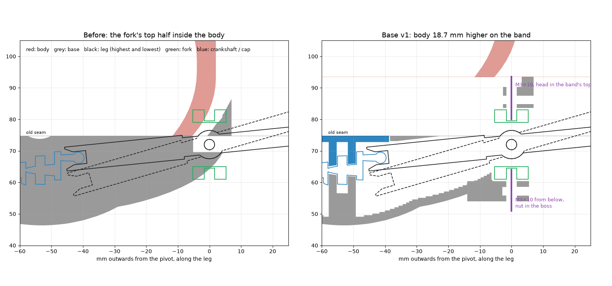
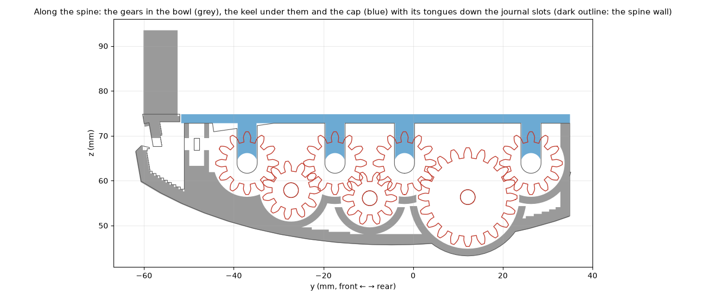

# Base v1

The [carcass base](../carcass-120/) made to carry the [legs](../legs/) and [crankshafts](../crankshafts/), modelled in code from the mesh
(trimesh + manifold3d booleans). How and why: [build log](../../build-log/3-legs-and-drive.md#base-v1-in-cad).

```
python3 ../legs/build.py    # the legs' and forks' STLs first (and ../crankshafts, ../gear-train-test for check.py)
python3 build.py            # out/: base-v1, cap, front-block (+ body-lifted, for the check)
python3 check.py --step 10  # moving parts against base, cap, front block and body over a full turn (about 2 min)
python3 figures.py          # the pictures below
```

Needs Python 3.12 with build123d (for the legs and crankshafts), numpy, scipy, trimesh, manifold3d, shapely and matplotlib. All sizes
come from parameters at the top of [`build.py`](build.py).

**Why a band.** The forks are 22 mm tall and swivel on a screw above and one below. On the original carcass the body
sits on the base right above the leg notches, so the top half of every fork went into the body. The body now sits
18.7 mm higher, on a band that is part of this base and holds the upper screw of every fork.









| File (`out/`) | What | X × Y × Z (mm) | Print |
|---|---|---|---|
| `base-v1.stl` | Bowl, band, spine walls with the journal slots, a boss under each fork | 121.4 × 106.0 × 69.6 | 1 |
| `cap.stl` | Closes the deck over the spine; a tongue down every journal slot holds the crankshafts | 29.4 × 86.7 × 10.1 | 1 (upside down) |
| `front-block.stl` | The carcass's front block, 18.7 mm higher, on longer stems | 63.5 × 38.2 × 51.9 | 1 |
| `body-lifted.stl` | The carcass body moved up, for the check only (not committed: `build.py` writes it) | — | — |

Print plate: [`print/base-v1.3mf`](../../print/base-v1.3mf).

**What changed from the carcass base:**

- **Hollow bowl:** 2 mm walls below a 2 mm deck at the old seam (z 74.8).
- **Band:** the base's outline with a lobe round every fork, from the deck up to z 93.5. It is open over the cap
  and round the front block's stems. The side lips are under it, and the two posts that stood inside the body are
  gone.
- **Spine built in:** the two walls of the [gear train test's spine](../gear-train-test/), with the same journal slots and idler pin holes,
  join the bowl. Where the gears go lower than the bowl (the 20-tooth idler, by 2.4 mm), a **keel** 8.5 mm wide covers
  them.
- **Forks:** each sits in a pocket 0.6 mm larger than its swivel, open outwards, so fork and leg slide in together
  from outside. One M3×10 goes up through a boss under the fork and one goes down through the band. Each is locked by a
  nut in a slot, and its tip turns 3 mm inside the fork.
- **Leg paths** are cut with 0.8 mm of room, from each leg's inner end to 30 mm outside its pivot.
- **Cap:** the deck is open over the spine so the crankshafts drop in from above, as on the test frame. The cap closes
  it, and its tongues hold the journals in their slots. It has three M3×10 screws: one into the front end block and
  two into bosses beside the walls, each into a nut in a slot.
- **Front block and pegs** go up with the body. The two pegs stay on the base. The front block is now a separate part
  that drops in through the band once the cap is on, because its stems stood over the opening the first crankshaft
  goes in through.

**Hardware:** 16 × M3×10 + 16 nuts (fork swivels), 3 × M3×10 + 3 nuts (cap). The drive's own hardware is in
[../legs/](../legs/) and [../crankshafts/](../crankshafts/).

**Assembly:**

1. Idlers: each on its 3 mm steel pin, pushed in from the side through both spine walls.
2. Legs into forks (M3×16 and a nylon lock nut, as on the test frame).
3. Each fork with its leg slides into its pocket from outside, the leg's tube first. Slide a nut into each of the
   fork's two slots, then put one M3×10 up through the boss and one down through the band, into the fork's blind holes.
4. Crankshafts into their slots, guiding each ball into its leg's tube, with the cranks as printed (see
   [../crankshafts/](../crankshafts/)).
5. Cap: nuts into its three slots, then the cap on, with the tongues down the slots, and three M3×10.
6. Front block into its place in the band, then the body on the band.

**Check over a full turn** ([`check.py`](check.py), every 10°): no part overlaps. The closest pairs are the designed
clearances: 0.25 mm a side for the journals in their slots, 0.45 mm beside the idlers and 0.65 mm or more for the legs (cut with 0.8 mm; the check samples every 10°).
Latest result: [`check-result.txt`](check-result.txt).

**License:** CC BY-NC-SA, like the carcass it is made from ([LICENSE.txt](../carcass-120/LICENSE.txt)).
