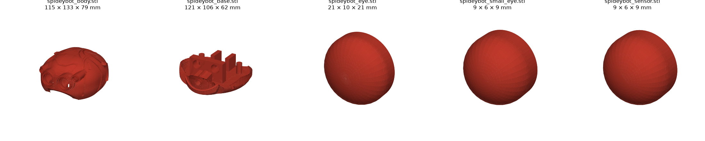
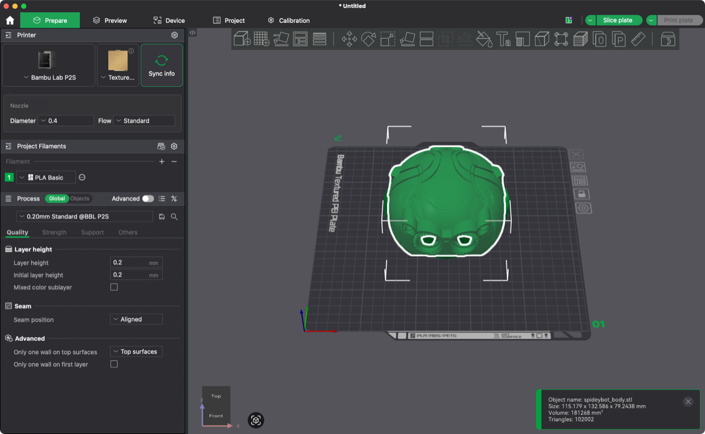

# Carcass at 120 %, repaired

Body, base, eyes and sensor of [Spidey-Bot by jenscolt](https://www.thingiverse.com/thing:5196618), made watertight
with [`repair_stl.py`](../../tools/repair_stl.py) and scaled to 120 % (the print scale, see
[cad/layout/](../layout/)). Surface within 0.01 mm of the original. Positions as in the original files (eyes off to
the side). How and why: [build log](../../build-log.md#mesh-repair).

**License:** CC BY-NC-SA, like the original ([LICENSE.txt](LICENSE.txt)).

| File | X × Y × Z (mm) | Triangles | Print |
|---|---|---|---|
| `spideybot_body.stl` | 115.2 × 132.6 × 79.2 | 102002 | 1 |
| `spideybot_base.stl` | 121.4 × 106.2 × 62.4 | 7516 | 1 |
| `spideybot_eye.stl` | 21.0 × 10.2 × 21.2 | 3686 | 2 |
| `spideybot_small_eye.stl` | 8.8 × 5.7 × 8.8 | 3682 | 2 |
| `spideybot_sensor.stl` | 9.1 × 5.7 × 9.1 | 3684 | 1 |

Bambu Studio `--info` reports `manifold = yes` for all five, and the import shows no mesh errors:

 Legs are not here: they are a reference only, see
[../carcass-jenscolt/](../carcass-jenscolt/).
