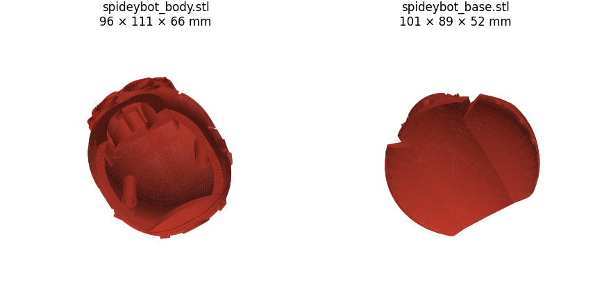

# Carcass base model: Spidey-Bot by jenscolt

Unmodified files of [Spidey-Bot](https://www.thingiverse.com/thing:5196618) by **jenscolt** (Thingiverse, January 2022), a
static display model of the Avengers Campus Spider-Bot with room inside the body for lights. It is the starting point
for the carcass. Repaired and scaled versions: [../carcass-120/](../carcass-120/).

**License:** Creative Commons Attribution-NonCommercial-ShareAlike ([CC BY-NC-SA](https://creativecommons.org/licenses/by-nc-sa/4.0/)),
see [LICENSE.txt](LICENSE.txt). Unlike the rest of the repo, these files and anything derived from them are
non-commercial and must keep this license.

 

*The model printed and painted by jenscolt (photos from the download, same license).*

Assembled with [`assemble_jenscolt.py`](../../tools/assemble_jenscolt.py): 224 × 154 × 118 mm. Body, base, sensor and
front legs are where the author placed them; eyes moved into their sockets; the other 6 legs placed approximately.

| File | X × Y × Z (mm) | Triangles | Part |
|---|---|---|---|
| `spideybot_body.stl` | 96.0 × 110.5 × 66.1 | 102244 | Top shell, hollow |
| `spideybot_base.stl` | 101.2 × 88.5 × 52.0 | 7522 | Bottom half, with posts and mounts inside |
| `spideybot_L_leg1.stl` / `R_leg1.stl` | 30.5 × 29.7 × 91.3 | 11676 | Lower leg (foot), left / right |
| `spideybot_L_leg2.stl` / `R_leg2.stl` | 36.3 × 39.9 × 47.8 | 23474 | Upper leg with hip joint, left / right |
| `spideybot_eye.stl` | 17.5 × 8.5 × 17.7 | 3692 | Large eye dome |
| `spideybot_small_eye.stl` | 7.3 × 4.8 × 7.4 | 3692 | Small eye dome |
| `spideybot_sensor.stl` | 7.6 × 4.8 × 7.6 | 3692 | Front sensor dome |

Sizes at 100 % scale. For the full robot print 4 of each leg file (L and R) and 2 of each eye.

## Notes

- Every file has some mesh errors (non-manifold edges, reversed faces); Bambu Studio flags them on import. Repaired
  versions (body, base, eyes, sensor) are in [../carcass-120/](../carcass-120/); the legs are not repaired.
- The legs are static: no joints to move. They are a reference for the outer shape of the walking legs.
- STL files are meshes: Onshape can import them as a reference but not edit them. Cuts and holes go in Bambu Studio
  (cut tool and negative parts); new parametric parts (chassis, crank, linkages) are designed in Onshape.
- Thingiverse rejects scripted downloads (HTTP 403). Download by hand with **Download all files** on the thing page.
- Images regenerated with [`../../tools/stl_preview.py`](../../tools/stl_preview.py):
  `python3 stl_preview.py images/parts.png *.stl` and `--elev -70` for the underside; turntable with
  [`stl_turntable.py`](../../tools/stl_turntable.py) `images/assembled-turntable.gif spideybot_assembled.stl`.
