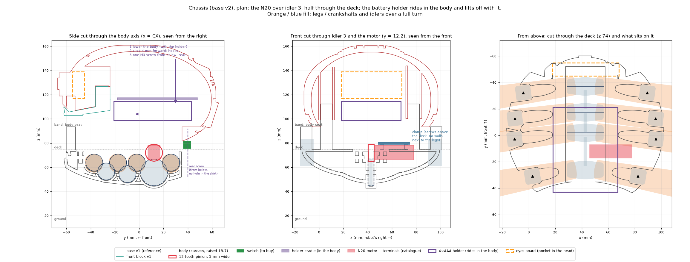

# Chassis (base v2) and robot master model

The chassis that carries the whole drive (crankshafts, idlers, the N20 and its pinion) under the carcass body, and
the whole-robot check that every other design is verified against. It follows the [CAD rules](../README.md#a-design-folder).



## Files

| File | What it is |
|---|---|
| [`design-plan.md`](design-plan.md) | The plan: decisions, part list, fits, motor seat, joint table, assembly sequence, coupons, hardware, the master model's interface table, and the modelling order |
| [`plan_figure.py`](plan_figure.py) | Plan figures from real geometry: `images/plan-layout.png` and one view each (`plan-side.png`, `plan-front.png`, `plan-top.png`) |
| [`mass_estimate.py`](mass_estimate.py) | Mass and centre of mass of the final robot and of the v0 walk test, with contingency by source; `images/plan-mass.png` |
| `build.py`, `verify.py`, `design-review.md` | Started from [`../_template/`](../_template/); they become the model, the whole-robot `cad_verify` spec and its review as the plan is modelled |

`--lang es` on either script writes the Spanish copies of the figures (`-es.png`) for the workshop kit.

## Rebuild the figures

```bash
../../.venv/bin/python plan_figure.py       # needs ../base/out (../base/build.py) and the legs' and crankshafts' STLs
../../.venv/bin/python mass_estimate.py
```

The motor sizing these figures depend on: [`../../sim/motor_sizing.py`](../../sim/motor_sizing.py).
