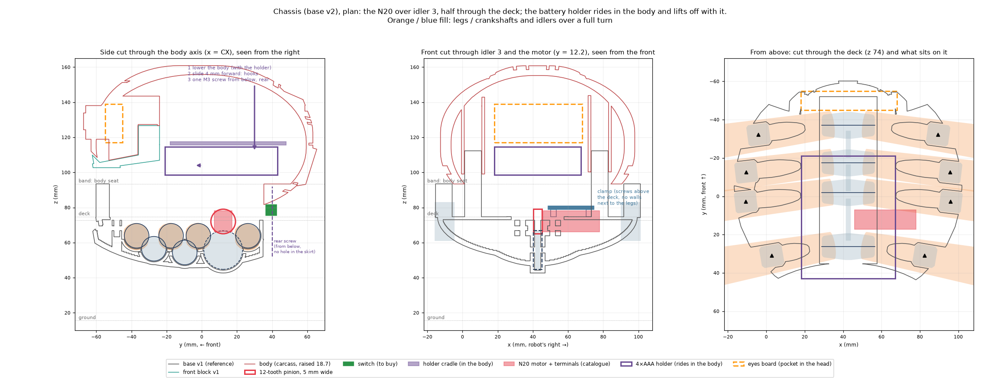

# Chassis (base v2) and robot master model

The chassis that carries the whole drive (crankshafts, idlers, the N20 and its pinion) under the carcass body, and
the whole-robot check that every other design is verified against. It follows the [CAD rules](../README.md#a-design-folder).
The robot's datums, interfaces and bought-part envelopes are in the master model, [`../robot.py`](../robot.py).



The parts below are Part A of the [plan](design-plan.md#status-and-next-steps): the drive module and its small parts.
The plan lists what the next parts add (looks chassis, body v2, front block v2, cradle, ballast frame, whole robot).

## Parts (Part A)

| Part | What it is | Print | g (shell model) |
|---|---|---|---|
| `drive-module` | Spine walls with the journal slots, the 5.9 mm pocket for idler 3 v2, blind idler pin holes, a U-notch r 5.5 in the -X wall round the clutch's collar (x -3.3 to -5.4, open at the top), the gearbox pad on the +X wall between two steps (0.5 a side), a V saddle and an end wall for the N20 inside its own Y band, the -X boss for the shared screw, the keeper recess, 4 nut traps for the chassis | Upside down, top on the bed | 15.1 |
| `cap` | Holds the crankshafts down (test cap v2.1 tongues and front skirts), windows round the pinion, the clutch's collar, shaft tip and motor | Upside down, plate on the bed | 5.9 |
| `motor-clamp` | Bar over the N20 from the cap's -X bridge to the end wall; over the pinion its underside is relieved, 1.8 mm above the teeth (0.8 keep-out + 1.0 relief); a gearbox pad pressed 0.3 into the gearbox (`MOTOR_PRELOAD`), two cheeks 0.2 off the gearbox flats (they take the motor torque), a can pad | Top on the bed, pads up | 2.3 |
| `pinion` | 12 teeth, module 1, **4 mm**, round Ø5.2 bore turning on the clutch sleeve (`SLIP_BORE` 0.1, assumed): the clutch's friction disc, clamped between the sleeve's shoulder (+X) and the steel wave washer (-X). No mark: either way round | Flat | 0.4 |
| `clutch-sleeve` | Friction clutch: Ø5 sleeve (1 mm wall) with a D-bore pressed on the N20 shaft (`DSHAFT`), Ø9 × 1 shoulder (the +X friction face); dot over the flat | Shoulder down, D-bore vertical | 0.1 |
| `clutch-collar` | Friction clutch: Ø9 × 1.2 collar with a D-bore pressed on the shaft's tip; holds the shims and the wave washer; dot over the flat | Flat | 0.1 |
| `idler-3-v2` | Idler 3 with a 5 mm face: same teeth and phase, a dot on its +X face | Flat | 1.4 |
| `pin-keeper` | Strip over the three idler pins' +X ends, in a recess | Flat | 0.7 |
| `gauge-fork` | Bench tool, not in the robot: the 0.8 mm gauge, a U-fork dropped into the press jig's slot over the pinion; the gearbox face stops on it. Measure it before use: 0.8 ± 0.05 | Flat (4 layers: its thickness is the gauge) | 0.2 |
| `press-jig` | Bench tool, not in the robot: U-channel open at +Z, stood on the table (-X face down): pinion pocket (squares the pinion) with a Ø9.5 pocket below its step for the clutch's collar, shims and wave washer, the fork's slot, a gearbox socket 10.4 × 12.4 (squares the motor), a Ø4 U for the shaft tip. The motor slides out through the open side after the press. Presses the sleeve and the collar in one push (fork in). Also presses coupon K1's sleeves and collars | On its -Z face, open side up | 5.6 |
| `press-cup` | Bench tool, only if the thumb is not enough: cup over the can's rear rim, clear of the terminals (wires out at +Z); jig and cup go between a vise's jaws | Top plate on the bed | 1.9 |

Clutch coupons (`coupons_clutch.py`, built by `build.py`; cut and handed over only with the whole-robot batch):

| Coupon | What | Pass test |
|---|---|---|
| CL1 | The real clutch on the real motor (pressed in the jig) + `coupon-cl1-arm` (30 mm lever over the pinion's teeth) + `coupon-cl1-stand` (slice of the drive module: idler 3 v2 on its pin, keeper, notch, pad; the robot's centre distance with the +0.1) | Slips at 440–665 g on 30 mm (129–196 N·mm), 3 trials; after 50 slips each way the collar has not moved (pen mark); again after 24 h clamped; 3 turns of idler 3 by hand against the pinion in the stand (motor held), no bind |
| CL1-heat | CL1 on the motor, crank blocked, 60 s at 4.8 V | No fusing or smear; slip torque re-measured inside the window (`verify.py` MEASURE) |
| CL2 | `coupon-cl2`: option B, 4 detent hubs printed in their tooth rings (arms 0.8 / 1.0 × bumps 0.25 / 0.4; 1–4 dots) | Same lever test; 60 s motor run, re-measure, no crack |
| CL3 | `coupon-cl3`: option C, 3 pinions with two O-ring grooves (15 / 20 / 25 % squeeze; 1–3 dots) and a hub | Same lever test and 60 s run |
| K1 | `coupon-k1`: 3 sleeves with a 50 mm lever and 3 collars, D-bores DSHAFT −0.05 / 0 / +0.05 a side (1–3 dots) | Holds 440 g on 50 mm (215 N·mm) without turning; collar pull-off ≥ 170 N; fork still fits after 24 h |

Masses: `mass_estimate.py` (shell model of `sim/motor_sizing.py`).
Reused unchanged: crankshafts 1–4 and idlers 1–2 ([`../crankshafts/`](../crankshafts/)), the legs ([`../legs/`](../legs/)).

## Hardware (Part A)

| Item | Count | Where |
|---|---|---|
| Steel pin Ø3 × 10 | 3 | Idler pins, pushed in from +X, blind at -X |
| M3 × 8 + nut | 1 | Pin keeper |
| M3 × 12 + nut | 3 | Cap front; cap and clamp (shared, in the -X boss); clamp rear (end wall) |
| M3×6 + nut, M3×8 + nut | 3 + 1 | I7: module to chassis, from below into the module's nut traps. Stock lengths, never cut: the shell's counterbores (`shell.py`) are deep enough that each tip ends between its nut's top and the hole's end: M3×6 at the front, under the can and the -X boss, M3×8 behind the can |
| M3 nut | 8 | 4 above (keeper, cap front, shared, clamp rear) + 4 I7 (as in [`hardware.md`](../../hardware.md)) |
| N20 HP 380:1 | 1 | Catalogue size until bought |
| Wave washer DIN 137 B M3, stainless | 1 (pack of 10) | Clutch, between the pinion and the shims (steel face on the pinion's -X face); rate ≤ 60 N/mm from the seller's load table. To buy with the motor |
| Shim washers DIN 988 3 × 6 × 0.1 / 0.2 / 0.3 | 0–3 (one assortment) | Clutch, between the wave washer and the collar: set the slip torque per unit. To buy with the motor |
| O-rings 5 × 1 NBR 70 | 2 (pack) | Coupon CL3 only (option C, fair comparison). To buy with the motor |

I7 nut traps (`build.py` `I7_NUTS`; x from the body axis, nut pocket bottom z; all ≥ 2 mm inside the carcass,
`verify.py` `KEEP_IN`). Screw length = Part B's floor and boss under the module + (nut top − module underside at the
nut). **Screw length rule:** the screw's tip ends between the nut's top and the hole's end above it, never past
it: a longer screw stops on PLA (and under the can it would push the 0.8 mm skin under the V into the motor):

| Nut | x, y | Nut z (bottom–top) | Module underside there | Hole above the nut | Screw tip | Slides in from |
|---|---|---|---|---|---|---|
| Front block | -0.15, -48.52 | 58.2–60.9 | 57.0 | 0.8 | nut top to +0.8 | -X |
| Saddle, under the can | 20.0, 12.18 | 59.2–61.9 | 58.0 | none: 0.81 skin to the V's bottom (62.71) | **flush with the nut's top** (M3×6, the counterbore sets it) | +Y |
| Saddle, behind the can | 32.5, 12.18 | 62.2–64.9 | 59.25–62.9 (sloped underside) | 0.8 | nut top to +0.8 | +Y |
| -X boss | -10.0, 12.18 | 64.5–67.2 | 63.0 | 0.8 | nut top to +0.8 | -X |

Service: legs off, robot on its back, the 4 screws out from below, the module lifts out of the deck window upwards.

## Assembly (bench)

1. Nuts into their slots: keeper (from below), cap front and shared (from -X), clamp rear (from +X).
2. Idlers 1, 2 and 3 v2 dropped between the walls; the three pins pushed in from +X until flush with the recess floor.
3. Pin keeper into its recess, M3×8.
4. Crankshafts 1–4 from above: the dots on each +X web match the dots beside its slot.
5. Cap from above (dots on its +X edge), front M3×12. Turn crankshaft 1 by hand: all four turn.
6. On the bench (the clutch): measure the fork (0.8 ± 0.05). The press jig on the table, its open side towards you.
   Look at which way the motor shaft's flat points. The collar into the small deep pocket, dot up, turned to point
   that way; one 0.1 shim, then the wave washer dropped onto it; the pinion slid into its pocket onto the step
   (either face up); the sleeve dropped into the pinion, shoulder up, its dot the same way as the collar's; the fork
   dropped into its slot over the shoulder. The motor pushed down into the socket by its can (shaft's flat over the
   dots; thumb on the rim below the terminals) until the gearbox face stops on the fork: the shaft presses into the
   sleeve and the collar in one push. If the thumb is not enough: the press cup and the vise. Note «by thumb» or
   «needed the vise». **Bench checks before the drop:** the fork comes out snug and slides back in snug (the 0.8
   gap); **lever test**: the coupon CL1 arm over the pinion's teeth, weights hung at its 30 mm hole: it must slip
   between 440 g and 665 g (129–196 N·mm), 3 trials. Below 440 g add a shim, above 665 g take one off (collar
   prised off with two small flat screwdrivers, a new collar pressed). Fork out, the motor with its clutch slides
   out of the jig towards you.
7. Motor and clutch lowered together, in one drop, onto the pad and the V saddle (the collar into the -X wall's
   notch); turn crankshaft 1 a little until the pinion drops into idler 3's teeth (380:1: the motor shaft cannot be
   turned by hand). Wires leave on +Y (red to «+»). Kit rule: if the legs stop and the motor keeps humming, switch
   off (the clutch is slipping; ≈ 47 s to 60 °C, CL1-heat measures it).
8. Clamp from above (its cheeks over the gearbox flats, its pad presses the gearbox 0.3), the shared M3×12 through
   clamp and cap at -X, the rear M3×12 into the end wall.

Removal of the motor: the two clamp screws out, lift the motor with its clutch. The idler pins push out from -X
with a 1.5 hex key after the keeper is off.

## Files

| File | What it is |
|---|---|
| [`datasheet.md`](datasheet.md) | Read first: status, which file and section holds each topic, commands |
| [`design-plan.md`](design-plan.md) | The plan: decisions, part list, fits, motor seat, joint table, assembly sequence, coupons, hardware, the master model's interface table, and the modelling order |
| [`build.py`](build.py) | The Part A parts into `out/` (STEP and STL, robot coordinates); `--part <name>` for one |
| [`verify.py`](verify.py) | The `cad_verify` spec of the whole walking robot (drive module, shell, forks, cover, front block, legs); last full result in [`verify-result.txt`](verify-result.txt), pictures in `images/verify/` |
| [`design-plan-b.md`](design-plan-b.md) | Part B's plan (the looks parts), rev 3.1, approved 2026-11-15 |
| [`shell.py`](shell.py) | Part B1 in progress: the looks shell `chassis` and the `crank-cover` (mesh builds from the carcass, as base v1) into `out/chassis.stl` and `out/crank-cover.stl`; prints their masses and the I7 stock screw lengths. Built in stages cached in `out/.cache/` (not in git; [`stage_cache.py`](../../tools/stage_cache.py)): a change rebuilds only the stages downstream of it; `--lite` (decimated body, legs every 30°) writes `out/chassis-lite.stl` |
| [`design-review.md`](design-review.md) | The review of Part A, each answer with its number or picture |
| [`plan_figure.py`](plan_figure.py) | Plan figures from real geometry: `images/plan-layout.png` and one view each |
| [`mass_estimate.py`](mass_estimate.py) | Mass and centre of mass of the final robot and of the v0 walk test; `images/plan-mass.png` |
| [`part_a_figures.py`](part_a_figures.py) | Build-log diagrams of the drive module: `images/part-a-*.png` (in the robot, keel, rear end, exploded, bench press) |

## Commands

```bash
../../.venv/bin/python build.py                     # every Part A part (≈ 40 s)
VERIFY_STEP=30 ../../.venv/bin/python ../../tools/cad_verify.py verify.py --quick --only cap   # while iterating
../../.venv/bin/python ../../tools/cad_verify.py verify.py --out verify-result.txt --render images/verify
../../.venv/bin/python plan_figure.py               # plan figures (needs ../base/out and the legs' STLs)
../../.venv/bin/python mass_estimate.py
../../.venv/bin/python shell.py                    # Part B1: the looks shell (≈ 2 min cold, ≈ 15 s after a one-feature change)
../../.venv/bin/python shell.py --lite             # for trying a fix: out/chassis-lite.stl (SHELL_LITE=1 does the same)
../../.venv/bin/python part_a_figures.py            # build-log diagrams (needs out/ from build.py)
```

`--lang es` on the figure scripts writes the Spanish copies (`-es.png`) for the workshop kit. The motor sizing these
figures depend on: [`../../sim/motor_sizing.py`](../../sim/motor_sizing.py).
