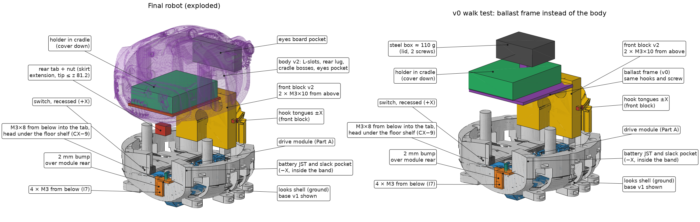
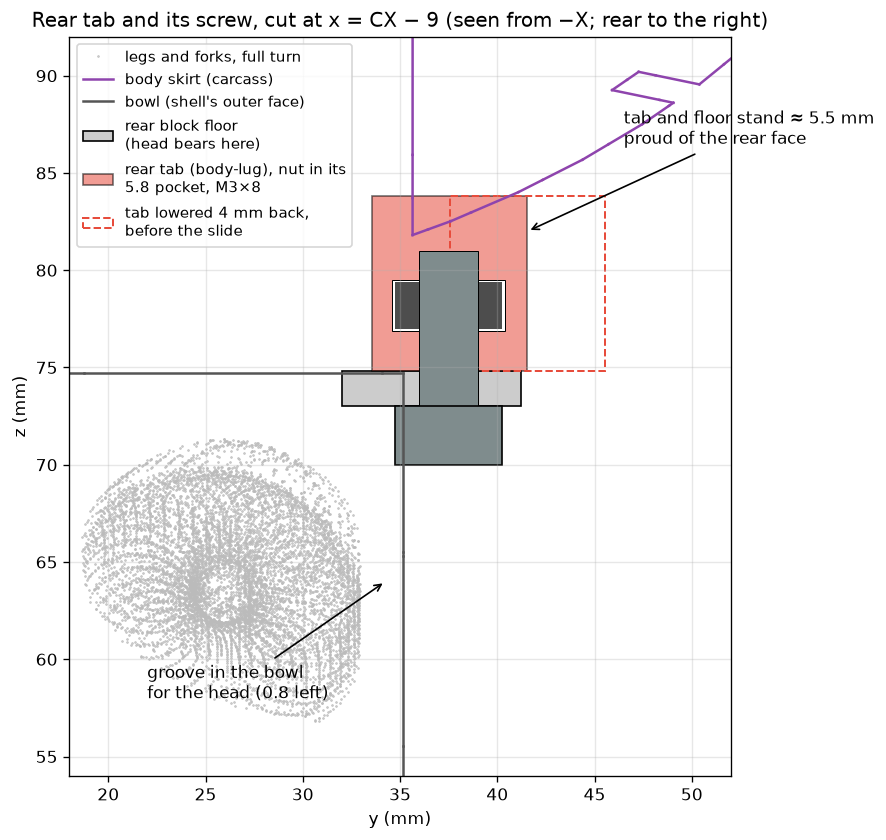

# Chassis Part B · the looks parts · plan

Status: **PLAN rev 3.1, approved** (Morante, 2026-11-15: «Sí, todas»). B1 is being modelled.
- Rev 1 went to the design-reviewer, who asked for changes on 10 points.
- Rev 2 closed points 1, 3 and 5–10.
- Rev 3 answers the second pass's 8 points, each with its probe, in «Rev 3: the second review's points» at the end.
- Rev 3.1 applies the third pass's text fixes. No design change:
  - the tab's nut walls are measured on the nut pocket, not the bare nut;
  - Q3 and H list the real print choices, with the separate lug as the default;
  - step 12's wording;
  - the turning key's stub;
  - the rear-left deck bridge joins the leg-path check.
- **Rev 3.2** (B1, 2026-11-16, the coordinator's option 1): the front block screws move to **(25, −51) and (60.44, −51)**, inside the pads. Rev 3.1's (16, −51) and (69, −51) lay 2.5 mm outside the pads' outline (the plan's pad table was the v1 block's bounding box, not its outline), and every point of the pads at y −24 to −36 put the nut boss 3.4–5.7 mm into the legs' path. At the new places, the pads' edges are 3.4 and 3.8 mm from the screws and the nut bosses are 2.8 mm outside the legs' path grown by `LEG_PATH` + 0.3. The **slack box and the eyes JST seat** move with them, to between the left access tube and the cap (x 29.45–35.25, y −56.9 to −46.9), because the tube now stands where rev 3.1's box was and x 13–22.5 has almost no block under the body. A tunnel carries the switch lead to the block's rear face. The pads stop 10.5 from CX (the cap's sides + `WINDOW`; 10.0 touched the cap). Probes: scratch `t5.py` (pads and leg path), `t6.py` (block material for the box); checked by `verify_fb.py`. **Mass** (Morante, 2026-11-16): the block built at 20.4 g against 13–15; lever 1 only, the block's rear face (y −24, facing the band's inside under the body) opened between the loaded side columns, from 2 mm over the lips to 1.5 mm under the top: **19.1 g built**. The plate above z 104 is not cut (Part D decides)

This is Part B of the [chassis plan](design-plan.md#status-and-next-steps). That plan's decisions 1–14, the
departures accepted in Part A, its fits, and the master model [`../robot.py`](../robot.py) all still hold. This file
adds what Part B needs: the geometry found on the real meshes, the parts, the joints, the assembly order, the choices
still open, and the questions for Morante. Nothing is modelled yet. Everything is drawn at 120 % (decision 14).

*Made by [`plan_b_figure.py`](plan_b_figure.py) from real geometry (Spanish copy: `images/plan-b-es.png`). Base v1's
shell and front block stand in for the looks shell and front block v2; the boxes are this plan's sizes. Left: the
final robot, exploded. The body, with the holder and eyes board inside it, goes on down, 4 mm forward, then one M3×8
from below at the rear. Right: v0, with the ballast frame on the same hooks and screw. Seen from behind and to the
left, so −X is on the right of the picture.*

## Decisions (Morante, 2026-11-15)

Every default of the open questions, approved with «Sí, todas»:

| Q | Decision |
|---|---|
| Q1 | Yes: the M3×8 at CX−9 behind the bowl into the rear tab; tab and shelf ≈ 5.5 mm proud of the rear face; switch at +X (x 55–67) inside the rear face |
| Q2 | **B1**: the original side lips, notched along the leg path |
| Q3 | **P1 + H2**: body printed upright on the skirt's lip; the rear tab is a separate `body-lug` |
| Q4 | Eyes glued in their sockets |
| Q5 | **A1b**: one-piece shell, band top on the bed, deck open at the sides and solid over the crank sweep |
| Q6 | Cradle on the guided L-path (L-grooves, entry notches, end stop); slide cover taken off in place |
| Q7 | Battery loop in the rear slack pocket, eyes loop in the closed box in the front block |
| Q8 | Every mass lever applied; the built mass reported; the decision taken in Part D |

Two more, taken during B1 (Morante, 2026-11-15):

| Point | Decision |
|---|---|
| The deck over the crankshafts | **Option (b).** The deck window opens over the crank slots (x CX ± 14.3, as base v1) so the module goes in with its crankshafts, and a separate screwed **`crank-cover`** (≈ 3 g, 2 × M3×10, fitted after the module, cut round the cap and motor) closes it. **It replaces Q5's solid strip over the crank sweep** as the guard against wires and fingers |
| The motor clamp under the band's seat | The seat ring and slide lip are **notched over the clamp's end** (y 5–19; built from x ≥ CX+30 = 72.7, because the quick check showed the seat's overhang reaching over the clamp from x ≈ 78, not 84 as first estimated), so the clamp drops in from above. The lip still locates the body in X along the rest of each side |
| The forks' pocket (coordinator, 2026-11-16, following the rules table: «every part held») | **Option (a).** The fork's top and bottom faces get a turning fit (`fits.TURN`, 0.25 + 0.02 mesh allowance) to the boss below and the upper boss; `LEG_PATH` (0.8 + 0.2) stays sideways only. `shell.py` has its own `fork_mounts`. At `LEG_PATH` all round the forks floated 1.0 mm each way (full check, 8 failures). Coupon K7 (the fork pocket) proves this fit too |
| The switch (coordinator, 2026-11-16; Morante: the simplest option, one part fewer) | **Option (b): carried on the crank cover.** The cover has the switch's cradle: floor, walls, and a top pad that retains it from above. The switch slides in from the cradle's open +X end on the bench, lever out through the rear wall, pins out through the front wall's slot. In the robot a 2 mm rib on the shell, 0.5 off the switch, closes that end. The plan's own M3×10 retainer goes. Leg 4R sweeps under the plan's switch place up to z 75.0, so the cradle's floor starts at 75.2 and the switch stands at z 76.5–82.5. Its lever tip is at y 34.7, 0.5 inside the band's inner face, so it passes when the cover is lifted; it is recessed 1.7–2.4 from the rear face, reached through the band's window with a fingernail or a pen tip. The leads run through clip 1 on the shell (open top) and an eye on the cover (threaded before soldering), so lifting the cover lifts the switch with its leads |

## Modelling order (how Part B splits)

Part B is one plan. It is modelled in three steps, and each one is checked with `cad_verify --quick` before the next
starts:

| Step | Parts | Why in this order |
|---|---|---|
| **B1** | `chassis` (the looks shell, which becomes the spec's fixed part instead of the module), `front-block-v2`, the I7 screws (stock lengths, the counterbores set to them), fork screws and nuts, switch and retainer, `turning-key`, the wire `KEEP_OUT` | Ground first. It closes I4, I7, I8 and I12, and the bump. The K4 and K7 coupon geometry comes from it. **Before B2 starts:** the shell's built mass (Q8) and its print option (Q5) |
| **B2** | `body-v2`, `holder-cradle`, eyes pocket | Closes I9, I10 and I11 against B1's hooks, rear block and slide lip |
| **B3** | `ballast-frame`, `ballast-lid` | The same hooks and tab as B2 (B2's parameters imported, not typed), the steel box at the v0 centre of mass |

Part C follows: the full whole-robot run, and `mass_estimate.py` rerun with the CAD masses.

## Survey findings (scratch probes on the real meshes, 2026-11-15)

The probe scripts are in the session scratchpad, not in the repo: `probe1–6.py`, `p_holder.py`, `p_rear.py`,
`p_mass.py`, `p_sup.py`, `p_rev3*.py`. The reviewer's are `rev/r1–r4.py`. Coordinates are the robot's, with the body
lifted by `LIFT` 18.7.

1. **The carcass base is solid**, not a shell: below the module's front nut the ray goes in at z 53.5 and out at
   74.4. The looks shell is the base hollowed to `WALL`, as `base v1 cavity()` did.
2. **Height of each I7 boss**, from the bowl's outer bottom to the module's underside:

   | Nut | Bowl bottom (outside) | Module underside | Boss inside the bowl |
   |---|---|---|---|
   | Front, x CX−0.15 | 53.5 | 57.0 | ≈ 1.5 |
   | Under the can, x CX+20 | 50.8 | 58.0 | ≈ 5.2 |
   | Behind the can, x CX+32.5 | 54.9 | 59.25–62.9 | ≈ 2.4–6 (sloped seat) |
   | −X boss, x CX−10 | 47.7 | 63.0 | ≈ 13.3 |

3. **The original side lips cut through the legs' path.** The lips are the base's flanges above the seam:
   x −18 to 6.9 and 77.6 to 103.4, z 74.8–84.6, 5.2 g solid. Over a full turn every 10°, every leg passes through
   them:

   | Legs | Overlap with the lips |
   |---|---|
   | 0 | 2.24 mm |
   | 1 | 1.84 mm |
   | 2 | 1.63 mm |
   | 3 | 0.85 mm |

4. **The body's rear skirt** (section in the figure below).
   - It hangs below the seat: its inner lip reaches z 81.77 at x 40, 81.9 at x 34, 82.35 at x 55 and 82.6 at x 28.
     There is no skirt below z 85 for x < 24 or x > 60.
   - Its outer face is not upright. From the lip it slopes outwards, at about 25° from horizontal: y 35.6 at
     z 81.8, 39.5 at z 83.8, 43 at z 85, 50 at z 88.
   - Under it the original base's rear face stood 0.5 mm inside the lip: y 34.84 at CX, 35.9 at x 28, 37.1 at
     x 61, 38.5 at x 66.
   - So **«no gap under the body's rear» means the band's rear wall continues the bowl's rear face up to 0.5 mm
     under the skirt's lip**, not out to the skirt's outer face. Rev 2 had this wrong.
   - The skirt also means the body cannot print rim-down without its seat on support (Q3).
5. **The rear screw column** (`p_rear.py`, `p_rev3b.py`; every leg and fork swept a full turn below the deck; the
   legs are mirror images, so ±X give the same numbers).
   - There is none inside the bowl.
   - Behind it, at **(CX ± 9, y 37.5)**, the head (r 2.75 + `WINDOW`) clears the legs by **1.35 mm** (0.85 at
     y 37.0, 1.85 at 38.0) and the bump by 1.5 mm. Rev 2 quoted 2.4, which was the figure at y 38.5.
   - The head passes 0.6 mm inside the bowl's rear face, so the bowl gets a vertical groove 1.2 mm deep, leaving
     0.8 mm, where nothing pushes.
   - **Rev 3 puts the screw at CX−9**, so the switch can stay at +X (finding 6).
   - The screw is an M3×8: its tip ends at 81.0, within decision 5's 81.2 (section below).
6. **Where the switch can go** (`p_rev3b.py`, `p_rev3c.py`). The SS12D00 envelope with its lever is 12 × 8.5 × 6;
   the gap is to the body mesh, in place and lowered 4 mm back:

   | Switch place | In place | Lowered |
   |---|---|---|
   | +X, x 54.7–66.7, inside the rear face (y 27.5–36.0), top z 80.8 | **1.42** | **4.48** |
   | +X, behind the rear face (rev 2, y 30.5–40.5), top 81.5 | 0.76 | 0.72 |
   | −X, x 18.7–30.7, top 81.5 | 0.62 | 0.65 |
   | Centre, x 31–43, top 81.5 | 0.17 | 0.15 |

   Decision 4's «0.75 before the slide, 1.37 in place» does not carry over from the earlier plan. At its new place
   the switch keeps **1.42 in place and 4.48 lowered**, both above those values.
7. **The front block blocks the 4 mm slide as it is.** Its step at y ≈ −36 follows the head's underside with a
   0.3 mm gap. **Front block v2 moves the step's front face back 4.5 mm** (4 + `WINDOW`).
8. **Front block nuts under the deck** (`r4.py`, `p_rev3.py`). At x 16 and 69, for y −42 to −24, the bosses come
   within 0.0–1.8 mm of the swept legs and cranks. At **y −51** they are 10.6 and 10.4 mm away, and the bowl's
   floor is at z 64.9 and 64.6, so a nut boss fits from 66.9 to the deck (72.8). At y −54 both points are outside
   the bowl.
9. **Holder path into the body** (`p_holder.py`, `r3.py`).
   - Straight up, it overlaps the skirt by up to 4077 mm³.
   - **Up 11–12 mm forward of its place, then back** gives 0.0 overlap.
   - The cover, slid −Y in its own plane, is free for 20 mm.
10. **Eyes box**: only 22 % of it is in head material, so body v2 adds walls round the pocket. It opens downwards
    through the head's underside (z ≈ 107.5).
11. **The crank webs sweep under the deck**: |x − CX| from 4.25 to ≈ 14, a 6.01 radius round each shaft, so
    y −43.8 to 33.1 with `LEG_PATH`. An open deck over them would let a wire or a finger into the webs.

*Cut at x = CX − 9, from [`plan_b_rear_section.py`](plan_b_rear_section.py) (Spanish: `-es.png`). Shown:
- the skirt (purple) and the bowl's rear face (grey line), both from the carcass meshes;
- the legs and forks swept a full turn (grey dots);
- the planned tab, nut and M3×8, with the floor shelf under it;
- the tab lowered 4 mm back, before the slide (dashed).

The tab and its shelf stand about 5.5 mm proud of the rear face, under the skirt's slope: that is the «ledge» in Q1.*

## Rear block layout (reviewer point 2, 6)

All boxes are in robot coordinates with the body at its place. Each pair is ≥ 1.2 mm apart or separated by a wall
of that size. B1 builds them as named parameters.

| Feature | x | y | z | Notes |
|---|---|---|---|---|
| Band rear wall | 22–64 | 1.6 thick, its outer face on the bowl's rear face continued up (34.84 at CX, 35.9 at x 28, 37.1 at x 61) | 74.8–81.15 | 0.5 under the skirt's inner lip (81.65 at its lowest) |
| Tab notch through the rear wall | 26.7–40.7 | 33.0 to the rear, open | 74.8 up, open | Tab + 1.0 a side in X (X is located by the slide lip); in Y the tab + 4 + 0.5, open at the rear |
| Floor shelf | 26.7–40.7 | 33.0–41.6 | 73.0–74.8 | Behind the bowl; it carries the screw head's counterbore |
| Tab (`body-lug`, H2 default) | 27.7–39.7 | 33.55–41.55 | 74.8 up to the skirt's slope (≈ 84) | Section below; inside the shelf's 41.6 |
| M3×8 | 33.7 (CX−9) | 37.5 | head 70.0–73.0, tip 81.0 | Head in open air behind the bowl, groove in the bowl's rear face |
| Switch + lever | 54.7–66.7 | 27.5–36.0 | 74.8–80.8 | Lever through the rear wall, recessed ≥ 0.5 from the rear face (36.5–37.1 there). Retainer from inside |
| Battery JST shell | 17–27 | 26.0–31.8 | 74.8–82 | Latch up |
| Rear slack pocket | 17–31 | 16–24.8 | 74.8–81 | Floor on a deck bridge (x 15–33, y 14–34, ≈ 0.9 g): A1b's open deck is open there otherwise |

**Clearances to the neighbours:**

| Feature | Neighbour | Gap |
|---|---|---|
| Slack pocket | Cap (x ≥ 32.7, y ≤ 30.3) | 1.7 |
| Slack pocket | The module's wire `KEEP_OUT` (x ≥ 33.8) | 2.8 |
| Switch | Cap | 2.0 |
| Switch | The motor's `KEEP_OUT` (y ≤ 20.2) | 7.3 |
| JST | Notch (y 33.0) | 1.2 |
| JST | Slack pocket (y 24.8) | 1.2 |

**The tab's section at the nut** (figure above):
- Nut pocket: `K.NUT_AF` + 2 × `STEEL.side` = 5.8 across the flats in Y (y 34.6–40.4 round the screw at 37.5),
  z 76.9–79.6.
- **The nut slides in from −X**, through a slot to the tab's −X face (x 27.7). Once the tab is in its notch, the
  notch's −X wall, 1.0 mm away, keeps the nut from walking out.
- **Front wall (−Y) 1.05** (34.6 − 33.55). It takes the +Y retention: the shank bears on it when the body is
  pushed back.
- **Rear wall (+Y) 1.15** (41.55 − 40.4). Nothing pushes on it.
- **Above the nut, 2.9 to the skirt's lip.** This takes the screw's pull.
- Below the nut, 2.1 to the tab's bottom.

**The screw clamps the tab onto the floor shelf.**
- The tab's bottom ends in a Ø7 ring at z 74.8 that bears on the shelf's top. This is a designed contact, declared
  in `ALLOWED_CONTACT`.
- The head bears on the shelf's underside at z 73.0, in a 0.5 counterbore.
- Hand tight; the screw's pull goes through the ring into the shelf.
- **So the band top's rear segment (x 22–64) is relieved 0.3**: the seat bears at the sides and front, and the rear
  is set by the clamp. Seat and ring never fight.
- While the body slides, the ring slides on the shelf: a designed sliding contact.

## Shell mass (corrected; reviewer point 4)

The volume is built from the mesh: the bowl and deck hollowed by `base v1 cavity()`, the band as a prism of the
body's seat outline (perimeter 525 mm), the lips from the mesh. PLA at 1.24 g/cm³, the skins solid.

| Piece | At the plan's walls | g |
|---|---|---|
| Bowl + deck, `WALL` 2.0 (the deck alone 19.0 g) | built | 63.4 |
| Band, 2.0 wall, 18.7 tall, 4 mm seat on top | 525 × 18.7 × 2 + 525 × 4 × 2 | 29.6 |
| Side lips B1 (notched) | mesh − notches | 4.7 |
| 8 fork mounts (boss r 5.5 × 6.4, bracket, upper screw boss in the band) | base v1's sizes | ≈ 18 |
| Rear block, bump, switch pocket, JST slots, slack pocket, I7 bosses, front block lips and nut bosses | estimate | ≈ 8 |
| **Total** | | **123.7 g, against the 86 g budget** |

| Lever | Saves | Note |
|---|---|---|
| Bowl skin `WALL` 1.6 (54.4 g built) | −9.0 | |
| Band wall 1.2 instead of 2.0 | −9.7 | Bosses and seat unchanged |
| Open deck (A1b) **with the crank sweep bridged** (x CX ± 14.8, y −43.8 to 33.1 stays solid) | −5.3 opened, + ≈ 1.5 bridges = **−3.8** | Rev 2 had −4.5 with the webs open |
| Fork brackets ribbed instead of solid | ≈ −4 | |
| **Every lever above** | **−26.5** | |

| Lips | Shell |
|---|---|
| B1 (notched, 4.7 g) | **≈ 97.2 g** |
| B2 (trimmed, ≈ 3.8 g) | **≈ 96.3 g** |
| B3 (none) | **≈ 92.5 g** |

**Every option is over the 86 g budget**, by 6.5 to 11 g. Effect on the motor:
- As summed, the robot goes from 445.3 g to ≈ 456 g (B1).
- The design mass depends on the contingency the shell carries:
  - with the plan's +15 % kept, ≈ 497 g (the reviewer's ≈ 495): **19 g over the 478 g ceiling**;
  - with the shell counted as solid CAD at 0 %, as the plan's contingency table allows once it is modelled,
    ≈ 482 g: 4 g over.
- `mass_estimate.py` decides in Part C. Either way the motor margin is at or below 3.0 (Q8).

## Brief trace (cad-designer §2.1)

| # | Item | Where it is met |
|---|---|---|
| 1 | Purpose; pass for this PLAN | Part list, joint table and sequence close I4, I7–I12. Masses against the budget: the shell is over (Q8) |
| 2 | Parts and motion; ground; how each part is held | Joint table and «Retention». Ground: `chassis`. Body and holder lift off together (decision 3) |
| 3 | Dimensions and sources | `robot.py` datums; Part A's `build.py` (`I7_NUTS`, `Y1`, `TOP`, `CAP_T`, `SCREW_FRONT`); carcass-120 meshes; findings 1–11 |
| 4 | Interfaces | Interface table at the end |
| 5 | Clearances | «Fits»: no new fit. `LEG_PATH` is the one assumed fit used; proven on the shell at step 11 and K7 |
| 6 | Assembly and service | Sequence and «Service». Battery change stays «1 screw, lift the body» |
| 7 | Deliverables and budget | Part list; this file; `images/plan-b*.png` (EN and ES); questions **Q1–Q8** |

## Part list

| Part | Why a separate part | Est. g (budget) | Print orientation (decided now; Q3 and Q5 open) |
|---|---|---|---|
| `chassis`: the looks shell, ground | Bowl (carcass − `WALL`); deck as a ring (A1b) kept solid over the crank sweep and module window, with bridges under the front block pads, its nut bosses and the rear-left pocket; band on the body's outline from 74.8 to 93.5 with the slide lip; side lips (Q2); 8 fork pockets and bosses; the 2 mm bump; the rear block (layout above); groove for the screw head; 2 front block pads; keel opening; wire channel and clips on the band's inside | 123.7 at the plan's walls; 92.5–97.2 with the levers (86); support see A | A1b: band top on the bed |
| `front-block-v2` | Face filler, screwed so a broken hook reprints 15 g, not the shell. Carries both hook tongues, the eyes JST slot and the **front slack box** (closed, with a printed floor). Step moved back 4.5 mm | 13–15 (15) | Base on the bed. Hollow, open at the bottom, 1.2 mm walls, 2 mm at the hooks, pads and screw bosses |
| `body-v2` | Carcass body with designed joints: 2 L-slot hook blocks, the root block for `body-lug` (or the rear tab itself, H1), 2 cradle boss blocks with L-grooves, the eyes pocket with walls, 2 LED holes, a clip for the eyes lead. Skirt not cut | ≈ 109 (shell model) | Q3 |
| `body-lug` (default, H2) | The rear tab as its own part: section above (nut walls 1.05 and 1.15), the M3×8's nut slid in from −X. 2 × M3×10 horizontal from inside the body (−Y) through the root block on the skirt's inner face into nuts trapped in the lug: heads hidden inside. It lets the body print upright on the skirt's lip (Q3), and reprints at 2 g | 2 | Flat, on its −X face: the nut pocket's walls print as solid perimeters |
| `holder-cradle` | Tray round the holder: top frame, ±X walls, 2 lips along the case's long bottom edges (clear of the cover), a −Y crossbar above the cover's plane, 2 ears that run in the boss blocks' L-grooves to a +Y end stop. «Insert here» arrows | 5–6 (6) | Top frame on the bed |
| `crank-cover` (Morante 2026-11-15, option b) | Closes the crank window over the crank slots (the deck opens there so the module goes in with its crankshafts); replaces Q5's solid strip as the guard against wires and fingers. Its **rear lip** (8.5 × 1.2 mm, z 75.3–83.35, flush with the bowl's rear face) also closes the slot the module's way in leaves in the band's rear wall: the module reaches the carcass's rear face (decision 13), so the band over its rear end had to open for it to drop in from above (B1 quick check, 2026-11-16). A 1.6 mm plate at z 83.35 (the clamp's top + `WINDOW`), from y −23.5 (the front block covers ahead) to 32.3, on 3 posts standing on the deck: 2 with captive nuts for M3×10 from above, 1 with a Ø5 spigot (`LOCATOR`) that locates it; a hole round the shared screw's head; FRONT arrow on top | 4.0 (built) | Plate on the bed, arrow up (the rear lip stands up from the plate) |
| `turning-key` (bench tool, new) | Turns the train by hand with the motor out (step 11): a 12 T pinion (`pinion` geometry, round bore) on a printed stem with a Ø12 knob, laid in the motor's place: its stem in the V saddle, its teeth in idler 3, and a Ø3 × 9 −X stub (the N20 shaft's size and place) in the −X wall's shaft-tip slot, so the key keeps the real pinion's 0.8 gaps | ≈ 2 | Flat, axis vertical |
| `ballast-frame` (v0 only) | Plate on the band with the body's 2 L-slot blocks, rear tab and cradle boss blocks; a post up to the steel box | 15 | Plate on the bed |
| `ballast-lid` (v0 only) | Closes the steel box; 2 × M3×10 | 3 | Flat |
| Eyes (carcass `spideybot_eye` ×2, small eye ×2, sensor) | Reused carcass prints in the face's sockets | 1.1 | As the carcass. Q4 |

## Fits (all from `../fits.py`, no new entry)

| Joint | Fit | Status | Note |
|---|---|---|---|
| Module in the deck window | `WINDOW` 0.5 | measured | The lip carries ±X ±Y |
| Fork swivel in its pocket (sweep in XY) | `LEG_PATH` 0.8 | **assumed** → K7 and step 11 | |
| Fork's top and bottom faces to the band and to the boss | `WINDOW` 0.5 | measured | Base v1's hand-typed `FORK_GAP` 0.6 becomes this |
| Leg path past the shell, lips, bump, screw column, front block nut bosses, the rear-left deck bridge (x 15–33, y 14–34) | `LEG_PATH` 0.8 | **assumed** → step 11 | |
| Screws | `STEEL` 0.15 | measured | Nut pockets as Part A |
| Front block pads in the deck's lips | `LOCATOR` 0.2 | measured | Two pads, 38.2 mm each: in `LOCATOR`'s ≤ 40 mm range |
| Front block over the cap and its front screw | `WINDOW` 0.5 | measured | ≥ 80.35 over the cap plate, ≥ 83.35 over the screw head (`KEEP_OUT`) |
| Body (or frame) on the band: the slide lip | `WINDOW` 0.5 | measured | **This one locates the body in X** |
| Hook tongue in its L-slot | `WINDOW` 0.5 in Z and Y; 1.2 a side in X | measured | The tongues carry ±Z and −Y only |
| Tab in its notch | 1.0 a side in X; in Y the tab + 4 + 0.5 | measured (`WINDOW`) | The notch never locates |
| Tab ring on the floor shelf | 0, designed clamp contact | – | `ALLOWED_CONTACT`; the band top's rear segment is relieved 0.3 |
| Cradle ears in their L-grooves | `WINDOW` 0.5 | measured | Located by the 2 screws (`STEEL`) and the +Y end stop; no spigots |
| Holder in the cradle; eyes board, switch, JST shells | `WINDOW` 0.5 on catalogue sizes | measured fit, catalogue size | Redrawn once measured (decision 9) |

**Body X stack-up.**
- The slide lip locates the body (`WINDOW` 0.5).
- The L-slots get 0.5 + 0.2 (front block pads) + 0.5 = **1.2 a side**.
- The tab's notch gets **1.0 a side**.
- Neither touches in X at the slide lip's worst position.

**Front block foot.** Two pads, each in its own `LOCATOR` lip on the deck:

| Pad | x | y |
|---|---|---|
| Left | 12.0–32.22 (rev 3.2: the stems' outline, 10.5 from CX) | −58.4 to −24 |
| Right | 53.22–73.2 | −58.4 to −24 |

- Between the pads the block bridges over the cap: ≥ 80.35, and ≥ 83.35 over the front screw.
- **Its two M3×10 are at (25, −51) and (60.44, −51)** (rev 3.2; rev 3.1 had (16, −51) and (69, −51), outside the pads). Rev 3.1's nut bosses were under the deck at z 66.9–72.8, 10.6 and
  10.4 mm from the swept legs and cranks (finding 8), and they are in B1's leg-path check.
- The module's front I7 nut is under the block's footprint, inside the module, and is reached only from below
  (`STEEL`).

## Joint table (Part B rows; Part A's rows still hold)

| Joint | Type | Holds it in ±X / ±Y / ±Z | Fit | Goes in from | Comes apart by |
|---|---|---|---|---|---|
| drive-module ↔ chassis (I7) | Module top in the deck window; 4 bosses under it; 4 × M3 from below | ±X ±Y window lip; −Z bosses; +Z screws | `WINDOW`, `STEEL` | Module from above; screws from below, robot on its back | Legs off, front block off, robot on its back, 4 screws |
| forks ↔ chassis (I4) | As base v1: lower M3×10 up from below through the boss, upper M3×10 down from the band top; pocket open outwards | ±X ±Y both screws; −Z boss; +Z band | `STEEL`, `LEG_PATH`, `WINDOW` | Outside; screws from above and below | Body off; 2 screws; slide out |
| front-block-v2 ↔ chassis (I8) | 2 pads in `LOCATOR` lips; 2 × M3×10 at (25, −51) and (60.44, −51) (rev 3.2) through Ø6.5 access tubes in the block's top, into nuts in bosses under the deck | ±X ±Y pad lips; −Z deck; +Z screws | `LOCATOR`, `STEEL` | Above | Body off, 2 screws, lift |
| body-v2 ↔ chassis (I9) | Lowered 4 mm behind its place (the tab into its notch from above), then 4 mm forward: 2 tongues on the front block's ±X faces into the L-slots. M3×8 up from below at (CX−9, 37.5): head on the floor shelf's underside, clamping the tab's ring onto the shelf | ±X slide lip; −Y tongues at the L-slot ends; +Y screw; −Z band top and tab ring; +Z tongues and screw | `WINDOW`, `STEEL` | Above at +4 Y, then −Y; screw from below, robot on its back | Screw out; robot upright; slide back 4 mm, lift, unplug |
| ballast-frame ↔ chassis (I9, v0) | As the body (B2's parameters imported) | As the body | As the body | As the body | As the body |
| holder-cradle ↔ body-v2 or frame (I10) | 2 ears go up through the entry notches of 2 L-grooves in boss blocks at x ≈ 12 and 73 (the peg tubes' places), 11.5 mm forward of their place, then slide 11.5 mm +Y along the grooves to the end stop; 2 × M3×10 up from the open bottom into captive nuts | ±X groove walls; +Y end stop; −Y screws in their holes; +Z groove roof; −Z screws | `WINDOW`, `STEEL` | Body upside down, from the open bottom | 2 screws, back along the grooves, out |
| holder ↔ cradle (I10) | Holder into the tray on the bench | ±X tray walls; +Y end stop; −Y crossbar (z ≥ 101, above the cover's plane z 98.5–100.5); +Z top frame; −Z 2 lips along the case's long edges, clear of the cover | `WINDOW` | Into the tray | Tray out, holder out |
| holder cover (catalogue: **slide cover**, assumed) | Slides −Y 6–10 mm in its own plane, under the crossbar, then lifts out of the open bottom (free for 20 mm, finding 9) | – | – | – | Body off and upside down, nothing else removed |
| eyes board ↔ body-v2 (I11) | Up into the pocket from the head's underside; 1 × M3×10 through a tab into a nut in the pocket wall | ±X ±Y pocket; +Z pocket top; −Z screw tab | `WINDOW`, `STEEL` | Body upside down | 1 screw, slide out |
| eyes ↔ body-v2 | In their carcass sockets | Q4 | | Front | |
| switch ↔ chassis | Pocket in the rear block at x 54.7–66.7 (layout); retainer + 1 × M3×10 from inside | Pocket on 5 sides + retainer | `WINDOW`, `STEEL` | Inside the band, body off | Retainer off |
| ballast-lid ↔ frame | Lid in the box rim, 2 × M3×10 | All 6 | `LOCATOR`, `STEEL` | Above | 2 screws |
| Battery JST | Shell in a slot at x 17–27, y 26–31.8 | Slot on 5 sides | `WINDOW` | Inside | Unplug |
| Eyes JST | Shell in a seat at the bottom of the front slack box (rev 3.2: x 29.45–35.25, y −56.9 to −46.9, z 88–95.2); the switch lead leaves it by a tunnel to the block's rear face | Slot on 5 sides | `WINDOW` | Above | Unplug |
| **Wire loops** (I12) | Battery: 60 mm loop in the rear slack pocket (floor on the deck bridge). Eyes: loop in the **front slack box**, a closed box with a printed floor inside the front block, between the left access tube and the cap (rev 3.2: the JST seat x 29.45–35.25, y −56.9 to −46.9, z 88–95.2, floor 1.2 at 88; the box above it grown 1 mm, open to the block's top under the eyes pocket; rev 3.1 had x 20.5–31, where the tube now stands), so nothing can drop onto the cap. Motor leads in a channel along the band's inside with 3 printed clips | Each loop: its box's 4 sides and floor; +Z the body's underside, 0.5 above, when the body is on; the clips' slots | `WINDOW` | Inside | Lift out |

**Wire `KEEP_OUT`** (in B1's spec). No wire, loop or connector may enter:

| Zone | Where |
|---|---|
| The module's top | Its outline + 3 mm, z 74.8–86: the crank web channels open at the top, the cap and its window over the pinion, the clamp |
| The motor | Its envelope + 3 mm |
| **The crank window and the crank webs' sweep under it** | x CX ± 14.3, y −43.5 to 32.8, z 57–83.35: closed by the crank cover (Morante 2026-11-15, option b) |
| The legs' and forks' swept volumes | + `LEG_PATH` |

The routes stay outside these zones:
- **Motor leads**: from the terminals (x CX+35, wires out on +Y) to the band's inner face on +X, along its clips round
  the rear to the switch.
- **Switch to the battery JST**: across the rear block, behind the cap (y ≥ 31).
- **Switch to the eyes JST**: along the band's −X inner face to the front block.
- **Battery lead from the holder**: down from the holder's +Y end to the rear slack pocket.
- **Eyes lead**: down from the pocket (z ≈ 107.5) to the front block's top, clipped once in the head.

## Retention of each non-ground part (for `RETAIN`)

| Part | +X | −X | +Y | −Y | +Z | −Z |
|---|---|---|---|---|---|---|
| drive-module | window lip | window lip | window lip | window lip | 4 I7 screws | 4 bosses |
| fork (each) | swivel screws | swivel screws | swivel screws | swivel screws | band (upper screw) | boss |
| front-block-v2 | pad lips | pad lips | pad lips | pad lips | 2 screws | deck |
| body-v2 / ballast-frame | slide lip | slide lip | M3×8 in the tab | tongues at the L-slot ends | tongues + screw | band top (sides, front), tab ring on the shelf |
| body-lug (H2, default) | root block | root block | 2 screws | root block | 2 screws | root block |
| holder-cradle | groove wall | groove wall | end stop | screws | groove roof | screws |
| holder | tray wall | tray wall | end stop | crossbar | top frame | 2 lips |
| holder cover | holder's own rails (catalogue) | | | its catch | | rails |
| eyes board | pocket | pocket | pocket | pocket | pocket top | screw tab |
| switch | pocket | pocket | retainer | pocket | pocket | retainer |
| wire loops | box | box | box | box | body underside (body on) | box floor |
| ballast steel | box | box | box | box | lid | box floor |
| ballast-lid | rim | rim | rim | rim | box rim | 2 screws |
| crank-cover | spigot in its post | spigot | spigot | spigot | 2 screws | 3 posts |

## Assembly sequence

The order (reviewer point 3):
1. The drive module is completed and tested on the bench, including T1, which needs crank 1 free of legs for its
   spool.
2. The motor comes out again.
3. The module goes into the shell and the legs are turned by hand with the turning key (the 380:1 motor cannot be
   turned by hand).
4. The motor is dropped back in, with no second T1.

| Step | Part or fastener | From | Hand or tool | Already in place | How you know it is right |
|---|---|---|---|---|---|
| **A · drive module (bench)** | | | | | |
| 1–5 | Part A steps 1–5: nuts, idlers and pins, keeper, crankshafts, cap with its front screw | | | | Crank 1 by hand: all four turn |
| 6–8 | Part A steps 6–8: pinion pressed on the bench, motor dropped in, clamp + 2 × M3×12 | Above | As Part A | Train | Sits flat; powered, it turns both ways |
| 8b | **T1** on the bench: spool on crank 1's +X web, weights, current | Bench | Spool, weights, meter | Module with motor | η recorded |
| 8c | Motor out: 2 clamp screws, lift the motor with its pinion; clamp and screws in a bag | Above | Hex key | – | Crank 1 turns by hand again |
| **B · chassis** | | | | | |
| 9a | **Before the module**: 2 front block nuts slid into their bosses at (25, −51) and (60.44, −51) (rev 3.2) along their slots from the module's space (the slots open towards CX), before the module; 16 fork nuts from the outer pocket sides | Below the deck; sides | Pliers | Shell | A screw tried from above finds each nut |
| 9b | Switch into its pocket, lever out at the rear; retainer + M3×10 | Inside the band | Hex key | Shell | Lever recessed at the rear, slides both ways |
| 9c | Battery JST shell into its slot; motor lead clips checked | Inside | Finger | Shell | Flush, latch up |
| 10 | Module (no motor) into the deck window; robot on its back, 4 × M3 from below (README I7 table) | Above; screws from below | Both hands; hex key | Shell | Lip sits all round; FRONT arrow forward |
| 11 | 8 legs with forks into their pockets; lower screw from below, upper from the band top. Then the **turning key** laid in the motor's place (stem in the V saddle, teeth in idler 3), its knob turned by finger | Outside, below, above | Hand, hex key, turning key | Module | **Pass: 3 full turns of crank 1 (3 of the key: 12 T → 20 T → 12 T, 1:1), every leg follows, nothing touches the lips, bump, band, screw column, the front block nut bosses or the rear-left deck bridge** (proves `LEG_PATH` on the real print) |
| 12 | Key out; motor with its pinion dropped back in: move one leg a little by hand (or turn idler 3's visible teeth through the pinion window) until the pinion drops into mesh; clamp + 2 × M3×12 | Above | Hand, hex key | Train, legs | Sits flat; powered, it turns both ways. No second T1 |
| 12b | Crank cover: 2 nuts slid into its posts (from the crank window's side), the cover over the window with its spigot in the front-left post, 2 × M3×10 from above | Above | Pliers, hex key | Clamp, motor leads in their clip | Sits flat on its 3 posts; FRONT arrow forward; the shared screw's head shows through its hole |
| 13 | Front block v2: pads into their lips, 2 × M3×10 through the access holes | Above | Hex key | Deck, cap | Sits flat; tongues on both sides |
| 14 | Eyes JST into the front block's slot; wiring along the band and its clips; switch → motor, switch → both JSTs | Inside | Hand | All | Motor runs through the switch; no wire inside a `KEEP_OUT` |
| **C · v0** | | | | | |
| 15a | Steel weighed into the box (≈ 110 g: frame + steel = 125 g); lid, 2 × M3×10 | Above | Hex key, scale | Frame | Shaken, nothing moves |
| 15b | Holder into the cradle; cradle into the frame's grooves (entry notches, slide to the stop), 2 × M3×10 | Frame upside down | Hex key | Frame | Ears at the stop; frame + holder + steel = 125 + 74 g |
| 16 | Plug the battery JST, loop into the rear pocket; frame lowered 4 mm behind its place (tab into its notch), slid 4 mm forward; robot **on its back** (on a cloth), M3×8 up into the tab, hand tight | Above, −Y, below | Both hands; hex key | Chassis | Tongues home without forcing; the screw pulls the tab onto its shelf |
| **D · body (after v0 walks)** | | | | | |
| 17 | Body upside down: eyes board up into its pocket, M3×10; lead clipped | Open bottom | Hex key | Body | LEDs show in the eyes |
| 18 | Holder into the cradle; cradle in: ears up through the entry notches at the «insert here» arrows, slid 11.5 mm toward the rear to the stop, 2 × M3×10 | Open bottom | Hands, hex key | Body | Ears at the stop; the cover slides 6 mm and back |
| 19 | Plug both JSTs (eyes loop into the front box, battery loop into the rear pocket); body on as step 16 | As step 16 | As step 16 | Chassis | As step 16 |

**`ASSEMBLY` in the spec:**
- the body (and the frame) go in two moves: −Z to the place + 4 Y, then −Y 4;
- the cradle goes in three: +Z at −11.5 Y through the entry notches (body upside down), +Y 11.5, then its screws;
- each move is swept in ≤ 1 mm steps, and the lowered pose (+4 Y) is checked as a pose of its own;
- the turning key is a bench part for step 11 only.

**Service.**
- **Batteries**: robot on its back, M3×8 out; robot upright, slide the body back 4 mm, lift it, unplug. Turn the
  body over, slide the cover 6–10 mm toward the face and lift it out. The cradle stays in.
- **Motor**: body off, 2 clamp screws.
- **Cap**: body and front block off, clamp off, front cap screw.
- **Module**: legs off, front block off, 4 I7 screws.
- **A leg or fork**: body off, its 2 screws.

## Alternatives (every candidate offered; the proposed one marked)

**A · How the shell prints.** The distances come from `p_sup.py`, a coarse probe (every face of the carcass below
the seam that faces down); B1 measures each region on the real shell.

| | Option | Support regions | Farthest support from an opening | For | Against |
|---|---|---|---|---|---|
| A1 | One piece, band top on the bed, full deck | (1) Under the deck inside the band: on the bed, open. (2) Bowl floor, 98 cm², on the deck's underside, **closed** | (2): **52.6 mm**, 42 cm² beyond 15 mm | One part | **Fails §3.6**: support trapped |
| **A1b (proposed)** | As A1, deck opened into a 10 mm ring; **kept solid over the crank sweep** (x CX ± 14.8, y −43.8 to 33.1) and the module window, with bridges under the front block pads and nut bosses and the rear-left pocket | (1) The ring's underside: a 45° chamfer, no support. (2) Bowl floor beside the solid strip: from the bed up through the open deck, open above. (3) Bowl floor under the strip (beside the module): reached sideways from the openings at x CX ± 14.8. (4) Under the ring and the leg notches ≈ 22 cm² | (2) 0; (3) ≤ 9 (14.8 − 5.9); (4) up to 31.9 (coarse; outer flare and leg notch edges) | Support open; −3.8 g | Tallest support (≈ 5–8 g); the band stiffens the rim |
| A2 | Two pieces: bowl (rim on the bed) + band-and-deck (deck on the bed), `LOCATOR` lip and 4 screws | Bowl floor: from the bed, open over the whole rim | 0 | Least support | Each fork's 2 screws in 2 parts; +4 screws, + ≈ 4 g |
| A3 | One piece upright, bowl on the bed (with the open deck) | Under the bowl outside (open); fork pocket roofs; lip undersides | 0 | No support inside | Scars on the whole underside; most support |

**B · Side lips** (every leg crosses them, finding 3):

| | Option | g | Shell with every lever |
|---|---|---|---|
| **B1 (proposed)** | Notched along the leg path, up to ≈ 3 mm | 4.7 | ≈ 97.2 |
| B2 | Trimmed evenly | ≈ 3.8 | ≈ 96.3 |
| B3 | None | 0 | ≈ 92.5 |

**C · Body front hooks:** **C1 (proposed)** tongues on the front block's ±X faces into L-slots in 2 designed blocks
in the head. C2: one central hook on the block's top.

**D · Rear screw:** **D1 (proposed)** M3×8 vertical at (CX−9, 37.5) behind the bowl, clamping the tab onto its
shelf. D2: horizontal from the rear face, with a visible head and the tab loaded across its layers.

**E · Front block screws:** **E1 (proposed)** from above through the access holes, nuts at y −51. E2: from below
through the bowl.

**F · Ballast:** **F1 (proposed)** a lidded box of loose steel. F2: washers on a bolt.

**G · Cradle location:** **G1 (proposed)** ears in L-grooves of 2 boss blocks at the peg tubes' places, located by
the screws and the end stop. The grooves force the 11.5 mm entry and the slide, and there are «insert here» arrows
on the cradle and the blocks. G2: `LOCATOR` spigots under the bosses, with U-slots open toward −Y so the last move
(+Y) can engage them. G2 is more precise but has one more feature to print, and nothing in the cradle needs it.

**H · Rear tab, and how the body prints** (with Q3). The skirt's lip hangs 7–8 mm above the tab's bottom and
11.9 mm below the seat, so every upright print has support under the seat:

| | Option | Stands on | Support | Cost |
|---|---|---|---|---|
| P1 + H1 | Upright, the tab part of the body | The tab's Ø7 ring at z 74.8 | Under the skirt's lip (7–8 mm) and the seat (19 mm) | The tab's nut pocket prints across layers |
| **P1 + H2 (proposed)** | Upright, the tab a separate `body-lug` | The skirt's lip (81.65–83) | Under the seat (≈ 12 mm), outside and reachable; the seat sanded | +2 × M3×10 + nuts; the lug prints flat with solid nut walls and reprints at 2 g |
| P2 + H1 or H2 | Upside down on the head's top | The head | Under the head's dome, outside | Clean seat; support marks on the head's top |

**I · Holder path**, only if Morante rejects the guided path (Q6):

| | Option | Cost |
|---|---|---|
| I1 | Move `HOLDER_CENTRE` forward ≥ 8.2 mm or up | Centre of mass ≈ 1.4 mm forward, inside `COM_BOX` |
| I2 | Relieve the skirt's inner face | Against «skirt not cut» |
| I3 | A shorter holder | |
| I4 | Cradle out at every battery change | |

**J · Turning the train at step 11:** **J1 (proposed)** the turning key. J2: by the legs themselves, two front legs
pushed through their stride. That needs no tool, but the linkage can lock at its dead points and loads the forks
sideways.

## Coupons (shipped only with the batch after Part D)

| Coupon | What it proves | g | Pass |
|---|---|---|---|
| **K4** | Cut from the shell (deck window lip, front I7 boss and counterbore) and from the module's front end (`drive-module` from Y0 to y −40, with its front I7 nut trap) | 6 | The module piece drops in, no wobble; the screw from below finds the nut |
| **K5** | **Reach and engagement**: the floor shelf with its counterbore and the bowl groove, the notch's walls; the body's tab with its nut and ring; one front block tongue with its L-slot piece | 8 | The tab drops into the notch; the M3×8 from below reaches the nut and pulls the ring onto the shelf, hand tight, no crack in the nut walls (1.05 and 1.15); the tongue enters its L-slot and stops on the end. **The slide is proven in CAD (`ASSEMBLY`, +Z then −Y) and on v0 at step 16** |
| **K7** | **The fork pocket only**: one pocket and boss from the shell, both swivel screws and nuts, a reused fork | 8 | Swivels freely; both screws in and out; the nut stays. **The leg path is proven on the shell at step 11** |

## Interfaces closed by Part B

| Interface | How |
|---|---|
| I4 legs ↔ forks ↔ chassis | Fork pockets and bosses (K7, step 11) |
| I7 module ↔ chassis | Deck window, 4 bosses, 4 screws from below |
| I8 front block ↔ chassis and body | 2 `LOCATOR` pads, 2 × M3×10 at y −51; tongues; step back 4.5 mm; clears the cap |
| I9 body or frame ↔ chassis | Slide lip (X locator), L-slots + tongues, tab clamped onto its shelf by an M3×8 at (CX−9, 37.5) |
| I10 holder ↔ cradle ↔ body | Cradle in L-grooves, 2 × M3×10; the cover comes off in place |
| I11 eyes board ↔ body | Pocket opened downwards, walls added, 1 screw, 2 LED holes |
| I12 wiring | Switch, battery JST and slack pocket in the rear block (layout), eyes JST and closed slack box in the front block, motor channel and clips, wire `KEEP_OUT` including the crank sweep under the deck |
| Decision 13 | 2 mm bump, ≈ 8.5 × 18 mm, z ≈ 57–74.8 |

## Hardware (changes for `hardware.md` and the main plan's table, applied when B1 is modelled)

| Item | Count | Where | Change |
|---|---|---|---|
| M3×10 + nut | 28 | Forks 16, front block 2, cradle 2, eyes board 1, switch retainer 1, ballast lid 2, `body-lug` 2, `crank-cover` 2 | **+8 over the plan's 20** (with H2 and the crank cover) |
| M3×8 + nut | 1 | Body (or frame) rear screw | **New use**: was the body's M3×12 |
| M3×12 + nut | 3 | Part A only | **−1** (body) |
| M3×6 + nut, M3×8 + nut | 3 + 1 | I7 (front, under the can, −X boss: M3×6; behind the can: M3×8) | **Stock lengths, never cut** (B1: `shell.py` sets each counterbore's depth so the tip ends between the nut's top and the hole's end); M3×6 is to buy |
| SS12D00, 2 × JST-XH, 2 resistors, ≈ 110 g steel | | Already «to buy» or in stock | – |

## Risks and pre-mortem

- **Shell mass: 92.5–97.2 g with every lever**, against 86 g; design mass ≈ 482–497 g against the 478 g ceiling
  (Q8). This is the largest risk.
- **The rear tab stands ≈ 5.5 mm proud of the rear face** under the skirt's slope (Q1). If Morante does not accept
  it, the screw has to move off the leg-clear column, and no other column clears the legs.
- **The cradle's path has a 1 mm margin** (11–12 mm forward); the grooves fix it at 11.5.
- **The holder's cover type is assumed** (slide cover); a different cover changes the lips (Q6).
- **Thin walls**: the tab's nut walls are 1.05 (front, loaded) and 1.15 (rear); K5 pulls on them. The bowl groove leaves 0.8 at the rear face.
- **The screw head clears the legs by 1.35 mm**: 0.55 above `LEG_PATH`.

## Rev 3: the second review's points

| # | Point | Resolution | Probe |
|---|---|---|---|
| 1a | The front slack pocket had no floor over the cap | Closed box with a printed floor inside the front block over the left pad (x 20.5–31, y −58 to −46, z 88–100) | Part A `CAP_T`, `SCREW_FRONT` |
| 1b | The open deck exposed the crank webs | The deck stays solid over x CX ± 14.8, y −43.8 to 33.1; the wire `KEEP_OUT` extends below the deck to that sweep; the lever re-costed at −3.8 g (was −4.5) | `p_rev3.py`: opened 2141 mm², 5.3 g |
| 2 | Rear block crowded; the switch's skirt clearance | Layout table, no overlaps (≥ 1.2 walls). Tab and screw moved to CX−9, switch kept at +X inside the rear face: **1.42 in place, 4.48 lowered**; the battery JST and slack pocket at −X in front of the notch, on a deck bridge. The band's rear wall corrected to the bowl's rear face (finding 4). Q1 | `p_rev3b.py`, `p_rev3c.py` |
| 3 | T1 order | Bench: steps 6–8 and T1; motor out (8c); module into the shell, legs, **turning key** at step 11; motor back in (12), no T1 | – |
| 4 | Mass arithmetic | 123.7 g; levers −26.5 (with 1b) → 97.2 / 96.3 / 92.5; design mass 482–497 g; Q2, Q8 and risks corrected | – |
| 5 | Cradle | No spigots: ears in L-grooves (entry notch at 11.5, slide to the +Y stop), located by the screws and the stop; «insert here» arrows; the −Y crossbar at z ≥ 101, above the cover's plane (98.5–100.5) | `r3.py`: ears clear |
| 6 | The tab at the nut | Section drawn (figure): front wall 1.2 (loaded), rear 0.8, 2.9 above the nut. The screw clamps the tab's ring onto the shelf (head under the shelf at z 73.0); the band top's rear segment relieved 0.3. The tab stands ≈ 5.5 mm proud: Q1 with the picture | `plan_b_rear_section.py` |
| 7 | Front block nut bosses near the legs | Moved to (16, −51) and (69, −51): 10.6 and 10.4 mm from the legs; in B1's leg-path check | `p_rev3.py` |
| 8 | Wording | «Robot on its back» for the rear screw and I7; Q1 names the switch's place and the tab | – |

## Open questions for Morante

- **Q1 · The rear of the robot** (picture: `images/plan-b-rear-section-es.png`).
  - **Battery screw.** The battery screw is an M3×8 from below, 9 mm left of centre, behind the bowl. The robot is
    laid on its back to reach it. A shallow groove in the bowl's rear face lets the screw head pass.
  - **The tab.** Under the body's skirt hangs a 12 mm-wide tab (a small lug screwed inside the body, Q3) that the screw pulls onto a shelf. Tab and shelf
    stand about 5.5 mm proud of the rear face, under the skirt's slope. This is the only column clear of the legs.
  - **The switch** (decision 4) stays at the rear, recessed, but moves to the right of centre (x 55–67), inside
    the rear face. It clears the skirt by 1.4 mm in place and 4.5 mm while the body slides.
  - Default: yes to all three.
- **Q2 · Side lips.** B1 notched (4.7 g, shell ≈ 97 g), B2 trimmed (3.8 g, ≈ 96 g) or B3 none (0 g, ≈ 92.5 g).
  Default B1.
- **Q3 · Body print** (alternative H). Every upright print has support under the seat, because the skirt hangs
  below it.
  - **P1 + H2** (default): upright on the skirt's lip; the rear tab is a small separate lug screwed inside the body
    (2 more M3×10). Seat on about 12 mm of support, then sanded.
  - **P1 + H1**: upright, standing on the tab; the skirt's lip and the seat on 7–19 mm of support.
  - **P2 + H1 or H2**: upside down on the head; clean seat, support marks on the head's top.
- **Q4 · Eyes** in their sockets. Default: glued, as jenscolt did.
- **Q5 · Shell print.** Default **A1b**: the deck open at the sides and solid over the cranks. A2 two pieces; A3
  upright.
- **Q6 · Holder.** Default: the cradle goes in by its guided path, and the slide cover comes off with the body
  upside down. If not: I1–I4.
- **Q7 · Wire slack.** Default: the battery loop in the rear pocket and the eyes loop in a closed box inside the
  front block, both closed by the body. Alternative: a printed cover over the cap and clamp.
- **Q8 · Shell mass.** 123.7 g at the plan's walls. With every lever it is ≈ 97 g (B1), 96 g (B2) or 92.5 g
  (B3), all over the 86 g budget. The design mass becomes ≈ 482 g (shell counted as CAD) to ≈ 497 g (+15 % kept),
  against the 478 g motor ceiling. Default: model B1 with every lever, report the built mass, and decide in Part D
  (scale, lighter body) before the motor is bought.

## B2 addendum: body v2 at 1.6 mm against the 90 g budget (cad-designer, 2026-11-17, PLAN)

Probes (scratchpad `pfeat.py`, `parea.py`, `pbody2.py`, on `R.carcass_proxy("body", lifted=True)`; shell model of
`sim/motor_sizing.py`):
- Bare body at a uniform 1.6 wall: ≈ 86 g (half of the scan's 862 cm² both faces × 1.6, plan D's method).
- Designed features, volume outside the scan skin (boxes at plan sizes): eyes pocket walls 1.2 → 4.20 cm³; hook
  blocks 0.65 + 0.64; cradle groove blocks 1.58 + 1.56; lug root block 0.31. **8.94 cm³ = 11.1 g.**
- The body's inner side face is at x 2.8 / 82.7 (y −31, z 100) and −3.3 / 88.8 (y 11): the tongues and the cradle
  ears are ≈ 10 mm inboard, so the hook and groove blocks hang from the head on the scan's rib and peg-tube places
  (scan volume there 0.6 + 2.3 cm³ a side), redrawn as designed posts.
- **Body v2 at a uniform 1.6: ≈ 97 g, 7 g over the 90 g budget.**

| Option | Body v2 g | Note |
|---|---|---|
| A. 1.6 everywhere, plan B's features | ≈ 97 | Over by 7 g; design mass ≈ +7 g against the budget |
| **B (proposed). 1.6 below z 125 (seat rim, hooks, lug root, cradle grooves, eyes pocket); 1.2 on the dome above z 125** (≈ 235 cm² outer) | **≈ 85** | 3 lines on the dome, where only handling pushes; 5 g spare |
| C. 1.6 everywhere; eyes pocket walls 0.8 (two lines, nothing pushes), blocks ribbed | ≈ 94 | Still over by 4 g |
| D. 1.4 everywhere | ≈ 86 | Departs from the brief's 1.6 |

Open: (1) which option (default B); (2) `robot.py` I9 lists «M3×12 from below», plan B and the shell use an M3×8
(the tip limit 81.2): the interface row to be corrected by its owner. Diagram: not drawn (budget).

**Decision (Morante, 2026-11-17): option B**, 1.6 mm below z 125 and 1.2 mm on the dome above it, ≈ 85 g. The I9
row in `cad/robot.py` now reads M3×8 from below (the coordinator, same day).

### B2 state (cad-designer, 2026-11-17, FAIL at the budget: parts built, spec rows not written)

The ray-thinning stage (the old B2 state) is gone: `body_v2.py` now builds the scan as it is plus the features, per
the decision below. All three parts build in ≈ 10 s (`../../.venv/bin/python body_v2.py [--part <name>] [--no-step]`),
every STL reads back closed:

| Part | Solid g (STL) | Feature (numbers at the top of `body_v2.py`, each from its source) |
|---|---|---|
| `body-v2` | 229.3 solid; sliced ≈ 93.2 (85.5 S1 + 7.7) | Hook posts on the scan's ribs round front-block-v2's tongues (entry at +4 Y open below, roof over the tongue, end wall at y −27.5; 1.2 a side in X, WINDOW in Y/Z; no floor: the slide lip, top 96.5, is under it, −Z is the band top's). Cradle groove blocks (x 6–16 / 69.4–79.4, y −7…17.5, z 102.5–113.6): L-groove, entry 11.5 forward, +Y end stop, 1 × M3×10 up through floor, ear and roof into a nut slid in from the inboard face (the tray wall then closes the slot). Eyes pocket = `EYES_BOX` + WINDOW, open downwards, 1.2 walls from z 112, 2 LED holes Ø6.0 at x 25 / 60.44, z 128 into the eye sockets; 1 × M3×10 at x 16.0 whose head reaches 0.75 under the board's left bottom edge, nut in a boss slid in from −X; lead clip (3.5 slot) behind the pocket. Lug root block x 27.7–39.7, y 36–49, z 81.2–92 under the rear skirt, 2 nut pockets slid in from ±X (the notch walls 1.0 away keep them) |
| `holder-cradle` | 6.6 | Tray: walls 1.2 with windows, snap lips 1.0 under the case's long edges (wall 1.2 × 18 flexes 1.0: ε 0.56 %), −Y crossbar from z 101 (the cover slides under it), +Y end wall, top frame, 2 ears 7 × 8 × 2.4 with Ø3.3 holes |
| `body-lug` | 0.9 | Plan section: y 33.55–41.55, z 75.3–81.2, Ø7 × 0.5 ring on the shelf, M3×8 nut z 76.9–79.6 slid in from −X; rear part y 41.55–48.5, z 76–81.2 with 2 Ø3.3 holes at (30.4 / 37.0, 44.8) for the 2 × M3×10 from below (heads at z 73–76, 0.45 behind the shelf) into the root block |

Changes to the plan's joints (for the reviewer): the lug screws are vertical from below on the bench (the plan's
horizontal −Y screws had no room: the skirt's inner face is at y 35.65 and the lug's top limit 81.2); the eyes board's
«tab» is the screw head itself (0.75 mm under the board; a printed washer is the fallback); the cradle's holder goes in
by a 1.0 snap (the plan's tray had no way in for the holder).

Probes (scratchpad `b2/p3.py`, `p4.py`, on the built STLs; overlap volumes by manifold):
- At place: body-v2 against front-block-v2, crank cover, cradle, lug: 0. Against `chassis`: 8.2 mm³, all at z 93.4–93.5,
  the scan's own seat 0.1 mm into the band top (the bare scan gives the same): a seat contact for `ALLOWED_CONTACT`.
- Body lowered at +4 Y from 30 mm in 1 mm steps and slid −4 Y in 0.25 steps: no overlap with the front block; with
  the shell only the seat's 0.1. The lug through the notch: 0. Cradle + holder up at −11.5 Y from 30 mm below, then
  +11.5 Y: 0 with the body. Eyes board up into its pocket from 30 mm below: 0. Sampled gaps: body–block 0.5,
  cradle–body 0.28 (to locate: below WINDOW somewhere), holder–cradle 0.5.
- Mass: `mass_estimate.py` body row 85.5 (slicer S1) + 7.7 g of features (9.24 cm³ added outside the scan at 0.9 of
  solid with «more loops», minus 5.56 cm³ of scan cut at its sliced 0.472 g/cm³), source «slicer + plan»; cradle and
  lug from their STLs; + 3 × M3×10. **Design mass 457 g**; `sim/motor_sizing.py --mass 457`: HP 1:380 margin 3.2 at
  4.0 V (PASS, ≥ 3.0).

Not done (next call): rows in `verify.py` (PARTS body-v2, holder-cradle, body-lug and their 7 screws + 6 nuts;
holder and eyes board made non-fixed with `RETAIN`; `ALLOWED_CONTACT` seat, ring on shelf, lug on root, heads; ASSEMBLY:
cad_verify takes one straight direction per step, so the body's +Z-then-−Y and the cradle's +Z-then-+Y paths need
either a two-move option in `tools/cad_verify.py` or a probe in the spec that fails the run; ACCESS, JOINTS, MARKS
(«insert here» arrows on the cradle not modelled), LABELS es, PRINT_ORIENT with `body_v2.FEATURE_BOXES` as the
modifier regions, MEASURE, SECTIONS); `build.py` hook (`--part body-v2`); STEP for body-v2 (102k faces: the sewing
writer not timed); the full `cad_verify` run.

**B2 spec rows (cad-fixer, 2026-11-17): FAIL at the budget, 13 failures left, rows written.** `verify.py` now has the
section «Part B2» at its end (parts, 6 screws + 6 nuts, RETAIN, ALLOWED_CONTACT, PAIR_GAP, bench ASSEMBLY, ACCESS,
JOINTS, MARKS, LABELS es, PRINT_ORIENT + `PRINT_SETTINGS` (modifier boxes from `FEATURE_BOXES`; the tool does not read
them), MEASURE, SECTIONS); holder and eyes board are no longer fixed; `build.py --part body-v2|holder-cradle|body-lug`
calls `body_v2.build()`. Fixed in the geometry (checks proved them): `body-lug` clipped 8.85 mm³ into the crank cover's
rear lip (corner cut at x ≥ `rear_slot()[0]`, y < rear face + WINDOW); `holder-cradle`'s side walls came 0.025 mm from
the scan's rear inner wall at (x 16.5 / 68.9, y 44.6, z 96.8-97.3), the «0.28»: lower rear corners cut (y > holder end +
WINDOW, below the crossbar), gap now 0.5. STEP: body-v2 takes 3 min and writes 177 MB.
Left (full run `verify-result.txt`, 4 min 50 s): (1) **real fault: `eyes-board × eyes-nut` 5.74 mm³**: the nut pocket at
x 16.0 (nut half-width 2.75-3.2) reaches x 18.8-19.2, the board's left edge is at 18.0: no nut fits 2.0 mm from the
board over the board's whole height (z 117-139); needs a design decision (washer tab instead of the head, screw moved
and a printed tab, or a notch in the board's corner). (2) bench ASSEMBLY steps that are spec choices, not yet tuned:
lug-nut-2, cradle-nut-2, eyes-nut, eyes-screw blocked on the bench; the body group «down 30, then -Y 4» blocked at the
end of move 1 (check the sign of the slide and the lug/cover/hooks at +4 Y: the cover-lip corner cut was made after
the first smoke); pliers/hex-key ACCESS tools hit body-v2 for the lug, cradle and eyes nuts and the eyes and
cradle-1 screws (tools to be re-aimed or the slots' mouths opened).

**Decision (Morante, 2026-11-17): the slicer lightens the body**, in place of thinning the scanned skin in CAD. Body
v2 keeps the scan's skin as it is (outer look untouched) with plan B's features added; its weight comes from per-object
slicer settings (fewer wall loops, sparse infill; modifiers with more loops round screws and hooks). First a slicing
probe on the scanned body gives the real grams for each setting; `body_v2.py`'s ray thinning (stage 1 above) is set
aside.

**Slicing probe (print-plater, 2026-11-17)**, scanned body as is, upright, standard settings 0.20 mm: 2 loops + 15 %
grid 117.0 g (the shell model said 110); 1 loop + gyroid 10 % **85.5 g**; 1 loop + gyroid 15 % 93.1 g; 2 loops +
gyroid 5 % 104.2 g. Fewer top layers need `top_shell_thickness=0` as well (not measured). Support 40.6 g in every
setting (35–47 % of the part): the orientation is the plater's to fix at the plate step. The 1-loop skin on the dome,
face and eye slits is not yet inspected layer by layer.

**Decision (Morante, 2026-11-17): the eyes board is held by a printed tab** (washer tab clamping the board's edge),
with the eyes screw moved ≈ 3 mm outboard so its nut clears the board (the full check found the nut 1 mm into the
board's edge at x 18.0). The screw head alone held only 0.75 mm of board.

**B2 fixes (cad-fixer, 2026-11-17): FAIL at the budget, 7 failures left in the partial run (no full run).**
Done: new part `eyes-tab` (PLA, 9.5-20.5 × 8 × 2, z 114.5-116.5, hole Ø3.3) under the eyes boss, slot cut open downwards
through the pocket wall; eyes screw x 16.0 -> 13.0 (`EB_OUT` 3.0), head under the tab (`EB_SCREW_Z` 114.5), nut clears
the board's edge (x 16.35 vs 18.0); bench order board -> tab -> screw; JOINTS/MARKS/LABELS/RETAIN/PRINT_ORIENT rows.
Nut slot mouths opened `MOUTH` 25 mm (lug ±X, eyes -X); cradle nuts as paths (-20 / +20 mm: the 60 mm grid reached the
other block). Seat: body cut 0.2 clear of the shell (`SEAT_CUT`, chassis swept over the slide, 9 y steps × 3 z steps);
the ALLOWED_CONTACT for the seat dropped; move 1 of the body path now passes, move 2 (the slide) still blocked.
Left: (1) body × chassis 0.0012 mm³ (above EPS 1e-3) at z 93.4-96.5 and 1 zero-area face in body-v2; a finer sweep (0.25 y,
5 z) cut the body into 13 pieces (it hugs the shell sideways somewhere: look there). (2) ACCESS: lug-nut-1 4 mm³, lug-nut-2
264 mm³ (pliers Ø10 vs the 2.7 slot / skirt on +X), eyes-nut 2 mm³, cradle-screw-1 2 mm³. (3) full run not done; body-v2 now
228.3 g solid (was 229.3): mass_estimate not rerun.

**B2 fixes, second pass (cad-fixer, 2026-11-17): FAIL at the budget, items 2 and 3 not started.**
Item 1 (body × chassis): the 0.0012 mm³ was slivers all along the seat (z 93.40-93.50, the body hugging the shell
sideways, not a z 96.5 feature). `body_v2.py` now cuts the swept shell also ±`SIDE_CUT` 0.1 mm in X (3 x copies of the
27 sweep shapes; no finer sweep: body stays 1 watertight piece, 184.1 cm³). Rest-pose overlap with the chassis fell from
1.2e-3 to ~1e-6 mm³ (PASS), but the smoke now reports «body-v2 × chassis: gap 0.00 < 0.2» (surfaces touching somewhere,
not yet located: closest-point scan of the body vs chassis.stl at d < 0.19 was running when the budget ended) and
«body-v2: 2 zero-area faces» (was 1; the seat cut leaves coplanar slivers). The build now takes ~4 min (81 shapes in one
union); to speed it, union per dz first or cut with one dilated slab. Next: find the touching spot (probably where the
slab's z edge 96.5 or a wall crosses the cut), then clean the zero-area faces (merge/remove degenerate faces after S()).
Items 2 (ACCESS: lug-nut-1/2, cradle-nut-1/2, eyes-nut, cradle-screw-1, eyes-screw) and 3 (full run, mass_estimate,
motor_sizing) untouched. Slot mouths (`MOUTH` 25) and the eyes-tab stay as in the first pass.

**B2 fixes, third pass (cad-fixer, 2026-11-17): seat done; ACCESS left.**
The seat is a designed contact, not an interference. `body_v2.py`: the swept-shell cut (`SEAT_CUT` 0.2, `SIDE_CUT` 0.1,
81 3D shapes) is replaced by 13 flat layers: the chassis section at each layer of z (`BAND_TOP` - `SEAT_DEPTH` 3.0 to
+ `SEAT_ABOVE` 3.0, 12 layers, plus one `SEAT_TRIM` 0.2 layer under the band top), carried back `SLIDE` 4 mm in -Y as a 2D
union, `WIN` wider sideways, extruded and cut. The seat is trimmed flat at z 93.5 (the body rests on the band top), with
no lift. `verify.py`: `ALLOWED_CONTACT[(BODY, "chassis")]` declares the sliding seat. The body path (down 30, -Y 4) needs
nothing more: `sweep_path` counts only overlap above the one at the place, and the body's overlap with the chassis is now
0 at every mm of the slide. Smoke: PASS, no zero-area face. `body_v2()` takes 8 s (the 6 min of `build.py` is the STEP
sewing). Left: ACCESS (lug-nut-1 4 mm³, lug-nut-2 264 mm³, eyes-nut 2 mm³, cradle-screw-1 2 mm³); no full run.

**B2 fixes, fourth pass (cad-fixer, 2026-11-17): PASS, `verify-result.txt` says «cad_verify: PASS (0 failures, 100 warnings)».**
The 4 ACCESS fails are closed by geometry only (no RETAIN, bench order or tool change). `body_v2.py`: new `PLIERS_R` 5.0,
`RELIEF` 0.2 and `xcyl()`; (1) lug nuts: a cylinder r 5.2 along X at the nut's mid-plane (y 44.8, z `ROOT_NUT_Z0` + 1.2), from the
root block's side face out 29 mm (-X for lug 1, +X for lug 2): the skirt's slope (underside z 86-90 over x 40-68) was inside the
Ø10 rod; (2) eyes-nut: the same cylinder along the eyes slot from x `EB_BOSS[0]` - 8 for `MOUTH` (clipped the cheek's rounded
edge, 2 mm³); (3) cradle-screw-1: a cylinder r `HEAD_D`/2 + 0.3 from `BLK_Z0` - 4 up to the block's floor (a strip at z 99.25-101.25 sat under the
head and the key). The seat cut and `ALLOWED_CONTACT[(BODY, "chassis")]` are untouched. Body-v2 183.5 cm³ solid (was 184.1).
Mass: 420.2 g final, design mass 457 g (ceiling 478 g), HP 1:380 margin 3.14 (mass_estimate), motor_sizing PASS R 1.0 HP 1:380.
