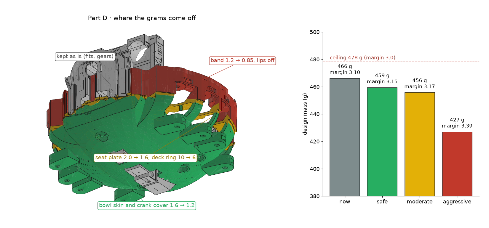

# Chassis Part D · lightening plan (rev 1, 2026-11-17)

Status: **PLAN**, waiting for Morante's answers (end). Nothing modelled; no build file touched.

## Brief

Part D of [`design-plan.md`](design-plan.md#status-and-next-steps), scope set by Morante on 2026-11-16: **lighten
only**. The 120 % scale and the 4×AAA holder stay; no scale study. The Part C leftover is included (the shell rebuilt
without the old 5 mm pinion's swept cut). Body v2, the cradle and the eyes pocket are out of scope (a budget is
proposed below). Must not change: interfaces I1–I12, measured fits, the clutch stack, gear geometry and centre
distances, the keep-in check. Start: design mass 466 g, HP 380:1, margin 3.08 (`mass_estimate.py`), ceiling 478 g.

## Findings (probes, 2026-11-17; scripts listed under «Probes»)

1. **The printed parts are already near their floor.** In the shell model (2 loops, 15 % infill) the infill share
   of every part is under 0.7 g: drive module 0.60, cap 0.61, each leg ≈ 0.3, shell 0.23, front block 0 (probe A).
   Infill or wall-loop settings, and hollowing thick parts (cap plate, module walls, fork bosses), save under 1.5 g
   in all. They are rejected (table below).
2. **The shell model cannot see a wall get thinner.** It takes min(V, A × 0.84 mm) over the whole part, so a
   thinner wall barely moves it: the seat plate from 2.0 to 1.6 removes 0.92 cm³ and the model moves 0.08 g.
   Deltas are therefore taken from a per-layer slicer model (`slicer_mass.py`: 2 loops of 0.42, top 5 and bottom 3
   solid layers, 15 % infill, gap fill under 2 mm, sparse areas under 15 mm² solid). That model is checked against
   the print reports: base v1 74.3 g against 82.3 measured (−10 %), front block v1 23.2 against 23.4 (−1 %); the
   shell model gives −3 % and +2 %. **Each delta is the slicer model's change × (shell model ÷ slicer model) of
   that part**, so the absolute masses keep the calibrated shell model. For the bowl skin the two models disagree:
   −2.5 g (slicer, used) against −4.9 g (shell model); the built STL decides.
   → `mass_estimate.py` needs the per-layer model for thin-walled parts, or Part D's thinning will not show in the
   design mass (Q5).
3. **Cache bug in `shell.py`**: the `bowl` stage names `BV.cavity`, which reads base's `WALL`; the stage key does not
   see `WALL`, so changing `shell.WALL` reuses the old bowl. Probe B: `WALL = 1.2` under the same tag gave
   57.81 cm³ (base 57.85); under a fresh tag, 52.82 cm³. The fix (pass `WALL` into `st_bowl` as an argument) goes in
   before any wall lever.
4. **Part C leftover**: the shell rebuilt (lite, scratch cache) round the 4 mm pinion and the clutch: 57.85 cm³,
   70.15 g (the full STL of 2026-11-16: 57.63 cm³, 70.14 g). No mass change; the rebuild is part of every set.
5. **Hardware count**: the spec (`verify.py`) has 20 M3×10, 3 M3×12, 3 M3×6, 2 M3×8 and 28 nuts. `mass_estimate.py`
   counts the 4 I7 screws as M3×10 (spec: 3 M3×6 + 1 M3×8) and the body screw as M3×12 (M3×8): −0.95 g. It also
   leaves out 4 body-v2 screws that `hardware.md` lists (2 body lug, 1 eyes board, 1 switch retainer): +4.6 g once
   body v2 is drawn. The legs and forks' 46.9 g is the plate with ≈ 2 g of support: the cleaned parts exist and can
   be weighed.
6. **Margin from `sim/motor_sizing.py`'s own crank torque** (probe E; the friction and the legs' weight do not scale
   with mass): 466 g → 3.10 (the 1/mass shortcut gives 3.08); margin 3.0 is reached at ≈ 481 g.

## Part by part (CAD grams, shell model; deltas as finding 2)

| Part | g now | Lever | Saves (g printed) | Risk | Verify effect | Set |
|---|---|---|---|---|---|---|
| Chassis shell | 70.1 | Bowl skin `WALL` 1.6 → 1.2 (the loaded minimum, §3.2; bosses unchanged) | −2.5 (−4.9 shell model) | Stiffness of the ground part: low (fork mounts and deck carry the legs); print: none (FLIP, the bowl is the top) | `KEEP_IN` margin +0.4 inwards; I7 boss heights unchanged; smoke `chassis` | Safe |
| Chassis shell | | Seat plate `SEAT_T` 2.0 → 1.6 | −0.6 | The body sits on it; 1.6 > 1.2 loaded minimum | `MEASURE` slide-lip height unchanged (lip measured from the seat top); K5 recut | Moderate |
| Chassis shell | | Deck ring `RING` 10 → 6 (crank-sweep deck stays solid) | −0.8 | Deck stiffness between the fork mounts | none on fits; smoke `chassis` | Moderate |
| Chassis shell | | Band skin `BAND_SKIN` 1.2 → 0.85 (two lines) | −1.8 | Looks wall flexes and may warp (printed on its top); the upper fork bosses stay | K5 recut; a band coupon (push test) | Aggressive |
| Chassis shell | | Side lips B3 (none) instead of B1 | −4.7 (plan-b mesh number) | Reverses a looks decision (plan B, Q on lips) | `KEEP_IN` unaffected | Aggressive |
| Chassis shell | | Windows in the belly floor between the fork mounts, ribs ≥ 6 mm left round bosses, keel and I7 | ≈ −2 (estimate from the z 55 section, 30.5 cm²; not built) | Gears visible from below; stiffness; must be built and checked | `KEEP_OUT` of the module unaffected; smoke | Aggressive |
| Chassis shell | | Fork brackets ribbed (plan B lever) | < 0.5: the 23 g of fork mounts (solid, before cuts) are thick, mostly infill | Nut pockets' walls | | Rejected |
| Crank cover | 4.7 | `COVER_T` 1.6 → 1.2 | −1.0 | Nothing pushes on it but a finger; 1.2 is still 3 lines | `crank-cover` smoke; cover-to-clamp gap +0.4 | Safe |
| Front block v2 | 19.1 | Already 0.85 where nothing pushes, 1.2 loaded, 2.0 pads; rear face open | ≤ 0.5 (pads 2.0 → 1.2 carry the screws' clamp) | | | Rejected |
| Drive module | 15.1 | Thick walls are pin seats, idler-3 pocket (K2, 2.55 mm) and keel; infill share 0.60 g | ≤ 0.6 | Fits K2, K3 | | Rejected |
| Cap | 5.8 | Pocket the 5 mm plate | ≈ 0.3 (the plate's middle is already 15 % infill) | Tongues (K3), thrust face | | Rejected |
| Clamp, keeper, clutch, idler 3 v2 | 4.1 | none (fits, clutch stack, gear) | 0 | | | Rejected |
| Crankshafts, idlers 1–2, legs, forks | 4.7 + 46.9 | Printed and reused (decision 10) | 0 (infill 15 → 10 %: −0.1 per leg) | | | Rejected |
| Legs + forks (accounting) | 46.9 | Weigh the cleaned parts (plate number includes ≈ 2 g support) | ≈ −2 (measured, 0 %) | none | none | Safe |
| Screws (accounting) | 50.3 | Count from the spec (finding 5) | −0.95 now (+4.6 with body v2) | none | none | Safe |
| Screws, crank cover | 2.3 | 2 nylon M3×10 + nylon nuts (new hardware) | −2.0 | Unloaded joint; creep of nylon | label in `verify.py` | Moderate |
| Screws, forks and pivots | 31.2 | Aluminium 7075 M3: 16 fork M3×10 + their nuts, 8 pivot M3×16 (lock nuts stay steel) (new hardware) | −18.0 | Thread galling in the nuts, wear at the turning swivel and pivot; strength is enough (7075 ≈ 500 MPa) | labels; `MU_STEEL` in `motor_sizing.py` reviewed | Aggressive |

Design mass counts a printed delta × 1.05 (shell contingency), a catalogue delta × 1.10, a measured one × 1.0.

## Lever sets

| Set | Levers | Design mass | Margin (motor_sizing) | Changes |
|---|---|---|---|---|
| Now | | 466 g | 3.10 | |
| **Safe** | Cache fix; Part C rebuild; `WALL` 1.2; `COVER_T` 1.2; weigh legs and forks; screw recount | **459.3 g** (−6.7) | **3.15** | cad-fixer: `shell.py` parameters + the stage fix; `mass_estimate.py` rows |
| **Moderate** | Safe + `SEAT_T` 1.6, `RING` 6, nylon crank-cover screws | **455.7 g** (−10.3) | **3.17** | cad-fixer; 1 hardware row |
| **Aggressive** | Moderate + `BAND_SKIN` 0.85, lips B3, belly windows, aluminium fork and pivot screws | **426.9 g** (−39.1); without the aluminium screws 446.7 g | **3.39** (3.24) | cad-fixer for the parameters; the belly windows are a new feature (designer); 2 hardware rows |

Printed-part probe of each set (probe B, lite, combined, the shell and cover rebuilt): shell slicer 61.17 → 58.97 /
57.77 / 56.15 g; cover 4.62 → 3.65 g. Per lever, alone: seat −0.55, ring −0.68, band −1.56, wall −2.20 (slicer g).

**Body v2 budget (out of scope, proposed).** The scanned body is a hollow skin of mean wall 4.2 mm (181 cm³,
865 cm² both faces): 110 g in the shell model. Drawn at a 1.6 mm wall it would be ≈ 86 g, at 1.2 ≈ 64 g, plus
bosses, hooks and slots. Proposed budget: **90 g** (−20 g printed, ≈ −21 g design; with the moderate set ≈ 435 g, margin ≈ 3.3, read between probe E's 430 and 440 g rows). It is the largest
lever left in the robot and belongs to the body v2 plan.

## cad-fixer change or new design

- cad-fixer: everything in Safe and Moderate (parameters in `shell.py`, the `st_bowl` key fix, `mass_estimate.py`
  rows and its per-layer model), band skin and lips (Aggressive). Each: `shell.py --lite`, smoke `--only chassis
  crank-cover`, then one full build and the full `verify.py` check.
- New design (cad-designer): the belly windows (layout round bosses, keel, I7; support-free on the FLIP print).

## Coupons K1–K6b

| Set | K1, K2, K3, K6a, K6b, CL1–CL3 | K4 module location (from the shell) | K5 body joint (shell + body v2) | New |
|---|---|---|---|---|
| Safe | unchanged (Part A untouched) | recut (bowl skin 1.2 round the bosses; fits unchanged) | unchanged | none |
| Moderate | unchanged | recut | recut (seat 1.6) | none |
| Aggressive | unchanged | recut | recut (seat 1.6, band 0.85) | band segment with an upper fork boss (push test); aluminium M3 in a fork swivel slice (turn 200 times, no galling); a belly-window section (flex by hand) |

## Figure

*Left: the shell from below, coloured by the first set that thins each region (green safe, yellow moderate, red
aggressive; grey stays). Right: design mass and margin per set against the 478 g ceiling.* Spanish copy:
`images/plan-d-es.png`. Script: [`plan_d_figure.py`](plan_d_figure.py).

## Probes (scratch scripts, run on the real meshes, 2026-11-17)

A `probe_parts.py`: shell-model mass, infill share per part. B `probe_shell.py` / `probe_variants.py`: the shell
and crank cover rebuilt (lite, scratch cache) per lever and per set, both mass models. C `probe_cap.py`: cap pocket.
D `probe_hidden.py`: belly floor section, front block faces covered by the body. E `probe_margin.py`:
`motor_sizing.crank_torque` and `motor_point` (HP 380:1, 4.0 V, worst split, μ 0.6) per design mass.

## Open questions for Morante

1. **Which set?** Proposed: **Moderate** (455.7 g, margin 3.17) now; the aggressive levers only if he wants the
   margin for a heavier body v2.
2. **New hardware** (`hardware.md` rule): nylon M3×10 + nuts for the crank cover (2)? Aluminium 7075 M3×10 (16) +
   nuts (16) and M3×16 (8) for the forks and pivots? Default: nylon yes, aluminium no (wear at the turning joints).
3. **Lips B3** (no side lips, −4.7 g): reverses the looks choice of Part B. Default: keep B1.
4. **Belly windows** (≈ −2 g, gears visible from below). Default: no.
5. **The mass model**: switch `mass_estimate.py` to the per-layer model for thin-walled parts (calibrated on base v1
   and front block v1), so the thinning shows in the design mass? Default: yes.
6. **A scale**: does he have one reading 0.01 g (or 0.1 g)? Weighing the cleaned legs and forks and 10 of each M3
   item moves them to «measured» (0 % contingency, up to −5 g of design mass on the screws).
7. **Body v2 budget**: 90 g at a 1.6 mm wall (proposal for the body v2 plan)?

## Review and Morante's answers (2026-11-17)

Design-reviewer at the PLAN gate: **CHANGES** (9 points). Morante answered with the review in hand:

1. **Set: Safe**, and a **90 g budget for body v2** (for the body v2 plan). The reviewer showed Moderate takes only
   3.6 g more than Safe at the cost of a K5 recut, new hardware and stiffness risk; body v2 at 90 g is ≈ 20 g.
2. **No new hardware**: no nylon or aluminium screws. Lips B1 kept, no belly windows.
3. **Crank cover**: 1.6 mm kept under the switch cradle and the three posts, 1.2 mm only on the free span. Front
   block v2 reads `SH.COVER_T` and `out/crank-cover.stl` (`front_block.py` `cover_clear`): rebuilt and checked with
   the cover.
4. **No 0.01 g scale**: legs, forks and screws stay at their plate and catalogue masses; the «weigh» lever drops.
5. **Mass of the thinned parts** (coordinator, after review point 3): taken from the print-plater's Bambu slice, not
   from a per-layer model calibrated on parts without thin walls. The per-layer model is not added to
   `mass_estimate.py`.

Conditions from the review carried into the fix:
- The stage-cache hole is wider than `WALL`: `BV.WALL`, `BV.DECK_BOT`, `BV.FORK_GAP`, `BV.LEG_CLR` and `shell.py`'s
  own parameters never reach the keys of `st_bowl`, `st_forks`, `st_placements`. Fixed for all of them, then the
  cache is rebuilt once.
- The bowl skin at 1.2 mm on the FLIP print: support grams and overhang from the plater before «no support change»
  is claimed.
- K4 is recut from the new skin and states its load: an I7 screw torqued in a boss on the 1.2 mm skin.
