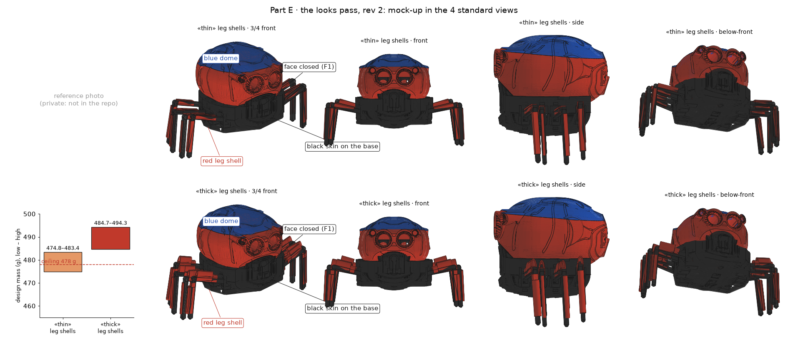

# Chassis Part E · the looks pass · plan (rev 2, 2026-11-17)

Status: **paused: legs to be rethought**. Nothing modelled; no build file touched. Only the figure
script [`plan_e_figure.py`](plan_e_figure.py) changes (it now holds the leg-shell geometry the sweep probe uses).

*Made by [`plan_e_figure.py`](plan_e_figure.py) (Spanish copy `images/plan-e-es.png`). The proposed looks robot in the
4 standard views, once with «thin» and once with «thick» leg shells: base skin, F1 face wall, blue dome on the q1
plane, red shells. Bottom left: design mass range per option against 478 g. The reference photo is private: the repo
copies leave its panel empty (`--photo` renders a private copy).*

## Decisions (Morante, 2026-11-17, after rev 2)

1. **Legs: rethink them as a new step.** Neither shell option looks like the thick, curved legs of the reference photo
   of the toy (kept outside the repo): the black legs are straight 5 × 6 mm bars and the middle shins sit 0.8 mm
   apart. The new step may change the leg shape, spacing, mechanism, mass and motor margin. The leg shells of rev 2
   are on hold.
2. **Base skin: all-round** (+8.6 g).
3. **Lever V4 accepted** (plan D moderate: SEAT_T 1.6, RING 6, −1.6 g). It reverses plan D's «Safe».
4. **Front block v2: review whether it should exist as a separate part.** It is large and heavy and its only job
   seems to be covering. Re-examine merging it into the base or the body (rev 1 rejected «merge with the body» only
   for two colours in one part, which no longer applies, see 5) or reshaping it.
5. **Colours are painted in Bambu Studio** by Morante, so colour is not a reason to split parts. The blue/red boundary
   follows the toy's own panel line on the body, not a plane; in CAD the colour split matters only for renders.
   Consequence, to be confirmed in the next plan: the separate dome part, its joint (hooks, screws, rabbet) and the
   cut faces' solid layers (+3.8 to +6.1 g and +2.0 to +3.0 g) are not needed unless another reason appears.
6. **Eyes: out of scope,** Morante solves them himself. Filament in the workshop: PLA red, blue, black, yellow; no
   translucent.

## Changes from rev 1

1. Dome plane (145,128) → **(145,135)**: body-v2 and dome each one piece on the built `out/body-v2.stl` (q1).
2. Dome held by **2 front-corner hooks + 2 rear M3×8** (was 3 screws at the rear); nuts in side-entry pockets.
3. Base skin re-probed on the built meshes: clear of front block, body, swept forks and legs + `LEG_PATH`, closed at
   the bottom by the chassis's own floor; all-round or seen-faces-only (q2).
4. Leg shells: one row per leg type; two options «thin» and «thick», both clear at `LEG_PATH` over a full turn (q3).
5. Mass as a range with the missing items counted (cut faces, dome joint features), V2 dropped, V3 limited to
   infill (no loop cut), `motor_sizing.py` rerun with `LEG_G` per option.
6. Lenses removed: the eyes are Morante's (pocket unchanged). Colours fixed: body red, dome blue, base black, legs
   black + red shells; no translucent.
7. Figure: 4-view mock-up per leg option instead of one 3/4 view.

## Brief (Morante, 2026-11-17)

The looks robot reads as the toy in the photo at first glance; inside stays. Pass: every outside face seen in the 4
standard views is a designed looks surface, colours as above, the whole robot passes the full `cad_verify`, design
mass ≤ 478 g with the HP 380:1.

## Findings (probes on the built `out/*.stl`, probe scripts kept outside the repo; never the scan mesh)

1. **Dome plane (q1, connectivity of both halves on body-v2.stl).** (145,128): body + 2 islands 3.61 / 3.52 cm³ (the
   cradle tubes; reviewer's numbers reproduced). One piece both sides: (145,135) dome 53.3 cm³ = 29 %, cut 4044 mm²;
   (142,135) 60.3 = 33 %; (145,138) 26 %; (150,135) 25 %. (148,135) leaves two 41 mm² slivers on the dome: rejected.
2. **Rim wall at (145,135) (q1b, 1.5 mm below the plane).** Rear min 5.27 (p10 6.89), mid min 20.5, front min 3.09
   (p10 9.59). The 4.2 rabbet stack fits except at the front minimum: there it becomes 1.2 + 0.5 + 1.2 = 2.9 ≤ 3.09.
   (142,135): front min 1.18: rejected.
3. **Front hooks (q1b rays along −Y).** At x 14 and 71 (outside the eyes box x 18–68) the body's front wall is 4.4
   thick (y −52.1 to −56.5) at z 133–139, with 27 mm free behind it to the next rib (y −25.2). Tongue from the dome's
   front rim down to z ≈ 139, lip 1.5 into a slot in the wall's inner face (2.9 left outside). The dome goes on tilted
   ≈ 23° nose-down about its front rim, hooks first, rear lowered: lip swing 2.0 mm at 23° (arc arithmetic on these
   numbers; the hook path goes into `ASSEMBLY` when modelled, and into coupon E2).
4. **Rear screws (q1b rays up from z 93.6).** At x 17/69 and at y 50–55 the column meets body material at z 95–99;
   at **x 25 and 61, y 45** it is clear to z 136.6: screw vertical from the open bottom, rim 43.1 mm up (hex key 50),
   2 mm behind the holder (y ≤ 43), which goes in after the dome. Body tab: 8 deep × 2.5 thick from the rear wall,
   root fillet; dome boss with a side-entry nut pocket (`K.NUT_AF + 2 × STEEL.side` = 5.8 wide, walls ≥ 1.2).
5. **Base skin (q2, 1 mm slabs, 1.2 skin on the chassis hull, minus front block / body / cover + `WINDOW` and forks
   + legs swept at 10° + `LEG_PATH`).** Added where the chassis has no material: **8.6 g all-round, 6.5 g on the
   sectors the 4 views see** (unseen: outward normals 85–150°, the rear-left quarter). Windows round the swept
   forks and legs: 2245 mm² of hull, of which 813 mm² look past the fork at rest. The skin runs from the chassis's
   bottom (z 46) to the body seat (93.5): its bottom edge merges into the chassis floor (closed), its top meets the
   body (0.5 gap). No overlap with front block or body by construction.
6. **Leg shells (q3/q3b/q3c, the figure's geometry, grown by `LEG_PATH` 0.8 against built static parts, all forks,
   other legs and their shells, 36 angles).** Both options **clear everywhere** after four fixes found by the sweep:
   middle arms' facing skirts end at x 40 (at 44: 0.4–0.8 left at 180°); front shin without its +Y skirt (met the
   middle shin at 350°); front-shin bulge from t 12; middle-shin bulge 1.5 (2.5 met the front shin). q3c: the outer
   edge of the middle-2 shin is free over its whole length; the middle-1 shin's outer edge is swept by the front shin
   over its whole length.
7. **Face opening (q5, rays along +Y).** Through-slot at z 80, |x−CX| ≤ 8 (sees the crank cover at y 33.6); body's
   rear wall seen at z 96–100, |x−CX| ≤ 4; the chassis centre post at z 84–92 (y −60.1) framed by the block (−60.5).

## Parts (new or changed)

| Part | Colour | g printed (probe) | Print orientation |
|---|---|---|---|
| `leg-shell-front/mid1/mid2/rear` × 2 (L mirrored) | red | thin 1.34 / 0.83 / 1.21 / 1.57 (9.9 for 8); thick 2.68 / 1.78 / 2.30 / 2.90 (19.3 for 8) (q3) | Leg plane on the bed, outer face down; fit faces on the bed or ≤ 45° chamfers; plater judges support in the channel |
| `dome` | blue | from body-v2 (no new skin) + bosses/hooks ≈ 1.2 | Cut face on the bed (tilted 4.6°) |
| `body-v2` | red | − dome + 2 tabs + 2 hook slots | As now |
| `front-block-v2` | black | F1 wall ≈ +0.5; V1 trim | As now |
| `chassis` | black | skin +8.6 / +6.5 (q2) | As now (FLIP) |

## Joints (new rows)

| Joint | −X/+X | −Y/+Y | −Z/+Z (at rest) | Fit | In / out |
|---|---|---|---|---|---|
| E1 front shell | arm skirts both sides (`TURN`); shin −Y skirt | arm skirts; shin plate on outer face | hood on arm top; 2 lips under the arm, 1 lip on the shin −Y skirt | `TURN`, lips `PRESS` assumed → coupon | thumb from outside-above / fingernail at lips |
| E1 mid1 shell | arm skirts (facing one to x 40) | idem | arm lips; **shin plate held only through the one-piece knee bend** (no edge free, q3c) | idem | idem; coupon E1 on mid1 |
| E1 mid2 shell | arm skirts (facing one to x 40) | + shin outer-edge (+Y) skirt and lip | arm lips + shin lip | idem | idem |
| E1 rear shell | U arm and U shin | both | 2 + 2 lips | idem | idem |
| E2 dome ↔ body | rabbet (`WINDOW`) | rabbet; front hooks stop −Y | shoulder (down); **+Z: 2 front hooks + 2 rear M3×8** into side-entry nuts | `WINDOW`, `STEEL` | tilt in hooks-first, screw from below / unscrew, lift rear, unhook |
| E4 skin, F1 wall | part of chassis / front block | — | — | — | — |

## Assembly (added; plan B's order otherwise)

E-b dome: body upright, dome tilted 23° nose-down, hooks into the front slots, rear lowered (both hands; rim
flush all round). E-c: body turned over onto the dome (nuts stay in their side pockets: gravity along the axis), 2 ×
M3×8 from below at x 25/61, y 45, before the holder (`hex-key`). E-d: 8 shells on the bench onto each leg before it
goes into its fork (thumb; clicks; knee and foot black).

## Alternatives

| Item | Options (proposed first) |
|---|---|
| Legs | **thin** 9.9 g, flat boxes, close to the photo in colour pattern only · **thick** 19.3 g, 9 mm curved hoods and 4 mm bulged shins: closer in silhouette, still straight bars (the legs' 5 × 6 bar, the 0.8 gap of the middle shins and the 1.6 of the middle arms limit width) · L-C rails (reprint 8 legs) |
| Base | **all-round skin** +8.6 · **seen faces only** +6.5 (rear-left quarter stays ribbed) · colour only (fails the pass) · removable fairing 17.7 + screws |
| Dome hold | **2 hooks + 2 screws** · 3 rear screws (front lifts: rev 1 defect) · glue (breaks the screw rule) |
| Face | **F1** (stop the cuts, 1.2 wall over the slot and the post) · black clip-in plate |

## Mass (design: printed × 1.05, catalogue × 1.10; low / high)

| Item | Low | High | Source |
|---|---|---|---|
| Now | 457.0 | 457.0 | B2 fourth pass |
| Base skin, all-round (seen-only −2.1 / −2.2) | +9.0 | +9.5 | q2 (high: lead-ins) |
| Dome cut faces' solid layers (1.0 top + 0.6 bottom over the infill share 50–80 % of 4044 mm²) | +3.8 | +6.1 | q1, q4; **slice requested** |
| Dome joint: 2 bosses, 2 tabs, 2 hooks | +2.0 | +3.0 | box volumes of finding 4 |
| 2 × M3×8 + nut | +2.3 | +2.3 | catalogue |
| F1 face wall | +0.5 | +0.8 | q5 / p3 areas × 1.2 |
| Leg shells thin / thick | +10.4 / +20.3 | +11.4 / +22.3 | q3 (high: lips, chamfers) |
| V1 front block above z 109 | −3.8 | −1.9 | p7b (solid 3.6; printed share unknown) |
| V3 body + dome gyroid 10 → 7 %, loops kept | −4.8 | −3.2 | plater 7.6 g / 5 %; **slice requested** |
| V4 plan D moderate (`SEAT_T` 1.6, `RING` 6) | −1.6 | −1.6 | plan D probe B |
| **Thin, all-round / seen-only** | **474.8 / 472.7** | **483.4 / 481.2** | |
| **Thick, all-round / seen-only** | **484.7 / 482.6** | **494.3 / 492.1** | |

V2 (open the old band) dropped: it carries the fork brackets. `motor_sizing.py --mass`, HP 1:380 row (margin at 4.8 V /
4.0 V / mean 4.0 V): now 478 g, `LEG_G` 5.9: 2.2 / 1.8 / 4.0; thin high 483.4 g, `LEG_G` 7.47: 2.1 / 1.8 / 4.0; thick
high 494.3 g, `LEG_G` 8.80: 2.1 / 1.7 / 3.9. Thin fits 478 only at its low end; thick does not fit without
more levers. Slices that settle the range: body-v2 + dome split at (145,135) at 10 % and 7 %, front block with V1.

## Coupons (batch after the whole robot passes)

E1: 20 mm of the knee of `leg-middle-right` + the **mid1** shell, final orientation and support (clicks on, does not
lift, comes off with a fingernail). E2: 40 mm of the dome rim with one hook and its slot, plus one boss + tab + M3×8
(hooks in at the tilt, screw pulls it flush, nut stays in its pocket upside down).

## Questions for Morante (defaults)

1. Leg shells: **thin** (default: fits the mass range's low end) or **thick** (closer to the photo, +9.4 g, needs
   ≈ 7–16 g more levers or a lower margin). Neither reaches the photo's curved fat legs: the black bars stay straight.
2. Base: **all-round skin** (default) or seen faces only (−2.1 g, rear-left quarter ribbed).
3. Dome line (145, 135) (default; 29 % blue) or (145, 138) (26 %).
4. Dome: 2 front hooks + 2 rear screws (default).
5. F1 face wall (default yes).
6. Levers V1, V3 (infill only), V4 (reverses his Safe choice of plan D) (default yes), and the plater's slices
   before modelling.
7. Web lines: relief only (default) or black marker by hand.

## Probes

Probe scripts (kept outside the repo): `q1_dome.py`, `q1b_dome.py`, `q2_skin.py`, `q3_shells.py`, `q3b.py`, `q3c.py`, `q4_domemass.py`,
`q5_face.py`; rev 1 `e/p1`–`p7`. Not run: any build, `cad_verify`.
