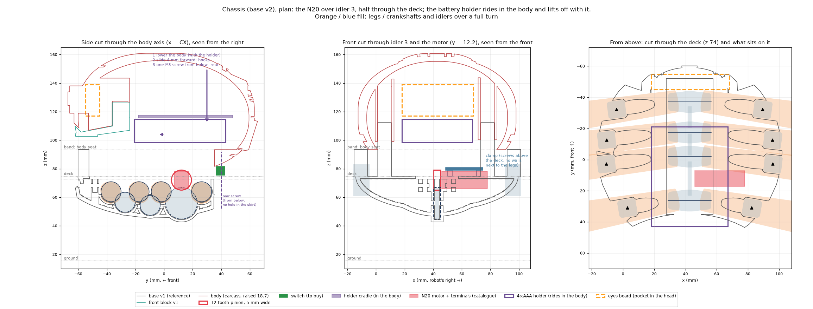
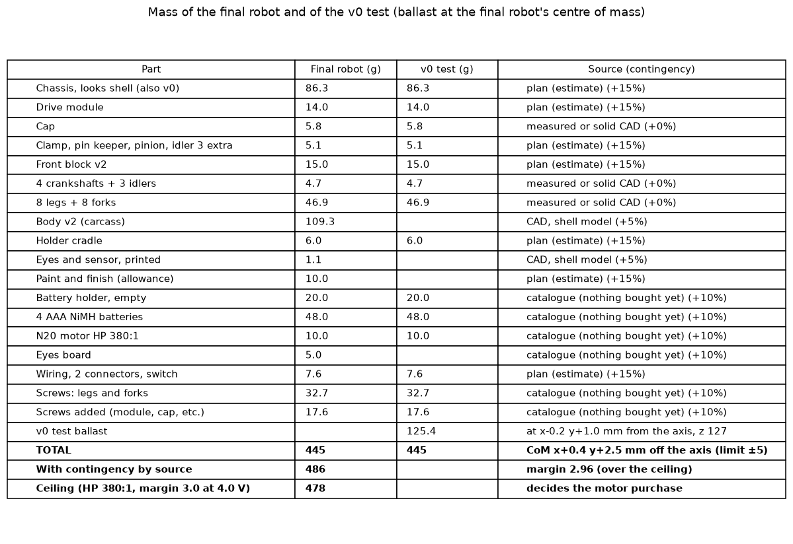

# Chassis (base v2) and robot master model · plan

Status: **PLAN rev 4, approved** (2026-11-14). It takes in Morante's decisions and answers of 2026-11-14 and both
of the design-reviewer's passes. Why the whole robot is planned before anything else is printed, and the motor
sizing behind it: [build log](../../build-log/3-legs-and-drive.md#whole-robot-first-motor-sizing-and-chassis-plan).

## Status and next steps

Nothing is modelled yet: `build.py`, `verify.py`, `README.md` and `design-review.md` here are still the
template's. Modelling goes in three parts, each checked before the next starts:

1. **Part A · master model and drive module.**
   - `cad/robot.py`: datums, the carcass envelope, the interface table (end of this plan), envelopes of the bought
     parts (catalogue values, flagged `catalogue`).
   - The drive module: spine, idler pins and keeper, idler 3 v2 (5 mm face), motor saddle and pad, flange slot
     (x ≤ CX+18), clamp bridge, cap with a window over the pinion, pinion (12 T, 5 mm, D-bore).
   - Fits in `cad/fits.py`: `DSHAFT`, `MOTOR_SEAT`, `TONGUE` (assumed), `GEAR_THRUST_CRANK` 0.25 and
     `GEAR_THRUST_IDLER` 0.45 (measured on the gear train test v2), with their rows in `measurements.csv` (below,
     «Fits»).
   - The start of the whole-robot spec, `cad/chassis/verify.py`.
2. **Part B · the looks parts.** The looks chassis shell, body v2 with the holder cradle and the rear lug, front
   block v2 with the hooks, the ballast frame, the eyes pocket.
3. **Part C · whole robot.** The whole-robot verify with a full PASS; rerun `mass_estimate.py` and
   `sim/motor_sizing.py` with the CAD masses: that decides the motor purchase. Then cut the coupon batch (K1–K6b)
   and make the workshop kit.

The coupons wait for the whole robot to pass; K1, K2 and the efficiency test T1 also wait for the motor.

## Figures

Made by scripts from real geometry (`--lang es` writes the Spanish copies, `-es.png`, for the workshop kit):

- [`plan_figure.py`](plan_figure.py) uses the carcass at 120 % lifted by base v1's band, and the legs, crankshafts
  and idlers swept over a full turn: `images/plan-layout.png` (below) and one view per file, `plan-side.png`,
  `plan-front.png`, `plan-top.png`.
- [`mass_estimate.py`](mass_estimate.py) uses `sim/motor_sizing.py`'s shell model on the meshes, plus plan and
  catalogue estimates, and prints the design mass that decides the motor: `images/plan-mass.png`.

*Left: the body goes on and off with the holder inside it (down, 4 mm forward onto the hooks, one screw from below
at the rear). Middle: the N20 over idler 3, with its clamp above the deck. Right: the deck from above, with the
motor between legs 3 and 4.*

## Decisions taken (Morante, 2026-11-14)

1. **Motor at M1**: over idler 3, half through the deck. Idler 3 is reprinted with a 5 mm face.
2. **S2**: a separate drive module.
3. **The holder rides in the body.** Body and holder lift off together, and a 2-pin connector joins them to the
   chassis.
4. **Switch at the rear, recessed** (clearance to the skirt: 0.75 mm before the slide, 1.37 mm in place).
5. **Batteries**: one screw from below at the rear (Q2: yes), then lift the body. The lug top is at z ≤ 81.2 and the
   skirt at 81.9. No hatch.
6. **Eyes board** in a pocket in the head: 50 × 22 × 10 mm, 2 LEDs + 2 resistors, 2-pin connector.
7. **v0 walk test with ballast** at the final mass and centre of mass. The holder rides at its final place.
8. **L2: v0 is printed as the looks shell.** The looks shell is in the whole-robot verify from the start, and
   coupons K4 and K5 are cut from its geometry. There is no separate v0 shell.
9. **Nothing is bought yet**, not even the holder and batteries. Catalogue sizes and masses are used until the
   first looks version passes in CAD. Then motor, holder, batteries and switch are bought, and their measured
   values replace the catalogue ones.
10. **Reuse** the printed crankshafts, idlers 1–2, legs and forks if the whole-robot check passes them.
11. **Stall protection: D-bore pinion, 5 mm (F3).** The printed teeth break before the gearbox (245 N·mm). The
    rule and the break coupons are below; F2b is the fallback.

## Brief

| # | Item |
|---|---|
| 1 | **Purpose and pass.** The robot master model `cad/robot.py` and the chassis carrying the whole drive. **CAD pass:** one whole-robot spec, `cad/chassis/verify.py`, PASS with every part present. The parts are the looks chassis, module, crankshafts, idlers, legs, forks, N20 and pinion, holder, eyes board, front block, body v2, cradle, ballast frame and all hardware. The spec checks no collisions over a full turn every 10°, complete JOINTS and RETAIN, and an assembly order that can be done by hand with `TOOLS`. It replaces `cad/base/check.py`, `cad/legs/check.py` and `cad/crankshafts/check_gear_train.py`; `cad/test-frame` gets its own spec. **Physical pass:** v0 (the looks shell + ballast) walks on the table under motor power. |
| 2 | **Motion.** Ground: the chassis. Turning: crankshafts 1–4, idlers 1–3 and the pinion. Moving: 8 legs and 8 forks (`cad/legs` `poses()`). Fixed on the chassis: N20, module, front block. Fixed on the body: holder, eyes board. |
| 3 | **Dimensions.** Shafts are at y −37.02, −17.42, −1.92, 26.28, z 63.9. Idlers (y, z, teeth): (−27.22, 56.51, 12), (−9.67, 54.38, 12), (12.18, 55.77, 20). Pivots are at z 72.0, the deck from 72.8 to 74.8, the band top at 93.5, the ground at 15.6. **Catalogue** values, named parameters flagged `catalogue` until the parts are bought and measured: N20 (Pololu HP 6 V), holder ≤ 64 × 49 × 16, AAA NiMH, switch SS12D00, JST-XH. |
| 4 | **Interfaces.** The table at the end (= `cad/robot.py`). |
| 5 | **Fits.** Only `cad/fits.py`; new entries under «Fits». |
| 6 | **Service.** Batteries: 1 screw, then lift the body. Motor: body off, 2 screws, lift the motor. Module: legs off, 4 screws. |
| 7 | **Budget.** v0 plates (looks shell, module, small parts, front block, cradle, ballast frame) about 150 g of parts + 14 g of support, about 10 h; coupons about 40 g and 3 h 15 min. |

## Survey findings (scratch scripts on the real meshes)

- **Motor envelope.** The 12 T pinion sits on idler 3 at axis (CX, 12.18, 72.05), along +X. The N20 envelope is
  x CX+3.3 to CX+35, y 7.2–17.2, z 66–78. Over a full turn every 10°, the smallest gaps are:
  - legs 1.5–2.0 mm (the least at the gearbox);
  - crankshafts 2.0–2.5 mm;
  - pinion tips to the crank 3 and 4 gears 2.28 mm.

  Ground clearance stays 30 mm.
- **Where the legs pass near the deck (reviewer, second pass).** Below the deck nothing may stand outside the
  motor's own Y band. **At deck level (z 72.8–74.8) leg 3R also passes the motor's −Y side for x > CX+20**: there
  the gap from a slot side to the leg is 0.0 mm. So the flange slot may locate the motor only for **x ≤ CX+18**,
  where it is 0.99 mm from leg 3R. Beyond that, the deck and flange are cut back on −Y along the leg's path with
  `LEG_PATH` (0.8 mm), as base v1 did. Above the deck top (z ≥ 74.8) no leg passes near the motor.
- **Holder in the body**: centre (CX, 11, 106.5), z 98.5–114.5, long side along Y, 2 mm a side.
- **Head**: solid behind the eyes. Eyes pocket x 18–68, y −55 to −45, z 117–139 (a carcass cut).

## Mass and the motor

All values are from [`mass_estimate.py`](mass_estimate.py) and [`images/plan-mass.png`](images/plan-mass.png).

**Contingency by source** (reviewer):

| Source | Contingency | Parts |
|---|---|---|
| Measured or solid CAD | 0 % | Cap 5.8, legs and forks 46.9, crankshafts and idlers 4.7 |
| Shell model of a mesh | +5 % | Body v2 109.3, eyes 1.1 |
| Catalogue (nothing bought) | +10 % | Holder 20, AAA 48, N20 10, eyes board 5, screws 32.7 + 17.6 (catalogue masses × the plan's counts) |
| Plan estimate | +15 % | Looks shell 86.3, module 14, front block 15, small parts 5.1, cradle 6, wiring and connectors 7.6, paint 10 |

| | Mass | Centre of mass |
|---|---|---|
| Final robot, as summed | 445.1 g | **From the body axis** (x 42.72, y −3.6): x +0.4, y +2.5 mm, inside the ±5 mm `COM_BOX`. **Absolute**: (43.1, −1.1, 93.9) |
| Contingency | +40.4 g (shell 5.5, catalogue 13.3, plan 21.6) | |
| **Design mass** (decides the motor) | **486 g** | |
| v0 without ballast (looks shell, L2) | 319.7 g | |
| v0 ballast (frame ≈ 15 g + steel ≈ 110 g) | 125.4 g | From the axis: x −0.2, y +1.0, z 127.4. Absolute: (42.5, −2.6, 127.4) |

- **Ceiling.** HP 380:1 keeps a margin of 3.0 at 4.0 V up to 463 × 3.1 / 3 = **478 g**. The design mass is
  **486 g (445.1 + 40.4), margin 2.96: over the ceiling by 8 g.** As summed, without contingency, it is 445 g, margin 3.22. The
  margin is scaled as 1/mass: a first approximation, which `motor_sizing.py` replaces once it is rerun on the
  modelled mass.
- **Before anything is bought:**
  1. Model the looks shell, module, front block and cradle; their CAD values replace the plan's (contingency 15 % →
     5 % or 0 %).
  2. Rerun `motor_sizing.py` with that mass and centre of mass.
  3. Morante decides.
  4. Buy motor, holder, batteries and switch, and measure them.
- **If it is still over the ceiling**, the options are below. None is chosen here.

| Option | What it does |
|---|---|
| Lighter printed parts | Body at 2 walls and 10 % infill (about −15 g, to confirm on a print), lighter front block and module, less paint |
| Measured efficiency | Test T1 below: with η 0.7 instead of the assumed 0.5, the margin grows about 1.4 times |
| Another ratio | HP 1000:1: margin 6.8, but 0.6 cm/s. An extra stage has no room without a pod |
| Smaller contingency | Once parts are modelled and weighed, their contingency drops |

## Stall protection (decided: F3, D-bore pinion)

Morante: «lo más sencillo posible, pero no quiero romper el motor». The pinion is a plain 12 T, 5 mm gear with a
D-bore pressed on the shaft (F3). **The gearbox is protected by the printed teeth breaking first**, below Pololu's
instantaneous limit for the 380:1 gearbox, **245 N·mm**. HP 380:1 stalls at 360–503 N·mm (4.0–5.6 V), so when a leg
jams, the weakest printed tooth in that jam's path breaks.

**How the break torques are estimated.** Every mesh carries the same pitch-line force, F = T_motor / 6 mm. A tooth
breaks at about F = 50 MPa × b × m × Y, where:

- b is the contact width: the narrower of the two faces in that mesh;
- Y is 0.245 for 12 T and 0.32 for 20 T;
- 50 MPa is PLA loaded along the layers (sizing). This is the figure the coupons replace.

The result is given as torque at the motor.

| Mesh (contact width) | Tooth that breaks first in it | Break torque (N·mm at the motor) |
|---|---|---|
| pinion 5 mm ↔ idler 3 v2 5 mm (5) | Pinion (12 T) | 368 (idler 3: 480) |
| idler 3 v2 ↔ crank 3 or crank 4 gear (3) | **Crank gear (12 T, 3 mm)** | **≈ 220** (idler 3: 288) |
| crank 3 gear ↔ idler 2 (2.6) | **Idler 2 or the crank gear (both 12 T, 2.6 mm contact)** | **≈ 191** |
| idler 2 ↔ crank 2 gear; crank 2 ↔ idler 1; idler 1 ↔ crank 1 (2.6) | Idler or crank gear (2.6 mm contact) | ≈ 191 |

| Jam at | Path from the motor | Weakest printed tooth | Break (N·mm) | vs 245 (gearbox) | vs 196 (= 0.8 × 245, the rule) |
|---|---|---|---|---|---|
| Crank 4 (rear legs) | pinion → idler 3 → crank 4 | Crank 4 gear, 3 mm contact | ≈ 220 | Below (90 %) | **Above** |
| Crank 3 | pinion → idler 3 → crank 3 | Crank 3 gear, 3 mm contact | ≈ 220 | Below (90 %) | **Above** |
| Crank 2 | … crank 3 → idler 2 → crank 2 | 2.6 mm contact | ≈ 191 | Below (78 %) | Below |
| Crank 1 (front legs) | … idler 2 → crank 2 → idler 1 → crank 1 | 2.6 mm contact | ≈ 191 | Below (78 %) | Below |

**Rule** (Morante):

- **Keep the D-bore pinion** if every measured break torque, taking the weakest tooth in each jam path, is
  **≤ 0.8 × 245 = 196 N·mm**.
- **Otherwise F2b**, below, becomes the design.
- **The lower bound** also has to hold: each break must be ≥ 1.5 × the worst design torque, 113 N·mm, so
  **≥ 170 N·mm**. Below that, the teeth would break while walking, which is a different fault (the gear needs
  more width).

On the estimates, the paths through crank 3 and crank 4 (≈ 220) fail the rule. The coupons decide, because the
50 MPa figure is the uncertain part. The crank gears print axis-horizontal, with stepped teeth and layers across the
tooth, and may break lower than estimated.

**Break coupons** (printable now, no motor needed; each cut from the real part's geometry, printed in that part's
orientation):

| Coupon | What breaks | g | Test |
|---|---|---|---|
| K6a idler | A 12 T, 2.6 mm idler (idler 1/2 profile, printed flat) with a 30 mm lever printed with it. A holder locks one tooth against a mating crank-gear tooth block | 0.5 (+ 3 holder) | Hang weights in 50 g steps until a tooth breaks. Estimate: ≈ 650 g (191 N·mm). Three samples |
| K6b crank-gear tooth | A short stub of a crankshaft with its 12 T, 3 mm gear, printed **axis-horizontal like the crankshafts**, with a lever. The holder locks one tooth against an idler-3-v2 tooth block (3 mm contact) | 0.8 (+ 3 holder) | The same; estimate ≈ 750 g (220 N·mm). This is the decisive case for the jam paths through cranks 3 and 4 |

Rule in grams on a 30 mm lever: keep the D pinion if every break is ≤ 667 g (196 N·mm) and ≥ 578 g
(170 N·mm).

**Fallback F2b** (the design only if the rule fails): a hub with a D-bore on the motor shaft carries the pinion on a
round spigot. The pinion is pressed between the hub's flange and a collar by a **steel wave washer** (to buy then).
The collar is locked on the D-flat with an M2 set screw. It slips at a designed face set at 170 N·mm, under the
weakest tooth and under 245.

- **Faces**: two PLA faces, annulus Ø5–Ø10, μ 0.35, effective radius 3.89 mm. Clamp force 62 N (125 N with one
  face).
- **Space along the shaft**: it fits only with a **4 mm pinion face** (19.4 MPa at the worst design load). The
  stack is flange 1.5 + pinion 4 + washer 0.7 + collar 2 = 8.2 mm, exactly the shaft left after the 0.8 mm gauge.
- **Space radially**: the Ø10 flange lies in the −X notch, 0.27 mm from idler 3's tip circle in projection and
  0.75 mm apart along X. To check with a `KEEP_OUT` zone.
- **Risk**: PLA creep under 62 N; the wave washer keeps the preload. Its slip torque would be set on coupon K1.

## Part list

| Part | Why a separate part | Est. g | Print orientation |
|---|---|---|---|
| `chassis` = the **looks shell** (ground; also v0, L2) | Bowl, deck, a band on the body's outline, side lips, closed rear, fork pockets and bosses with hidden screws, nut traps, a recessed switch pocket at the rear, the hex-key tunnel for the body's rear screw (lug top ≤ z 81.2). No spine or keel inside; nothing above the band top | 86 + ≈ 14 support | Band top on the bed; fork screw holes vertical; the bowl prints as an inverted dome. Support is reached through the deck opening and the open fork pockets; the side lips are to be checked in the print check |
| `drive-module` | Spine walls, journal slots, idler pin holes, idler 3 pocket, keel, motor pad and saddle, flange with the motor slot (x ≤ CX+18) | 14 | Flange on the bed |
| `cap` | Keeper over the journal slots (test cap v2.1), cut round the pinion | 6 | Upside down |
| `motor-clamp` | Bridge over the N20; 2 screws into bosses on the flange, above the deck | 3 | Flat |
| `pinion` | 12 T, m 1, 5 mm face, D-bore pressed on (F3). A 0.5 g part, reprinted after a stall if needed. F2b adds `pinion-hub` and `pinion-collar` only if the break rule fails | 0.5 | Flat, axis vertical |
| `idler-3-v2` | 5 mm face; the same teeth, phase and mark | 1.5 | Flat |
| `pin-keeper` | Axial stop for the idler pins | 1 | Flat |
| `front-block-v2` | Hollow face filler, screwed; carries the body's front hooks | 15 | Base on the bed |
| `holder-cradle` | Holds the holder inside the body (cover down); the same part rides on the ballast frame in v0 | 6 | Flat |
| `ballast-frame` (v0 only) | Uses the body's hooks and rear screw; carries the cradle and about 110 g of steel at the final centre of mass | ≈ 15 | Upright |
| `body-v2` (printed after v0) | Carcass with designed joints: hook slot, rear lug with captive nut, cradle bosses, eyes pocket, LED holes. No cut in the skirt | 109 | As the carcass |
| Reused | Crankshafts 1–4, idlers 1–2, legs, forks (if the whole-robot check passes them) | | |

**Chassis plates for v0**: about 150 g of parts + 14 g of support, about 10 h. That is the looks shell (about
6.5 h) plus the small parts.

## Fits

| Fit | Status | Used for |
|---|---|---|
| `TURN`, `STEEL`, `WINDOW`, `LOCATOR`, `GEAR_AXIAL` (0.8: still covers next to spinning faces), `GEAR_BACKLASH`, `LEG_PATH` | In `fits.py` | Throughout |
| **`GEAR_THRUST_CRANK`** (new, measured): crank gear between the spine walls, 0.25 mm a side | Gear train test v2, 2026-11-12: the train turned without the cap | Crank gears in the module |
| **`GEAR_THRUST_IDLER`** (new, measured): idler between the spine walls, 0.45 mm a side | The same test | Idlers 1–2, idler 3 v2 (pocket 5.9 for 5 mm) |
| `DSHAFT`, `MOTOR_SEAT`, `TONGUE` (0.3, test cap v2.1) (new, assumed) | Coupons K1, K2, K3 | |
| `FRICTION_SLIP` (only if F2b) | Coupon K1-F2b | |

Two rows go into `measurements.csv` with the new fits, in its format (`date, part, feature, nominal_mm, measured_mm,
tool, result, entry`):

- `2026-11-12, gear train test v2, crank gear face to spine wall a side, 0.25, , by hand, turned without the cap, gear-train-test-v2-the-cap`
- `2026-11-12, gear train test v2, idler face to spine wall a side, 0.45, , by hand, turned without the cap, gear-train-test-v2-the-cap`

## Motor seat

- **Below the deck, only inside the motor's Y band** (y 7.2–17.2):
  - an arc saddle under the can, whose edges stay inside the band;
  - the **gearbox pad**, which is the top of the +X spine wall. Outside the pinion (|x − CX| 3.3–5.5, thickened
    outward between y 5 and 19) the wall **rises to z 66.05** to carry the gearbox's bottom face. Inside
    |x − CX| < 3.3 it stops at z 64.25, giving the pinion's tip circle 0.8 mm.
- **Y location**: the flange slot sides, at z 72.8–74.8, **for x ≤ CX+18 only** (0.99 mm to leg 3R). Beyond that
  the flange and deck are cut back along leg 3R's path with `LEG_PATH`, so only the clamp locates the motor there.
- **Clamp**: a bridge with its underside at z ≥ 79.85. Its 2 × M3×10 go into bosses standing on the flange, above
  the deck top (z 74.8–79), at x ≤ CX+18 on −Y and anywhere on +Y.
- **Walls**: both are notched round the pinion. The −X notch takes the shaft tip (and the F2b flange and collar, if needed).
- **Cap and clamp** keep 0.8 mm (`GEAR_AXIAL`) from the pinion; these are `KEEP_OUT` zones in the
  spec.
- **Removal**: body off (the holder goes with it), 2 clamp screws out, lift the motor with its pinion.

## Joint table

| Joint | Type | Holds it in ±X / ±Y / ±Z | Fit | Goes in from | Comes apart by |
|---|---|---|---|---|---|
| drive-module ↔ chassis | Flange on the deck + lip + 4 × M3×10 into captive nuts | ±X ±Y lip; −Z flange; +Z screws | `LOCATOR`, `STEEL` | Above | Legs off, 4 screws |
| crankshaft ↔ module | Journals in slots open at the top | ±X webs on the walls; ±Y slot; −Z slot bottom; +Z cap tongues; spin free | `TURN`, `GEAR_THRUST_CRANK` | Above | Cap off |
| cap ↔ module | Skirts + tongues + 3 × M3×12 | ±X skirts; ±Y tongues; −Z walls; +Z screws | `LOCATOR`, `TONGUE` | Above | 3 screws |
| idlers ↔ pins ↔ module | Ø3 steel pins, blind at −X with a push-out hole | Idler: ±Y ±Z pin, ±X walls. Pin: −X blind end, +X keeper | `STEEL`, `GEAR_THRUST_IDLER` | +X, finger (on the bench) | Keeper off, push out with a 1.5 hex key |
| pin-keeper ↔ module | Strip + M3×8 (z ≤ 57) | All 6 | `LOCATOR` | +X | 1 screw |
| N20 ↔ module | Pad, saddle, flange slot (x ≤ CX+18), clamp | ±X clamp stop; ±Y slot and clamp; −Z pad and saddle; +Z clamp | `MOTOR_SEAT`; centre distance + `MOTOR_SEAT.side` | Above | 2 screws, lift |
| pinion ↔ shaft | D-bore pressed on the D-shaft | ±X press fit, set with the 0.8 gauge; spin locked by the D | `DSHAFT` | −X, by hand or with a vise, with the gauge | Pull off with pliers (a 0.5 g part) |
| pinion ↔ idler 3 | Mesh | – | `GEAR_BACKLASH` | – | – |
| legs, forks ↔ chassis | As base v1 and the legs design (screws hidden in the looks band, reached from above with the body off) | As v1 | `TURN`, `STEEL`, `WINDOW` | Outside | Screws |
| front-block-v2 ↔ chassis | Lip + 2 × M3×10 | ±X ±Y lip; −Z deck; +Z screws | `LOCATOR`, `STEEL` | Above | 2 screws |
| holder ↔ cradle | Rim, cover facing down, 2 end straps clear of the cover's slide | ±X ±Y rim; ±Z straps | `WINDOW` (catalogue size until measured) | Body upside down | 2 straps |
| cradle ↔ body-v2 (or ballast frame) | 2 × M3×10 into bosses | All 6 | `LOCATOR`, `STEEL` | Body upside down | 2 screws |
| body-v2 (and the ballast frame) ↔ chassis | Down, 4 mm forward onto 2 hooks; 1 × M3×12 from below through the band's rear tunnel into the body's rear lug (top ≤ z 81.2, skirt at 81.9) | ±X band-top lip; −Y hooks; +Y screw; −Z band top; +Z hooks and screw | `WINDOW`, `STEEL` | Above, then −Y | 1 screw, slide back, unplug, lift |
| eyes board ↔ body-v2 | Slot + 1 screw | All 6 | `WINDOW` | Body upside down | 1 screw |
| switch ↔ chassis | Recessed rear pocket from inside; skirt clearance 0.75 before the slide, 1.37 in place | Pocket on 5 sides + a screwed retainer | `WINDOW` (catalogue size) | Inside | Retainer off |
| connectors | 2 × JST-XH 2-pin in printed holders on the band's inside; 60 mm slack | – | – | – | Unplug |

## Assembly sequence

| Step | Part or fastener | From | Hand or tool | Already in place | How you know it is right |
|---|---|---|---|---|---|
| **A · drive module (bench)** | | | | | |
| 1 | Nuts: cap ×3, clamp ×2, keeper ×1 | Side slots | Pliers | Module | The hole lines up |
| 2 | Idlers 1, 2, 3-v2; 3 pins from +X | +X | Finger | Module | Flush; the dots match |
| 3 | Pin keeper, M3×8 | +X | Hex key | Pins | It covers all 3 pins |
| 4 | Crankshafts 1–4 | Above | Hand | Idlers | The dots on the webs match the slots |
| 5 | Cap, 3 × M3×12 | Above | Hex key | Crankshafts | Crank 1 by hand: all four turn |
| 6 | Pinion pressed on the D-shaft with the 0.8 gauge | −X | Hand or vise | – | The gauge comes out snug |
| 7 | N20 onto its pad and into the flange slot | Above | Hand | Train | It sits flat; the pinion meshes |
| 8 | Clamp, 2 × M3×10 | Above | Hex key | N20 | Powered, it turns both ways; **test T1** |
| **B · chassis (looks shell)** | | | | | |
| 9 | Nuts: module ×4, front block ×2, body ×1, forks ×16; switch into its pocket + retainer | Slots, inside | Pliers | Shell | The holes line up; the lever shows recessed at the rear |
| 10 | Module in, 4 × M3×10 | Above | Both hands, hex key | Shell | The flange is flat; FRONT arrow forward |
| 11 | 8 legs with forks | Outside | Hand, hex key | Module | L/R labels; each leg follows its crank |
| 12 | Front block v2, 2 × M3×10 | Above | Hex key | Deck | The lip sits |
| 13 | Wiring: switch → motor; connector holders | Inside | Hand | All | The motor runs from a bench supply |
| **C · v0** | | | | | |
| 14 | Cradle with the holder on the ballast frame; steel weighed into the box | Bench | Hand, hex key, kitchen scale | – | Frame + holder + steel = 125 + 74 g |
| 15 | Plug in; frame on: down, 4 mm forward, M3×12 from below | Above, −Y, below | Both hands, hex key | Chassis | The screw goes in without forcing |
| **D · body (after v0 walks)** | | | | | |
| 16 | Eyes board and cradle with the holder into body-v2 | Below | Hex key, screwdriver | Body | LEDs in their holes; the cover slides |
| 17 | Plug in both; body on as in step 15 | As in step 15 | As in step 15 | Chassis | As in step 15 |

**Batteries:** tip the robot back, rear screw out, slide the body back 4 mm, lift it, unplug. Turn the body over,
slide the cover off, change the batteries, and reverse.

## Tests and coupons

| Test | Proves | g | Time | Pass test | When |
|---|---|---|---|---|---|
| K1 pinion | `DSHAFT`: 3 D-bores around the assumed value | 1.5 | 15 min | It goes on by hand or in a vise to the gauge and does not turn on the shaft at 113 N·mm (230 g on a 50 mm lever, motor held, power off) | **Waits for the motor** |
| K2 motor stage, **loaded** | `MOTOR_SEAT`, saddle, clamp, idler 3 v2 in its pocket with 2.55 mm walls, pin and keeper | 10 | 55 min | The motor lifts 390 g on a 50 mm spool of **fixed radius** keyed to idler 3 (190 N·mm: the worst design load, 19 N at the mesh) 10 times each way, with no visible flex or click. The motor lifts out after 2 screws. **No efficiency is claimed from K2** (one mesh only) | **Waits for the motor** |
| T1 train efficiency (on the module at step 8, not a coupon) | The train's efficiency η | – | 30 min | Motor alone: a 10 mm spool on the D-shaft and 3 weights give its torque against current at 4.8 V (minus the no-load current). Module: the same spool on crankshaft 1 (the far end), keyed to its +X web, the same weights. η = torque out / motor torque read from that line. Feeds `motor_sizing.py` | **Waits for the motor** |
| K3 cap tongues | `TONGUE` and skirts on a 2-slot spine slice | 5 | 25 min | On and off by hand 5 times, no crack; the crankshaft turns | **Now** |
| K4 module location | Flange lip, nut trap, cut from the **looks shell** | 6 | 30 min | It drops in, no wobble; the screw finds the nut | **Now** |
| K5 body joint | Cut from the **looks shell** and body v2: band rear with tunnel and nut, rear lug, front hook and head slot | 10 | 45 min | Down, 4 mm forward, the screw from below reaches the lug; it comes off with the hex key | **Now** |
| K6a / K6b break coupons | The break torque of the weakest printed tooth: a 2.6 mm idler, and a 3 mm crank-gear tooth printed axis-horizontal (see «Stall protection») | 0.5 + 0.8 (+ 2 × 3 holders) | 25 min | Every break ≤ 196 N·mm (667 g at 30 mm) and ≥ 170 N·mm (578 g): keep the D pinion; otherwise F2b | **Now** |
| Clearance block | X-Y compensation (Open items) | – | – | print/README | **Now** |
| | **Total coupons** | **≈ 40 g** | **≈ 3 h 15 min** | | Now: K3, K4, K5, K6a, K6b and the clearance block ≈ 28 g, 2 h 05 min |

## Hardware

Nothing is bought until the looks version passes in CAD and the motor decision is taken.

| Item | Count | Note |
|---|---|---|
| M3×10 + nut | 26 | Forks 16, module 4, clamp 2, front block 2, cradle 2 |
| M3×12 + nut | 4 | Cap 3, body rear 1 |
| M3×8 + nut | 1 | Pin keeper |
| M3×16 + lock nut | 8 | Leg pivots |
| Ø3 pin, 8.5 mm | 3 | Idler pins |
| N20 HP 380:1 | 1 | Catalogue until bought |
| 4×AAA holder, AAA ×4, LEDs, perfboard | | |

**«to buy» in `hardware.md`:** SS12D00 switch, 2 JST-XH pairs, 2 resistors, about 110 g of ballast steel. An M2 set screw
and a steel wave washer (inner ≥ Ø3.2, outer ≤ Ø10, ≈ 60 N at 0.7 mm) are added only if the break rule sends
the design to F2b.

## Robot master model: interface table (`cad/robot.py`)

| Datum | Value | Owner |
|---|---|---|
| Frame | Carcass 120 %; Z up; −Y forward; body axis (42.72, −3.6) (`sim.CENTER`) | `cad/README.md`, `common.py` |
| Ground, pivots, deck, body seat | z 15.6; 72.0; 72.8–74.8; 93.5 (LIFT 18.7) | sim, chassis |
| Gear plane | \|x − CX\| ≤ 1.75; idler 3 pocket ≤ 2.95; walls to 4.25 (5.5 at idler 3) | crankshafts, module |
| Motor axis | (CX, 12.18, 72.05) along +X; envelope x CX+3.3 to +35, y 7.2–17.2, z 66–78; flange slot x ≤ CX+18 | module |
| Holder box | 49 × 64 × 16, centre (CX, 11, 106.5), on the body | body-v2 |
| Eyes box | x 18–68, y −55 to −45, z 117–139 | body-v2 |
| Centre of mass, final | From the axis: x +0.4, y +2.5. Absolute: (43.1, −1.1, 93.9). `COM_BOX` ±5 | mass_estimate |
| v0 ballast | 125.4 g; from the axis: x −0.2, y +1.0; absolute: (42.5, −2.6, 127.4) | mass_estimate |
| Body rear lug, switch | Lug top ≤ z 81.2 (skirt at 81.9); switch recessed, skirt clearance 0.75 / 1.37 | chassis, body-v2 |

| Interface | Between | Fit / hardware |
|---|---|---|
| I1 | crankshafts ↔ module | `TURN`, `GEAR_THRUST_CRANK` |
| I2 | idlers ↔ module | `STEEL`, `GEAR_THRUST_IDLER` |
| I3 | crankshafts ↔ legs | `TURN` |
| I4 | legs ↔ forks ↔ chassis | `STEEL`, `WINDOW` |
| I5 | cap ↔ module | `LOCATOR`, `TONGUE` / 3 × M3×12 |
| I6 | N20, pinion ↔ module, idler 3 | `MOTOR_SEAT`, `DSHAFT`, `GEAR_BACKLASH` / 2 × M3×10 |
| I7 | module ↔ chassis | `LOCATOR` / 4 × M3×10 |
| I8 | front block ↔ chassis and body | `LOCATOR`, `WINDOW` / 2 × M3×10 |
| I9 | body or ballast frame ↔ chassis | `WINDOW`, `STEEL` / M3×12 from below |
| I10 | holder ↔ cradle ↔ body | `WINDOW`, `LOCATOR` / 2 × M3×10 |
| I11 | eyes board ↔ body | `WINDOW` |
| I12 | Wiring: holder → JST → switch → motor; switch → JST → eyes board; 60 mm slack | SS12D00, 2 × JST-XH |

## Open questions for Morante

None for this plan. Q1 is decided: F3 with the break rule, and F2b as the fallback. The next decision is the motor
purchase, after the looks version is modelled and `motor_sizing.py` is rerun (see «Mass and the motor»).
