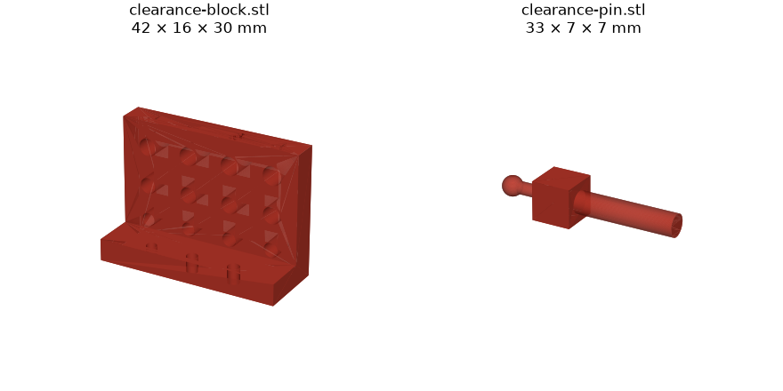
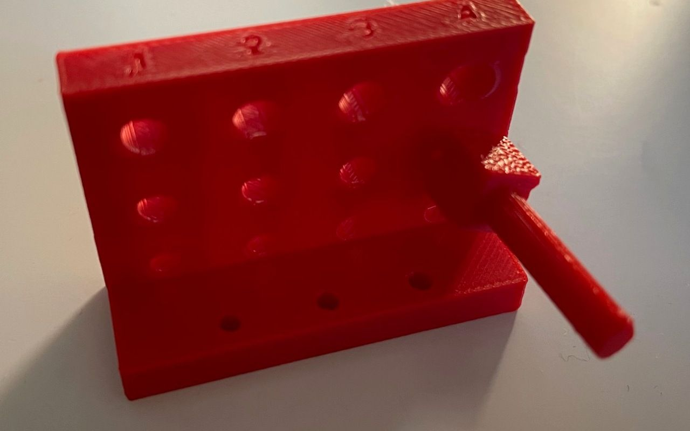
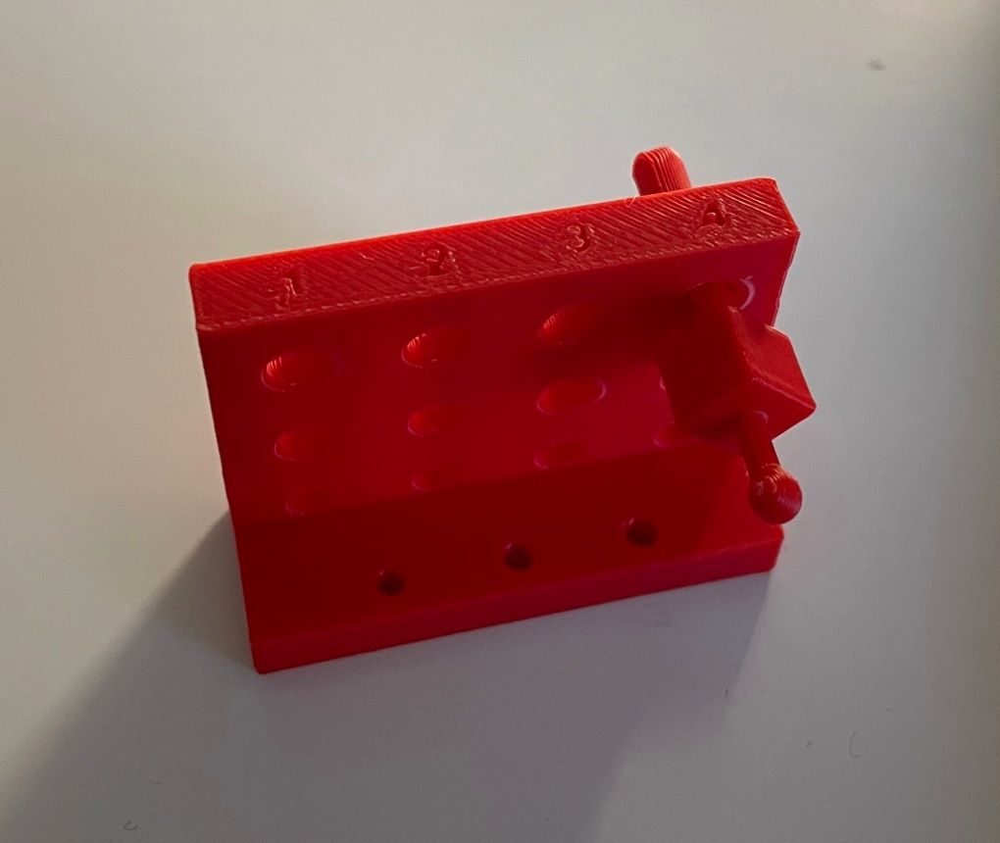
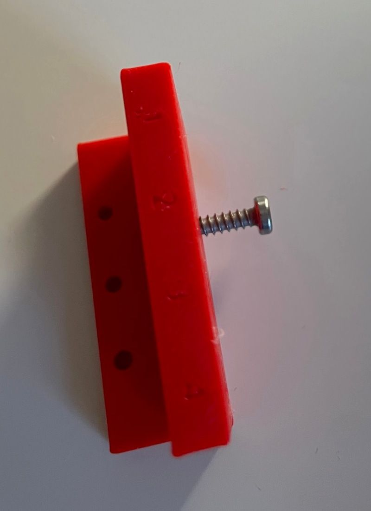

# Clearance test

How much bigger than its part a hole has to be on this printer for the drive's fits: a shaft that turns, a ball that
slides, an M3 screw that turns, and an M3 screw that cuts its own thread. The values found go into `CLR` and
`CLR_STEEL` in [`../drive/build.py`](../drive/build.py).

```
python3 build.py      # STEP + STL into this folder
```



| File | What | X × Y × Z (mm) |
|---|---|---|
| `clearance-block.stl` | Upright wall with 3 rows × 4 horizontal holes, and a foot with 3 blind holes | 42.0 × 16.0 × 30.0 |
| `clearance-pin.stl` | Ø4.0 journal and Ø3.6 ball on a Ø2.2 stub, printed lying down like a crankshaft | 32.8 × 7.0 × 7.0 |

**Block.** The holes go through the wall horizontally, so they print the same way as the leg's bore and the
journal holes. The clearance on the diameter grows from left to right: +0.1, +0.2, +0.3, +0.4 mm (engraved on top).

| Row | Nominal | Tests |
|---|---|---|
| Top | Ø4.0 | Journal of a crankshaft in the spine / test frame |
| Middle | Ø3.6 | Ball on the crank pin in the leg's bore |
| Bottom | Ø3.0 | M3 screw turning in the leg |
| Foot, 3 blind holes 3.6 deep | Ø2.3 / 2.5 / 2.7 (left to right) | M3 screw cutting its own thread |

**How to read it:** the right clearance is the smallest one in which the part turns or slides freely without
wobbling. For the tap holes, the right one is the smallest in which the screw goes in by hand with a screwdriver
without splitting the plastic.

Results of the first print and the values taken: [build log](../../build-log.md#test-leg-first-assembly-and-clearance-result).






