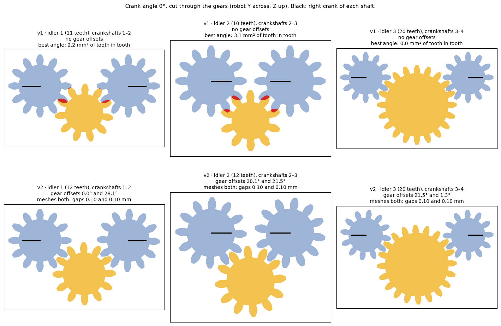

# Crankshafts and idlers

The four crankshafts that drive the [legs](../legs/), one per pair of legs, and the three idler gears that link them so
all four turn the same way. Modelled in code with build123d from the simulator's geometry. How and why:
[build log](../../build-log/3-legs-and-drive.md#legs-and-drive-in-cad) and
[gear train v2 in CAD](../../build-log/3-legs-and-drive.md#gear-train-v2-in-cad).

[`build.py`](build.py) also holds the numbers every part that carries the shafts uses: the spine walls
(`WALL_IN`, `WALL_OUT`), where the shafts and idlers sit (`shaft_yz()`, `idlers()`), and how close a cap's tongues
may come to the gears (`TONGUE_IN`, `TONGUE_OUT`). The [gear train test](../gear-train-test/),
the [test frame](../test-frame/) and [base v1](../base/) import them.



## Parts

| File (`out/`) | What | X × Y × Z (mm) | Print |
|---|---|---|---|
| `crankshaft-1.stl` … `-4.stl` | One piece: 12-tooth gear, two journals, two cranks with balls (front to rear). Each is different: its gear is turned on the shaft by its own offset, and 1–4 dots on the +X web say which it is. Crankshaft 4's crank webs are 1.5 mm thick instead of 2, to keep them clear of the rear legs | 27.6 × 14.0 × 14.0 | 1 each |
| `idler-1.stl`, `-2`, `-3` | Idler gears, 12, 12 and 20 teeth | up to 22.0 × 22.0 × 2.6 | 1 each |

STEP files with the same names are for Onshape.

**Gears:** module 1, 20° pressure angle, 3 mm wide (idlers 2.6 mm). The crankshaft gears all have 12 teeth, so the
four turn at the same speed. The idlers sit below the line of shafts, each 0.275 mm further from its crankshafts
than in theory, for about 0.2 mm of backlash (`BACKLASH`). Each crankshaft's gear offset (`gear_offsets()`) lets
every idler mesh with both of its neighbours. The motor's drive is designed in phase 4.

**Hardware:** 3 × 3 mm steel pins 9 mm long (idler axles in the robot); the gear train test uses M3×12 screws instead
(see [../gear-train-test/](../gear-train-test/)).

## Print

PLA, 0.2 mm layers. Plates and settings: [`../../print/README.md`](../../print/README.md).

| Part | Lay it | Supports |
|---|---|---|
| Crankshafts | Axis horizontal, so the ball stubs are not split by layer lines | Tree |
| Idlers | Flat | None |

## Assemble

With every crank level (crank angle 0°) and the dots on +X, the side of the right legs: a shaft one tooth off has
its cranks 30° from level. Steps for the test: [../gear-train-test/](../gear-train-test/).

## Rebuild and check

```
python3 build.py                # every part into out/
python3 check_gear_train.py     # every mesh in 2D, every 1°
python3 gear_phase_figure.py    # images/gear-phase.png
```

[`check_gear_train.py`](check_gear_train.py) checks every mesh in 2D every 1°, finer than `cad_verify`'s steps
([`check-gear-train.txt`](check-gear-train.txt)). [`gear_phase_figure.py`](gear_phase_figure.py) draws each idler
between its two crankshafts, v1 and v2. The gears turning in 3D, with what holds them, are checked by the
[gear train test's spec](../gear-train-test/verify.py); this design has no `verify.py` of its own.

See [the CAD rules](../README.md#a-design-folder).
