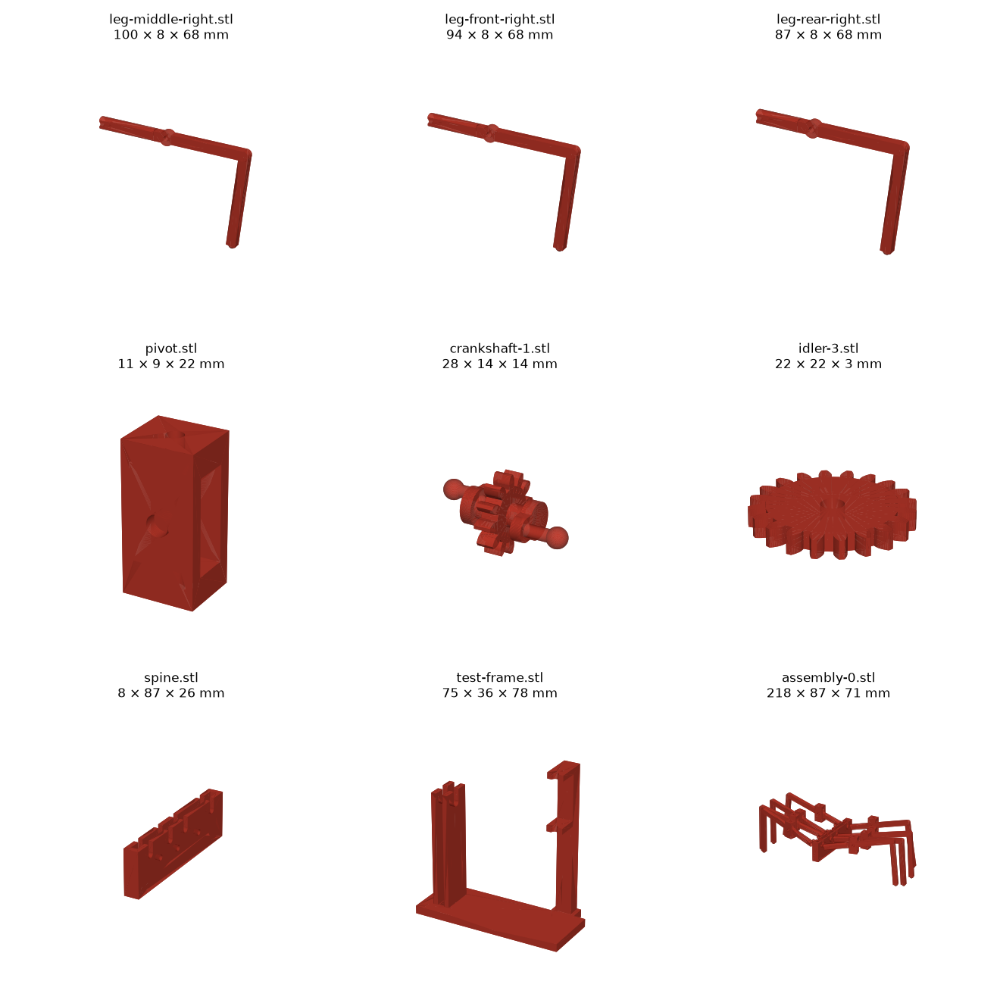
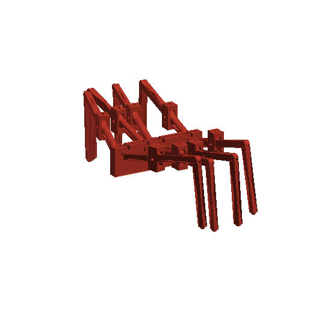

# Legs and drive

The 8 legs, their pivots and the drive that turns them, modelled in code with build123d from the simulator's
geometry ([`sim/toy_leg_3d_rows_cad.json`](../../sim/toy_leg_3d_rows_cad.json), first entry). Four lateral
crankshafts drive the legs, one per pair of legs, linked by idler gears so all four turn the same way. Each leg slides
on its crank pin. How and why: [build log](../../build-log.md#legs-and-drive-in-cad).

```
python3 build.py --assembly 0   # every part (STEP + STL) and the assembled drive at crank angle 0°
python3 check.py --gaps         # collision and gap check over a full turn (about 9 minutes)
```

Needs Python 3.12 with build123d, numpy, trimesh and manifold3d. All sizes come from parameters at the top of
[`build.py`](build.py).





| File | What | X × Y × Z (mm) | Print |
|---|---|---|---|
| `leg-front-right.stl` / `-left` | Front leg | 93.6 × 7.6 × 67.6 | 1 + 1 |
| `leg-middle-right.stl` / `-left` | Middle legs (2nd and 3rd) | 99.7 × 7.6 × 67.6 | 2 + 2 |
| `leg-rear-right.stl` / `-left` | Rear leg | 87.3 × 7.6 × 67.6 | 1 + 1 |
| `pivot.stl` | Fork that holds a leg at the rim | 10.6 × 9.4 × 22.0 | 8 |
| `crankshaft-1.stl` … `-4.stl` | One piece: 12-tooth gear, two journals, two cranks with balls (front to rear) | 27.6 × 14.0 × 14.0 | 1 each |
| `idler-1.stl`, `-2`, `-3` | Idler gears, 11, 10 and 20 teeth | up to 22.0 × 22.0 × 2.6 | 1 each |
| `spine.stl` | Two walls that carry the 4 crankshafts (slots open at the top) and the idler pins | 8.5 × 87.3 × 26.1 | 1 |
| `test-frame.stl` | Desk stand for one middle leg, its pivot and crankshaft 2, turned by hand | 75.4 × 35.5 × 77.7 | 1 |
| `assembly-0.stl` | Whole drive at crank angle 0°, for reference only | 218.0 × 87.5 × 71.3 | — |

STEP files with the same names are for Onshape (how to assemble and animate them: [onshape.md](onshape.md); the test-frame assembly: [Onshape](https://cad.onshape.com/documents/07632681db3e0a6b5b785746/w/6c5d5bb7bfec5781a6827599/e/c59459f0a1ed69675318d6bb)). Bambu Studio `--info` reports `manifold = yes` for all of them.

**How it fits together:**

- **Leg:** the inner end is a tube (flat sides, 5.6 × 7.6 mm) with a Ø3.8 mm bore. The ball on the crank pin
  (Ø3.6) slides 1.8–2.5 mm in it and lets the leg tilt. At the rim the leg goes through the pivot fork on an M3 screw,
  so it can tilt up and down (6–23°). The fork swings left and right (±6°) on two M3 screws driven into its top and
  bottom, which turn in the rim (or the test frame). The leg does not roll about its own axis.
- **Gait:** the two cranks on a crankshaft sit 180° apart. Neighbouring crankshafts are printed 180° apart too, so
  left legs 1 and 3 + right legs 2 and 4 move against the other four. Assemble with the cranks as printed.
- **Gears:** module 1, 20° pressure angle, 3 mm wide (idlers 2.6 mm). The crankshaft gears all have 12 teeth, so the
  four turn at the same speed. The idlers sit below the line of shafts. The motor's drive is not here yet (phase 4
  picks the ratio).

**Hardware:** for the whole robot, 8 × M3×12 screws + nuts (leg pivots), 16 × M3×6 screws (forks), 3 × 3 mm steel
pins 9 mm long (idlers). For the test frame: 1 × M3×12 + nut, 2 × M3×6.

**Print** (PLA, 0.2 mm layers):

| Part | Lay it | Supports |
|---|---|---|
| Legs | On their −Y face (rotate 90° about X): arm, boss, knee and shin are offset so their −Y face is flush with the tube's, and the leg lies flat (the shin rises 3 mm towards the foot) | Tree, on the build plate only, under the shin |
| Crankshafts | Axis horizontal, so the ball stubs are not split by layer lines | Tree |
| Pivot, spine | As modelled (Z up) | None |
| Idlers | Flat | None |
| Test frame | Plate on the bed | Tree, under the pivot arms |

**Clearances:** every hole that turns or slides is 0.2 mm larger than its part (parameter `CLR`). The phase 2
clearance test has not been printed yet, so this is a guess: if the ball binds in the bore, or a journal in the
spine, raise `CLR` and run `build.py` again.

**Check over a full turn** ([`check.py`](check.py), every 30°): no overlaps between any two parts. The closest pairs
are the designed clearances: 0.1 mm a side for the balls in their bores and the journals in the spine, 0.2 mm a side
for each leg in its fork. Between parts that do not touch on purpose, the closest are the middle legs' shins
(0.74 mm) and a rear leg against its crank (0.53 mm). Result: [`check-result.txt`](check-result.txt).

**Not done yet:**

- The base: the rim notches must take the forks and their screws, and the bowl must be hollowed for the spine and
  idlers. The spine is not fixed to anything yet.
- A cap over the spine's journal slots (in the test frame, hold the shaft down with a finger or a rubber band).
- The N20 drive and its reduction (phase 4).
