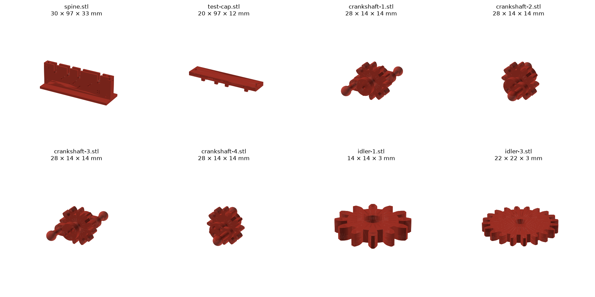
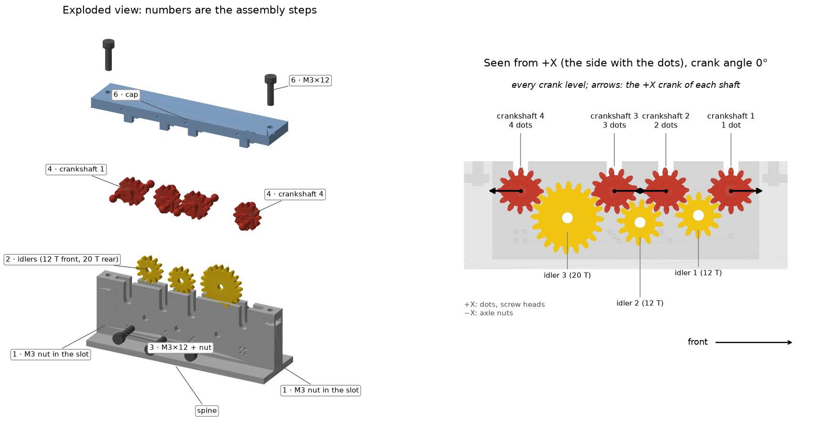

# Gear train test

A stand-alone spine that holds the four [crankshafts](../crankshafts/) and three idlers as base v1 does, with a cap
whose tongues keep the shafts in their slots, turned by hand to check that the gears mesh. How and why:
[build log](../../build-log/3-legs-and-drive.md#gear-train-v2-in-cad) and
[the cap](../../build-log/3-legs-and-drive.md#gear-train-test-v2-the-cap).



## Parts

| File (`out/`) | What | X × Y × Z (mm) | Print |
|---|---|---|---|
| `spine.stl` | Two walls on a foot that carry the 4 crankshafts and the idler axles, an M3 nut slot at each end, dots by each slot. The robot's spine is built into [base v1](../base/) | 30.0 × 97.3 × 32.5 | 1 |
| `test-cap.stl` | Cap whose tongues hold the crankshafts down in their slots, as base v1's cap does; four skirts at the ends centre it on the walls, and the tongues cover only the outer part of each wall, clear of the gears (print upside down) | 20.0 × 97.3 × 11.6 | 1 |

The crankshafts and idlers are those of [../crankshafts/](../crankshafts/). STEP files with the same names are for
Onshape.

**Hardware:** 3 × M3×12 + nuts (idler axles, head on +X, nut on −X), 2 × M3×12 + nuts (cap).

## Print

PLA, 0.2 mm layers. Plate and settings: [`../../print/README.md`](../../print/README.md).

| Part | Lay it | Supports |
|---|---|---|
| Spine | As modelled (Z up) | None |
| Test cap | Upside down, tongues up | None |

## Assemble



Made by [`assembly_figure.py`](assembly_figure.py) (`--lang es` for Spanish).

## Rebuild and check

```
python3 ../crankshafts/build.py
python3 build.py
python3 ../../tools/cad_verify.py verify.py --out verify-result.txt --render images/verify
python3 assembly_figure.py
```

**Check** ([`verify.py`](verify.py), a spec for the shared [`tools/cad_verify.py`](../../tools/cad_verify.py)): the
gear train test with every gear turning at its real angle, the cap shifted to either side, keep-out zones around the
gear faces, and what holds each part. Latest result: [`verify-result.txt`](verify-result.txt); pictures in
`images/verify/`.

See [the CAD rules](../README.md#a-design-folder).
