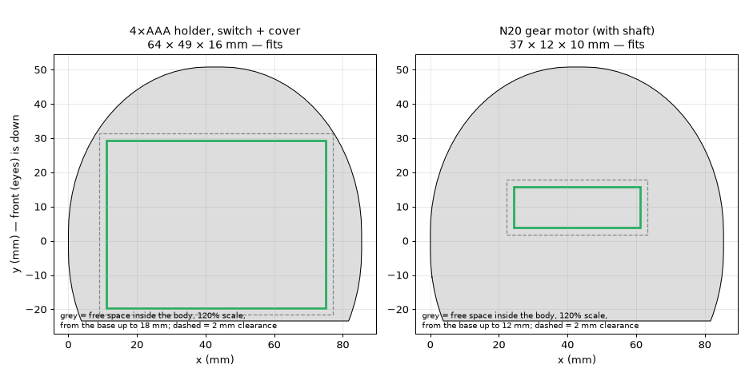
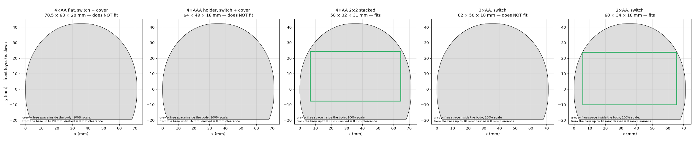

# Layout: what fits inside the body

Free space inside the [jenscolt body](../carcass-jenscolt/), checked with [`fit_check.py`](../../tools/fit_check.py).
Details and decisions in the [build log](../../build-log/2-carcass.md#motor-battery-holder-and-print-scale).

**Print scale: 120 %.** At that size a 4×AAA holder with switch and cover (64 × 49 × 16 mm) and the N20 gear motor
(37 × 12 × 10 mm) fit with 2 mm clearance per side.

| Part | Smallest scale that fits |
|---|---|
| N20 gear motor, 37 × 12 × 10 mm | under 100 % |
| 4×AAA holder, switch + cover, 64 × 49 × 16 mm | 111 % (118 % with 2 mm clearance) |
| 4×AA flat holder, switch + cover, 70.5 × 68 × 20 mm | 137 % |
| 3×AA holder, switch, ~62 × 50 × 18 mm | 109 % |
| 2×AA holder, switch, ~60 × 34 × 18 mm | under 100 % |
| 4×AA 2×2 stacked holder, 58 × 32 × 31 mm | under 100 % |

