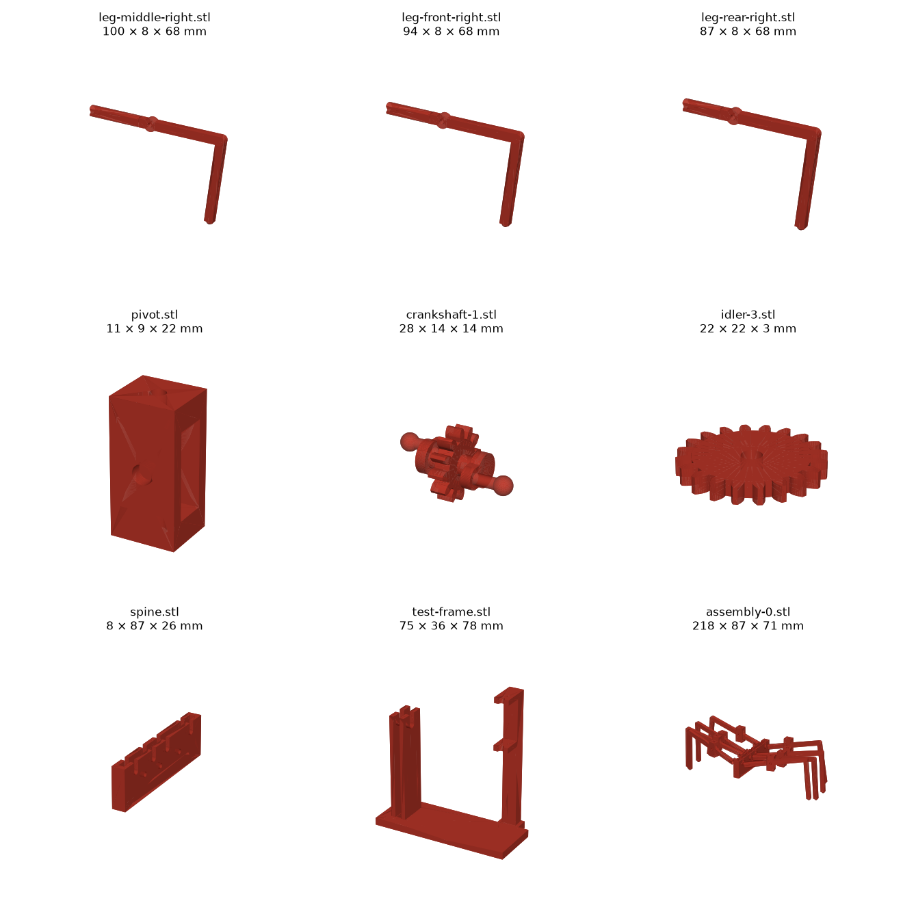
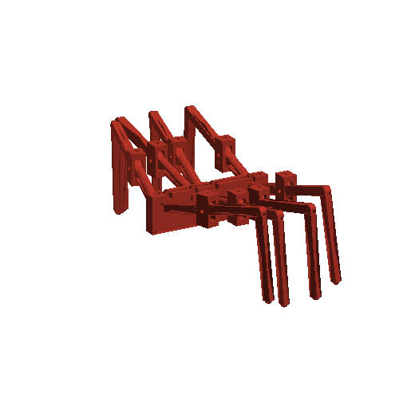

# Legs

The 8 legs and their pivot forks, modelled in code with build123d from the simulator's geometry
([`sim/toy_leg_3d_rows_cad.json`](../../sim/toy_leg_3d_rows_cad.json), first entry). Four lateral
[crankshafts](../crankshafts/) drive the legs, one per pair of legs, linked by idler gears so all four turn the same
way. Each leg slides on its crank pin. How and why: [build log](../../build-log/3-legs-and-drive.md#legs-and-drive-in-cad).

This folder also places the whole drive by the simulator's kinematics (`assembly()`, `poses()` in
[`build.py`](build.py)), for the check below, [base v1](../base/) and the figures.





## Parts

| File (`out/`) | What | X × Y × Z (mm) | Print |
|---|---|---|---|
| `leg-front-right.stl` / `-left` | Front leg | 93.6 × 7.6 × 67.6 | 1 + 1 |
| `leg-middle-right.stl` / `-left` | Middle legs (2nd and 3rd) | 99.7 × 7.6 × 67.6 | 2 + 2 |
| `leg-rear-right.stl` / `-left` | Rear leg | 87.3 × 7.6 × 67.6 | 1 + 1 |
| `pivot.stl` | Fork that holds a leg at the rim | 10.6 × 10.0 × 22.0 | 8 |
| `assembly-0.stl` | Whole drive at crank angle 0° (`build.py --assembly 0`), for reference only | 218.0 × 87.5 × 71.3 | — |

STEP files with the same names are for Onshape (how to assemble and animate them:
[../test-frame/onshape.md](../test-frame/onshape.md)). Bambu Studio `--info` reports `manifold = yes` for all of them.

**How it fits together:**

- **Leg:** the inner end is a tube (flat sides, 5.6 × 7.6 mm) with a Ø3.8 mm bore. The ball on the crank pin
  (Ø3.6) slides 1.8–2.5 mm in it and lets the leg tilt. At the rim the leg goes through the pivot fork on an M3 screw,
  so it can tilt up and down (6–23°). The fork swings left and right (±6°) on two M3 screws driven into its top and
  bottom, which turn in the rim (or the test frame). The leg does not roll about its own axis.
- **Gait:** the two cranks on a crankshaft sit 180° apart. Neighbouring crankshafts are printed 180° apart too, so
  left legs 1 and 3 + right legs 2 and 4 move against the other four. Assemble with every crank level (crank
  angle 0°) and the dots on +X, the side of the right legs: a shaft one tooth off has its cranks 30° from level.

**Hardware:** for the whole robot, 8 × M3×16 screws + nylon lock nuts (leg pivots; the fork is 10.0 mm across, so M3×12
leaves no room for the nut), 16 × M3×10 screws + nuts (forks, as pins: they go in [base v1](../base/)). The idlers'
hardware is in [../crankshafts/](../crankshafts/), the test frame's in [../test-frame/](../test-frame/).

## Print

PLA, 0.2 mm layers. Plates and settings: [`../../print/README.md`](../../print/README.md).

| Part | Lay it | Supports |
|---|---|---|
| Legs | On their −Y face (rotate 90° about X): arm, boss, knee and shin are offset so their −Y face is flush with the tube's, and the leg lies flat (the shin rises 3 mm towards the foot) | Tree, on the build plate only, under the shin |
| Pivot | As modelled (Z up) | None |

**Clearances** (on the diameter, from the [clearance test](../clearance-test/), `CLR` and `CLR_STEEL` in
[`../common.py`](../common.py)): 0.5 mm for a printed part turning or sliding in a printed hole (the ball in the bore),
0.3 mm for a steel screw or pin. The fork's window is 1.0 mm wider than the leg (0.5 mm a side; 0.2 mm a side was too
tight on one print).

## Rebuild and check

```
python3 ../crankshafts/build.py && python3 ../gear-train-test/build.py && python3 ../test-frame/build.py
python3 build.py --assembly 0   # every part (STEP + STL) into out/ and the assembled drive at crank angle 0°
python3 check.py --gaps         # collision and gap check over a full turn (about 9 minutes)
```

**Check over a full turn** ([`check.py`](check.py)): every leg, fork, crankshaft and idler, with the gear train
test's spine standing in for the robot's, and the [test frame](../test-frame/) with its leg, fork and crankshaft 2.
It lists any overlap between two parts and every pair closer than 1 mm. Latest result:
[`check-result.txt`](check-result.txt). This design has no `cad_verify` spec yet (`verify.py`): the whole-robot spec
is an [Open item](../../build-log.md#open-items).

All sizes come from parameters at the top of [`build.py`](build.py) and [`../common.py`](../common.py). See
[the CAD rules](../README.md#a-design-folder).
