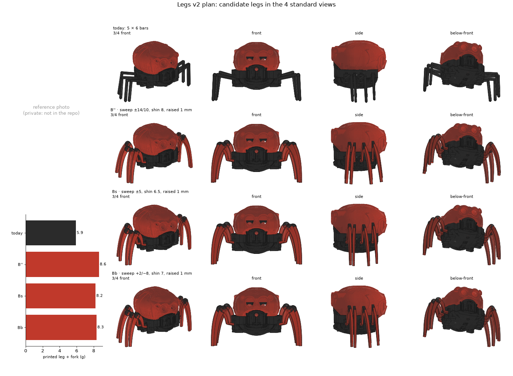

# Legs v2 · thick curved legs like the toy · plan (rev 3, 2026-11-17)

Status: **paused, superseded by the new direction** (2026-11-17): Morante rejected every option here as too thin
(«No me convence. Las patas son muy finas y pierdo todo el encanto. Quiero patas como las del dibujo y si hay que
adelgazar que sea en la base y la carcasa/cuerpo. Analiza los volúmenes para ver si sobra algo. No podemos estar
sacrificando constantemente el diseño exterior, especialmente de las patas.» In English: «I am not convinced. The
legs are very thin and I lose all the charm. I want legs like the drawing, and if something has to get thinner let
it be the base and the shell/body. Analyse the volumes to see if anything is spare. We cannot keep sacrificing the
exterior design, especially the legs.»). New order: (1) a mass and purpose audit of every printed part except the
legs; (2) legs v3 as thick and wide as the toy's, using the grams freed, options compared on low-poly stand-ins
first; (3) the motor side (ratio, voltage) only if (1) frees too little. Story and table:
[build log](../../build-log/3-legs-and-drive.md#legs-v2-three-plan-rounds-paused). Decisions below stand; the
recommendation does not. Earlier status line, kept for the record: rev 3 incomplete (Bb fails the middle gap 0.61 < 0.8;
B'' and Bs thinner than the toy's, 0.22 and 0.31 mm leg to fork against 0.5 designed).

Nothing modelled; no build file touched. Rev 3 adds to
[`plan_v2_geom.py`](plan_v2_geom.py) the raised-shin B family (`B3` = B'', `Bs`, `Bb`, `bed_side()`), redraws
[`plan_v2_figure.py`](plan_v2_figure.py), and gives the simulator a sweep per leg (`sim/toy_leg_3d.py` `leg_params()`,
`sim/motor_sizing.py --sweep a,b,c,d`; default output identical, diffed).

*Today and the B candidates, shin raised 1 mm, 4 standard views (Spanish copy `images/plan-v2-es.png`).*

## Morante's decisions (2026-11-17, after rev 2)

1. Body and dome are one piece (plan E decision 5): the dome items stay out of the mass.
2. Legs print at 10 % infill (lever L1) by default.
3. The shin is never flat on the bed: its bed face (foot included) at least 1 mm above the bed all along.
4. Middle-pair gap: any, as long as it is ≥ `LEG_PATH` 0.8 by the refined sweep (rv2 method: 0.35 mm, 3° + 0.5°).
5. A is rejected (too thin); choose the best of the B family.

## Rev 3: the B family with a raised shin (probes `probe_v3.py`, `grams_v3.py`, `levers_v3.py`, `gait_v3.py`, private)

Raising the shin decides the print side: a foot swept forward (−Y) more than ≈ +2° would go under the −Y bed, so
B'' and Bs print their front and middle-1 legs on the **+Y** face. There the 5-wide bar inside the fork sits 0.6 mm
above the bed (the tube is 5.6): **a 0.6 mm gap under the fork bar**, support that does not come off, at the fit that
matters most. **Bb** keeps every foot within +2° forward and spreads the middle pair by moving middle-2 and rear back:
all 8 legs print on −Y as today.

| | today | B'' (`B3`) | Bs | **Bb** |
|---|---|---|---|---|
| Sweep added f / m1 / m2 / r (°), shin across | 0, 5 | +14/+10/−10/−14, 8 | +5/+5/−5/−5, 6.5 | **+2/+2/−8/−8, 7** |
| Print side f / m1 / m2 / r | −Y | +Y +Y −Y −Y | +Y +Y −Y −Y | **−Y all** |
| Middle pair, refined (mm) | 0.65 | not run (coarse 1.87) | not run (coarse 1.84) | **0.59 FAIL** (middle-1 shin's +Y face below the knee, leg frame (50.5, 4.0, 22.4), crank 169.5°) |
| Leg–leg 0-1 / 2-3 (10°, 0.6 mm) | 2.17 / 15.64 | 2.22 / 16.0 | 1.63 / 15.29 | 1.32 / 14.91 |
| Leg–body/forks min | 0.52–0.88 | **0.22** (front), 0.34 (middle-1): the raised bar on the +Y bed | **0.31** (front), 0.34 (middle-1), idem | 0.50 (fork window) |
| Base skin hull (q2), carcass proxy | −0.72 / 0.01 (inside both: rim windows) | −1.82 / 0.03 (as today) | −1.82 / 0.01 (as today) | −2.11 / 0.02 (as today) |
| Printed leg + fork at 10 % (g) | 5.9 (15 %) | 8.62 | 8.21 | **8.33** |
| Design mass low / high (g), vs 478 | 456.3 / 460.6 | 479.1 / 483.4, +5.4 | 475.7 / 480.0, +2.0 | **476.7 / 481.0, +3.0** |
| Support per leg (mm²), least height under the shin | 381, ≈ 0.3 (wedge) | 780–785 / 692–701; 2.7; **0.6 under the fork bar (+Y legs)** | 812 / 722; 1.5; **0.6 (idem)** | **705–715; 1.06** |
| Gait (`gait_v3.py`): stride, slip, static margin | 9.65, 6.5, 3.16 | 9.37, 7.2, 3.27 | 9.52, 6.7, 3.19 | **9.43, 6.7, 5.96** |
| HP 380:1 R 1.0 margin 4.8 / 4.0 / mean 4.0 V, per-leg sweep | 3.6 / 3.0 / 6.7 (478) | 3.8 / 3.1 / 6.9 (478) | 3.7 / 3.1 / 6.8 (476.8) | **3.7 / 3.0 / 6.6 (477.7) PASS** |

Grams: `motor_sizing.printed_g` on the union of the mock-up leg at 10 % infill × the calibration that makes today's
leg + fork 5.9 at 15 % (`grams_v3.py`). Design mass: plan E rev 2 base without dome items, 456.3 / 460.6, plus
8 × (leg + fork − 5.9) × 1.05. Margins: `sim/motor_sizing.py --mass M --leg-g G --sweep …`, R 1.0 row.

**Gait with a sweep per leg** (`toy_leg_3d.leg_params`: sweep added per leg, L2 stretched so the foot keeps its height
under the knee): the same legs carry the body (3–6 support feet, mean 3.27–3.28; stance fraction f / m1 / m2 / r
0.51 / 0.56 / 0.57 / 0, as today: the rear feet never carry), the ground z and bob are unchanged (15.63, 4.54); the foot
paths keep their shape and move along Y with the sweep (Bb: front −2, middle-2 +8.6, rear +8.4 mm; B'': ±15); the
stride drops 0.2–0.3 mm and the slip grows with the spread (B'' 7.2 mm/turn). Bb's static margin rises to 5.96 (the
rear support moves back).

## Weight: over 478, the cheapest levers (10 % infill already taken; `levers_v3.py`)

| Lever | Bb leg + fork → design high | Bs | Look |
|---|---|---|---|
| L2 knee depth 14 → 11 (femur top, shin top) | 7.94 → **477.7 (−0.3)** | 7.83 → 476.8 | slimmer arch, knee still high |
| L3 knee boss r 8 → 6 | 8.24 → 480.2 | 8.11 → 479.2 | smaller black knee |
| L5 shin 7 → 5.5 deep at the foot | 8.11 → 479.2 | 8.00 → 478.2 | thinner tip |
| L2 + L3 | 7.80 → 476.6 | 7.68 → 475.6 | both |

## Recommendation (provisional: Bb fails decision 4 as drawn)

**Bb with L2** (sweep +2/+2/−8/−8, knee 5 across, shin 7 across raised 1 mm, knee 11 deep): every leg prints on −Y
as today with every support ≥ 1 mm high, the middle pair 0.59 (fails 0.8), the drive margin passes with its own feet
(3.0 at 4.0 V, at the limit), 477.7 g high. B'' and Bs need the +Y print side for four legs, which leaves 0.6 mm
under the fork bar (unremovable) unless the bar inside the fork is redesigned (a fork change: ask first).

## Part list (recommended option)

| Part | Count | Why separate | g printed (g1) | Print orientation |
|---|---|---|---|---|
| `leg-front-right/-left` | 1 + 1 | moves on its own pivot | ≈ 6.3 (10 %, L2) | leg plane on the bed (−Y face, flush with the tube), as today; shin ≥ 1 mm up, support from the bed |
| `leg-middle1-right/-left`, `leg-middle2-right/-left` | 1 + 1 each | idem; Bb's middles differ (+2 / −8 sweep) | ≈ 6.4 / 6.5 (10 %, L2) | idem |
| `leg-rear-right/-left` | 1 + 1 | idem | ≈ 6.2 (10 %, L2) | idem |
| `pivot` (fork) | 8 | unchanged | 1.6 | unchanged |

One part per leg: knee and outer shell are the same body, painted black/red in Bambu Studio. No shell, no new
hardware.

## Joints (unchanged from today; rows for `JOINTS` when modelled)

| Joint | ±X (along leg) | ±Y (across) | ±Z | Fit (`fits.py`) | In / out |
|---|---|---|---|---|---|
| Ball on crank pin ↔ leg bore | slides (designed) | bore | bore | `TURN` (Ø3.6 ball, bore +0.5) | ball into the bore from inside / pull out along the leg |
| Leg ↔ fork (pitch) | M3×16 pin across, boss in window | window walls | M3 pin | `STEEL` (pin), `WINDOW` (leg in window, 0.5 a side) | leg into the fork, M3×16 + nylon lock nut / unscrew |
| Fork ↔ chassis (yaw) | 2 × M3×10 as pins top and bottom | idem | idem | `STEEL` | as today (chassis plan B) |
| Leg ↔ everything it sweeps | — | — | — | `LEG_PATH` 0.8 | — |
| Leg middle-1 ↔ leg middle-2 (Bb) | — | — | — | `LEG_PATH` 0.8; refined minimum 0.59 (fails 0.8) | — |

What is new is only outside the fork (x > 7 mm): the boss, bore, tube and fork window stay as built.

## Assembly sequence (unchanged)

1. Leg into its fork from outside (right hand), the ball on the crank pin entering the bore (left hand holds the
   body); the knee goes up, so the leg is lifted, not pushed down. Check: the leg tilts freely by hand.
2. M3×16 through fork and boss from the front side, nylon lock nut at the rear (hex key + 5.5 mm spanner). Check:
   the leg drops under its own weight in the fork.
3. Service: nut, screw, leg out along the same path.

## Coupons (batch after the whole robot passes)

V1: the knee and 30 mm of shin (raised 1 mm, its support) of the heaviest leg in its print orientation (support: none or tree from the bed,
comes off by hand; the shin's 2-loop wall does not split when the foot is pushed 1 kg sideways by hand). No new fit:
the fork, bore and pin are unchanged.

## Questions for Morante (defaults)

1. **Bb with L2** for the model (default: yes). Bs or B'' only with a fork-bar change for the +Y print side.
2. **Weight:** Bb is 3.0 g over 478 at 10 %; default L2 (knee 11 deep, 477.7 g); or L2 + L3 (476.6 g, smaller knee).
3. **Margin 3.0 at 4.0 V (R 1.0)** with Bb's own feet, at the limit as A was: default accept.
4. **Feet move** (middle-2 and rear 8.5 mm back, front 2 mm forward): the footprint grows 10 mm; default accept.
