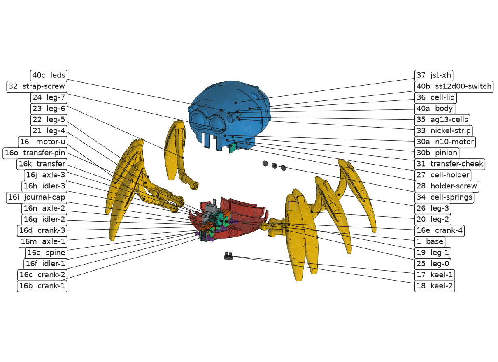

# Robot

The whole Spider-Bot as one assembly, at 70 % of jenscolt's model: the shells and legs converted in
[`../base/`](../base/), [`../body/`](../body/), [`../eyes/`](../eyes/) and [`../legs/`](../legs/), placed with
[`../motion.py`](../motion.py), and the drive and power fitted inside them. Level N2: these are the printed parts.
State, numbers and decisions: [`datasheet.md`](datasheet.md).

**License:** the shells and legs are derived from jenscolt's [Spidey-Bot](https://www.thingiverse.com/thing:5196618),
so [CC BY-NC-SA](../carcass-jenscolt/LICENSE.txt); the drive and power parts are CC BY-SA like the rest of the repo.



*The robot pulled apart, each part numbered by its assembly step (`cad_verify --render`).*

## Parts

| Part (`out/`) | What it is | Size (mm) | Colour |
|---|---|---|---|
| `body` | The top shell with the eyes, the front panel and the two front snap fingers | 69.4 × 78.3 × 47.3 | red |
| `leg-0` … `leg-7` | The eight legs: 0–3 on the right, front to rear, 4–7 their mirrors on the left; each snaps onto its crank pin | 52–72 × 25–47 × 70 | red |
| `base` | The bottom bowl with the leg windows | 67.6 × 60.5 × 21.7 | blue |
| `spine` | The beam that carries the four crankshafts | 5.9 × 43.3 × 15.9 | yellow |
| `crank-1` … `crank-4` | The crankshafts, each with the crank pins of one pair of legs and its gear | 8.4 × 8.8 × 19.0 | yellow |
| `idler-1` … `idler-3`, `sleeve-1` … `sleeve-3` | The idler gears between the cranks, on printed sleeves | 8.4 × 8.4 × 2.6 | yellow |
| `transfer`, `transfer-sleeve` | The compound gear from the pinion to the idlers | 13.2 × 13.2 × 8.0 | yellow |
| `drive-unit` | Holds the motor, the transfer gear and the caps of cranks 1–3 | 23.8 × 28.8 × 28.1 | yellow |
| `pinion` | The gear on the motor's shaft | 10.8 × 10.8 × 3.0 | yellow |
| `cell-holder`, `cell-lid` | The six AG13 cells (2S3P), with a snap lid | 39.7 × 23.3 × 21.0 | yellow |

Hardware (N10 motor, cells, springs, nickel strip, switch, JST-XH, LEDs, M2 screws): [`../../hardware.md`](../../hardware.md).
`out/` is not in git: `build.py` writes it. The printed STLs are in the [print plates](../../print/).

| File | What it is |
|---|---|
| `build.py` | Builds every part into `out/` (`--part <name>` one part, `--fine` the printed STL) |
| `shells.py`, `cutters.py` | The shells and legs in the robot frame, and the designed cutters that clear the legs' sweeps |
| `drive.py`, `power.py`, `interior.py` | The drive, the power parts, and the module that merges them |
| `verify.py`, `drive_verify.py`, `power_verify.py`, `interior_verify.py` | The `cad_verify` spec of the whole robot: parts, 24 crank poses, joints, retention, assembly, access |
| `verify-result.txt` | The last full check: PASS, 0 FAIL |
| `views.py` | The judge's views: the robot and jenscolt's assembled model in the same four views |
| `spec.json`, `plan.json`, `design-plan.md` | The request, the plan and the plan as tables |
| `fitcheck/` | The layout planner used before the parts were modelled (not a gate) |

## Print

Three plates, one per colour, and which parts to print first: [`../../print/README.md`](../../print/README.md#robot-plates-one-per-colour).

## Assemble

Steps: [`images/verify/assembly-steps.png`](images/verify/assembly-steps.png). Legs 1, 2 and 4–7 go on with the
cranks at pose 0; then the cranks turn half a turn (pose 12) for legs 0 and 3 and the body. The robot walks forward
with the poses running backward (k 23, 22, …), so the motor's leads must turn the cranks that way.

## Rebuild and check

From this folder (each under 40 s):

```bash
../../.venv/bin/python build.py
../../.venv/bin/python ../../tools/cad_verify.py verify.py --smoke
../../.venv/bin/python ../../tools/cad_verify.py verify.py --out verify-result.txt --render images/verify
```

Then `viewer/src/export.py` from the repo root updates the [3D viewer](../../viewer/). Rules: [the CAD rules](../README.md#a-design-folder).
