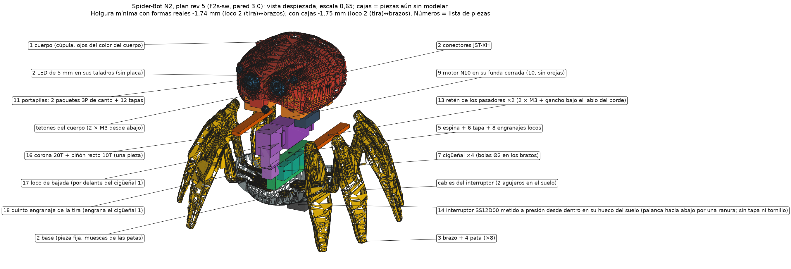

# robot · plan

Generated from `plan.json` by `tools/rounds.py validate`: edit the JSON, never this page.

**Rev 5 (2026-11-19): the approved N1 look at S 0.65 walking on one N10; the N10 lies along Y high in the dome in a closed sleeve (one screw behind), a crown pair turns the drive 90 degrees at the front and two gears bring it down in front of crank 1 into the spine strip, which turns the 4 crankshafts that swing the 8 legs on steel pins; the switch sits under the base (pressed into a floor pocket from inside, closed below by a 0.8 mm skin with a slot for the lever; no cover, no screw). Probe status: does not fit yet, best layout F2s-sw least -1.75 mm with every box placed and the strip gear counted against the arms (-1.64 crown vs shell if that gear is exempt as the strip; probes.py layouts5). Measured again with real shapes on that layout (probes.py real): least -1.74 (strip gear 2 vs arms), 20 pairs still overlap, does not fit.**

Level N2 · purpose: Print detail of the looks robot approved at N1: the mechanism re-laid out to fit inside the unchanged look at S 0.65 · pass: It walks on its 8 legs inside the approved look, with every part inside the body (no box left out) and min gap >= 0 over the 24 poses

## Part list

| Part | Role | Why separate | g | Print orientation |
|---|---|---|---|---|
| body | looks shell: dome, eyes with two 5 mm LED bores, two body bosses, skirt band lugs | lifts off for the cells and the legs' keepers | 22.6 | open side down, support only inside the crown and under the eyes (D8, slicer on the N2 mesh) |
| base | ground part: bowl, 8 leg notches with steel-pin seats, rim lip, nut lands, spine lugs, switch pocket in the floor (open to the inside, closed below by a 0.8 mm skin with a slot for the lever, 2 wire holes) | the ground every other part is held to | 11.7 | rim up (default D8), notch floors face up |
| leg-arm | inner arm x8: eye on the pivot pin, bar, end tube on the crank ball | flat part keyed into the leg, prints with no support | 0.4 | flat, ball bore along the bed |
| leg | outer leg x8 with the key groove | looks part, curved | 2.3 | on its side |
| spine | drive frame: strip walls, idler bores, front tower (crown walls, drop-idler walls, motor sleeve seat) | one frame screwed to the base carries every gear | 5.0 | walls up |
| spine-cap | closes the journal slots and holds the idler pins down | off for the crankshafts | 1.5 | flat |
| crankshaft | x4: 10T gear, two webs, two 2 mm balls on 1.6 mm necks, 180 degrees apart | moving | 0.4 | lying down, 0.3 flat |
| strip-idler | x3 idlers between the cranks (13T, 13T, 16T) on 3 mm pins | moving | 0.2 | flat |
| front-strip-gear | 13T fifth strip gear in front of crank 1 (y -24.6, z 13.9), meshes crank 1 | moving | 0.2 | flat |
| drop-idler | 18T gear in the clear channel in front of crank 1 (y -25.2, z 22.9): crown spur to the front strip gear | moving | 0.3 | flat |
| crown-part | 20T face gear and 10T spur on one part, axis X, at the motor height (y -23.0, z 31.0) | turns the drive 90 degrees | 0.6 | face up, 0.12 mm layers on the teeth |
| pinion | 10T x +0.42 with a D-bore on the N10 shaft | pressed on the bought shaft | 0.1 | flat, D-bore up |
| motor-sleeve | closed sleeve round the N10 can on the spine tower, front lip, rear cap with 1 x M3 on the axis: no clamp ears | the motor slides in from the rear; a fix reprints 1 g | 1.2 | standing, axis vertical, no support |
| cell-pack | x2: three AG13 on edge (3P), tongue into the sleeve's side rail | cells replaceable | 2.0 | open side up |
| pack-lid | x2: hook at the front end, 1 x M3 at the rear inside the pack length | access to the cells | 0.5 | flat |
| pivot-keeper | x2, one per side: 2 x M3 and 2 hooks under the rim lip hold the 8 pivot pins down | holds the pins, off for a leg | 1.0 | flat, hooks up |
| n10-motor | N10 3 V gear motor (datasheet, measure on arrival) |  |  |  |
| ag13-cell | 6 x AG13 wired 2S3P (3 V) |  |  |  |
| ss12d00-switch | slide switch, under the base (pressed into the floor pocket from inside, lever down through the pocket's slot; 5.5 mm below the base at the lowest point, 3.4 mm left of the 8.9 mm ground height; 4.8 mm from the legs' sweep; glue optional) |  |  |  |
| led-5mm | 2 x 5 mm LEDs from the Arduino kit, the pupils; Morante wires them |  |  |  |
| pin-2mm | 8 x steel pin 2 x 8, leg pivots |  |  |  |
| pin-3mm | steel pins 3 mm: strip idlers, front strip gear, drop idler, crown part |  |  |  |
| screw-m3 | M3 Allen: spine (2), keepers (4), packs (2), sleeve cap (1), body (2) |  |  |  |
| nut-m3 | M3 nuts in pockets |  |  |  |
| cell-spring | conical spring 5 mm, negative contact, 6 (to buy, datasheet) |  |  |  |
| jst-xh | 2 mated 2-pin JST-XH: cells to motor, body LEDs |  |  |  |

## Joint table

| Joint | Parts | Type | Held | Fit | In from | Apart by |
|---|---|---|---|---|---|---|
| spine-on-base | spine ↔ base | screw | +x locating pins · -x locating pins · +y locating pins · -y locating pins · +z 2 x M3 from below into nuts · -z base floor lugs | fits.LOCATOR | +z | 2 screws from below |
| crank-in-spine | crankshaft ↔ spine | revolute X | +x webs on the walls (GEAR_THRUST_CRANK) · -x webs on the walls · +y journal slot · -y journal slot · +z spine-cap tongue (TONGUE_SHORT) · -z slot floor | fits.TURN | +z | cap off, lift |
| gears-on-pins | strip-idler ↔ spine | revolute X | +x spine wall · -x spine wall · +y 3 mm pin · -y 3 mm pin · +z 3 mm pin, pin held by the cap · -z 3 mm pin | fits.GEAR_THRUST_IDLER | +z | cap off, pin out |
| front-gears-on-pins | front-strip-gear ↔ spine | revolute X | +x tower wall · -x tower wall · +y 3 mm pin · -y 3 mm pin · +z 3 mm pin pressed in the walls (STEEL) · -z 3 mm pin | fits.GEAR_THRUST_IDLER | +x | push the pin out along X |
| drop-idler-on-pin | drop-idler ↔ spine | revolute X | +x tower wall · -x tower wall · +y 3 mm pin · -y 3 mm pin · +z 3 mm pin pressed in the walls (STEEL) · -z 3 mm pin | fits.GEAR_THRUST_IDLER | +x | push the pin out along X |
| crown-on-pin | crown-part ↔ spine | revolute X | +x tower wall (GEAR_THRUST_IDLER) · -x tower wall · +y 3 mm pin · -y 3 mm pin · +z 3 mm pin · -z 3 mm pin | fits.STEEL | +x | push the pin out along X |
| pinion-on-shaft | pinion ↔ n10-motor | press | +x D-flat · -x D-flat · +y press (DSHAFT_N10 to add as assumed, coupon K1) · -y press · +z D-flat · -z D-flat | fits.DSHAFT | -y | pull with pliers |
| motor-in-sleeve | n10-motor ↔ motor-sleeve | slide | +x sleeve wall · -x sleeve wall · +y rear cap and its M3 · -y front lip on the gearbox face · +z sleeve wall · -z sleeve wall | fits.MOTOR_SEAT | +y | cap screw out, slide back |
| sleeve-on-spine | motor-sleeve ↔ spine | slide | +x tower rail · -x tower rail · +y rear cap M3 into the tower lug · -y rail stop · +z rail lips · -z tower floor | fits.WINDOW | +y | cap screw out, slide back |
| pack-on-sleeve | cell-pack ↔ motor-sleeve | slide | +x tongue in the sleeve rail · -x tongue · +y lid M3 into the sleeve lug · -y rail stop · +z tongue · -z tongue | fits.TONGUE | +y | lid screw out, slide back |
| lid-on-pack | pack-lid ↔ cell-pack | hook and screw | +x pack rim · -x pack rim · +y hook · -y hook · +z hook and M3 · -z pack rim | fits.LOCATOR | +z | screw out, tip off the hook |
| leg-on-arm | leg ↔ leg-arm | key | +x key · -x key · +y key · -y key · +z pivot-keeper over the pin · -z notch floor | fits.PRESS | +z | lift off the arm |
| leg-pivot | leg-arm ↔ base | revolute Z and pitch on a 2 mm pin | +x pin · -x pin · +y pin · -y pin · +z pivot-keeper (0.5 play) · -z notch floor | fits.LEG_PATH | +z | keeper off, pin out |
| keeper-on-base | pivot-keeper ↔ base | hook and screw | +x rim lip · -x rim lip · +y hooks and 2 x M3 · -y 2 x M3 · +z hooks under the lip and screws · -z rim top | fits.WINDOW | +y | 2 screws, slide back |
| switch-in-pocket | ss12d00-switch ↔ base | press | +x pocket wall · -x pocket wall · +y pocket wall · -y pocket wall · +z press fit in the pocket (glue optional) · -z pocket floor, a 0.8 mm skin (slot for the lever) | fits.PRESS | +z | pull up from inside with tweezers (if glued: a drop of solvent, or cut the pocket) |
| body-on-base | body ↔ base | lip and screws | +x skirt lip inside the rim · -x skirt lip · +y skirt lip · -y skirt lip · +z 2 x M3 up into the body bosses · -z rim | fits.WINDOW | +z | 2 screws, unplug JST 2 |

## Assembly sequence

| Step | Part | From | Hand or tool | Already in | How you know |
|---|---|---|---|---|---|
| 1 | base | None | hand |  | flat on the bench |
| 2 | pinion | -y | pliers, shaft supported | n10-motor on the bench | flush with the shaft mark |
| 3 | n10-motor | +y | hand | pinion | gearbox face on the sleeve lip |
| 4 | motor-sleeve | +y | 2.5 mm hex key | spine on the bench, n10-motor in the sleeve | cap screw home, pinion turns the crown |
| 5 | crown-part | +x | hand, pin pushed with the hex key | spine | crown turns on its pin |
| 6 | drop-idler | +x | hand | crown-part | phase mark on the crown spur's mark |
| 7 | front-strip-gear | +x | hand | drop-idler | phase mark on the drop idler's mark |
| 8 | pin-3mm | +x | pliers | the tower gears | pins flush with the walls |
| 9 | spine | +z | 2.5 mm hex key, finger on the nut | base | no rock |
| 10 | strip-idler | +z | hand | spine | on their pins, marks up |
| 11 | crankshaft | +z | hand | strip-idler | phase marks on the idler marks |
| 12 | spine-cap | +z | 2.5 mm hex key | crankshaft | the train turns by the motor shaft |
| 13 | leg-arm | +z | hand | spine-cap | end tube on the crank ball |
| 14 | leg | +z | hand | leg-arm keyed in | eye holes over the seat |
| 15 | pin-2mm | +z | fingers | leg | 2.0 mm proud of the stack |
| 16 | pivot-keeper | +y | 2.5 mm hex key | pin-2mm | legs swing, pins cannot lift |
| 17 | ss12d00-switch | +z | tweezers | base | base open side up: switch pressed into the pocket from inside until it sits on the floor skin; lever through the slot, wires through the 2 floor holes; it does not fall out when the base is turned over |
| 18 | cell-spring | +z | tweezers | cell-pack on the bench | seated in the ring |
| 19 | cell-pack | +y | hand | motor-sleeve | tongue home in the rail |
| 20 | jst-xh | +z | soldering iron | cell-pack, switch | 3.0 V across JST 1 |
| 21 | ag13-cell | +z | hand | cell-pack | + mark on each bay |
| 22 | pack-lid | +z | hand | ag13-cell | hook engaged |
| 23 | screw-m3 | +z | 2.5 mm hex key | pack-lid | lid flat, pack does not slide |
| 24 | nut-m3 | -z | finger in the pocket | each screw's part | nut flush in its pocket |
| 25 | led-5mm | -y | hand, Morante's own wiring | body on the bench | dome flush in the eye |
| 26 | body | +z | hand, then 2.5 mm hex key from below | everything | JST 2 plugged first, lip seated all round |

## Alternatives

- **where the drive comes down to the strip**: R4: crown in front, 12T idler over crank 1 (-2.74 at D4a) / F1: one idler chosen for room (-2.74) / F2: two idlers down in front of crank 1 (-2.74) / B1: crown at the rear (-5.10) / B2: two idlers behind crank 4 (-3.14) / T1: toy-style motor across, 30T layshaft, ratio 0.40 (-9.00) / F2s: F2 + sleeve + free bosses + strip rule (-1.64) / F2s-sw: F2s + switch under the base, strip gear counted against the arms (-1.75; -1.64 with it exempt) → **F2s-sw**, the least overlap of every layout tried; ratio 0.50 kept; the switch under the base frees the rear of the dome (wires vs switch gone) but the binds are at the front (crown, strip gear vs shell), so it does not fit yet
- **how the motor is held**: clamp with 2 x M3 ears beside the can (rev 4) / closed sleeve, front lip, rear cap with 1 x M3 on the axis → **closed sleeve**, the ears took 5.8 mm a side at the packs' height (ear vs pack -1.76)
- **body wall**: D4a 3.0 mm (-1.75 F2s-sw) / D4b 1.6 mm (-1.78 F2s, -1.77 R4) → **D4a 3.0 mm**, the thin wall gains nothing: the binds are not at the wall
- **pivot keeper**: one per side, 2 screws and 2 hooks / one per leg pair → **one per side**, 2 parts and 4 screws, rev 4 probe pivot
- **where the switch goes**: inside at the rear skirt, in a slot with a retainer boss (rev 4) / under the base: body in the floor, lever from below, only the wires inside → **under the base**, Morante 2026-11-19; 4.9 mm below the base at the lowest point against 8.9 mm of ground height in the approved N1 walk (4.0 mm left), 4.8 mm from the legs' sweep

## Acceptance

| Id | Item | How | Check | Priority |
|---|---|---|---|---|
| a1 | It walks on its 8 legs inside the approved look, with every part inside the body (no box left out) and min gap >= 0 over the 24 poses | verify | motion | must |
| a2 | the approved N1 look at S 0.65: jenscolt body, eyes and base, his legs on N0's path, high knees | visual |  | must |
| a3 | one N10 3 V gear motor and 6 x AG13 wired 2S3P (3 V), a switch, no microcontroller | verify | keep-in | must |
| a4 | two eye bores for the 5 mm LEDs from the Arduino kit; no eyes board (Morante wires them) | measure |  | must |
| a5 | every part fits inside with every box placed: motor, clamp, gears, cell packs, switch, wires | verify | keep-in | must |
| a6 | every part prints with <= 10 % support and none on a functional face (Bambu P2S, PLA) | verify | print | must |
| a7 | not a scale above S 0.65 to solve a fit (ceiling S 0.70; change placement, toy's own layout first) | visual |  | must |
| a8 | not jenscolt's inner posts | visual |  | must |
| a9 | every part held in all six directions | verify | retention | must |
| a10 | the train turns by hand from the motor shaft with every gear in mesh | verify | gears | must |
| a11 | every screw reachable with the 2.5 mm hex key in assembly order | verify | access | must |
| a12 | the gear meshing crank 1 is the 5th strip gear and runs beside crank 1's arm ends with the strip's clearance (coupon K3c, accepted by Morante 2026-11-19) | print |  | must |
| a13 | the switch under the base keeps at least 3 mm of the approved N1 walk's 8.9 mm minimum base height and clear of the legs' sweep | verify | motion | must |

## Open questions

- No layout reaches min gap ≥ 0 at S 0.65 with every box placed (best F2s-sw -1.75: strip gear vs arms; -1.64 crown vs shell, -1.40 crown vs front body boss, -1.32 packs vs LEDs). The switch is already under the base. Which way to go? Options: F2s-sw, and round r00 places the remaining boxes by hand on the N2 shapes (no S change) / drop the body bosses: the body clips onto the base rim (frees the front and rear skirt) / cells as one 2S3P pack across the top of the motor (new search). Default: F2s-sw, then a new search with the shell shapes before r00
- LEDs Options: 5 mm from the Arduino kit / 3 mm. Default: 5 mm
- Base print Options: rim up / rim down. Default: rim up

## Diagram

