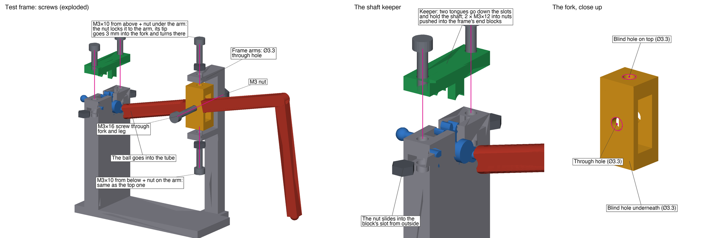

# Test frame

A desk stand for one middle leg (right), its pivot fork and crankshaft 2, turned by hand. The leg and fork are those
of [../legs/](../legs/), the crankshaft that of [../crankshafts/](../crankshafts/). How and why:
[build log](../../build-log/3-legs-and-drive.md#clearance-test-and-test-leg-print-plate).



## Parts

| File (`out/`) | What | X × Y × Z (mm) | Print |
|---|---|---|---|
| `test-frame.stl` | Desk stand for one middle leg, its pivot and crankshaft 2, turned by hand | 75.4 × 35.8 × 80.1 | 1 |
| `test-frame-keeper.stl` | Cap that holds crankshaft 2 in the test frame (print upside down) | 8.5 × 28.0 × 9.0 | 1 |

STEP files with the same names are for Onshape: how to assemble and animate them, [onshape.md](onshape.md) (its
pictures made by [`onshape_figures.py`](onshape_figures.py)); the test-frame assembly in
[Onshape](https://cad.onshape.com/documents/07632681db3e0a6b5b785746/w/6c5d5bb7bfec5781a6827599/e/c59459f0a1ed69675318d6bb).

**Hardware:** 1 × M3×16 + nylon lock nut, 2 × M3×10 + 2 nuts (fork), 2 × M3×12 + 2 nuts (keeper).

## Print

PLA, 0.2 mm layers. Plate and settings: [`../../print/README.md`](../../print/README.md).

| Part | Lay it | Supports |
|---|---|---|
| Test frame | Plate on the bed | Tree, under the pivot arms |

## Assemble

1. Leg in the fork: put the leg's boss in the fork's window, and an M3×16 through the fork's side hole, the leg
   and the other side. Nut on the end, snug but not tight: if it squeezes the fork's walls onto the leg, the leg
   cannot tilt. A nylon lock nut keeps it there. The window is 1 mm wider than the leg: if the leg slides along
   the screw, put an M3 washer on each side of it where they fit (the middle legs pass 0.7 mm apart).
2. Fork in the frame: the fork goes between the frame's two arms. An M3×10 down through the upper arm's hole,
   with a nut on it under the arm, tightened against the arm; its tip goes 3 mm into the blind hole on top of the
   fork. The same from below through the lower arm. The two screws are fixed to the frame and the fork turns on
   their tips.
3. Crankshaft last: guide the ball into the mouth of the leg's tube while lowering the journals into the slots.
4. Keeper: slide an M3 nut into each end block's slot from outside, put the keeper on top with its tongues down the
   slots, and drive two M3×12 down through it into the nuts.

Figure: [`screws_figure.py`](screws_figure.py).

## Rebuild and check

```
python3 ../legs/build.py && python3 ../crankshafts/build.py
python3 build.py
python3 ../legs/check.py --gaps    # the whole drive, and this frame with its leg, fork and crankshaft 2
python3 screws_figure.py           # images/test-frame-screws.png
python3 onshape_figures.py         # images/onshape/
```

The frame is checked by [`../legs/check.py`](../legs/check.py) together with the whole drive (its latest result:
[`../legs/check-result.txt`](../legs/check-result.txt)); it has no `cad_verify` spec (`verify.py`) yet.

See [the CAD rules](../README.md#a-design-folder).
