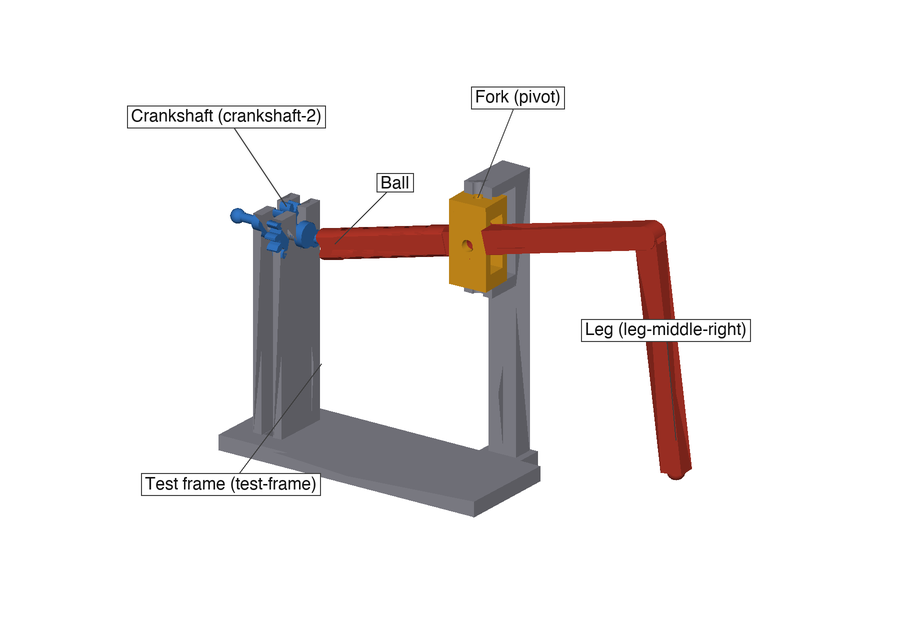
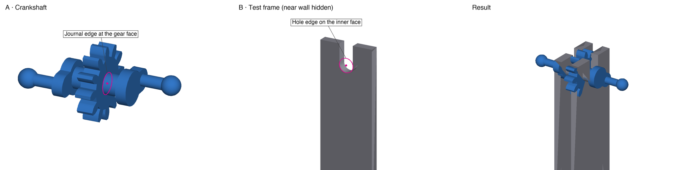
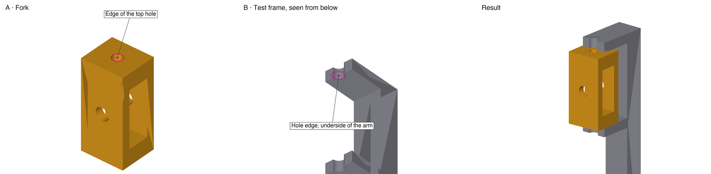
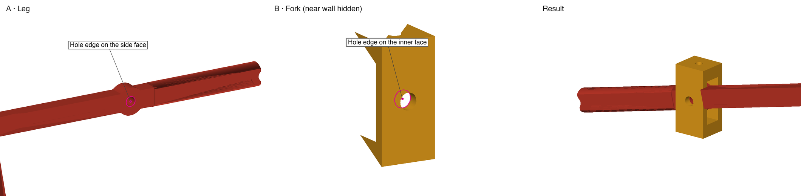
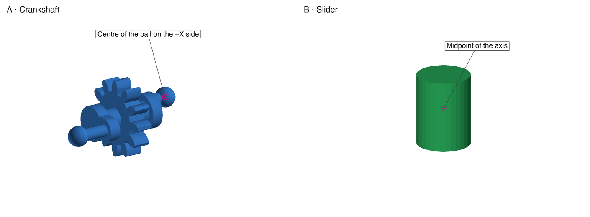
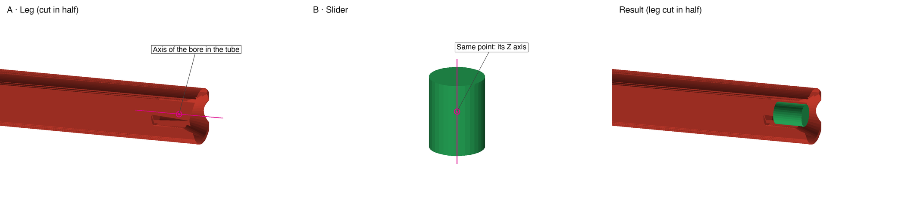
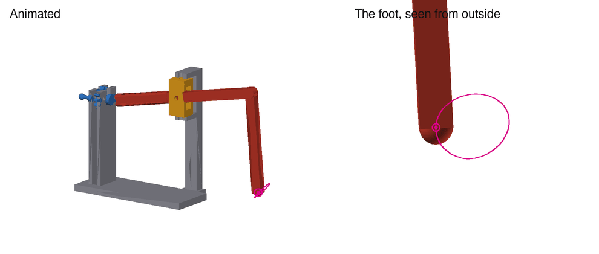

# Legs and drive · Onshape assembly

How to assemble one Spider-Bot leg on the test frame in Onshape, join the parts so they move as they will in the
real thing, and animate it to compare the foot path with the simulator. Part 1 (one leg on the test frame) is the
one that matters. Part 2 (the gear train) is optional. The pictures are made by
[`onshape_figures.py`](onshape_figures.py).

You need a free Onshape account. Documents on the free plan are public, which is fine here because the files are
public anyway. Onshape button names are in **bold**.

## Terms

| In Onshape / in the files | What it is |
|---|---|
| **Part Studio** | A tab where parts are drawn or imported |
| **Assembly** | A tab where parts are put together and joined |
| **Mate** | A joint between two parts: it says how one can move relative to the other |
| **Mate connector** | A point with X, Y, Z axes that Onshape offers when you hover over an edge or a face. A mate joins two of them |
| **Revolute** | Hinge: turns about one axis only (the connector's Z) |
| **Slider** | Slides along one axis only, without turning |
| **Ball** | Ball joint: the two points stay together, but the part can turn any way |
| **Fix** | The part no longer moves, and everything else is placed relative to it |
| **Offset** | Moves a connector a few millimetres along its Z axis |
| crankshaft | The shaft with the gear in the middle and a crank with a ball at each end |
| journal | The Ø4 section of the crankshaft that turns in the wall's hole |
| pivot (fork) | The frame-shaped part the leg goes through |
| boss | The round disc on the leg where the fork's M3 screw goes through |
| bore | The hole inside the leg's tube, where the ball slides |
| test frame | Desk stand to try one leg by hand |

## Part 1 · One leg on the test frame

The same parts you will print and turn by hand: `test-frame`, `crankshaft-2`, `leg-middle-right`, `pivot`.

### 1. Import

1. **Create → Document**, name it `Spider-Bot drive`.
2. Inside the document, click **+** (bottom left) → **Import**. Pick `test-frame.step`, `crankshaft-2.step`,
   `leg-middle-right.step` and `pivot.step`. Each one becomes a Part Studio tab. STEP carries millimetres, so nothing
   needs scaling.

Import from inside the document, not from the Documents page: there, every file becomes a document of its own. If an
options dialog comes up, leave *Orient imported models with Y Axis Up*, *Create a composite part* and *Join adjacent
surfaces* unticked. The files are Z up and each one is a single solid.

### 2. The slider (a helper part)

Onshape has no mate for "a ball that slides inside a tube and can also tilt". You get it with a small helper part in
between, which stands for the part of the ball that is inside the tube:

> crankshaft → **Ball** → slider → **Slider** → leg

1. **+** → **Create Part Studio**. Double-click the new tab and name it `slider`.
2. **Sketch** on the **Top** plane. With **Center point circle**, draw a circle centred on the origin, type 3 mm
   for the diameter and click ✓.
3. **Extrude** the circle. Change **Blind** to **Symmetric**, set 4 mm and click ✓.

The result is a Ø3 × 4 mm cylinder, centred on the origin, with its axis vertical (Z). It can be hidden later.

### 3. Assembly

1. **+** → **Create Assembly**.
2. **Insert** → the `test-frame` tab → click the part. **Do not click in the view**: close the dialog with ✓. The
   part then lands on the origin with its own coordinates, which are the robot's (mm, z up, forward = −Y).
3. Right-click the frame → **Fix**.
4. **Insert** again. This time click in the view to drop the crankshaft, the leg, the fork and the slider near the
   frame. Anywhere will do, because the mates move them into place.

### 4. Mates

How to make a mate:

1. Pick the type in the toolbar (**Revolute**, **Slider** or **Ball**).
2. Hover over the edge shown in the picture. Onshape shows small white points: the circle's centre, its ends, and so
   on. Click **the centre point**. That is the first connector.
3. Do the same on the other part.
4. Type the **Offset** (Z axis) if there is one and click ✓.

**Offset sign:** the offset is measured along the connector's Z axis, which points one way or the other depending
on the face you clicked. If a positive offset makes the parts collide, use the same number negative. Each offset is
exactly the designed clearance, so with the right sign the part sits centred without touching. With the wrong sign
it goes into the wall.

If a part ends up the wrong way round, edit the mate (double-click it in the **Mates** list, bottom left) and click
**Flip primary axis**. To move around in the view: right-drag to rotate, scroll wheel to zoom.

In the pictures, magenta is where to click. Some walls are left out of the picture so that the edge can be seen. In
Onshape they are there.

#### Mate 1 · Crankshaft in the frame (Revolute)

The crankshaft turns in the holes in the walls.

- **A:** on the crankshaft, the circular edge where the journal (Ø4) leaves the gear face.
- **B:** on the frame, the edge of the hole on the **inner** face of the wall on the same side: the face towards the
  gear, not the outside one.
- **Offset:** 0.25 mm. This puts the gear in the middle between the walls without rubbing.

To check: use **Measure** between the journal edge and the origin. The shaft's centre should be at y = −17.4,
z = 63.9.

#### Mate 2 · Fork in the frame (Revolute)

The fork swings left and right between the frame's two arms.

- **A:** on the fork, the edge of the small hole in its top face.
- **B:** on the frame, the edge of the hole in the upper arm, **on the arm's underside** (the face towards the fork).
  Rotate the view to see it from below.
- **Offset:** 0.4 mm.

#### Mate 3 · Leg in the fork (Revolute)

The leg tilts up and down on the M3 screw across the fork.

- **A:** on the leg, the edge of the hole in the round boss, on one of its side faces.
- **B:** on the fork, the edge of the side hole, on the **inner** face of the wall on that same side.
- **Offset:** 0.2 mm.

The leg must go through the fork with the tube towards the crankshaft and the foot outwards. If it is the other way
round, **Flip primary axis**.

#### Mate 4 · Crankshaft ball to slider (Ball)

- **A:** on the crankshaft, the **centre of the ball** on the leg's side (+X). Hover over the ball's surface and pick
  the centre point.
- **B:** on the slider, the **midpoint of its axis**. Hovering over the cylinder's round face shows three points:
  top, middle and bottom. Pick the middle one.

#### Mate 5 · Slider in the leg's tube (Slider)

The slider can only slide along the bore of the tube.

- **A:** on the slider, the same midpoint as before (its Z axis runs along the cylinder).
- **B:** on the leg, a point on the axis of the bore: hover over the inside surface of the tube and pick one of the
  points that appear on its axis.

If Onshape says it cannot solve it, the ball is too far from the tube's mouth. Delete mate 5, drag the crankshaft
round until the ball is near the tube, and make the mate again. If the leg jumps to the wrong side (tube pointing
outwards), drag it back, or **Flip** mate 3.

Now the leg is tied in: drag the crankshaft and everything moves together.

### 5. Animate

In the **Mates** list, right-click mate 1 → **Animate**. Set 0° to 360°, about 60 steps, loop on, and click **Play**.
You should see the following:

- The fork swings a little left and right (±6°), and the leg tilts up and down in it (between 6° and 23°).
- The ball slides in and out of the tube by about 1.7 mm and never comes out.
- The foot draws a closed loop.

### 6. Compare with the simulator (optional)

1. Put a point at the centre of the foot: **Mate connector** in the toolbar, hover over the foot's ball and pick its
   centre point.
2. Turn the crankshaft (drag it, or double-click mate 1 and type an angle) until the crank on the leg's side points
   in each of the four directions in the table.
3. For each one, **Measure** between that point and the assembly origin, and write down x, y, z.

| The crank on the leg's side points | Foot x | Foot y | Foot z |
|---|---|---|---|
| Back (+Y) | 148.7 | −8.3 | 20.4 |
| Down | 152.3 | −2.8 | 25.2 |
| Forward (−Y) | 146.7 | 1.4 | 20.2 |
| Up | 143.0 | −3.9 | 15.7 |

These are the simulator's numbers (`sim/toy_leg_3d_rows_cad.json`). Over a full turn the foot moves 9.8 mm back and
forth (the stride) and 9.5 mm up and down. On the stand the foot never touches anything, so this is the full loop,
not the 4.6 mm bob of the walking robot. A few tenths of a millimetre off is normal, because the crank direction is
picked by eye. More than 1 mm means a mate is off: check the offsets.

## Part 2 · The gear train (optional)

Four crankshafts linked by three idlers. In Onshape the gear teeth do not need to mesh: a **Gear relation** couples
two revolute mates.

1. Import `spine.step` (robot coordinates: insert it at the origin and **Fix**), `crankshaft-1` … `-4` and
   `idler-1` … `-3`.
2. A **Revolute** for each crankshaft, as in mate 1: the journal edge on the gear face against the inner face of a
   spine wall, 0.25 mm offset. Front to rear: crankshaft 1 goes in the frontmost slot (most negative Y).
3. A **Revolute** for each idler: the edge of its bore against the edge of the pin hole on a wall's inner face,
   0.45 mm offset. Idler 1 (11 teeth) goes between crankshafts 1 and 2, idler 2 (10) between 2 and 3, and idler 3
   (20) between 3 and 4.
4. **Before adding any relation, set the phases.** Turn each crankshaft until its right crank (+X side) points as
   below. The cranks point opposite ways on neighbouring shafts, as in [the assembly image](../legs/images/assembly.gif):

   | Crankshaft | 1 | 2 | 3 | 4 |
   |---|---|---|---|---|
   | Right crank points | Forward (−Y) | Back (+Y) | Forward (−Y) | Back (+Y) |

   Turn each idler until its teeth sit between the teeth of its neighbours.
5. Add a **Gear relation** between each crankshaft's revolute and the neighbouring idler's revolute:
   - set the ratio to the two tooth counts (12 and 11, 12 and 10, 12 and 20);
   - turn **Reverse direction** on, because meshed gears turn opposite ways.

   Each idler joins two crankshafts, so that makes 6 relations in all. All four crankshafts must turn the same way.
   If an idler spins too fast or too slow against its neighbours, swap the ratio.
6. Animate crankshaft 1's revolute. All four shafts must turn together, and each one's cranks must stay 180° from its
   neighbours'.
