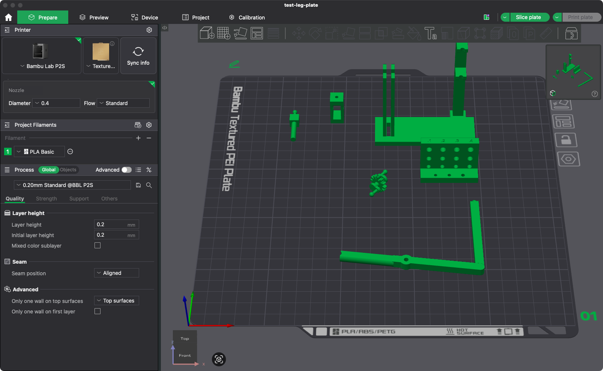
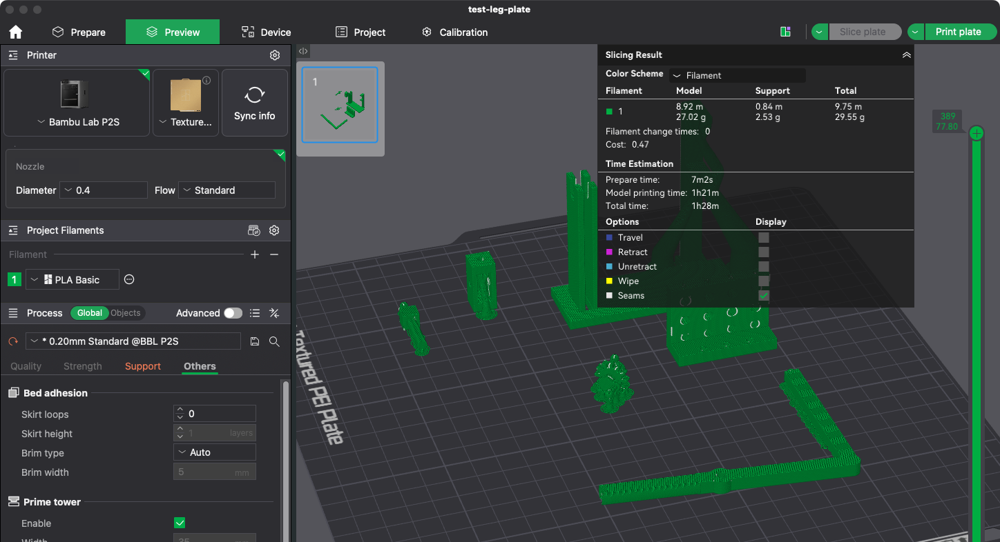
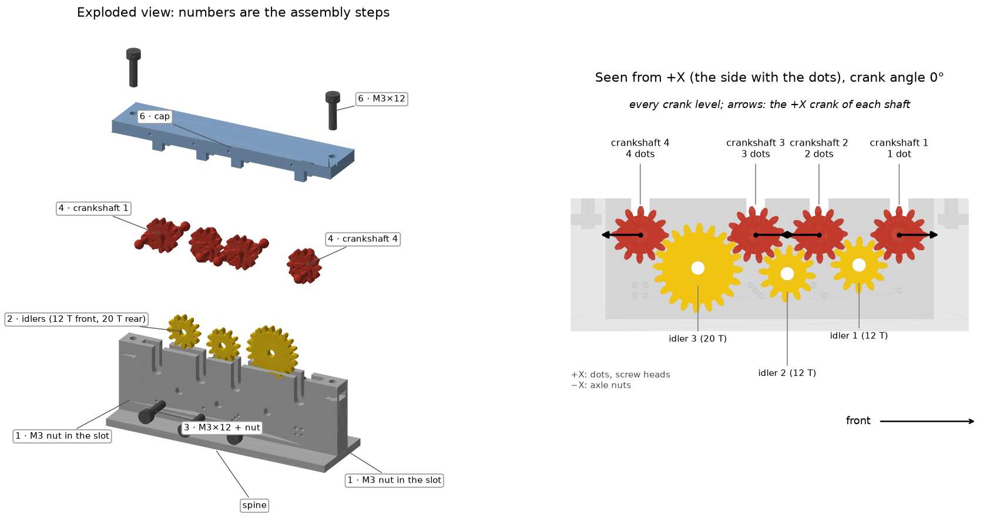
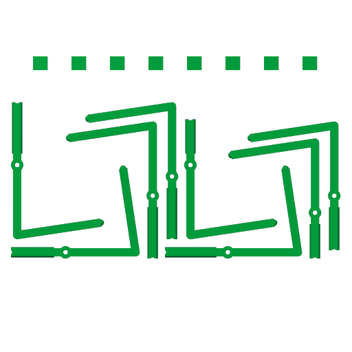

# Print plates

Bambu Studio projects (.3mf), ready to print on the Bambu Lab P2S (0.4 mm nozzle, Textured PEI plate, Bambu PLA
Basic, 0.20 mm Standard). Open one in Bambu Studio, check it and send it: **Slice plate** → **Print plate**.

| Plate | Parts | Time | PLA |
|---|---|---|---|
| [`test-leg-plate.3mf`](test-leg-plate.3mf) | [Test frame](../cad/drive/), middle leg (right), fork, crankshaft 2, [clearance block and pin](../cad/clearance-test/) | 1 h 28 min | 29.6 g |
| [`test-frame-v2.3mf`](test-frame-v2.3mf) | Test frame v2 with a keeper for the crankshaft, the fork on M3 pins, and the leg, with the clearances from the block | 1 h 18 min | 25.6 g |
| [`gear-train-test.3mf`](gear-train-test.3mf) | First gear train test: [spine](../cad/drive/) on its own, the 4 crankshafts and the 3 idlers (made with the earlier parts; the STLs it was built from have changed) | 47 min | 16.5 g |
| [`gear-train-test-v2.3mf`](gear-train-test-v2.3mf) | Gear train test v2: spine on a foot, test cap, the 4 crankshafts and the 3 idlers | 1 h 19 min | 33.5 g |
| [`test-cap-v2.3mf`](test-cap-v2.3mf) | The gear train test's cap on its own (upside down), to reprint just the cap | 13 min | 6.7 g |
| [`base-v1.3mf`](base-v1.3mf) | [Base v1](../cad/base/), its cap (upside down) and the front block | 7 h 57 min | 140.4 g |
| [`legs-forks-v1.3mf`](legs-forks-v1.3mf) | The 8 legs (front, middle × 2 and rear, right and left) and the 8 forks for base v1 | 2 h 30 min | 46.9 g |

## Test leg plate

One run with everything needed to turn one leg by hand and to learn which hole clearance this printer needs.





**Settings changed from the presets:** supports on, **tree(auto)**, **On build plate only**. Build-plate-only keeps
supports out of the holes and the leg's bore. Bambu Studio then warns about 2 regions of the leg it cannot support:
the top of the bore and the flared mouth inside the tube. Both are short bridges (3.8 mm) and print without support.

**How it was made** (to repeat it):

1. Lay out the parts in their print orientation, arrange them and slice with the CLI. The leg is laid on its flat
   side (rotated 90° about X); everything else stays as modelled:
   ```
   python3 tools/bambu_plate.py print/test-leg-plate.3mf cad/drive/test-frame.stl cad/drive/leg-middle-right.stl@90,0,0 \
       cad/drive/pivot.stl cad/drive/crankshaft-2.stl cad/clearance-test/clearance-block.stl cad/clearance-test/clearance-pin.stl \
       --set enable_support=1 "support_type=tree(auto)" support_on_build_plate_only=1 "curr_bed_type=Textured PEI Plate"
   ```
   The tool lists the `--set` overrides in the project as changed settings. Without that, the GUI opens the project
   with the plain system preset and drops them.
2. Open the .3mf in Bambu Studio and check **Process → Support**: **Enable support** ticked, **tree(auto)**, **On
   build plate only** ticked (checked on `test-frame-v2.3mf`: the GUI keeps them). **Slice plate**, check the preview,
   and save (⌘S).

**Hardware for the test:** see [cad/drive/](../cad/drive/) (test frame), plus a few spare M3 screws for the
clearance block's bottom row and its 3 tap holes.

**After printing:** remove the supports. Then try the clearance block: the journal through the top holes, the
ball into the middle ones and an M3 screw through the bottom ones. The right clearance is the smallest one that
turns freely without wobbling; set it as `CLR` / `CLR_STEEL` in [`cad/drive/build.py`](../cad/drive/build.py) and
rebuild the parts before printing them.

## Gear train test

The four crankshafts and three idler gears in the loose [spine](../cad/drive/), to check by hand that the gears mesh
and all four shafts turn together, before printing [base v1](#base-v1). Same settings as the other plates; the
crankshafts get tree supports.

**Hardware:** 3 × M3×12 + 3 nuts as the idlers' axles (in place of the 3 mm steel pins): head on one wall, nut on the
other, through the idler.

**Assembly:** each idler between the walls on its screw (11 teeth at the front, 20 at the rear), then the
crankshafts into their slots, front to rear, with the cranks as printed (see [cad/drive/](../cad/drive/)). The slots
are open at the top, so hold the shafts down with a finger while turning crankshaft 1.

```
python3 tools/bambu_plate.py print/gear-train-test.3mf cad/drive/spine.stl cad/drive/crankshaft-1.stl \
    cad/drive/crankshaft-2.stl cad/drive/crankshaft-3.stl cad/drive/crankshaft-4.stl cad/drive/idler-1.stl \
    cad/drive/idler-2.stl cad/drive/idler-3.stl \
    --set enable_support=1 "support_type=tree(auto)" support_on_build_plate_only=1 "curr_bed_type=Textured PEI Plate"
```

## Gear train test v2

The four crankshafts and three idlers in the test spine, closed by a cap, to check by hand that all four shafts turn
together before printing [base v1](#base-v1). Same settings as the other plates; the crankshafts get tree supports,
the cap prints upside down.

**Hardware:** 5 × M3×12 socket head screws and 5 M3 nuts (3 as idler axles, 2 for the cap). 3 mm steel pins work
better than screws as idler axles, if you have them.



*Left: the parts pulled apart, numbered by assembly step. Right: seen from the +X side with every crank level; the
arrows show where each +X crank points. Made by
[`cad/drive/assembly_figure.py`](../cad/drive/assembly_figure.py).*

**Assembly:**

1. Slide an M3 nut into the slot at each end of the spine, flats along the slot, until it stops over the hole.
2. Drop the idlers between the walls from above: the two 12-tooth ones at the front, the 20-tooth one at the rear.
3. Each idler: an M3×12 from the +X side (the wall with dots) through the wall, the idler and the other wall, nut
   on the −X side. Tighten only until the screw stops wobbling: the idler must still spin.
4. Crankshafts front to rear (1 to 4 dots), dots on the side of the spine's dots. Hold every crank level; on the +X
   side they point front, rear, front, rear. Lower each into its slots, turning it a little until the teeth drop
   in. If it only drops in with its cranks tilted (30°: one tooth off), lift it and try again.
5. Check that all eight cranks are level at the same time.
6. Cap on, dotted edge on +X, tongues down the slots and the four skirts outside the walls at each end. Push it
   straight down (the tongues are thin), then 2 × M3×12 into the nuts. If the skirts will not go over the walls,
   file their inner faces a little.
7. Turn crankshaft 1 by its crank, ten full turns.

```
python3 tools/bambu_plate.py print/gear-train-test-v2.3mf cad/drive/spine.stl cad/drive/test-cap.stl@180,0,0 \
    cad/drive/crankshaft-1.stl cad/drive/crankshaft-2.stl cad/drive/crankshaft-3.stl cad/drive/crankshaft-4.stl \
    cad/drive/idler-1.stl cad/drive/idler-2.stl cad/drive/idler-3.stl \
    --set enable_support=1 "support_type=tree(auto)" support_on_build_plate_only=1 "curr_bed_type=Textured PEI Plate"
```

To reprint only the cap:

```
python3 tools/bambu_plate.py print/test-cap-v2.3mf cad/drive/test-cap.stl@180,0,0 \
    --set enable_support=1 "support_type=tree(auto)" support_on_build_plate_only=1 "curr_bed_type=Textured PEI Plate"
```

## Base v1

Base, cap and front block of [base v1](../cad/base/) on one plate, with the same settings as the test leg plate
(tree supports, on the build plate only).

```
python3 tools/bambu_plate.py print/base-v1.3mf cad/base/base-v1.stl cad/base/cap.stl@180,0,0 cad/base/front-block.stl \
    --set enable_support=1 "support_type=tree(auto)" support_on_build_plate_only=1 "curr_bed_type=Textured PEI Plate"
```

## Legs and forks v1

The 8 legs and the 8 forks for [base v1](#base-v1), on one plate, with the same settings as the test leg plate (tree
supports, on the build plate only). The legs lie on their flat side, as on the test leg plate; the forks stand as
modelled.



*The plate from above: the L-shaped legs nested into each other, the forks in a row at the back.*

Bambu Studio's arrange fits only three legs on a plate (it keeps a box around each L), so the parts are placed by
hand: `:x,y` after each part is where its corner goes on the bed, and nothing is arranged.

```
python3 tools/bambu_plate.py print/legs-forks-v1.3mf cad/drive/leg-front-right.stl@90,0,0:8,68 \
    cad/drive/leg-middle-right.stl@90,0,90:48,68 cad/drive/leg-middle-right.stl@90,0,0:120,68 \
    cad/drive/leg-rear-right.stl@90,0,90:166,68 cad/drive/leg-front-left.stl@90,0,90:180,74 \
    cad/drive/leg-middle-left.stl@90,0,270:8,82 cad/drive/leg-middle-left.stl@90,0,90:62,82 \
    cad/drive/leg-rear-left.stl@90,0,270:134,82 cad/drive/pivot.stl:24,205 cad/drive/pivot.stl:52,205 \
    cad/drive/pivot.stl:80,205 cad/drive/pivot.stl:108,205 cad/drive/pivot.stl:136,205 \
    cad/drive/pivot.stl:164,205 cad/drive/pivot.stl:192,205 cad/drive/pivot.stl:220,205 \
    --set enable_support=1 "support_type=tree(auto)" support_on_build_plate_only=1 "curr_bed_type=Textured PEI Plate"
```
