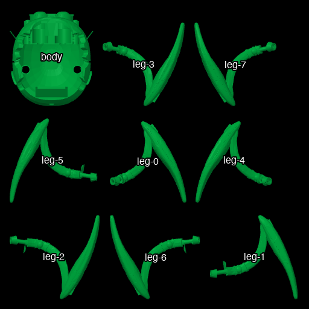
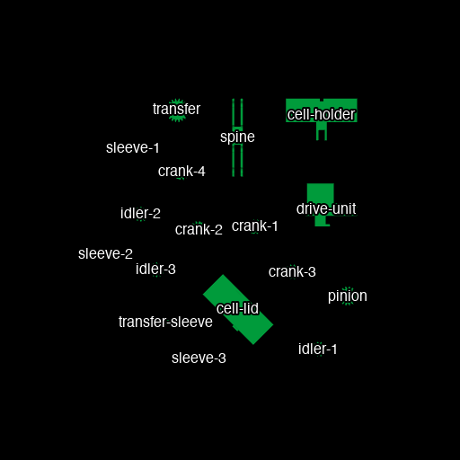
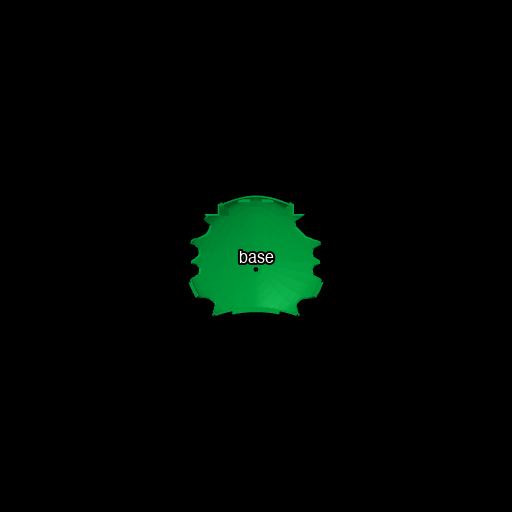

# Print plates

Bambu Studio projects (.3mf), ready to print on the Bambu Lab P2S (0.4 mm nozzle, Textured PEI plate, Bambu PLA
Basic, 0.20 mm Standard). Open one in Bambu Studio, check it and send it: **Slice plate** → **Print plate**.

## Robot plates (one per colour)

The whole robot ([`cad/robot`](../cad/robot/), round r00) split by filament colour: red body and legs, yellow inner
mechanisms, blue base.

<table>
<tr>
<td width="33%"></td>
<td width="33%"></td>
<td width="33%"></td>
</tr>
</table>

*The three plates, labelled by part and drawn in green; the colours are chosen in Bambu Studio.*

| Plate | Parts | Time | PLA |
|---|---|---|---|
| [`robot-red.3mf`](robot-red.3mf) | The body and legs 0–7 (legs 4–7 mirrored) | 5 h 22 min | 86.5 g |
| [`robot-yellow-inner.3mf`](robot-yellow-inner.3mf) | Spine, cranks 1–4, idlers 1–3 and their sleeves, transfer gear and its sleeve, drive unit, pinion, cell holder and lid | 1 h 14 min | 14.5 g |
| [`robot-blue-base.3mf`](robot-blue-base.3mf) | The base, foot down | 52 min | 8.0 g |

Every part is a separate object: in Bambu Studio delete the ones you do not want before slicing.

**Print order.** Batch 1 (≈ 2 h 35 min) is the test: the blue and yellow plates whole and only leg 3 from the red
one (named `leg-3-7.stl`), to check that the leg snaps onto its crank pin and that the M2 screws bite in their
pilot holes. Batch 2 (≈ 5 h) is the rest of the red plate, once leg 3 snaps well. Why: [Print plates by
colour](../build-log/4-looks-first.md#print-plates-by-colour).

Support is tree(auto), on the build plate only. The marks are on faces that do not work and get sanded. The parts
with the most support for their weight are the cranks (about 140 %), the base (outside the bowl), the drive unit,
the transfer gear and the spine.

## Standard settings

Every plate uses the same settings, so the measured fits in [`../cad/fits.py`](../cad/fits.py) stay valid from one
print to the next: P2S, 0.4 mm nozzle, Textured PEI plate, Bambu PLA Basic, **0.20 mm Standard**, supports
**tree(auto)**, **On build plate only**, X-Y hole and contour compensation left at 0.
[`bambu_plate.py --standard`](../tools/bambu_plate.py) adds them:

```bash
uv run python tools/bambu_plate.py print/<plate>.3mf <part>.stl[@rx,ry,rz][:x,y][xN] ... --standard
```

`@rx,ry,rz` turns a part into its print orientation, `:x,y` places it by hand on the bed (nothing is arranged),
`xN` repeats it. The tool writes the settings into the project as changed settings, so the GUI keeps them. A plate
that needs something else says so, with the reason. A plate is committed once, for the version that is printed.

## Earlier plates

Plates of the first design (before the looks-first redesign of 2026-11-17), kept in the
[archive](https://github.com/Morante-robotics/spider-bot-replica/tree/pre-redesign-2026-11-17/print) with their
commands and assembly notes. The [build log](../build-log/3-legs-and-drive.md) tells what each one taught.

| Plate | Parts | Time | PLA |
|---|---|---|---|
| [`test-leg-plate.3mf`](https://github.com/Morante-robotics/spider-bot-replica/blob/pre-redesign-2026-11-17/print/test-leg-plate.3mf) | Test frame, one leg, fork, crankshaft, clearance block and pin | 1 h 28 min | 29.6 g |
| [`test-frame-v2.3mf`](https://github.com/Morante-robotics/spider-bot-replica/blob/pre-redesign-2026-11-17/print/test-frame-v2.3mf) | Test frame v2 with the crankshaft keeper, fork and leg | 1 h 18 min | 25.6 g |
| [`gear-train-test.3mf`](https://github.com/Morante-robotics/spider-bot-replica/blob/pre-redesign-2026-11-17/print/gear-train-test.3mf) | First gear train test: spine, 4 crankshafts, 3 idlers | 47 min | 16.5 g |
| [`gear-train-test-v2.3mf`](https://github.com/Morante-robotics/spider-bot-replica/blob/pre-redesign-2026-11-17/print/gear-train-test-v2.3mf) | Gear train test v2: spine on a foot, cap, 4 crankshafts, 3 idlers | 1 h 19 min | 33.5 g |
| [`test-cap-v2.3mf`](https://github.com/Morante-robotics/spider-bot-replica/blob/pre-redesign-2026-11-17/print/test-cap-v2.3mf) | The gear train test's cap on its own | 13 min | 6.7 g |
| [`base-v1.3mf`](https://github.com/Morante-robotics/spider-bot-replica/blob/pre-redesign-2026-11-17/print/base-v1.3mf) | Base v1, its cap and the front block | 7 h 57 min | 140.4 g |
| [`legs-forks-v1.3mf`](https://github.com/Morante-robotics/spider-bot-replica/blob/pre-redesign-2026-11-17/print/legs-forks-v1.3mf) | The 8 legs and 8 forks for base v1 | 2 h 30 min | 46.9 g |
