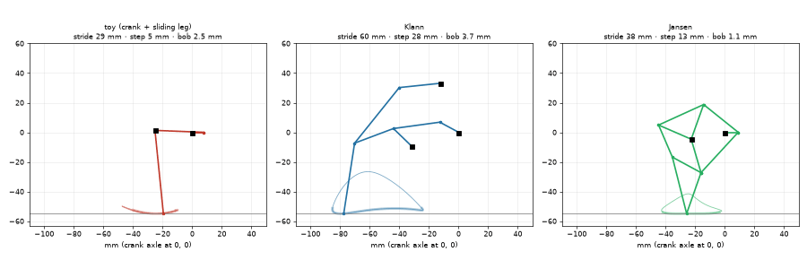
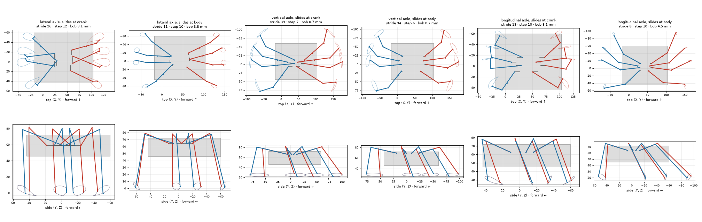
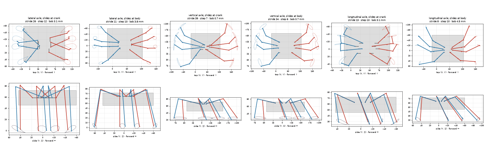
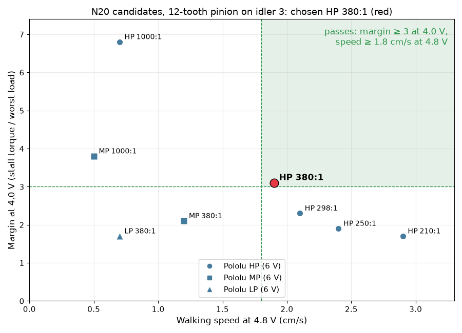

# Leg simulator

[`legs.py`](legs.py) simulates three walking legs driven by one crank (toy crank + sliding leg, Klann, Jansen),
scaled so the crank axle is 55 mm above the ground, and prints the numbers used to choose one. It also checks the
Grashof condition of a four-bar. It is 2D: the toy leg (the one chosen) moves in 3D, so its numbers here
under-rate it; the 3D model is [`toy_leg_3d.py`](toy_leg_3d.py), below. How it was used and the results: [build log](../build-log/3-legs-and-drive.md#leg-simulator-and-comparison).

```
python3 legs.py --png images/foot-paths.png --gif images/legs.gif   # --hip 60 for another axle height
```

Needs numpy, matplotlib and pillow.




## Toy leg in 3D

[`toy_leg_3d.py`](toy_leg_3d.py) models the toy leg on the whole robot: 8 legs in the base rim notches of the 120 %
carcass, two gait groups, a quasi-static walk over one crank turn. It compares 3 crank axle directions × 2 joint types
(the leg slides at the crank pin or at the body pivot), each searched for its best geometry, and measures stride, bob,
step height, foot slip, stability, gap between legs, ground clearance and footprint. Best geometries:
[`toy_leg_3d.json`](https://github.com/Morante-robotics/spider-bot-replica/blob/pre-redesign-2026-11-17/sim/toy_leg_3d.json). Results: [build log](../build-log/3-legs-and-drive.md#toy-leg-in-3d).

`--strict` adds 6 mm between every pair of legs (inner arms too) and a minimum footprint; the `shaft` axle (archived, see
above) put all 8 cranks on one lateral crankshaft inside the base. Results:
[toy_leg_3d_strict.json](https://github.com/Morante-robotics/spider-bot-replica/blob/pre-redesign-2026-11-17/sim/toy_leg_3d_strict.json), [build log](../build-log/3-legs-and-drive.md#toy-leg-on-one-crankshaft). With a
crankshaft, `--strict` also keeps every inner arm 1 mm clear of the cranks and shaft it does not ride on; no layout
passes ([toy_leg_3d_shaft_check.json](https://github.com/Morante-robotics/spider-bot-replica/blob/pre-redesign-2026-11-17/sim/toy_leg_3d_shaft_check.json),
[build log](../build-log/3-legs-and-drive.md#crankshaft-against-real-parts)). `--only sides/crank` puts the cranks on two
front-to-back shafts, one per side: they fit, but the feet move sideways
([toy_leg_3d_sides.json](https://github.com/Morante-robotics/spider-bot-replica/blob/pre-redesign-2026-11-17/sim/toy_leg_3d_sides.json), [build log](../build-log/3-legs-and-drive.md#two-side-crankshafts)). `--only rows/crank` puts one lateral shaft under each pair
of legs: it fits and walks, with a short stride ([toy_leg_3d_rows.json](https://github.com/Morante-robotics/spider-bot-replica/blob/pre-redesign-2026-11-17/sim/toy_leg_3d_rows.json),
[build log](../build-log/3-legs-and-drive.md#four-lateral-crankshafts)). With the limits that make it buildable (XC ≥ 12, shafts 8 mm under
the rim), the geometry used for the CAD is [toy_leg_3d_rows_cad.json](toy_leg_3d_rows_cad.json)
([build log](../build-log/3-legs-and-drive.md#legs-and-drive-in-cad), parts in [../cad/legs/](https://github.com/Morante-robotics/spider-bot-replica/tree/pre-redesign-2026-11-17/cad/legs) and [../cad/crankshafts/](https://github.com/Morante-robotics/spider-bot-replica/tree/pre-redesign-2026-11-17/cad/crankshafts)).

```
python3 toy_leg_3d.py --search 3000 --only lateral/crank --json lateral-crank.json   # search one combination
python3 toy_leg_3d.py --params toy_leg_3d.json --png images/toy-3d-comparison.png --gif images/toy-3d.gif
```

Needs numpy, scipy, matplotlib and pillow. The `shaft` axle (one crankshaft for all 8 legs) and the check that the
cranks stay inside the base read the 120 % carcass mesh and are archived at
[pre-redesign-2026-11-17](https://github.com/Morante-robotics/spider-bot-replica/blob/pre-redesign-2026-11-17/sim/toy_leg_3d.py): that fit is N2's, on the parametric parts.





## N20 motor sizing

The motor sizing (`motor_sizing.py`) weighed the robot from meshes and designs that no longer exist; it is archived
([script](https://github.com/Morante-robotics/spider-bot-replica/blob/pre-redesign-2026-11-17/sim/motor_sizing.py), [result](https://github.com/Morante-robotics/spider-bot-replica/blob/pre-redesign-2026-11-17/sim/motor-sizing-result.txt)).
Results: [build log](../build-log/3-legs-and-drive.md#whole-robot-first-motor-sizing-and-chassis-plan). The N2 design sizes the motor again from its
own parts.


