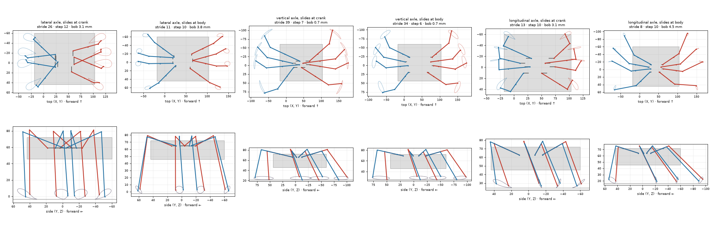
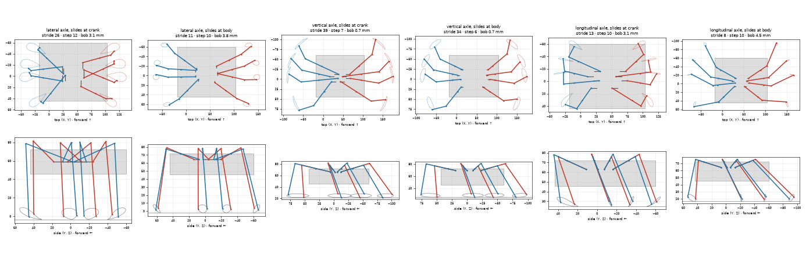
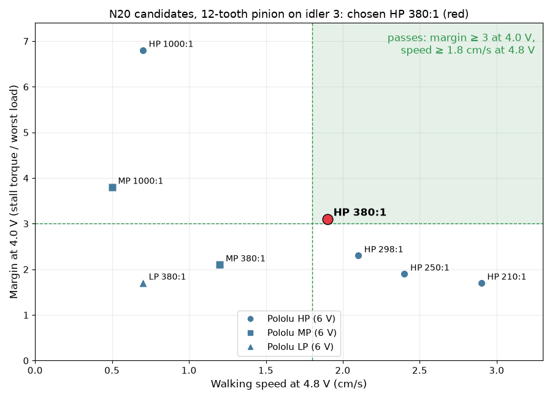

# Leg simulator

[`legs.py`](legs.py) simulates three walking legs driven by one crank (toy crank + sliding leg, Klann, Jansen),
scaled so the crank axle is 55 mm above the ground, and prints the numbers used to choose one. It also checks the
Grashof condition of a four-bar. It is 2D: the toy leg (the one chosen) moves in 3D, so its numbers here
under-rate it; the 3D model is [`toy_leg_3d.py`](toy_leg_3d.py), below. How it was used and the results: [build log](../build-log/3-legs-and-drive.md#leg-simulator-and-comparison).

```
python3 legs.py --png images/foot-paths.png --gif images/legs.gif   # --hip 60 for another axle height
```

Needs numpy, matplotlib and pillow.


## Toy leg in 3D

[`toy_leg_3d.py`](toy_leg_3d.py) models the toy leg on the whole robot: 8 legs in the base rim notches of the 120 %
carcass, two gait groups, a quasi-static walk over one crank turn. It compares 3 crank axle directions × 2 joint types
(the leg slides at the crank pin or at the body pivot), each searched for its best geometry, and measures stride, bob,
step height, foot slip, stability, gap between legs, ground clearance and footprint. Best geometries:
[`toy_leg_3d.json`](toy_leg_3d.json). Results: [build log](../build-log/3-legs-and-drive.md#toy-leg-in-3d).

`--strict` adds 6 mm between every pair of legs (inner arms too) and a minimum footprint; `--only shaft/crank` puts
all 8 cranks on one lateral crankshaft inside the base (needs trimesh and shapely to read the base). Results:
[toy_leg_3d_strict.json](toy_leg_3d_strict.json), [build log](../build-log/3-legs-and-drive.md#toy-leg-on-one-crankshaft). With a
crankshaft, `--strict` also keeps every inner arm 1 mm clear of the cranks and shaft it does not ride on; no layout
passes ([toy_leg_3d_shaft_check.json](toy_leg_3d_shaft_check.json),
[build log](../build-log/3-legs-and-drive.md#crankshaft-against-real-parts)). `--only sides/crank` puts the cranks on two
front-to-back shafts, one per side: they fit, but the feet move sideways
([toy_leg_3d_sides.json](toy_leg_3d_sides.json), [build log](../build-log/3-legs-and-drive.md#two-side-crankshafts)). `--only rows/crank` puts one lateral shaft under each pair
of legs: it fits and walks, with a short stride ([toy_leg_3d_rows.json](toy_leg_3d_rows.json),
[build log](../build-log/3-legs-and-drive.md#four-lateral-crankshafts)). With the limits that make it buildable (XC ≥ 12, shafts 8 mm under
the rim), the geometry used for the CAD is [toy_leg_3d_rows_cad.json](toy_leg_3d_rows_cad.json)
([build log](../build-log/3-legs-and-drive.md#legs-and-drive-in-cad), parts in [../cad/legs/](../cad/legs/) and [../cad/crankshafts/](../cad/crankshafts/)).

```
python3 toy_leg_3d.py --search 3000 --only lateral/crank --json lateral-crank.json   # search one combination
python3 toy_leg_3d.py --params toy_leg_3d.json --png images/toy-3d-comparison.png --gif images/toy-3d.gif
```

Needs numpy, scipy, matplotlib and pillow (plus trimesh and shapely for `shaft`).





## N20 motor sizing

[`motor_sizing.py`](motor_sizing.py) sizes the gear motor from the robot's mass and the 3D toy leg's kinematics: the
crank torque over one turn (lifting the body, the feet slipping on the ground, friction in the printed joints), the
crank speed for a walking speed, where the motor can mesh with the gear train, and Pololu's N20s scaled to 4.8 V and
4.0 V. A motor passes with a margin of 3 (worst working torque ≤ 1/3 of stall, gear efficiency 0.5) at 4.0 V and
at least 1.8 cm/s at 4.8 V. Output: [`motor-sizing-result.txt`](motor-sizing-result.txt).
[`motor_sizing_figure.py`](motor_sizing_figure.py) draws the candidates against that zone and the break torque of
the printed teeth if a leg jams. Results: [build log](../build-log/3-legs-and-drive.md#whole-robot-first-motor-sizing-and-chassis-plan).

```
../.venv/bin/python motor_sizing.py > motor-sizing-result.txt
../.venv/bin/python motor_sizing_figure.py
```


