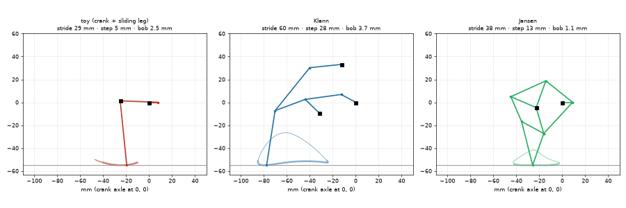

# Leg simulator

[`legs.py`](legs.py) simulates three walking legs driven by one crank (toy crank + sliding leg, Klann, Jansen),
scaled so the crank axle is 55 mm above the ground, and prints the numbers used to choose one. It also checks the
Grashof condition of a four-bar. How it was used and the results: [build log](../build-log.md#leg-simulator-and-comparison).

```
python3 legs.py --png images/foot-paths.png --gif images/legs.gif   # --hip 60 for another axle height
```

Needs numpy, matplotlib and pillow.



